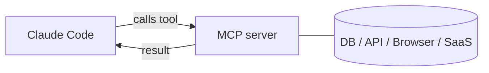

<LevelBadge level="advanced" />

<VerifyNote lastVerified="2026-11-10" source="https://code.claude.com/docs/en/mcp">
Os comandos `claude mcp`, os escopos de configuração e os transportes evoluem — confirme na documentação oficial de MCP do Claude Code e em modelcontextprotocol.io. Os quatro transportes, os caminhos de armazenamento dos escopos, a descontinuação do SSE e o comportamento de aprovação de projeto descritos abaixo vêm todos dessa página.
</VerifyNote>

O **Model Context Protocol (MCP)** é um padrão aberto para conectar a IA a ferramentas e dados externos. Um **servidor MCP** expõe capacidades (consultar um banco de dados, abrir uma PR no GitHub, controlar um navegador); o Claude Code se conecta a ele e pode **chamar essas ferramentas** durante uma sessão. É assim que você estende o Claude para além do seu sistema de arquivos e do seu shell.

<Callout type="objectives" items={["Explicar o que é um servidor MCP e como o Claude Code chama suas ferramentas", "Distinguir os dois transportes: stdio local e HTTP/SSE remoto", "Adicionar um servidor com claude mcp add e ler o JSON que ele grava", "Escolher o escopo certo (local, project, user) conforme quem deve ver um servidor", "Conectar um banco de dados real ao Claude de ponta a ponta", "Evitar as armadilhas de segurança e de configuração em que a maioria das pessoas cai"]} />

## A forma da coisa



Você declara os servidores que o Claude pode usar; cada servidor publica um conjunto de ferramentas com seus esquemas; o Claude as escolhe e as chama como qualquer outra ferramenta.

<Flashcards title="Vocabulário de MCP" cards={[{front: "Model Context Protocol (MCP)", back: "Um padrão aberto para conectar a IA a ferramentas e dados externos."}, {front: "Servidor MCP", back: "Um programa que expõe capacidades — consultar um banco de dados, abrir uma PR no GitHub, controlar um navegador — como ferramentas que podem ser chamadas."}, {front: "Ferramenta (tool)", back: "Uma capacidade que um servidor MCP publica com um esquema; o Claude a escolhe e a chama como qualquer outra ferramenta."}, {front: "Transporte", back: "Como o Claude chega a um servidor: stdio (processo local), HTTP (hospedado, geralmente com OAuth), SSE (descontinuado — o HTTP recorre a ele automaticamente) ou WebSocket ws/wss (persistente, com push, apenas autenticação por cabeçalho, sem a opção --transport)."}, {front: "Escopo (scope)", back: "Quem vê um servidor: local (você, este projeto), project (a equipe, via commit) ou user (você, em todo lugar)."}]} />

## Transportes

Há quatro maneiras de o Claude chegar a um servidor. Escolha conforme onde o servidor roda e como ele se comunica.

- **stdio** — um processo local que o Claude inicia (ótimo para ferramentas/CLIs locais). É isso que significa uma entrada JSON sem `type`.
- **HTTP** — um servidor hospedado, geralmente com OAuth. A escolha padrão para qualquer coisa remota.
- **SSE** — **descontinuado**; use HTTP sempre que puder. Alguns serviços ainda expõem apenas um endpoint SSE e, a partir do Claude Code v2.1.265, `--transport http` tenta HTTP primeiro e muda sozinho para SSE, então você raramente precisa indicar `--transport sse` explicitamente.
- **WebSocket** (`ws` / `wss`) — uma conexão bidirecional persistente, para um servidor que envia eventos por conta própria. `--transport` *não* aceita `ws`: adicione-o com `claude mcp add-json '{"type":"ws","url":"wss://…"}'` ou escreva-o no `.mcp.json`. Sem OAuth — a autenticação é apenas por cabeçalho.

<Callout type="warning" items={["Uma entrada JSON com url mas sem type é um erro de configuração, não um padrão sensato: o Claude Code lê uma entrada sem type como um servidor stdio, a ignora e informa que ela tem uma «url» mas não tem «type». Defina sempre \"type\": \"http\" (ou \"sse\" / \"ws\") em um servidor remoto que você escreve à mão."]} />

## Configurando servidores

O caminho mais rápido é o comando `claude mcp add` — ele grava a configuração para você. Siga esta sequência para ir do zero a um servidor conectado.

<Steps items={[{title: "Adicione um servidor stdio local", body: "Execute claude mcp add — tudo o que vem depois do -- é o comando de inicialização que o Claude executa por você."}, {title: "Ou adicione um servidor HTTP remoto", body: "Passe --transport http e um escopo, depois a URL do servidor. Servidores remotos costumam ser hospedados e usar OAuth."}, {title: "Veja o que está conectado", body: "Execute claude mcp list para ver os servidores configurados e o status de conexão deles."}, {title: "Inspecione e autentique", body: "Use /mcp dentro de uma sessão para inspecionar as ferramentas de um servidor e autenticar servidores remotos."}]} />

<PromptCard title="Adicionar um servidor stdio local">{`# A local stdio server (everything after -- is the launch command)
claude mcp add filesystem -- npx -y @modelcontextprotocol/server-filesystem ~/code/myproject`}</PromptCard>

<PromptCard title="Adicionar um servidor HTTP remoto (compartilhado com o projeto)">{`# A remote HTTP server, shared with everyone on the project
claude mcp add --transport http --scope project github https://api.githubcopilot.com/mcp/`}</PromptCard>

Por baixo dos panos, é só JSON. Um servidor com escopo **project** vai parar em um `.mcp.json` na raiz do repositório — faça o commit e seus colegas recebem as mesmas ferramentas assim que confiarem no espaço de trabalho:

```json
{
  "mcpServers": {
    "github": { "type": "http", "url": "https://api.githubcopilot.com/mcp/" }
  }
}
```

<Callout type="warning" items={["Não recorra aos pacotes @modelcontextprotocol/server-github, -postgres, -slack ou -puppeteer que você encontra em tutoriais antigos. Eles estão arquivados e trazem um aviso de descontinuação do npm com o texto «Archived and unmaintained; no security guarantees». Use o servidor do próprio fornecedor quando houver — o do GitHub é o endpoint HTTP acima, e o controle de navegador passou para @playwright/mcp. Entre os servidores de referência em TypeScript, apenas filesystem, memory, everything e sequential-thinking ainda são mantidos."]} />

### O escopo decide quem vê o servidor

| Escopo | Armazenado em | Carregado em | Use para |
|---|---|---|---|
| `local` (padrão) | `~/.claude.json`, sob o caminho deste projeto | somente este projeto | experimentos pessoais, segredos |
| `project` | `.mcp.json` no repositório (com commit) | somente este projeto, compartilhado com a equipe | ferramentas que toda a equipe deve compartilhar |
| `user` | `~/.claude.json` | todos os seus projetos | servidores que você quer em todo lugar |

<Callout type="warning" items={["O «escopo local» do MCP não é a mesma coisa que as configurações locais. Um servidor MCP de escopo local fica em ~/.claude.json, no seu diretório pessoal — NÃO no .claude/settings.local.json do projeto. Procurá-lo na pasta do projeto é um beco sem saída."]} />

Execute `claude mcp list` para ver o que está conectado e `/mcp` dentro de uma sessão para inspecionar as ferramentas e autenticar servidores remotos. Veja [Configuração MCP e modelos de servidor](/docs/templates/mcp-config) para pontos de partida prontos para copiar e colar.

## Exemplo prático: dê seu banco de dados ao Claude

Digamos que você queira que o Claude responda a perguntas sobre um Postgres local, em vez de você colar os resultados das consultas. Adicione o servidor com escopo project, para que seus colegas também o recebam.

Os bancos de dados são onde o problema dos servidores arquivados mais pesa: o antigo `@modelcontextprotocol/server-postgres` não é mais mantido e não existe um substituto oficial, então o nome do pacote é a única decisão que você mesmo precisa tomar. Escolha um servidor da comunidade que seja mantido, [revise-o](/docs/security/reviewing-third-party-code) e então conecte — a forma é a mesma, qualquer que seja a sua escolha:

<PromptCard title="Adicionar um servidor Postgres com escopo project">{`# Replace the package with a maintained Postgres MCP server you have reviewed.
# The connection string is read-only on purpose — see below.
claude mcp add --scope project db -- npx -y <postgres-mcp-server> "postgresql://readonly@localhost/app"`}</PromptCard>

Agora, em uma sessão, você pode fazer a pergunta em linguagem natural e deixar o Claude cuidar do ciclo de consultas:

<PromptCard title="Fazer uma pergunta ao banco de dados">{`How many users signed up last week? Check the DB.`}</PromptCard>

O Claude chama a ferramenta de consulta que o servidor publica, recebe as linhas e responde — sem ciclo de copiar e colar. Mantenha a string de conexão somente leitura, a menos que o Claude realmente precise escrever. E se tudo o que você queria era uma única consulta, lembre-se de que `psql -c '…'` via Bash custa uma fração dos tokens; [O imposto de tokens do MCP](/docs/claude-code/mcp-token-cost) explica quando cada um vence.

Como tem escopo project, um colega que faz pull do repositório recebe a mesma capacidade — mas **nem em silêncio, nem na hora**. Um servidor de um `.mcp.json` com commit fica em `⏸ Pending approval` até que ele execute `claude` na pasta e aceite a caixa de diálogo de confiança do espaço de trabalho. Um repositório clonado não pode pré-aprovar os próprios servidores: `enableAllProjectMcpServers` ou `enabledMcpjsonServers` com commit no `.claude/settings.json` do projeto são *ignorados* em uma pasta não confiável. Já as aprovações vindas de um `~/.claude/settings.json` em nível de usuário, de configurações gerenciadas ou passadas com `--settings` valem ali. Essa é a resposta de sempre para «por que meu colega não vê o servidor?»

## Confiança e segurança

<Callout type="warning" items={["Um servidor MCP executa código e pode ler dados e tomar ações — conecte apenas servidores em que você confia.", "Dê a cada servidor o menor privilégio de que ele precisa.", "Qualquer conteúdo externo que um servidor devolve pode carregar injeção de prompt.", "Revise servidores de terceiros antes de conectá-los."]} />

:::warning[Trate servidores MCP como instalar um software]
Um servidor MCP executa código e pode ler dados e tomar ações. Conecte apenas servidores em que você confia, dê a eles o **menor privilégio** necessário e lembre-se de que qualquer conteúdo externo que devolvam pode carregar [injeção de prompt](/docs/security/prompt-injection). Revise primeiro os servidores de terceiros — veja [Revisando código de terceiros](/docs/security/reviewing-third-party-code).
:::

## MCP nos apps também

O MCP também alimenta os **Conectores** nos apps do Claude — o mesmo padrão, outra superfície. Veja [Conectores (MCP) nos apps](/docs/claude-app/connectors) e, para a API, [MCP e conexão com ferramentas](/docs/api/mcp).

## Erros comuns

- **Escopo errado.** Um servidor adicionado com escopo `local` não aparecerá para seus colegas; um que você queria só para si não deve receber commit com escopo `project`. Escolha com intenção.
- **Servidores demais, ferramentas demais.** A busca de ferramentas vem ativada por padrão, então um servidor conectado normalmente custa a cada turno os *nomes* das ferramentas e as instruções do servidor, e não os esquemas completos — mas isso ainda é um imposto por turno, e os esquemas entram no contexto no momento em que o Claude os procura. Conecte o que a tarefa precisa, não o seu catálogo inteiro. Veja [O imposto de tokens do MCP](/docs/claude-code/mcp-token-cost) para os números reais, os modos de `ENABLE_TOOL_SEARCH` e como a execução de código reduz o segundo custo.
- **Conexões com privilégio demais.** Dê a um servidor de banco de dados um papel somente leitura, a menos que o Claude realmente precise escrever. O MCP torna as capacidades reais — restrinja-as.
- **Esquecer o risco de injeção.** Tudo o que um servidor devolve (uma página web, o corpo de uma issue, uma linha) é texto não confiável que pode carregar [injeção de prompt](/docs/security/prompt-injection). Não ligue um servidor poderoso com capacidade de escrita ao lado de um não confiável com capacidade de leitura sem pensar bem.

<Quiz title="Teste-se" questions={[{q: "Qual transporte é um processo local que o próprio Claude inicia?", options: ["HTTP/SSE remoto", "stdio", "OAuth"], answer: 1, explain: "stdio é um processo local que o Claude inicia — ideal para ferramentas e CLIs locais. Os outros três são remotos: HTTP (geralmente com OAuth), o SSE descontinuado e o WebSocket."}, {q: "Onde um servidor com escopo project é gravado, e o que um colega precisa fazer?", options: ["Nas suas configurações de usuário; só você o vê", "Em um .mcp.json na raiz do repositório; depois do pull, ele ainda precisa confiar no espaço de trabalho para o servidor sair de Pending approval", "Em um cache global oculto; ninguém pode editá-lo"], answer: 1, explain: "O escopo project vai parar em um .mcp.json com commit na raiz do repositório. Mas um repositório clonado não pode aprovar os próprios servidores — um enableAllProjectMcpServers com commit é ignorado em uma pasta não confiável, então o servidor espera em Pending approval até que o colega aceite a caixa de diálogo de confiança do espaço de trabalho."}, {q: "Por que manter somente leitura uma conexão de banco de dados quando o Claude só precisa ler?", options: ["Faz as consultas rodarem mais rápido", "Menor privilégio — o MCP torna as capacidades reais, então não conceda acesso de escrita a menos que seja realmente necessário", "O protocolo exige somente leitura"], answer: 1, explain: "Dê aos servidores o menor privilégio de que precisam. O MCP torna as capacidades reais, então um papel somente leitura evita escritas não intencionais."}]} />

<Callout type="takeaways" items={["O MCP é um padrão aberto; um servidor MCP expõe ferramentas que o Claude Code chama como qualquer outra ferramenta.", "Quatro transportes: stdio (um processo que o Claude inicia), HTTP (o padrão para remoto), SSE (descontinuado — o HTTP muda para ele sozinho) e WebSocket ws/wss (push, autenticação por cabeçalho, somente via add-json).", "claude mcp add grava a configuração para você; por baixo dos panos é JSON. O escopo project fica em um .mcp.json com commit, e a cópia de um colega permanece em Pending approval até que ele confie no espaço de trabalho.", "O escopo controla a visibilidade: local (você, este projeto), project (com commit para a equipe), user (você, em todo lugar).", "Trate servidores como instalar um software: confiança, menor privilégio e atenção à injeção de prompt em tudo o que eles devolvem."]} />

## Próximo

- [Construa e conecte seu primeiro servidor MCP (passo a passo)](/docs/walkthroughs/first-mcp-server)
- [Configuração MCP e modelos de servidor](/docs/templates/mcp-config)
- [Protegendo agentes e ferramentas](/docs/security/securing-agents)
