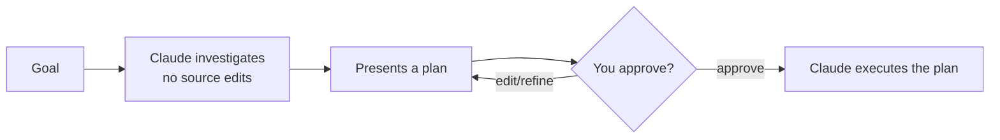

<LevelBadge level="beginner" />

<Callout type="objectives" items={["Explicar o que o Plan Mode bloqueia — e o que ele ainda permite que o Claude execute", "Entrar e sair do Plan Mode de três formas diferentes", "Percorrer o ciclo investigar-propor-aprovar-executar", "Distinguir o Plan Mode das Permissões e usá-los juntos"]} />

<VerifyNote lastVerified="2026-10-09" source="https://code.claude.com/docs/en/permission-modes">
A forma como você entra no Plan Mode (atalho/flag) e exatamente quais comandos de shell ele permite que o Claude execute durante o planejamento mudam entre releases — verifique a documentação oficial do Claude Code.
</VerifyNote>

## A grande ideia

Imagine entregar as chaves da sua casa a um empreiteiro versus primeiro pedir que ele faça uma visita e descreva *o que* mudaria. O Plan Mode é essa visita.

O **Plan Mode** instrui o Claude a **pesquisar e propor mudanças sem fazê-las**: ele lê arquivos, executa comandos de shell para explorar e escreve um plano — mas **não edita o seu código-fonte**. As edições ficam bloqueadas até você aprovar o plano.

<Callout type="tip" items={["Plan Mode significa que o Claude INVESTIGA, mas não ALTERA o seu código-fonte — ele produz um plano e aguarda o seu sinal verde."]} />

### Ele não é estritamente somente leitura

Explorar às vezes exige um comando, então o Plan Mode trata de *não editar*, não de *não executar*. O que acontece com um comando de shell durante o planejamento depende da sessão — vale o primeiro caso que corresponder:

<Steps items={[{title: "Sessões de terminal interativas com bypass permissions disponível", body: "Os bloqueios do Plan Mode NÃO são impostos. O Claude continua instruído a planejar sem editar, mas uma edição ou um comando que ele tente durante o planejamento é executado sem perguntar. O Plan Mode mantém seus bloqueios em todos os outros lugares — execuções headless -p, o Agent SDK e o painel de chat da extensão do VS Code."}, {title: "auto mode disponível e useAutoModeDuringPlan ativado (o padrão)", body: "O classificador revisa os comandos de shell em vez de perguntar a você, exceto nas remoções em caminho crítico. Os comandos aprovados são executados; os rejeitados são bloqueados."}, {title: "auto mode indisponível, ou useAutoModeDuringPlan desativado", body: "Comandos fora do conjunto somente leitura embutido pedem a sua aprovação."}]} />

<Callout type="warning" items={["Se você iniciou com --allow-dangerously-skip-permissions, o Plan Mode é uma instrução forte, e não uma proteção rígida. Trate-o como uma convenção de planejamento, não como um sandbox."]} />

## Por que é a forma mais segura de começar

Para qualquer coisa grande, arriscada ou desconhecida, você quer ver *o que* o Claude pretende fazer antes que ele toque no seu repositório. O Plan Mode separa **pensar** de **fazer**:

A recompensa: você pega suposições erradas *antes* que elas virem código errado.

## Quando usá-lo

<Callout type="tip" items={["SEMPRE para mudanças grandes ou em múltiplos arquivos, migrações ou refatorações", "Quando estiver trabalhando em uma base de código que você ainda não conhece totalmente", "Quando você quiser um plano revisável para compartilhar com um colega de equipe"]} />

Para edições pequenas e óbvias, você pode pulá-lo — mas, na dúvida, planeje primeiro.

## Como funciona na prática

Siga o ciclo. Cada etapa conquista a próxima — o Claude só muda para o modo de edição *depois* que você aprova.

<Steps items={[{title: "Entre no Plan Mode e declare seu objetivo", body: "Pressione Shift+Tab para alternar entre os modos de permissão até a barra de status mostrar 'plan mode on', ou prefixe um único prompt com /plan. Para começar já nele, inicie com claude --permission-mode plan. Depois descreva o que você quer alcançar."}, {title: "O Claude investiga", body: "Ele lê os arquivos relevantes, executa comandos exploratórios e faz perguntas esclarecedoras."}, {title: "O Claude retorna um plano passo a passo", body: "Arquivos a mudar, a abordagem e como verificar o resultado. Pressione Ctrl+G para abrir o plano proposto no seu editor e alterá-lo diretamente."}, {title: "Você aprova ou refina", body: "Escolha 'Yes, and use auto mode', 'Yes, manually approve edits' ou 'No, keep planning'. Aprovar faz você sair do Plan Mode para o modo de permissão que a opção descreve, e o Claude começa a editar."}]} />

Para sair do Plan Mode sem aprovar um plano, pressione `Shift+Tab` novamente. Para torná-lo o padrão nas sessões de terminal de um projeto, defina `defaultMode` como `plan` em `.claude/settings.json` — veja [Configurações](/docs/claude-code/settings).

### Experimente você mesmo

Copie isto em uma sessão de planejamento real e observe o ciclo acontecer:

<PromptCard title="Inicie uma sessão de planejamento">{`I want to migrate our auth from sessions to JWT. Stay in Plan Mode: investigate the current setup, ask anything you need, then propose a step-by-step plan with files to change and how to verify — don't edit anything yet.`}</PromptCard>

:::tip[Combine com o CLAUDE.md]
Um bom [CLAUDE.md](/docs/claude-code/claude-md) torna os planos mais precisos — o Claude planeja já tendo em mente suas convenções e proteções.
:::

## Plan Mode vs Permissões

Uma confusão clássica. Eles resolvem problemas diferentes e funcionam juntos:

- **Plan Mode** = "investigue e proponha, não edite ainda." (Esta página.)
- **[Permissões](/docs/claude-code/permissions)** = uma vez agindo, *quais* ações são permitidas sem perguntar.

Pense nisso como **se deve agir agora** (Plan Mode) versus **quais ações são permitidas uma vez agindo** (Permissões).

<Flashcards cards={[{front: "Em que estado o Plan Mode coloca o Claude Code?", back: "Pesquisar-e-propor: ele lê arquivos, executa comandos de shell para explorar e escreve um plano, mas não edita o seu código-fonte. As edições ficam bloqueadas até você aprovar."}, {front: "Como você entra e sai do Plan Mode?", back: "Entre com Shift+Tab, com um prefixo /plan em um único prompt ou com claude --permission-mode plan. Saia sem aprovar pressionando Shift+Tab novamente."}, {front: "Qual é o ciclo do Plan Mode?", back: "Investigar → apresentar um plano → você aprova ou refina → o Claude executa."}, {front: "Quando você deve recorrer ao Plan Mode?", back: "Por padrão, para trabalhos grandes, arriscados ou desconhecidos (mudanças em múltiplos arquivos, migrações, refatorações, bases de código desconhecidas). Pule apenas edições pequenas e óbvias."}, {front: "Plan Mode vs Permissões?", back: "O Plan Mode governa SE deve agir agora; as Permissões governam QUAIS ações são permitidas uma vez agindo."}]} />

<Callout type="takeaways" items={["O Plan Mode é pesquisar-e-propor: o Claude lê e executa comandos exploratórios, mas não edita o seu código-fonte até você aprovar o plano", "Ele não é estritamente somente leitura — os comandos durante o planejamento são revisados pelo classificador, submetidos à sua aprovação ou (com bypass permissions disponível em um terminal interativo) totalmente desbloqueados", "Entre com Shift+Tab, com um prefixo /plan ou com --permission-mode plan; aprovar muda a sessão para o modo que a opção de aprovação nomeia", "Use-o por padrão para trabalhos grandes, arriscados ou desconhecidos; pule apenas edições pequenas e óbvias", "O Plan Mode governa SE deve agir agora; as Permissões governam QUAIS ações são permitidas uma vez agindo"]} />

<Quiz title="Teste seus conhecimentos" questions={[{q: "O que o Claude Code pode fazer enquanto está no Plan Mode?", options: ["Editar arquivos e executar qualquer comando", "Ler arquivos e executar comandos de shell para explorar — mas não editar o seu código-fonte até você aprovar", "Apenas responder perguntas, sem nenhum acesso a arquivos"], answer: 1, explain: "O Plan Mode trata de não editar, não de não executar. O Claude lê arquivos e executa comandos exploratórios (revisados pelo classificador ou submetidos à sua aprovação, dependendo da sessão), mas as edições no seu código-fonte ficam bloqueadas até você aprovar o plano."}, {q: "Quando você deve recorrer ao Plan Mode?", options: ["Apenas para correções de erros de digitação de uma linha", "Para mudanças grandes ou em múltiplos arquivos, migrações, refatorações ou bases de código desconhecidas", "Nunca — ele só atrasa você"], answer: 1, explain: "Use-o sempre para mudanças grandes ou em múltiplos arquivos, migrações ou refatorações, e quando estiver trabalhando em uma base de código que você ainda não conhece totalmente. Edições pequenas e óbvias podem dispensá-lo."}, {q: "Qual é a ordem correta do ciclo do Plan Mode?", options: ["Executar, depois investigar, depois aprovar", "Investigar sem editar, apresentar um plano, você aprova ou refina, e então o Claude executa", "Aprovar primeiro, depois o Claude investiga e edita"], answer: 1, explain: "O Claude investiga sem editar o seu código-fonte, apresenta um plano, você aprova ou refina, e só então ele muda para executar o plano."}, {q: "Como o Plan Mode e as Permissões diferem?", options: ["São dois nomes para o mesmo recurso", "Plan Mode = investigar e propor, não editar ainda; Permissões = uma vez agindo, quais ações são permitidas sem perguntar", "As Permissões decidem se deve planejar; o Plan Mode decide quais arquivos editar"], answer: 1, explain: "O Plan Mode separa o pensar do fazer. As Permissões controlam quais ações são permitidas sem perguntar uma vez que o Claude está agindo. Eles funcionam juntos."}]} />

## Próximos passos

- [Permissões e Modos de Permissão](/docs/claude-code/permissions)
- [Gerenciamento de Contexto](/docs/claude-code/context-management) — mantenha sessões longas eficazes
- [Passo a passo: Personalize o Claude Code para um repositório real](/docs/walkthroughs/customize-claude-code)
