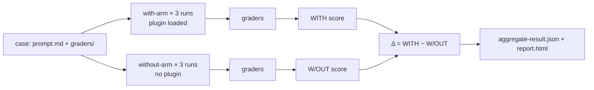

<LevelBadge level="advanced" />

<VerifyNote lastVerified="2026-09-14" source="https://code.claude.com/docs/en/plugin-evals">
O `claude plugin eval` chegou no Claude Code **v2.1.269 (11 de setembro de 2026)** e está documentado como um recurso jovem: o esquema de casos é `1.1`, o resultado JSON é `schemaVersion: 1` e a Anthropic pode desligar o comando pelo servidor ("plugin eval is currently unavailable"). Padrões, flags e semântica dos graders abaixo vêm da página oficial na data indicada; confira de novo antes de montar um portão rígido no CI.
</VerifyNote>

<Callout type="objectives" items={[
  "Entender o que um plugin eval mede e que o `claude plugin validate` e um teste manual não medem: a skill *dispara* e supera um modelo sem plugin?",
  "Ler os três números de cada resultado — WITH, W/OUT e Δ — e saber por que alguns graders são deliberadamente excluídos da pontuação",
  "Escolher entre os seis tipos de grader (quatro gratuitos, dois baseados em juiz) e escrever rubricas que deem um sinal estável",
  "Simular os servidores MCP de um plugin para que uma suíte seja repetível e nunca toque o serviço real",
  "Montar um portão de CI com modelos fixados, um teto de custo e o contrato de códigos de saída"
]} />

Até agora, quem escrevia um plugin tinha duas ferramentas: `claude plugin validate`, que confere se manifestos e frontmatter são lidos, e os próprios olhos. Nenhuma responde à pergunta que decide se vale a pena instalar um plugin: **quando o usuário digita um pedido natural, o Claude escolhe a skill, e o resultado é melhor do que o Claude faria de qualquer jeito?** O `claude plugin eval` responde exatamente isso. Ele roda cada caso numa sessão descartável só com o seu plugin carregado, roda de novo sem nenhum plugin, pontua os dois e reporta a diferença.

Esta página é para quem já tem um [plugin](/docs/claude-code/plugins-marketplaces) ou uma [skill](/docs/claude-code/skills) funcionando. Se você só precisa do conceito, leia as duas primeiras seções e o quiz.

## O modelo mental: dois braços e um delta

Todo caso é um **prompt** mais um ou mais **graders**. Um grader é uma checagem de passou/não passou sobre o que o Claude produziu. Para cada caso, o Claude Code executa:

- o **braço com plugin** (with-arm): uma sessão headless nova só com o seu plugin carregado, o prompt enviado, o Claude trabalhando até terminar ou atingir o limite de turnos/tempo, e então os graders aplicados;
- o **braço sem plugin** (without-arm): o mesmo prompt, o mesmo número de execuções, sem plugin.

Cada braço roda o caso **três vezes por padrão**, porque uma única execução de um agente não determinístico quase não diz nada. A pontuação de uma execução é a fração de graders que passaram (ponderada, se você definir pesos). A pontuação do caso é a média das execuções. Você obtém:

| Coluna | Significado |
|---|---|
| `WITH` | Pontuação média com o plugin carregado |
| `W/OUT` | Pontuação média sem plugin |
| `Δ` | `WITH − W/OUT` — o que o plugin realmente contribuiu |

A parte nada óbvia: **uma pontuação `WITH` alta, sozinha, não prova nada.** Se um caso marca 1.0 nos dois braços, o Claude resolveu sem você e o seu plugin é peso morto para esse prompt. O Δ é o número que justifica a existência de um plugin. A própria documentação da Anthropic cita a primeira descoberta mais comum: um Δ perto de zero *com* um grader skill-fired falhando, o que significa que o Claude nunca escolheu a sua skill com uma formulação natural. Isso é um problema de `description` no `SKILL.md`, não de código, e nenhum teste manual em que você invoca a skill pelo nome teria pegado.



### Por que alguns graders ficam fora da pontuação

Uma checagem como "a ferramenta `Skill` foi invocada" nunca pode passar no braço sem plugin. Se contasse, arrastaria o `W/OUT` para zero e inflaria o Δ de graça. Por isso, numa execução de dois braços, o Claude Code **exclui da pontuação, nos dois braços**, todo grader `tool_used` cujo `tool` seja `Skill`, além de tudo o que você marcar com `arm: with-only`. Eles ainda aparecem no relatório como indicadores de passou/não passou (o relatório os rotula como "plugin-fired indicator") e o JSON os marca `scored: false`. Daí saem duas regras de borda:

- Se *todos* os graders de um caso fossem excluídos, eles são pontuados normalmente; do contrário não sobraria nada para pontuar.
- `arm: both` força um grader a contar nos dois braços. É o que você quer para uma checagem de "**não** deve invocar a skill" num prompt isca, escrita como `tool_used` com `min: 0` e `max: 0`.

Consequência que vale lembrar: a mesma suíte pode relatar uma **pontuação absoluta diferente** com `--ablation none` (um braço só, nada excluído) do que no modo padrão de dois braços. Compare coisas comparáveis ao traçar tendências.

## Anatomia de um caso

Uma suíte vive em `evals/` dentro do plugin (ou em outro diretório que você indicar). Cada caso é uma pasta com um `prompt.md`, um `case.yaml` ou ambos, mais uma pasta `graders/` com um arquivo Markdown por grader.

```text
my-plugin/
├── .claude-plugin/plugin.json
├── skills/...
└── evals/
    ├── drafts-commit-message/
    │   ├── prompt.md            # frontmatter: run limits; body: the user's request
    │   └── graders/
    │       ├── criteria.md      # type: llm — rubric in the body
    │       └── skill-fired.md   # type: tool_used, tool: Skill
    ├── ignores-unrelated-request/
    │   └── ...
    ├── mocks/                   # optional suite-wide MCP mocks
    └── results/                 # written by each run — add to .gitignore
```

O corpo do prompt é enviado ao Claude **exatamente como escrito**. Duas coisas pegam quem está começando:

- Cada execução começa num **diretório de trabalho vazio**, com home descartável, sem configurações de usuário, sem `CLAUDE.md`, sem servidores MCP pessoais, sem outros plugins e só com uma lista de variáveis de ambiente permitidas (as básicas como `PATH`, a autenticação do provedor, a maioria de `ANTHROPIC_*`/`CLAUDE_CODE_*` e tudo que se chame `EVAL_*`). Se a tarefa precisa de arquivos, coloque-os no prompt, gere-os com um scaffold ou inclua-os no plugin.
- Menções `@path` no prompt **não** são expandidas em anexos. Conceda `Read` em `allowed_tools` se o Claude precisar abrir um arquivo.

Os campos do frontmatter de `prompt.md` que mais importam:

| Campo | Padrão | Observação |
|---|---|---|
| `runs` | 3 | De 1 a 50 por braço; `--runs` sobrescreve |
| `max_turns` | 10 | Até 200. Atingi-lo é registrado como erro de execução e normalmente baixa a pontuação, então seja generoso |
| `timeout_seconds` | 300 | Até 3600 por execução |
| `allowed_tools` | `[]` | Ferramentas somente leitura são concedidas só de listá-las; todo o resto precisa de uma concessão pela CLI |
| `model` | padrão da sessão | `--model` sobrescreve; fixe-o no CI |
| `env` | `{}` | As chaves devem casar com `EVAL_[A-Z0-9_]*` ou a execução falha |
| `plugins` | o plugin envolvente mais próximo | Defina `["../.."]` se a detecção automática não achar o seu plugin |

O `case.yaml` carrega os mesmos campos (os de execução sob `execution:`) mais três que referenciam outros arquivos: `context.scaffold_script` (um script Bash que prepara o espaço de trabalho, só roda com `--scaffold`), `context.history_file` (uma transcrição `.jsonl` a retomar, de modo que o seu prompt vira o próximo turno) e `context.add_dirs` (diretórios de fixtures que o Claude pode ler).

## Os seis tipos de grader

Quatro são calculados a partir da transcrição e dos arquivos e não custam nada. Dois chamam um modelo juiz e aumentam a conta.

| Tipo | Gratuito? | Passa quando |
|---|---|---|
| `regex` | sim | Uma regex JavaScript é encontrada no alvo (`last_message` por padrão, ou `trace`, `files`, um arquivo específico ou `mock_calls`). `match: not_contains` para ausência, `match: "count:N"` para uma contagem exata. A insensibilidade a maiúsculas vai em `flags: i`; o `(?i)` inline não é suportado |
| `tool_used` | sim | As chamadas a `tool` cuja entrada codificada em JSON casa com `input_match` ficam entre `min` (padrão 1) e `max` (ilimitado). `min: 0, max: 0` afirma que uma ferramenta nunca foi chamada |
| `tool_order` | sim | Ambas as ferramentas foram chamadas e a primeira ocorrência de `before` precede a primeira de `after` |
| `file_exists` | sim | Um arquivo **criado pelo Claude** casa com o glob de `path` (ou nenhum casa, com `exists: false`). Arquivos criados por um scaffold ou apenas editados pelo Claude não contam |
| `llm` | não | Um modelo juiz vota PASS na sua rubrica em pelo menos **dois de três votos** |
| `baseline` | não | Um juiz considera que a execução cumpre os critérios pelo menos tão bem quanto uma transcrição de referência que você salvou como `baseline_file` |

**Não existem graders de código customizado.** Se você precisa checar que um build ou teste passou, faça o prompt mandar o Claude rodá-lo e gravar o resultado num arquivo, pontue esse arquivo com `regex` e afirme que o comando rodou com um grader `tool_used` cujo `input_match` o nomeie.

O grader skill-fired que quase todo caso quer fica assim (troque o nome da skill; o padrão também casa a forma com namespace `plugin:skill`):

<PromptCard title="graders/skill-fired.md — did my skill actually run?">{`---
type: tool_used
tool: Skill
input_match: '"skill"\\s*:\\s*"(?:[\\w-]+:)?your-skill-name"'
---`}</PromptCard>

E a rubrica do juiz ao lado, escrita como condições concretas de PASS/FAIL em vez de adjetivos:

<PromptCard title="graders/criteria.md — a rubric that gives a stable verdict">{`---
type: llm
weight: 2
---

PASS if the reply is a single conventional-commit subject line under 72 characters,
starts with "refactor:", and mentions both the rename (getUser -> fetchUser) and the
number of call sites updated.
FAIL if the reply contains more than one candidate message, asks a clarifying
question, or omits the rename.`}</PromptCard>

### Hábitos que mantêm as pontuações estáveis

São as práticas que a documentação oficial recomenda e batem com o que todo mundo que já rodou pipelines de LLM-as-judge aprende na marra:

- **Pontue saídas longas com `regex` sobre o arquivo, não com um juiz `llm`.** A variância do juiz cresce com o tamanho do que ele lê. Reserve os graders `llm` para mensagens finais curtas.
- **Um grader no resultado, outro no caminho.** Um grader `regex`/`llm`/`file_exists` diz que a resposta estava certa; um grader `tool_used`/`tool_order` diz que *o seu plugin* a produziu. Você precisa dos dois para interpretar o Δ.
- **Desconfie do juiz antes do plugin quando o Δ é negativo mas a skill disparou.** O juiz padrão é um modelo pequeno e rápido; ele pode reprovar uma resposta correta por estar formatada diferente da rubrica. Rode de novo com `--judge-model sonnet` e aperte a rubrica para que a formatação não decida.
- **Itere num caso com um braço**, depois confirme com três execuções: `--case <name> --runs 1 --ablation none`. Com um braço só, a tabela mostra `SCORE` e `PASS%` em vez de `WITH`/`W/OUT`/`Δ`.

## Simule os servidores MCP

Se as skills do seu plugin chamam ferramentas MCP, uma execução **nunca inicia os servidores reais a menos que você peça**. Em vez disso, o Claude Code registra um substituto sob o nome de cada servidor e responde às chamadas de ferramenta a partir de arquivos Markdown: `evals/mocks/<server>/<tool>.md` para a suíte inteira, ou a pasta `mocks/` do próprio caso para sobrescrever por caso. O corpo do arquivo é o resultado da ferramenta, com substituições `{{input.<field>}}` e inserções `{{file:fixtures/...}}`. Uma ferramenta sem arquivo de mock simplesmente não está disponível para o Claude.

<PromptCard title="evals/mocks/tracker/create_issue.md — a mock that also asserts the input">{`---
expect:
  title: string
  priority: [low, medium, high]
---

Created issue #4821: {{input.title}}`}</PromptCard>

O bloco `expect:` transforma um mock numa asserção: uma chamada que o viole **aborta a execução com pontuação 0** e registra o servidor, a ferramenta e o motivo. Aponte um grader para `target: mock_calls` para pontuar o que o plugin pediu ao servidor. Para servidores cujas respostas dependem da conversa, `type: agent` deixa um modelo pequeno fazer o papel do servidor; execuções limpas salvam as respostas dele em `results/<timestamp>/mock-recordings/`, e quando você copia uma gravação para `mocks/.replay/<server>/`, as execuções seguintes a reproduzem sem chamar o modelo. Faça commit de `.replay/` para o CI ser determinístico. `_tools.json` (uma resposta `tools/list` salva) dá às ferramentas simuladas suas descrições e esquemas reais em vez de um marcador permissivo.

Para usar servidores reais: `--allow-real-servers` inicia os que não têm mocks; `--mocks off` ignora os mocks por completo. De qualquer forma, esses processos rodam **como você, fora do sandbox**, e suas ferramentas ainda precisam de uma concessão explícita como `--allow-tools "mcp__plugin_my-plugin_github__*"`.

## Executando

<Steps items={[
  {title: "Gere a suíte", body: "A partir da raiz do plugin, rode `claude plugin eval init`. Ele abre uma sessão interativa em que o Claude lê o plugin, pergunta como é um bom resultado, propõe prompts que devem e que não devem dispará-lo, projeta graders, testa uma vez e escreve um diretório de caso por prompt. `claude plugin eval init --bare <name>` escreve um modelo em branco (a única forma que funciona sem terminal, por exemplo no CI)."},
  {title: "Rode a suíte inteira", body: "`claude plugin eval .` roda todos os casos, os dois braços, três execuções cada. A primeira vez pergunta `Trust this plugin directory?`; dentro de um repositório git, dizer sim confia no repositório inteiro, também em sessões interativas. Uma linha de progresso é impressa por execução com o veredito de cada grader; em seguida vêm uma tabela-resumo e um caminho `Report:`."},
  {title: "Conceda só o que os casos precisam", body: "As execuções nunca param para pedir permissão. As ferramentas integradas que precisam de uma concessão que você não deu (`Bash`, `Write`, `Edit`, `WebFetch`, `WebSearch`) são removidas da sessão por completo. Conceda-as para a execução inteira: `--allow-tools Write Edit \"Bash(npm test *)\"`. Qualquer concessão de Bash roda sob o sandbox em nível de SO do Claude Code; numa máquina sem backend de sandbox (Windows nativo) a execução é recusada em vez de rodar sem confinamento."},
  {title: "Leia o relatório", body: "`report.html` é um único arquivo autocontido, sem requisições externas. No topo: uma linha de veredito (efeito do plugin em pontos contra o baseline, casos melhorados/estáveis/regredidos) e cinco cartões (pontuação da suíte, Δ de ablação, pontuação do baseline, casos aprovados, execuções perfeitas). Cada cartão de caso mostra o Δ e uma barra de pontuação com uma marca no limiar; um Δ negativo ganha uma borda esquerda vermelha. Os graders que falharam já vêm expandidos com os votos do juiz e o trecho que ele viu."},
  {title: "Decida para onde vai o relatório", body: "Com login numa assinatura do claude.ai e artefatos habilitados, o relatório também é publicado como um artefato privado e uma URL `Published:` é impressa; `--no-publish` o mantém local. A autenticação por chave de API nunca publica. Uma execução iniciada de dentro de uma sessão do Claude Code fica local, a menos que você adicione `--publish-report`."}
]} />

O comando para a suíte completa com os flags que você realmente vai usar:

<PromptCard title="Run the suite with a stronger judge and a cost ceiling">{`claude plugin eval . \\
  --judge-model sonnet \\
  --max-cost-usd 10 \\
  --allow-tools Read Write "Bash(npm test *)" \\
  -j 4`}</PromptCard>

Notas sobre os flags: `-j`/`--concurrency` vai de 1 a 8 e só encurta o tempo de relógio, porque todas as execuções dividem o limite de requisições da sua conta. `--max-cost-usd` é um teto sobre a **estimativa a preço de tabela**, conferido antes de cada execução começar; as execuções já em andamento terminam, então o gasto pode ultrapassar o teto por essas execuções, e qualquer coisa não iniciada faz o comando sair com 2 e `partial: true`. Coloque o alvo (`.`) **antes** de `--tag`, `--allow-tools` e `--json`: cada um deles recebe uma lista ou um valor opcional e engoliria um alvo que viesse depois (o erro "`--json` output path must end in `.json`" é exatamente esse deslize).

## Quanto custa

Cada execução e cada voto do juiz é uma chamada real a um modelo na sua conta, contando contra o uso do seu plano ou a sua fatura de API. A aritmética aproximada: `cases × runs` execuções de agente para o braço com plugin, o mesmo de novo para o braço sem plugin, mais **três chamadas curtas ao juiz por grader `llm` ou `baseline` por execução**. O caso único do passo a passo oficial, com dois graders (um `llm`, um `tool_used`), rodou seis execuções de agente em 74 segundos a uma estimativa de preço de tabela de cerca de $0.41. Três alavancas mantêm uma suíte acessível:

- `--ablation none` corta pela metade as execuções de agente quando você está iterando graders e não precisa do Δ.
- Só graders gratuitos (`regex`, `tool_used`, `tool_order`, `file_exists`) para a suíte de cada commit; graders com juiz para a noturna.
- Um erro de limite de uso ou de taxa no meio da suíte faz cada execução seguinte **terminar com esse erro e normalmente pontuar 0, e a suíte não é marcada como `partial`**, então uma execução limitada pode parecer exatamente uma regressão. Confira a coluna `NOTES` ou `cases[].arms.with[].error` antes de acreditar numa queda repentina.

## Bloqueie o CI com isso

<PromptCard title="CI job — pinned models, local report, exit code drives the build">{`claude plugin eval . \\
  --trust-plugin \\
  --json results.json \\
  --threshold 0.8 \\
  --model claude-sonnet-5 \\
  --judge-model claude-haiku-4-5 \\
  --no-publish \\
  --max-cost-usd 20`}</PromptCard>

Por que cada flag está ali:

- `--trust-plugin` afirma a decisão de confiança da primeira execução. Sem ele, um job não interativo é recusado com saída 1 (ou trava no aviso se o runner alocar um TTY). Passe-o só para plugins cujo código e suíte você rodaria na sua própria máquina.
- `--model` e `--judge-model` são **fixados** para que a implantação de um modelo nunca seja confundida com uma regressão do plugin. Isso importa mais do que parece: o agente sob teste usa por padrão `ANTHROPIC_MODEL` ou o modelo padrão atual do Claude Code, que muda com os lançamentos.
- `--threshold 0.8` porque o padrão é **1.0**, o que faz o comando sair com 1 sempre que algum caso for menos que perfeito. Uma barra de 1.0 sobre a média de três execuções de um agente não determinístico é um portão instável.
- `--json results.json` escreve o documento de resultado versionado (`schemaVersion: 1`, camelCase, campos novos são adicionados sem renomear) e silencia a saída de progresso.

O contrato de códigos de saída:

| Saída | Significado |
|---|---|
| 0 | Todos os casos no limiar ou acima e todos os arquivos de caso carregados |
| 1 | Um caso abaixo do limiar, um arquivo de caso falhou ao carregar, nenhum caso encontrado, uma execução não pôde começar, diretório não confiável sem `--trust-plugin`, ou uma opção inválida |
| 2 | Execução parcial: teto de custo atingido, ou credencial rejeitada na primeira execução ou antes. O `results.json` ainda é escrito com `partial: true` |
| 130 / 143 | Interrompida / terminada (por exemplo, timeout do CI). Resultados parciais são escritos |

Problemas ao escrever ou publicar o relatório **nunca** mudam o código de saída. Ao traçar tendências, descarte documentos com `partial: true` e execuções marcadas com `skippedPaidGraders`, já que suas pontuações não são comparáveis.

Campos que um script de portão lê do JSON: `aggregates.overallScore`, `aggregates.casesPassed` / `casesTotal`, `aggregates.meanDelta` e, por caso, `cases[].aggregates.score` e `.delta` (omitido quando os braços não são comparáveis). Uma execução com `cases[].arms.with[].error` não nulo (por exemplo, `timed out after 300s`) ainda é pontuada pelo que produziu, então um erro não implica pontuação 0; uma execução `aborted` (o `expect:` de um mock disparou) pontua 0 com `error` ainda `null`.

## O que uma execução pode e não pode alcançar

Leia isto antes de avaliar um plugin que você não escreveu. Apontar o `claude plugin eval` para um diretório é a mesma decisão de confiança que `claude --plugin-dir`: as skills **e os hooks** do plugin são carregados e rodam na sua máquina como você. O isolamento limita o que o *agente sob teste* pode fazer; não é uma fronteira contra o código do próprio plugin, e uma suíte que passa não diz nada sobre o plugin ser seguro.

- **Agente isolado.** Cada execução recebe um home, um diretório de trabalho e uma configuração do Claude Code descartáveis, roda como um processo filho `claude -p`, não consegue ler o diretório de evals (então nunca vê os prompts nem os graders do caso ou dos casos vizinhos) e tem a ferramenta Artifact desligada.
- **Configurações gerenciadas continuam valendo.** Restrições implantadas por um administrador na máquina valem dentro de uma execução, então resultados num notebook gerenciado podem diferir dos de um runner de CI não gerenciado.
- **Válvulas de escape opt-in.** O `scaffold_script` de um caso roda como você, fora do sandbox, e só com `--scaffold`. Servidores MCP reais só com `--allow-real-servers` ou `--mocks off`. O `allowed_tools` de um caso ou o frontmatter `allowed-tools` de uma skill nunca podem ampliá-los.
- **Rede.** Comandos de shell que você concede seguem as regras de rede do sandbox; uma concessão `WebFetch(domain:…)` alcança esse domínio diretamente; os hooks do plugin e qualquer servidor MCP real que você inicie podem alcançar qualquer host.

Para um plugin de terceiros que traz hooks ou precisa dos seus servidores reais, trate as pontuações como orientativas, a menos que você tenha rodado a suíte num contêiner ou num runner de CI. Veja [Reviewing Third-Party Code](/docs/security/reviewing-third-party-code) para a lista de verificação mais ampla.

## Referência rápida: as armadilhas

- O `target` padrão de `regex` é `last_message`. Quando você aponta para `trace`, é JSON por linha, então as aspas aparecem como `\"` e as quebras de linha são escapadas.
- `files` é uma **lista de caminhos** que o Claude criou, não o conteúdo deles. Para pontuar o conteúdo, use `{ source: file, path: <path> }` como `target`/`focus`. Um juiz `llm` vê PNG/JPEG/GIF/WebP como imagens e recusa outros binários (`.pptx`, PDF).
- Um juiz `llm` que lê `trace` vê apenas as **primeiras 12 e as últimas 12 mensagens**.
- `file_exists` só vê arquivos criados durante a execução. Um arquivo gerado por scaffold ou apenas editado é invisível para ele; pontue o conteúdo ou use `tool_used` em `Edit`.
- Chaves desconhecidas no frontmatter de `prompt.md` são um erro, e as chaves de `env` devem ser `EVAL_*`.
- Avaliar um plugin instalado pelo nome (`name@marketplace`) escreve os resultados em `./evals/results/` no seu diretório atual e pula o aviso de confiança.
- O formato de casos do plugin-eval é **separado** do arquivo `evals/evals.json` que o plugin skill-creator usa para avaliações de skills.

<Flashcards cards={[
  {front: "with-arm / without-arm", back: "Os dois conjuntos de execuções de um caso: só com o seu plugin carregado e sem nenhum plugin. Δ é a pontuação do braço com plugin menos a do braço sem plugin."},
  {front: "Por que `tool_used: Skill` não é pontuado?", back: "Ele nunca pode passar sem o plugin, então contá-lo arrastaria o W/OUT a zero e inflaria o Δ. É excluído nos dois braços e mostrado como indicador de plugin disparado."},
  {front: "Limiar padrão", back: "1.0 — qualquer caso abaixo do perfeito faz o comando sair com 1. Defina `--threshold` na sua barra real no CI."},
  {front: "Regra de votos do juiz", back: "Um grader `llm` passa quando o juiz vota PASS em pelo menos dois de três votos; um grader `baseline` compara com uma transcrição de referência salva."},
  {front: "Código de saída 2", back: "Execução parcial: o teto --max-cost-usd foi atingido ou a credencial foi rejeitada. O results.json ainda é escrito com partial: true."},
  {front: "Bloco `expect:` do mock", back: "Guarda de entrada de uma ferramenta MCP simulada. Uma chamada que o viole aborta a execução com pontuação 0 e registra servidor, ferramenta e motivo."},
  {front: "Variáveis EVAL_*", back: "As únicas variáveis de ambiente customizadas que chegam a uma execução. Todo o resto do seu shell é retido, exceto uma pequena lista permitida."}
]} />

<Quiz title="Teste-se" questions={[
  {q: "Um caso marca 1.00 WITH e 1.00 W/OUT. O que isso diz?", options: ["O plugin funciona perfeitamente", "O Claude resolve esse prompt sem o plugin, então o plugin não acrescenta nada aqui", "Os graders estão quebrados", "O modelo juiz é fraco demais"], answer: 1, explain: "O Δ é zero. Uma pontuação alta no braço com plugin nunca prova sozinha que o plugin ajudou; só a diferença entre os braços prova."},
  {q: "Seu job de CI roda `claude plugin eval . --json results.json` sem outros flags e sai com 1 embora todo caso tenha marcado 0.9. Por quê?", options: ["O modo JSON sempre sai com 1", "O --threshold padrão é 1.0, então 0.9 é uma falha", "O diretório do plugin era confiável", "--json desativa a pontuação"], answer: 1, explain: "O limiar padrão é o perfeito (1.0). Passe --threshold 0.8 ou a sua barra. Passe também --trust-plugin no CI, ou a checagem de diretório não confiável também sai com 1."},
  {q: "Quais tipos de grader não custam nada extra para rodar?", options: ["llm e baseline", "regex, tool_used, tool_order, file_exists", "Só regex", "Os seis são gratuitos"], answer: 1, explain: "Quatro graders são calculados a partir da transcrição e dos arquivos. llm e baseline acrescentam cada um três chamadas curtas ao juiz por execução."},
  {q: "O Δ é negativo, mas o grader skill-fired passou em toda execução do braço com plugin. O que a orientação oficial diz para checar primeiro?", options: ["Apagar o plugin", "Aumentar max_turns", "O juiz: rodar de novo com --judge-model sonnet e apertar a rubrica para que a formatação não decida", "Adicionar mais casos"], answer: 2, explain: "Um juiz pequeno pode reprovar uma resposta correta por estar formatada diferente da rubrica. Desconfie do juiz antes do plugin."},
  {q: "Uma ferramenta MCP simulada numa execução recebe uma chamada cuja entrada viola o bloco `expect:` do mock. O que acontece?", options: ["A chamada devolve uma string de erro e a execução continua", "A execução é abortada com pontuação 0 e o motivo é registrado", "O grader é pulado", "O servidor real é iniciado como alternativa"], answer: 1, explain: "expect: é uma asserção. Uma chamada que a viole aborta a execução, pontua 0 e aparece como `aborted` com servidor, ferramenta e motivo no JSON."},
  {q: "A qual destas coisas o agente sob teste tem acesso durante uma execução?", options: ["Suas configurações em ~/.claude e o CLAUDE.md", "Seus servidores MCP pessoais", "O prompt e os graders do caso", "Ferramentas somente leitura listadas em allowed_tools do caso, mais o que você concedeu com --allow-tools"], answer: 3, explain: "As execuções são isoladas: home e configuração descartáveis, sem configurações pessoais, sem outros plugins, e o diretório de evals fica oculto para o agente."}
]} />

## Fontes e leitura adicional

- [Test plugins with evals](https://code.claude.com/docs/en/plugin-evals) — a referência oficial em que esta página se baseia: formato de casos, tabela de graders, opções, códigos de saída, isolamento
- [Plugin CLI reference: `claude plugin eval`](https://code.claude.com/docs/en/plugins/cli-reference#plugin-eval) — cada flag, com `plugin eval init` para montar uma suíte
- [Plugins reference: `experimental.evals`](https://code.claude.com/docs/en/plugins-reference#fields) — o campo do manifesto que aponta para um diretório de evals não padrão
- [Claude Code changelog, v2.1.269 (11 set. 2026)](https://code.claude.com/docs/en/changelog) — a entrada do lançamento
- [Skills: frontmatter e como o `description` decide o disparo](https://code.claude.com/docs/en/skills)
- [Sandboxing](https://code.claude.com/docs/en/sandboxing) — o sandbox em nível de SO aplicado quando você concede Bash a uma execução
- [Headless mode](https://code.claude.com/docs/en/headless) — o filho `claude -p` sobre o qual cada execução é construída

## Próximo

- [Plugins & Marketplaces](/docs/claude-code/plugins-marketplaces) — empacote o que você acabou de testar e publique quando a suíte estiver verde
- [Skills](/docs/claude-code/skills) — o campo `description` é o que um grader skill-fired falhando está dizendo para você corrigir
- [Reviewing Third-Party Code](/docs/security/reviewing-third-party-code) — antes de rodar o plugin de outra pessoa (e os hooks dele) por um eval na sua máquina
