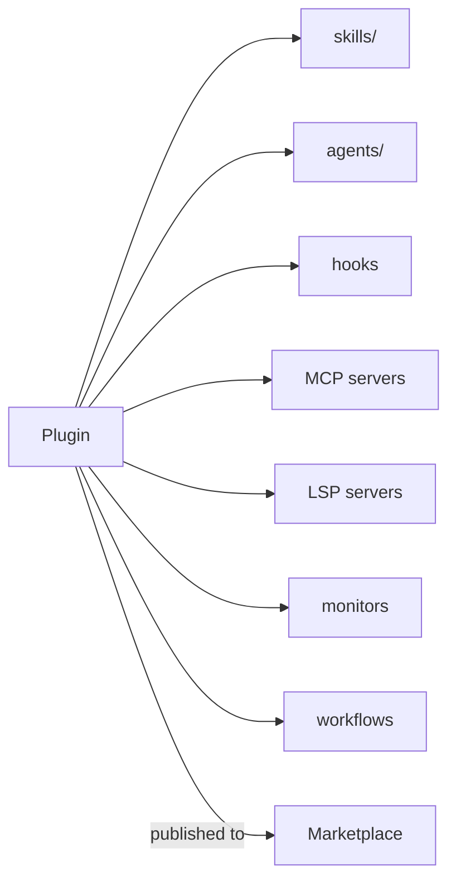

<LevelBadge level="advanced" />

<VerifyNote lastVerified="2026-10-22" source="https://code.claude.com/docs/en/plugins">
A estrutura dos plugins e o funcionamento dos marketplaces evoluem rápido — confirme os detalhes na documentação oficial do Claude Code.
</VerifyNote>

Um **plugin** agrupa várias personalizações — [skills](/docs/claude-code/skills), [subagentes](/docs/claude-code/subagents), [comandos slash](/docs/claude-code/slash-commands), [hooks](/docs/claude-code/hooks), [servidores MCP](/docs/claude-code/mcp) e, desde o Claude Code v2.1.287, um [**mod**](/docs/claude-code/mods) — em uma única unidade versionada e instalável. Um **marketplace** é um catálogo de plugins que as pessoas podem descobrir e instalar.

## Por que os plugins importam

- **Entregue o kit de ferramentas de uma equipe em um passo.** Em vez de pedir que todos copiem cinco arquivos, publique um plugin; os colegas o instalam e recebem os mesmos comandos, hooks, agentes e conexões MCP.
- **Versionamento.** Atualize o plugin e todos baixam a nova versão.
- **Distribuição.** Um marketplace torna seu kit de ferramentas (ou o de outras pessoas) fácil de descobrir.

## O que normalmente há dentro

Um plugin é uma pasta estruturada de componentes. O manifesto `.claude-plugin/plugin.json` é **opcional**: sem ele, o Claude Code carrega o que encontrar no [layout padrão](https://code.claude.com/docs/en/plugins-reference#standard-layout) — então uma pasta que contém apenas um `SKILL.md` já é carregada como plugin. Escreva um manifesto quando quiser metadados, uma versão, um componente fora do diretório padrão ou valores configuráveis pelo usuário.

Além de skills, um plugin pode agrupar subagentes, hooks e servidores MCP e — mais recentemente — [servidores LSP](https://code.claude.com/docs/en/plugins-reference#lspservers) para inteligência de código, [monitores](https://code.claude.com/docs/en/plugins-reference#monitors) em segundo plano, [workflows](https://code.claude.com/docs/en/workflows#distribute-a-workflow-in-a-plugin), uma pasta `bin/` de executáveis e configurações padrão. Mantenha cada plugin **coerente** — um plugin de "convenções da equipe", um plugin de "kit de ferramentas Python" — em vez de um balaio de gato.

## Confiança antes de instalar

:::warning[Plugins podem trazer código executável]
Hooks e servidores MCP em um plugin rodam com os seus privilégios. Instale apenas de fontes em que confia e revise antes o que o plugin faz — veja [Revisando código de terceiros](/docs/security/reviewing-third-party-code).
:::

## Um caminho para escalar sua configuração

A progressão natural: um `CLAUDE.md` → algumas [skills](/docs/claude-code/skills) e [comandos](/docs/claude-code/slash-commands) → agrupe-os em um plugin → publique em um marketplace para sua equipe ou para a comunidade. Esse último passo faz parte de como o AILmanac quer ajudar o ecossistema a crescer.

## Próximos passos

- [Mods: extensões in-process](/docs/claude-code/mods) — o único componente de plugin que roda *dentro* do Claude Code e pode substituir seu comportamento embutido
- [Plugin Evals](/docs/claude-code/plugin-evals) — prove que o plugin ajuda com `claude plugin eval` antes de publicá-lo
- [Skills](/docs/claude-code/skills) · [Subagentes](/docs/claude-code/subagents) · [MCP](/docs/claude-code/mcp)
- [Revisando código de terceiros](/docs/security/reviewing-third-party-code)
- Os [pacotes de skills](/docs/templates/skills) do AILmanac
