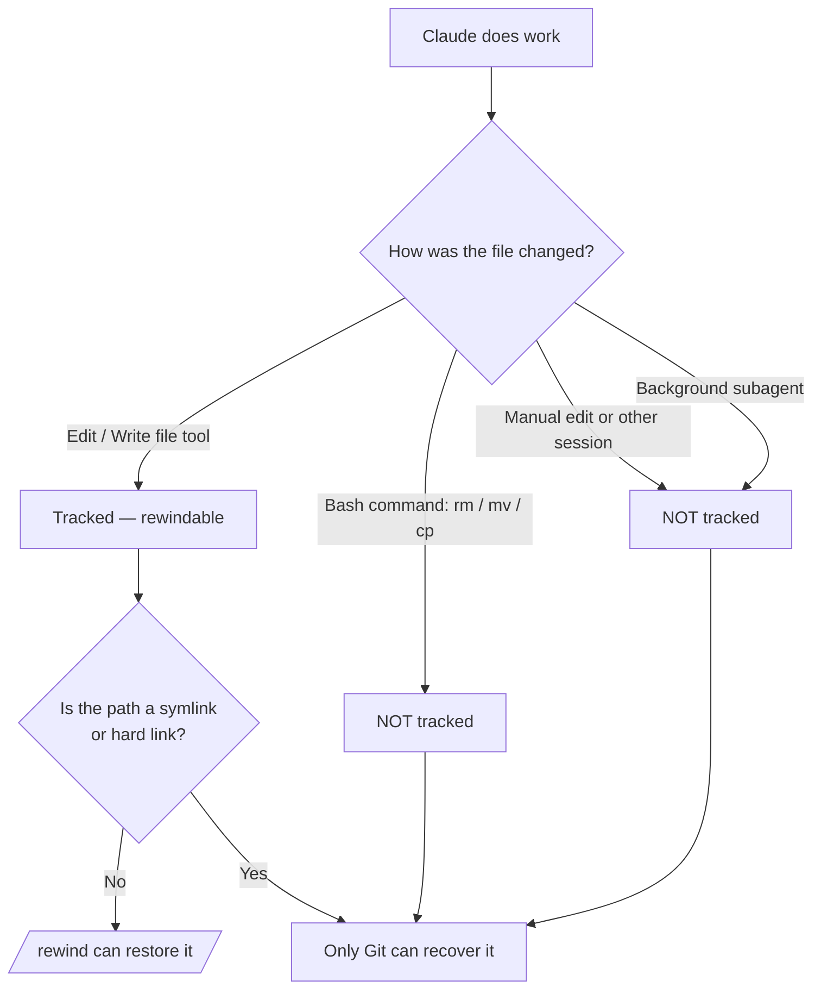

<LevelBadge level="intermediate" />

<Callout type="objectives" items={["Понять, что фиксирует контрольная точка — и чего она молча не фиксирует", "Открывать меню отката двумя способами и каждый раз выбирать правильное действие восстановления", "Отличать «restore» (отмена состояния) от «summarize» (сжатие контекста)", "Точно знать, почему контрольные точки дополняют Git, но никогда не заменяют его"]} />

<VerifyNote lastVerified="2026-10-09" source="https://code.claude.com/docs/en/checkpointing">
Поведение контрольных точек, действия меню отката, лимит снимков и срок хранения меняются от релиза к релизу — проверяйте в официальной документации.
</VerifyNote>

## Главная идея

Когда вы отпускаете Claude на амбициозное, масштабное изменение, самый страшный вопрос — «а что, если всё пойдёт не так на третьей правке?» Ответ — **контрольные точки** (checkpointing): Claude Code автоматически делает снимок вашего кода перед каждой правкой, и вы можете откатиться к любому прежнему состоянию, а не вручную распутывать недоделанный рефакторинг.

Считайте это **локальной отменой для всей сессии** — страховочной сеткой, которая позволяет без страха сказать: «да, пробуй смелый подход».

## Как создаются контрольные точки

Вы не создаёте контрольные точки — они появляются автоматически.

<Steps items={[{title: "Каждый запрос, начинающий ход = одна контрольная точка", body: "Каждый запрос, который начинает ход, фиксирует состояние вашего кода до запуска инструментов редактирования файлов Claude. Ни команд, ни настроек, ни церемоний."}, {title: "Хранятся только 100 последних", body: "Claude Code хранит снимки файлов для 100 самых свежих контрольных точек сессии. Более старые удаляются, поэтому очень длинную сессию нельзя откатить до самого начала."}, {title: "Они сохраняются между сессиями", body: "Контрольные точки сохраняются вместе с разговором, поэтому /rewind можно запустить и после возобновления сессии, а не только в текущей."}, {title: "Они чистятся сами", body: "Снимки файлов сессии удаляются при плановой очистке — по умолчанию примерно через 30 дней после того, как сессия в последний раз сохраняла снимок. Откат к контрольной точке, снимков которой уже нет, завершается ошибкой 'No files were restored' — увеличьте cleanupPeriodDays, чтобы хранить их дольше."}]} />

## Как открыть меню отката

Есть два способа:

<Steps items={[{title: "Выполнить /rewind", body: "Введите слэш-команду в строке запроса. Работает всегда."}, {title: "Нажать Esc дважды — но только при пустом вводе", body: "Двойное нажатие Esc открывает меню отката, когда поле запроса пустое. Если в нём есть текст, двойной Esc вместо этого очищает его (очищенный текст сохраняется в истории ввода, поэтому нажмите «Вверх», чтобы вернуть его)."}]} />

<PromptCard title="Открыть меню отката">{`/rewind`}</PromptCard>

Меню перечисляет **каждый запрос, отправленный в этой сессии**. Выберите точку, с которой хотите работать, а затем одно действие.

## Restore и summarize: ключевое различие

Именно здесь путаются. Меню предлагает два *вида* действий:

- Действия **Restore** меняют состояние на диске и/или в разговоре — они отменяют.
- Действия **Summarize** никогда не трогают ваши файлы — они сжимают разговор, чтобы освободить место в окне контекста.

<Callout type="warning" items={["Restore = отмена (возвращает код, разговор или и то и другое). Summarize = сжатие контекста (файлы на диске не затрагиваются).", "Используйте restore, когда правка что-то сломала. Используйте summarize, когда сессия раздулась, но с кодом всё в порядке."]} />

### Действия восстановления

<Steps items={[{title: "Restore code and conversation", body: "Возвращает и ваши файлы, и историю чата к выбранной точке — чистая «перемотка времени» к этому моменту."}, {title: "Restore conversation", body: "Откатывает чат к этому сообщению, но сохраняет ваш текущий код. Полезно, чтобы задать вопрос заново, не потеряв правки, которые вы хотите оставить."}, {title: "Restore code", body: "Откатывает изменения файлов, но сохраняет разговор. Отменяете правки, сохраняя обсуждение."}]} />

Две опции восстановления **кода** появляются, только если у выбранной контрольной точки действительно есть отслеживаемые изменения файлов для отката. Если после этой точки правок файлов не зафиксировано, меню предлагает лишь **Restore conversation**, два варианта summarize и **Never mind** (возвращает к списку сообщений без каких-либо изменений).

После восстановления разговора (или выбора «Summarize from here») исходный запрос выбранного сообщения возвращается в поле ввода, чтобы вы могли отправить его снова или отредактировать.

### Действия summarize

Оба сжимают часть разговора в сгенерированное ИИ резюме — как **точечный `/compact`**, где вы выбираете, какую сторону от выбранного сообщения сжать.

<Steps items={[{title: "Summarize from here", body: "Сообщения ДО выбранного остаются нетронутыми. Выбранное сообщение и всё после него превращаются в резюме. Используйте, чтобы отбросить побочное обсуждение, сохранив ранний контекст во всех подробностях."}, {title: "Summarize up to here", body: "Сообщения ДО выбранного превращаются в резюме; выбранное сообщение и всё после него остаются нетронутыми. Вы остаётесь в конце разговора. Используйте, чтобы сжать ранние вводные разговоры, сохранив недавнюю работу дословно."}]} />

В обоих случаях исходные сообщения остаются в журнале сессии, так что Claude по-прежнему может обращаться к деталям, а на месте сжатых сообщений появляется метка **Summarized conversation**. Чтобы направить резюме, выделите стрелками вариант **Summarize** и введите инструкции там, где в строке написано **add context (optional)**, затем нажмите Enter — выбор варианта цифровой клавишей запускает сжатие сразу, без инструкций.

Весь процесс описан в разделе [Управление контекстом](/docs/claude-code/context-management) — действия summarize в `/rewind` это скальпель, тогда как `/compact` — широкая кисть.

<Callout type="note" items={["Summarize оставляет вас в той же сессии. Чтобы ответвиться и попробовать другой подход, не трогая исходную сессию, используйте /branch или claude --continue --fork-session."]} />

## Откат за пределы `/clear`

Если ранее в том же процессе Claude Code вы выполняли `/clear`, меню отката показывает дополнительную запись сверху: `/resume <session-id> (previous session)`. Выберите её, чтобы вернуться к разговору, который был активен до `/clear`.

<VerifyNote lastVerified="2026-10-09" source="https://code.claude.com/docs/en/checkpointing">
Эта запись доступна только до тех пор, пока вы не выйдете из Claude Code или не возобновите другую сессию. Когда она исчезнет, выполните `/resume` и выберите предыдущую сессию из списка.
</VerifyNote>

## Где контрольные точки заканчиваются — ограничения, которые бьют больнее всего

Контрольные точки кажутся волшебством, пока не перестают им быть. Эти пробелы важны:

<Steps items={[{title: "Изменения через bash невидимы", body: "Файлы, затронутые shell-командами, которые запускает Claude — rm, mv, cp, генераторы кода, форматтеры — НЕ отслеживаются. В контрольные точки попадают только прямые правки через инструменты редактирования файлов Claude. Файл, удалённый через rm, для отката потерян."}, {title: "Большинство правок субагентов не восстанавливается", body: "Субагент редактирует теми же файловыми инструментами, но ваша сессия обычно не фиксирует эти правки. Исключение — навык с форком на переднем плане (context: fork с background: false), который редактирует во время вашего хода и откатывается как обычно. Любой другой субагент — включая навык с фоновым форком, который используется по умолчанию, — требует Git для отмены. См. /docs/claude-code/subagents."}, {title: "Внешние и параллельные изменения невидимы", body: "Ручные правки, сделанные вне Claude Code, и правки из других параллельных сессий, как правило, не фиксируются — если только они случайно не затрагивают те же файлы, что правила текущая сессия."}, {title: "Сообщения посреди хода не получают контрольной точки", body: "Сообщение, которое вы поставили в очередь, пока Claude работает, и которое дошло до него в рамках текущего хода, присоединяется к этому ходу вместо запуска нового, поэтому собственной контрольной точки у него нет. Чтобы отменить последовавшее за ним, откатитесь к запросу, начавшему ход, — это откатит весь ход, включая работу, сделанную до того, как пришло ваше сообщение."}, {title: "Символические и жёсткие ссылки пропускаются", body: "Restore пропускает любой отслеживаемый путь, являющийся символической или жёсткой ссылкой, и предупреждает 'Restored the code, but skipped N files'; эти файлы сохраняют текущее содержимое. Под это попадают и симлинки менеджеров dotfiles, и жёсткие ссылки pnpm. Выполните /debug перед восстановлением, чтобы пропущенные пути были названы в журнале отладки."}, {title: "Это уровень сессии, а не история", body: "Контрольные точки — это быстрое локальное восстановление. Это не коммиты, не ветки, и ими нельзя поделиться с командой."}]} />

## Контрольные точки и Git: используйте оба

Они решают разные задачи, поэтому сочетайте их.

| | Контрольные точки (`/rewind`) | Git |
|---|---|---|
| Охват | Одна сессия | Вся история проекта |
| Детализация | На каждый запрос, начинающий ход, автоматически | На каждый коммит, осознанно |
| Отслеживает изменения через bash? | Нет | Да (после добавления в индекс/коммита) |
| Срок жизни | 100 последних контрольных точек, очистка ~через 30 дней после сессии | Постоянно |
| Можно делиться / совместная работа | Нет | Да |
| Мысленная модель | «Локальная отмена» | «Постоянная история» |

<Callout type="tip" items={["Коммитьте рабочие состояния в Git перед рискованным масштабным запуском — это ваша прочная опора.", "Используйте /rewind для быстрого восстановления внутри сессии между коммитами, не засоряя историю Git.", "Если Claude будет выполнять разрушительный bash (rm/mv), генераторы или фоновых субагентов, опирайтесь на Git — откат эти файлы не спасёт."]} />

## Когда это использовать

<Steps items={[{title: "Исследование альтернатив", body: "Попробуйте смелую реализацию, и если она не понравится, восстановите код и разговор до точки развилки и попробуйте другую."}, {title: "Восстановление после плохой правки", body: "Правка внесла баг три запроса назад? Восстановите код до неё, а не отлаживайте обломки."}, {title: "Итерации над функцией", body: "Экспериментируйте с вариантами, всегда зная, что проверенное состояние — в одном /rewind."}, {title: "Освобождение места в контексте", body: "Многословный отладочный обход съел окно контекста? Сделайте summarize от середины и дальше, сохранив исходные инструкции во всех подробностях."}]} />

<Quiz title="Проверьте себя" questions={[{q: "Claude выполнил `rm config.old.json` через bash-команду, и вы хотите вернуть файл. Сможет ли `/rewind` его восстановить?", options: ["Да — каждое изменение Claude попадает в контрольную точку", "Нет — изменения через bash не отслеживаются; отслеживаются только прямые правки через файловые инструменты", "Только если запустить /rewind в течение 30 секунд"], answer: 1, explain: "Контрольные точки фиксируют только правки, сделанные через инструменты редактирования файлов Claude. Файлы, изменённые bash-командами (rm, mv, cp), не отслеживаются — именно для этого и нужен Git."}, {q: "С кодом всё в порядке, но долгий отладочный обход заполнил окно контекста. Какое действие подходит?", options: ["Restore code and conversation до обхода", "Restore code", "Summarize from here в начале обхода"], answer: 2, explain: "Действия summarize сжимают разговор, не затрагивая файлы. «Summarize from here» превращает обход в резюме, сохраняя ваш прежний контекст нетронутым, — место в контексте освобождается без единого изменения кода."}, {q: "Как создаётся контрольная точка?", options: ["Вы вручную запускаете /checkpoint", "Автоматически — каждый запрос, начинающий ход, создаёт одну", "Только когда вы делаете коммит в Git"], answer: 1, explain: "Контрольные точки автоматические: каждый запрос, начинающий ход, фиксирует состояние кода до правок. Ручного шага нет — но сообщение, пришедшее посреди хода, присоединяется к текущему ходу и не получает собственной контрольной точки."}]} />

<Flashcards title="Словарь контрольных точек и отката" cards={[{front: "Контрольная точка", back: "Автоматический снимок вашего кода перед каждым запросом, начинающим ход. Привязана к сессии, хранятся 100 последних, очистка ~через 30 дней после сессии."}, {front: "/rewind", back: "Открывает меню отката со списком каждого запроса сессии, чтобы можно было выполнить restore или summarize с любой точки. Также доступно двойным Esc при пустом вводе."}, {front: "Действие restore", back: "Возвращает состояние — код, разговор или оба — к выбранной точке. Это «отмена». Опции для кода появляются, только если у этой контрольной точки есть отслеживаемые изменения."}, {front: "Действие summarize", back: "Сжимает часть разговора в резюме от ИИ, чтобы освободить контекст. Файлы на диске никогда не затрагиваются."}, {front: "Слепое пятно bash", back: "Файлы, изменённые shell-командами (rm/mv/cp), НЕ попадают в контрольные точки — только прямые правки через файловые инструменты. Для них используйте Git."}, {front: "Слепое пятно субагентов", back: "Откатываются только правки навыка с форком на переднем плане. Фоновые субагенты (включая фоновый форк по умолчанию) требуют Git."}]} />

<Callout type="takeaways" items={["Контрольные точки — автоматические снимки перед каждым запросом, начинающим ход, то есть локальная отмена для сессии. Хранятся 100 последних, затем очистка ~через 30 дней после сессии.", "Меню отката открывается командой /rewind или двойным Esc при пустом вводе; в нём перечислены все отправленные запросы.", "Действия restore отменяют состояние (код, разговор или оба); действия summarize сжимают контекст и никогда не трогают файлы.", "Изменения через bash, внешние, параллельные и большинство правок субагентов НЕ отслеживаются — а пути с символическими и жёсткими ссылками при restore пропускаются.", "Контрольные точки дополняют Git, а не заменяют его: думайте «локальная отмена» против «постоянной истории, которой можно делиться»."]} />

## Дальше

- [Управление контекстом](/docs/claude-code/context-management) — `/compact`, `/clear` и место summarize в общей картине
- [Режим планирования](/docs/claude-code/plan-mode) — исследуйте и утверждайте план до выполнения правок, чтобы откатываться реже
- [Разрешения](/docs/claude-code/permissions) — вторая половина безопасного выполнения амбициозных задач
