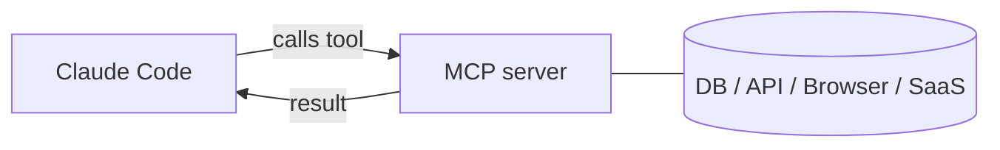

<LevelBadge level="advanced" />

<VerifyNote lastVerified="2026-11-10" source="https://code.claude.com/docs/en/mcp">
Команды `claude mcp`, области конфигурации и транспорты развиваются — сверяйтесь с официальной документацией Claude Code по MCP и с modelcontextprotocol.io. Четыре транспорта, пути хранения областей, устаревание SSE и поведение одобрения проекта ниже взяты с этой страницы.
</VerifyNote>

**Model Context Protocol (MCP)** — открытый стандарт для подключения ИИ к внешним инструментам и данным. **MCP-сервер** предоставляет возможности (запрос к базе данных, открытие PR на GitHub, управление браузером); Claude Code подключается к нему и может **вызывать эти инструменты** во время сессии. Так вы расширяете Claude за пределы вашей файловой системы и оболочки.

<Callout type="objectives" items={["Объяснить, что такое MCP-сервер и как Claude Code вызывает его инструменты", "Различать два транспорта: локальный stdio и удалённый HTTP/SSE", "Добавить сервер командой claude mcp add и прочитать записанный JSON", "Выбрать подходящую область (local, project, user) в зависимости от того, кто видит сервер", "Подключить настоящую базу данных к Claude от начала до конца", "Избежать ловушек безопасности и конфигурации, в которые попадает большинство"]} />

## Общая схема



Вы объявляете серверы, которые Claude может использовать; каждый сервер публикует набор инструментов со схемами; Claude выбирает и вызывает их как любой другой инструмент.

<Flashcards title="Словарь MCP" cards={[{front: "Model Context Protocol (MCP)", back: "Открытый стандарт для подключения ИИ к внешним инструментам и данным."}, {front: "MCP-сервер", back: "Программа, которая предоставляет возможности — запрос к базе данных, открытие PR на GitHub, управление браузером — в виде вызываемых инструментов."}, {front: "Инструмент (tool)", back: "Возможность, которую MCP-сервер публикует вместе со схемой; Claude выбирает и вызывает её как любой другой инструмент."}, {front: "Транспорт", back: "Как Claude обращается к серверу: stdio (локальный процесс), HTTP (размещённый, часто с OAuth), SSE (устарел — HTTP автоматически переключается на него) или WebSocket ws/wss (постоянное соединение, push, только аутентификация через заголовки, без флага --transport)."}, {front: "Область (scope)", back: "Кто видит сервер: local (вы, этот проект), project (команда через коммит) или user (вы, везде)."}]} />

## Транспорты

Есть четыре способа, которыми Claude обращается к серверу. Выбирайте по тому, где сервер работает и как он общается.

- **stdio** — локальный процесс, который запускает Claude (отлично для локальных инструментов и CLI). Именно это означает запись JSON без `type`.
- **HTTP** — размещённый сервер, часто с OAuth. Выбор по умолчанию для всего удалённого.
- **SSE** — **устарел**; используйте HTTP, где можете. Некоторые сервисы всё ещё предоставляют только SSE-эндпоинт, а начиная с Claude Code v2.1.265 `--transport http` сначала пробует HTTP и сам переключается на SSE, поэтому явный `--transport sse` нужен редко.
- **WebSocket** (`ws` / `wss`) — постоянное двунаправленное соединение для сервера, который сам присылает события. `--transport` *не* принимает `ws`: добавьте его через `claude mcp add-json '{"type":"ws","url":"wss://…"}'` или впишите в `.mcp.json`. Без OAuth — аутентификация только через заголовки.

<Callout type="warning" items={["Запись JSON с url, но без type — это ошибка конфигурации, а не разумное значение по умолчанию: Claude Code читает запись без type как stdio-сервер, пропускает её и сообщает, что у неё есть «url», но нет «type». Всегда задавайте \"type\": \"http\" (или \"sse\" / \"ws\") для удалённого сервера, который вы пишете вручную."]} />

## Настройка серверов

Самый быстрый путь — команда `claude mcp add`: она записывает конфигурацию за вас. Следуйте этой последовательности, чтобы дойти от нуля до подключённого сервера.

<Steps items={[{title: "Добавьте локальный stdio-сервер", body: "Запустите claude mcp add — всё после -- это команда запуска, которую Claude выполняет за вас."}, {title: "Или добавьте удалённый HTTP-сервер", body: "Передайте --transport http и область, затем URL сервера. Удалённые серверы часто размещены у провайдера и используют OAuth."}, {title: "Посмотрите, что подключено", body: "Запустите claude mcp list, чтобы увидеть настроенные серверы и состояние их подключения."}, {title: "Проверьте и аутентифицируйтесь", body: "Используйте /mcp внутри сессии, чтобы просмотреть инструменты сервера и аутентифицировать удалённые серверы."}]} />

<PromptCard title="Добавить локальный stdio-сервер">{`# A local stdio server (everything after -- is the launch command)
claude mcp add filesystem -- npx -y @modelcontextprotocol/server-filesystem ~/code/myproject`}</PromptCard>

<PromptCard title="Добавить удалённый HTTP-сервер (общий для проекта)">{`# A remote HTTP server, shared with everyone on the project
claude mcp add --transport http --scope project github https://api.githubcopilot.com/mcp/`}</PromptCard>

Под капотом это просто JSON. Сервер области **project** попадает в `.mcp.json` в корне репозитория — закоммитьте его, и коллеги получат те же инструменты, как только доверятся рабочему пространству:

```json
{
  "mcpServers": {
    "github": { "type": "http", "url": "https://api.githubcopilot.com/mcp/" }
  }
}
```

<Callout type="warning" items={["Не берите пакеты @modelcontextprotocol/server-github, -postgres, -slack и -puppeteer из старых туториалов. Они заархивированы и несут уведомление об устаревании npm: \"Archived and unmaintained; no security guarantees\". Используйте собственный сервер вендора, если он есть — у GitHub это HTTP-эндпоинт выше, а управление браузером перешло в @playwright/mcp. Среди эталонных серверов на TypeScript по-прежнему поддерживаются только filesystem, memory, everything и sequential-thinking."]} />

### Область определяет, кто видит сервер

| Область | Где хранится | Где загружается | Для чего |
|---|---|---|---|
| `local` (по умолчанию) | `~/.claude.json`, под путём этого проекта | только в этом проекте | личные эксперименты, секреты |
| `project` | `.mcp.json` в репозитории (коммитится) | только в этом проекте, общий для команды | инструменты, которыми должна пользоваться вся команда |
| `user` | `~/.claude.json` | во всех ваших проектах | серверы, которые нужны везде |

<Callout type="warning" items={["«local scope» в MCP — это не то же самое, что локальные настройки. Сервер MCP с областью local живёт в ~/.claude.json в вашем домашнем каталоге — а НЕ в .claude/settings.local.json проекта. Искать его в папке проекта бесполезно."]} />

Запустите `claude mcp list`, чтобы увидеть, что подключено, и `/mcp` внутри сессии, чтобы просмотреть инструменты и аутентифицировать удалённые серверы. Заготовки для копирования смотрите в разделе [Конфигурация MCP и шаблоны серверов](/docs/templates/mcp-config).

## Практический пример: дайте Claude вашу базу данных

Допустим, вы хотите, чтобы Claude отвечал на вопросы к локальному Postgres, а не вставлять результаты запросов самому. Добавьте сервер в области project, чтобы он был и у коллег.

Именно с базами данных проблема заархивированных серверов бьёт сильнее всего: старый `@modelcontextprotocol/server-postgres` не поддерживается, а официальной замены нет, так что название пакета — единственное решение, которое вам придётся принять самим. Выберите поддерживаемый community-сервер, [проверьте его](/docs/security/reviewing-third-party-code), затем подключите — форма одна и та же, что бы вы ни выбрали:

<PromptCard title="Добавить сервер Postgres в области project">{`# Replace the package with a maintained Postgres MCP server you have reviewed.
# The connection string is read-only on purpose — see below.
claude mcp add --scope project db -- npx -y <postgres-mcp-server> "postgresql://readonly@localhost/app"`}</PromptCard>

Теперь в сессии можно задать вопрос обычными словами, а цикл запросов Claude выполнит за вас:

<PromptCard title="Задать вопрос базе данных">{`How many users signed up last week? Check the DB.`}</PromptCard>

Claude вызывает инструмент запросов, который публикует сервер, получает строки и отвечает — без цикла копирования и вставки. Держите строку подключения только для чтения, если Claude действительно не нужно писать. А если вам нужен был всего один запрос, учтите, что `psql -c '…'` через Bash стоит долю токенов; когда выигрывает тот или иной вариант, разбирает [Налог MCP на токены](/docs/claude-code/mcp-token-cost).

Поскольку область project, коллега, который подтянет репозиторий, получит ту же возможность — но **не молча и не мгновенно**. Сервер из закоммиченного `.mcp.json` остаётся в состоянии `⏸ Pending approval`, пока коллега не запустит `claude` в папке и не примет диалог доверия рабочему пространству. Клонированный репозиторий не может заранее одобрить собственные серверы: `enableAllProjectMcpServers` или `enabledMcpjsonServers`, закоммиченные в `.claude/settings.json` проекта, *игнорируются* в недоверенной папке. Одобрения из пользовательского `~/.claude/settings.json`, из управляемых настроек или переданные через `--settings` там действуют. Это обычный ответ на вопрос «почему мой коллега не видит сервер?»

## Доверие и безопасность

<Callout type="warning" items={["MCP-сервер выполняет код, может читать данные и совершать действия — подключайте только те серверы, которым доверяете.", "Давайте каждому серверу минимально необходимые привилегии.", "Любой внешний контент, который возвращает сервер, может содержать prompt injection.", "Проверяйте сторонние серверы, прежде чем подключать их."]} />

:::warning[Относитесь к MCP-серверам как к установке программ]
MCP-сервер выполняет код, может читать данные и совершать действия. Подключайте только серверы, которым доверяете, давайте им **минимально необходимые привилегии** и помните, что любой внешний контент, который они возвращают, может содержать [prompt injection](/docs/security/prompt-injection). Сначала проверяйте сторонние серверы — см. [Проверка стороннего кода](/docs/security/reviewing-third-party-code).
:::

## MCP и в приложениях

MCP также лежит в основе **коннекторов** в приложениях Claude — тот же стандарт, другая поверхность. См. [Коннекторы (MCP) в приложениях](/docs/claude-app/connectors) и, для API, [MCP и подключение к инструментам](/docs/api/mcp).

## Частые ошибки

- **Неверная область.** Сервер, добавленный в области `local`, не появится у коллег; сервер, который нужен только вам, не следует коммитить в области `project`. Выбирайте осознанно.
- **Слишком много серверов, слишком много инструментов.** Поиск инструментов включён по умолчанию, поэтому подключённый сервер обычно обходится вам на каждом ходу в *названия* его инструментов и инструкции сервера, а не в полные схемы — но это всё равно налог на каждый ход, а схемы попадают в контекст в тот момент, когда Claude их ищет. Подключайте то, что нужно задаче, а не весь свой каталог. Реальные цифры, режимы `ENABLE_TOOL_SEARCH` и то, как выполнение кода снижает второй вид затрат, смотрите в [Налоге MCP на токены](/docs/claude-code/mcp-token-cost).
- **Избыточные привилегии подключений.** Давайте серверу базы данных роль только для чтения, если Claude действительно не нужно писать. MCP делает возможности реальными — ограничивайте их.
- **Забыть про риск инъекции.** Всё, что возвращает сервер (веб-страница, текст issue, строка), — это недоверенный текст, который может содержать [prompt injection](/docs/security/prompt-injection). Не ставьте мощный сервер с правом записи рядом с недоверенным сервером с правом чтения, не продумав это.

<Quiz title="Проверьте себя" questions={[{q: "Какой транспорт — это локальный процесс, который Claude запускает сам?", options: ["Удалённый HTTP/SSE", "stdio", "OAuth"], answer: 1, explain: "stdio — это локальный процесс, который запускает Claude; идеален для локальных инструментов и CLI. Остальные три удалённые: HTTP (часто с OAuth), устаревший SSE и WebSocket."}, {q: "Куда записывается сервер области project и что должен сделать коллега?", options: ["В ваши пользовательские настройки; видите его только вы", "В .mcp.json в корне репозитория; после pull коллега всё равно должен довериться рабочему пространству, чтобы сервер вышел из Pending approval", "В скрытый глобальный кэш; никто не может его редактировать"], answer: 1, explain: "Область project попадает в закоммиченный .mcp.json в корне репозитория. Но клонированный репозиторий не может одобрить собственные серверы — закоммиченный enableAllProjectMcpServers игнорируется в недоверенной папке, поэтому сервер ждёт в Pending approval, пока коллега не примет диалог доверия рабочему пространству."}, {q: "Зачем держать подключение к базе данных только для чтения, если Claude нужно лишь читать?", options: ["Запросы выполняются быстрее", "Минимальные привилегии — MCP делает возможности реальными, поэтому не давайте доступ на запись, если он действительно не нужен", "Только чтение требуется протоколом"], answer: 1, explain: "Давайте серверам минимально необходимые привилегии. MCP делает возможности реальными, поэтому роль только для чтения предотвращает непреднамеренную запись."}]} />

<Callout type="takeaways" items={["MCP — открытый стандарт; MCP-сервер предоставляет инструменты, которые Claude Code вызывает как любые другие.", "Четыре транспорта: stdio (процесс, который запускает Claude), HTTP (по умолчанию для удалённых), SSE (устарел — HTTP сам переключается на него) и WebSocket ws/wss (push, аутентификация через заголовки, только через add-json).", "claude mcp add записывает конфигурацию за вас; под капотом это JSON. Область project живёт в закоммиченном .mcp.json, а копия коллеги остаётся в Pending approval, пока он не доверится рабочему пространству.", "Область управляет видимостью: local (вы, этот проект), project (коммит для команды), user (вы, везде).", "Относитесь к серверам как к установке программ: доверие, минимальные привилегии и осторожность с prompt injection во всём, что они возвращают."]} />

## Дальше

- [Создайте и подключите свой первый MCP-сервер (пошаговое руководство)](/docs/walkthroughs/first-mcp-server)
- [Конфигурация MCP и шаблоны серверов](/docs/templates/mcp-config)
- [Защита агентов и инструментов](/docs/security/securing-agents)
