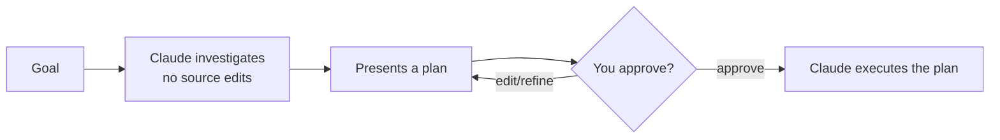

<LevelBadge level="beginner" />

<Callout type="objectives" items={["Объяснить, что блокирует режим планирования — и что он всё же позволяет Claude выполнять", "Входить в режим планирования и выходить из него тремя разными способами", "Пройти цикл исследование-предложение-одобрение-выполнение", "Различать режим планирования и разрешения и использовать их вместе"]} />

<VerifyNote lastVerified="2026-10-09" source="https://code.claude.com/docs/en/permission-modes">
Способ входа в режим планирования (сочетание клавиш/флаг) и то, какие именно shell-команды он позволяет Claude выполнять во время планирования, меняются от релиза к релизу — сверяйтесь с официальной документацией Claude Code.
</VerifyNote>

## Главная идея

Представьте, что вы отдаёте подрядчику ключи от дома — или сначала просите его пройтись по дому и расписать, *что именно* он собирается изменить. Режим планирования — это и есть тот обход.

**Режим планирования** говорит Claude **исследовать и предлагать изменения, не внося их**: он читает файлы, выполняет shell-команды для исследования и пишет план — но он **не редактирует ваш исходный код**. Правки остаются заблокированными, пока вы не одобрите план.

<Callout type="tip" items={["Режим планирования означает, что Claude ИССЛЕДУЕТ, но не МЕНЯЕТ ваш исходный код — он создаёт план и ждёт вашего сигнала."]} />

### Это не строго режим только для чтения

Исследование иногда требует команды, поэтому режим планирования — это про *отсутствие правок*, а не про *отсутствие выполнения*. Что произойдёт с shell-командой во время планирования, зависит от сессии — срабатывает первый подходящий случай:

<Steps items={[{title: "Auto mode доступен и useAutoModeDuringPlan включён (по умолчанию)", body: "Классификатор проверяет shell-команды вместо того, чтобы спрашивать вас, — за исключением удалений на критическом пути. Одобренные команды выполняются, отклонённые блокируются."}, {title: "Auto mode недоступен или useAutoModeDuringPlan выключен", body: "Команды вне встроенного набора только для чтения запрашивают у вас одобрение."}, {title: "Интерактивные сессии в терминале, где доступен bypass permissions", body: "Блокировки режима планирования НЕ применяются. Claude по-прежнему получает указание планировать, не редактируя, но правка или команда, которую он попытается выполнить во время планирования, пройдёт без запроса. Во всех остальных случаях режим планирования сохраняет свои блокировки — в headless-запусках -p, в Agent SDK и в панели чата расширения VS Code."}]} />

<Callout type="warning" items={["Если вы запустились с --allow-dangerously-skip-permissions, режим планирования — это настоятельная инструкция, а не жёсткий ограничитель. Воспринимайте его как соглашение о планировании, а не как песочницу."]} />

## Почему это самый безопасный способ начать

Для всего крупного, рискованного или незнакомого вы хотите увидеть, *что* Claude намеревается сделать, прежде чем он тронет ваш репозиторий. Режим планирования разделяет **мышление** и **действие**:

Выигрыш: вы ловите неверные предположения *до* того, как они станут неверным кодом.

## Когда его использовать

<Callout type="tip" items={["ВСЕГДА для крупных или многофайловых изменений, миграций или рефакторингов", "Когда работаете в кодовой базе, которую ещё не полностью знаете", "Когда вам нужен пригодный для проверки план, чтобы поделиться с коллегой"]} />

Для крошечных, очевидных правок его можно пропустить — но при сомнении сначала планируйте.

## Как это работает на практике

Следуйте циклу. Каждый шаг открывает следующий — Claude переключается на редактирование только *после* вашего одобрения.

<Steps items={[{title: "Войдите в режим планирования и сформулируйте свою цель", body: "Нажимайте Shift+Tab, чтобы переключать режимы разрешений, пока в статусной строке не появится 'plan mode on', либо добавьте к одному запросу префикс /plan. Чтобы начать сразу в нём, запустите claude --permission-mode plan. Затем опишите, чего хотите достичь."}, {title: "Claude исследует", body: "Он читает релевантные файлы, выполняет исследовательские команды и задаёт уточняющие вопросы."}, {title: "Claude возвращает пошаговый план", body: "Какие файлы менять, подход и как проверить результат. Нажмите Ctrl+G, чтобы открыть предложенный план в своём редакторе и изменить его напрямую."}, {title: "Вы одобряете или уточняете", body: "Выберите 'Yes, and use auto mode' (да, с использованием auto mode), 'Yes, manually approve edits' (да, одобрять правки вручную) или 'No, keep planning' (нет, продолжить планирование). Одобрение выводит вас из режима планирования в тот режим разрешений, который описан в выбранном варианте, и Claude начинает редактировать."}]} />

Чтобы выйти из режима планирования, не одобряя план, снова нажмите `Shift+Tab`. Чтобы сделать его режимом по умолчанию для терминальных сессий проекта, задайте `defaultMode` равным `plan` в `.claude/settings.json` — см. [Настройки](/docs/claude-code/settings).

### Попробуйте сами

Скопируйте это в настоящую сессию планирования и понаблюдайте, как разворачивается цикл:

<PromptCard title="Запустите сессию планирования">{`I want to migrate our auth from sessions to JWT. Stay in Plan Mode: investigate the current setup, ask anything you need, then propose a step-by-step plan with files to change and how to verify — don't edit anything yet.`}</PromptCard>

:::tip Сочетайте с CLAUDE.md
Хороший [CLAUDE.md](/docs/claude-code/claude-md) делает планы точнее — Claude планирует, уже учитывая ваши соглашения и ограничители.
:::

## Режим планирования против разрешений

Классическая путаница. Они решают разные задачи и работают вместе:

- **Режим планирования** = «исследуй и предлагай, пока не редактируй». (Эта страница.)
- **[Разрешения](/docs/claude-code/permissions)** = когда уже действуешь, *какие* действия разрешены без запроса.

Воспринимайте это как **действовать ли сейчас** (режим планирования) против **какие действия разрешены, когда уже действуешь** (разрешения).

<Flashcards cards={[{front: "В какое состояние режим планирования переводит Claude Code?", back: "Исследуй-и-предлагай: он читает файлы, выполняет shell-команды для исследования и пишет план, но не редактирует ваш исходный код. Правки остаются заблокированными, пока вы не одобрите."}, {front: "Как войти в режим планирования и выйти из него?", back: "Вход — через Shift+Tab, префикс /plan у одного запроса или claude --permission-mode plan. Выход без одобрения — снова Shift+Tab."}, {front: "В чём состоит цикл режима планирования?", back: "Исследование → представление плана → вы одобряете или уточняете → Claude выполняет."}, {front: "Когда стоит прибегать к режиму планирования?", back: "По умолчанию для крупной, рискованной или незнакомой работы (многофайловые изменения, миграции, рефакторинги, незнакомые кодовые базы). Пропускайте только крошечные, очевидные правки."}, {front: "Режим планирования против разрешений?", back: "Режим планирования управляет тем, ДЕЙСТВОВАТЬ ли сейчас; разрешения управляют тем, КАКИЕ действия разрешены, когда уже действуешь."}]} />

<Callout type="takeaways" items={["Режим планирования — это исследуй-и-предлагай: Claude читает и выполняет исследовательские команды, но не редактирует ваш исходный код, пока вы не одобрите план", "Это не строго режим только для чтения — команды во время планирования либо проверяются классификатором, либо запрашивают одобрение, либо (когда в интерактивном терминале доступен bypass permissions) вовсе не блокируются", "Вход — через Shift+Tab, префикс /plan или --permission-mode plan; одобрение переводит сессию в тот режим, который назван в выбранном варианте", "Используйте его по умолчанию для крупной, рискованной или незнакомой работы; пропускайте только крошечные очевидные правки", "Режим планирования управляет тем, ДЕЙСТВОВАТЬ ли сейчас; разрешения управляют тем, КАКИЕ действия разрешены, когда уже действуешь"]} />

<Quiz title="Проверьте себя" questions={[{q: "Что может делать Claude Code, находясь в режиме планирования?", options: ["Редактировать файлы и выполнять любые команды", "Читать файлы и выполнять shell-команды для исследования — но не редактировать ваш исходный код, пока вы не одобрите", "Только отвечать на вопросы, вообще без доступа к файлам"], answer: 1, explain: "Режим планирования — это про отсутствие правок, а не про отсутствие выполнения. Claude читает файлы и выполняет исследовательские команды (с проверкой классификатором или с запросом одобрения, в зависимости от сессии), но правки вашего исходного кода остаются заблокированными, пока вы не одобрите план."}, {q: "Когда стоит прибегать к режиму планирования?", options: ["Только для исправления однострочных опечаток", "Для крупных или многофайловых изменений, миграций, рефакторингов или незнакомых кодовых баз", "Никогда — он только замедляет вас"], answer: 1, explain: "Используйте его всегда для крупных или многофайловых изменений, миграций или рефакторингов, а также когда работаете в кодовой базе, которую ещё не полностью знаете. Крошечные очевидные правки можно пропустить."}, {q: "Каков правильный порядок цикла режима планирования?", options: ["Выполнить, затем исследовать, затем одобрить", "Исследовать, не редактируя, представить план, вы одобряете или уточняете, затем Claude выполняет", "Сначала одобрить, затем Claude исследует и редактирует"], answer: 1, explain: "Claude исследует, не редактируя ваш исходный код, представляет план, вы одобряете или уточняете, и только тогда он переключается на выполнение плана."}, {q: "Чем различаются режим планирования и разрешения?", options: ["Это два названия одной и той же функции", "Режим планирования = исследуй и предлагай, пока не редактируй; разрешения = когда уже действуешь, какие действия разрешены без запроса", "Разрешения решают, планировать ли; режим планирования решает, какие файлы редактировать"], answer: 1, explain: "Режим планирования отделяет мышление от действия. Разрешения управляют тем, какие действия разрешены без запроса, когда Claude уже действует. Они работают вместе."}]} />

## Дальше

- [Разрешения и режимы разрешений](/docs/claude-code/permissions)
- [Управление контекстом](/docs/claude-code/context-management) — поддерживайте эффективность длинных сессий
- [Пошаговое руководство: настройка Claude Code для реального репозитория](/docs/walkthroughs/customize-claude-code)
