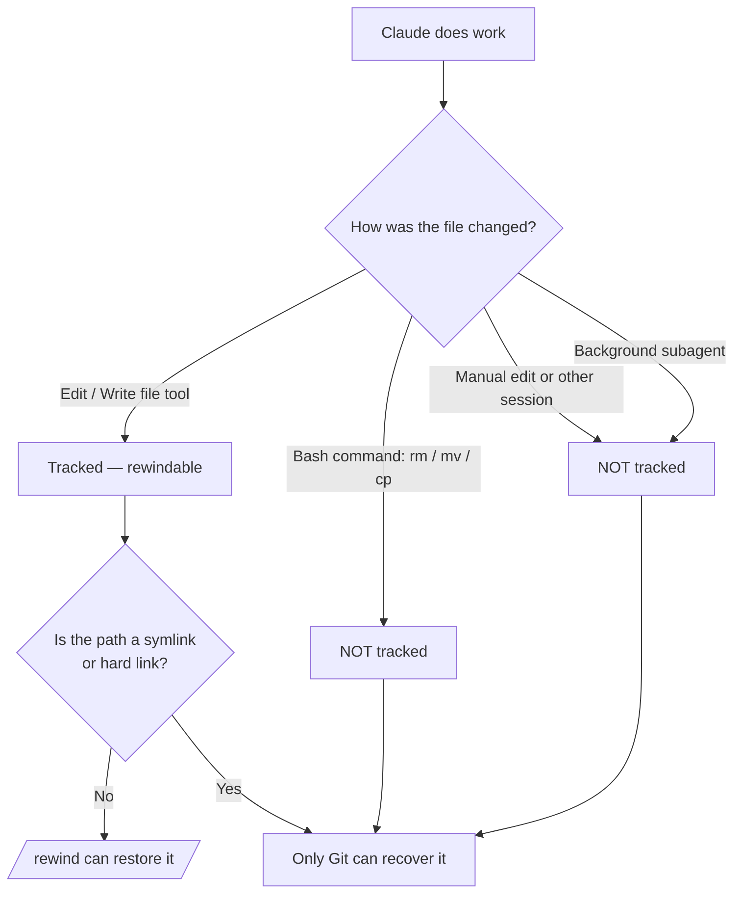

<LevelBadge level="intermediate" />

<Callout type="objectives" items={["理解检查点会记录什么——以及它悄悄不会记录什么", "用两种方式打开回溯菜单，并每次都选对恢复操作", "区分“恢复”（撤销状态）与“总结”（压缩上下文）", "清楚知道检查点为何是 Git 的补充而绝不是替代"]} />

<VerifyNote lastVerified="2026-10-20" source="https://code.claude.com/docs/en/checkpointing">
检查点的行为、回溯菜单中的操作、快照数量上限和保留时长会随版本变化——请在官方文档中确认。
</VerifyNote>

## 核心思想

当你放手让 Claude 去做一项雄心勃勃的大范围改动时，最可怕的问题是“如果做到第三处编辑就出错了怎么办？”**检查点（Checkpointing）** 就是答案：Claude Code 会在每次编辑之前自动为你的代码拍下快照，这样你就可以回溯到任何更早的状态，而不必手动去收拾一个做到一半的重构。

可以把它看作**针对整个会话的本地撤销**——一张安全网，让你可以放心地说“好，试试那个大胆的方案”。

## 检查点是如何创建的

你不需要创建检查点——它们是自动产生的。

<Steps items={[{title: "每个开启一轮的提示 = 一个检查点", body: "每个开启一轮的提示，都会在 Claude 的文件编辑工具运行之前记录下你的代码状态。无需命令，无需配置，没有任何繁琐流程。"}, {title: "只保留最近的 100 个", body: "Claude Code 会为一个会话中最近的 100 个检查点保留文件快照。更早的会被丢弃，因此一个很长的会话无法一路回溯到起点。"}, {title: "它们跨会话持久保留", body: "检查点与对话一起保存，所以恢复会话之后你仍然可以运行 /rewind，而不只是在当前活跃的会话中。"}, {title: "它们会自我清理", body: "会话的文件快照会在保留期清理任务中被删除，默认约在该会话最后一次保存快照后的 30 天。回溯到快照已被清除的检查点会失败，并提示“No files were restored”——调高 cleanupPeriodDays 可以让它们保留更久。"}]} />

## 打开回溯菜单

有两种进入方式：

<Steps items={[{title: "运行 /rewind——或它的别名 /checkpoint 和 /undo", body: "在提示符处输入这个斜杠命令。始终可用。/checkpoint 和 /undo 是同一条命令的别名，想到哪个名字就用哪个。"}, {title: "连按两次 Esc——但仅在输入为空时", body: "当提示框为空时，连按两次 Esc 会打开回溯菜单。如果框里有文字，连按两次 Esc 则会清除这些文字（被清除的文字会保存到输入历史中，之后按 ↑ 键即可找回）。"}]} />

<PromptCard title="打开回溯菜单">{`/rewind`}</PromptCard>

<Callout type="warning" items={["别名的名字比它的字面意思更亲切：/checkpoint 不会按需拍摄快照（快照是自动的），/undo 也不会自己撤销上一次编辑。三个名字打开的是同一个菜单，你仍然要在其中选择时间点和操作。"]} />

菜单会列出**本次会话中你发送的每一个提示**。选择你想操作的那个时间点，然后选择一个操作。

## 恢复与总结：关键区别

很多人会在这里搞混。菜单提供两*类*操作：

- **恢复（Restore）**操作会改变磁盘上和/或对话中的状态——它们是撤销。
- **总结（Summarize）**操作绝不会触碰你的文件——它们把对话压缩以释放上下文窗口空间。

<Callout type="warning" items={["恢复 = 撤销（回退代码、对话，或两者）。总结 = 压缩上下文（磁盘上的文件不受影响）。", "编辑把东西弄坏了，就用恢复。会话变得臃肿但代码没问题，就用总结。"]} />

### 恢复操作

<Steps items={[{title: "恢复代码与对话", body: "把你的文件和聊天历史都回退到所选时间点——干净利落地“回到那一刻”。"}, {title: "恢复对话", body: "把聊天回退到那条消息，但保留你当前的代码。适合在不丢失想保留的编辑的前提下重新提问。"}, {title: "恢复代码", body: "回退文件改动但保留对话。撤销编辑，保留关于这些编辑的讨论。"}]} />

两个**代码**恢复选项只有在所选检查点确实有可回退的已跟踪文件改动时才会出现。如果那个时间点之后没有记录到任何文件编辑，菜单就只提供**恢复对话**、两个总结选项，以及**Never mind**（返回消息列表，不做任何更改）。

恢复对话之后（或选择“从此处开始总结”之后），所选消息的原始提示会被放回输入框，方便你重新发送或修改。

### 总结操作

两者都会把对话的一部分压缩成 AI 生成的摘要——就像一个**有针对性的 `/compact`**，由你选择压缩所选消息的哪一侧。

<Steps items={[{title: "从此处开始总结", body: "所选消息之前的消息保持原样。所选消息及其之后的一切都会变成摘要。适合在保留早期上下文完整细节的同时，丢弃一段旁支讨论。"}, {title: "总结到此处为止", body: "所选消息之前的消息变成摘要；所选消息及其之后的一切保持原样。你仍停留在对话的末尾。适合压缩早期的铺垫闲聊，同时原文保留最近的工作。"}]} />

无论哪种方式，原始消息都仍保留在会话记录中，所以 Claude 仍能参考其中的细节，并且在被压缩的消息原来的位置会出现一个**Summarized conversation**标记。若想引导摘要的侧重点，用方向键高亮某个**总结**选项，在显示为**add context (optional)** 的那一行输入指示，然后按 Enter——如果直接按数字键选择该选项，则会立即总结，不带任何指示。

完整流程请参阅[上下文管理](/docs/claude-code/context-management)——`/rewind` 的总结操作是手术刀，而 `/compact` 是大刷子。

<Callout type="note" items={["总结会让你留在同一个会话中。如果想另开分支尝试不同的方案、同时保持原会话不变，请改用 /branch 或 claude --continue --fork-session。"]} />

## 回溯到 `/clear` 之前

如果你在同一个 Claude Code 进程中更早运行过 `/clear`，回溯菜单的顶部会多出一项：`/resume <session-id> (previous session)`。选择它即可跳回 `/clear` 之前的那段对话。

<VerifyNote lastVerified="2026-10-20" source="https://code.claude.com/docs/en/checkpointing">
该条目仅在你退出 Claude Code 或恢复另一个会话之前可用。一旦它消失，请改为运行 `/resume`，并从列表中选择之前的会话。
</VerifyNote>

## 检查点的边界——会让你栽跟头的局限

检查点在失灵之前都显得很神奇。这些缺口很重要：

<Steps items={[{title: "bash 改动是隐形的", body: "Claude 运行的 shell 命令所改动的文件——rm、mv、cp、代码生成器、格式化工具——都不会被跟踪。只有通过 Claude 的文件编辑工具进行的直接编辑才会被设置检查点。对回溯来说，被 rm 删掉的文件就是彻底没了。"}, {title: "大多数子智能体的编辑不会被恢复", body: "子智能体使用同样的文件工具进行编辑，但你的会话通常不会记录这些编辑。例外是前台的 forked skill（context: fork 且 background: false），它在你自己的这一轮里进行编辑，可以正常回溯。其他任何子智能体——包括默认的后台 forked skill——都需要用 Git 来撤销。参见 /docs/claude-code/subagents。"}, {title: "外部与并发改动是隐形的", body: "你在 Claude Code 之外手动做的编辑，以及其他并发会话所做的编辑，通常不会被记录——除非它们恰好触及了当前会话编辑过的那些文件。"}, {title: "会话进行中收到的消息没有检查点", body: "你在 Claude 工作期间排队发送、并在当前这一轮内送达的消息，会并入这一轮而不是开启新的一轮，所以它自己没有检查点——回溯菜单会把它标记为“No code restore”。要撤销它之后发生的事情，请回溯到开启这一轮的那个提示，这会回溯整整一轮，包括你的消息到达之前已完成的工作。直接选中这条被标记的消息，仍然可以使用“恢复对话”，你的文件保持原样。"}, {title: "符号链接和硬链接会被跳过", body: "恢复时会跳过任何属于符号链接或硬链接的已跟踪路径，并警告“Restored the code, but skipped N files”；这些文件保持当前内容。dotfile 管理器的符号链接和 pnpm 的硬链接都会碰到这个问题。恢复之前先运行 /debug，调试日志里就会列出被跳过的路径。"}, {title: "它是会话级别的，而非历史", body: "检查点是快速的本地恢复手段。它们不是提交，不是分支，也无法与团队共享。"}]} />

## 检查点 vs. Git：两者并用

它们解决的是不同的问题，所以要搭配使用。

| | 检查点（`/rewind`） | Git |
|---|---|---|
| 范围 | 一个会话 | 整个项目历史 |
| 粒度 | 每个开启一轮的提示，自动 | 每次提交，刻意为之 |
| 跟踪 bash 造成的改动？ | 否 | 是（一旦暂存/提交） |
| 寿命 | 最近 100 个检查点，会话结束后约 30 天清理 | 永久 |
| 可共享 / 可协作 | 否 | 是 |
| 心智模型 | “本地撤销” | “永久历史” |

<Callout type="tip" items={["在冒险的大范围运行之前，先用 Git 提交可工作的状态——那是你持久的底线。", "用 /rewind 在两次提交之间快速进行会话内恢复，而不会弄脏你的 Git 历史。", "如果 Claude 要运行具有破坏性的 bash（rm/mv）、代码生成器或后台子智能体，请依靠 Git——回溯救不了这些文件。"]} />

## 何时使用

<Steps items={[{title: "探索备选方案", body: "尝试一个大胆的实现，如果不喜欢，就把代码和对话恢复到分叉点，再试另一条路。"}, {title: "从糟糕的编辑中恢复", body: "三个提示之前的一次编辑引入了 bug？把代码恢复到它之前，而不是去调试那堆残局。"}, {title: "迭代某个功能", body: "尝试各种变体，始终知道一个已知良好的状态只需一次 /rewind 就能回到。"}, {title: "释放上下文空间", body: "一次冗长的调试岔路耗尽了你的上下文窗口？从中点开始往后总结，同时完整保留你最初的指示。"}]} />

<Quiz title="自测一下" questions={[{q: "Claude 通过 bash 命令运行了 `rm config.old.json`，你想把它找回来。`/rewind` 能恢复它吗？", options: ["能——Claude 做出的每一处改动都有检查点", "不能——bash 造成的改动不会被跟踪；只有直接的文件工具编辑才会", "只有在 30 秒内运行 /rewind 才行"], answer: 1, explain: "检查点只会记录通过 Claude 的文件编辑工具进行的编辑。由 bash 命令（rm、mv、cp）改动的文件不会被跟踪——这正是 Git 的用武之地。"}, {q: "你的代码没问题，但一段很长的调试岔路已经占满了上下文窗口。哪个操作合适？", options: ["把代码和对话恢复到岔路之前", "恢复代码", "在岔路开始处选择“从此处开始总结”"], answer: 2, explain: "总结操作会压缩对话而不触碰文件。“从此处开始总结”会把那段岔路变成摘要，同时保持你更早的上下文不变——在不改动任何代码的情况下释放上下文空间。"}, {q: "检查点是如何创建的？", options: ["运行 /checkpoint，它会按需为你的代码拍摄快照", "自动——每个开启一轮的提示都会创建一个", "只有当你在 Git 中提交时"], answer: 1, explain: "检查点是自动的：每个开启一轮的提示都会记录编辑前的代码状态。没有手动步骤——/checkpoint 命令确实存在，但它只是 /rewind 的别名，打开的是菜单，而不是拍摄快照。另外请注意，在一轮进行中收到的消息会并入当前这一轮，自己没有检查点。"}]} />

<Flashcards title="检查点与回溯词汇表" cards={[{front: "检查点（Checkpoint）", back: "在每个开启一轮的提示之前自动拍下的代码快照。会话作用域，保留最近 100 个，会话结束后约 30 天清理。"}, {front: "/rewind", back: "打开回溯菜单，列出本次会话的每个提示，让你可以从任意时间点恢复或总结。别名：/checkpoint 和 /undo。也可以在输入为空时连按两次 Esc 打开。"}, {front: "恢复操作（Restore）", back: "把状态——代码、对话，或两者——回退到所选时间点。这就是“撤销”。只有当该检查点有已跟踪的改动时，才会出现代码选项。"}, {front: "总结操作（Summarize）", back: "把对话的一部分压缩成 AI 摘要以释放上下文。磁盘上的文件绝不会被触碰。"}, {front: "bash 盲区", back: "由 shell 命令（rm/mv/cp）改动的文件不会设置检查点——只有直接的文件工具编辑才会。这类情况请用 Git。"}, {front: "子智能体盲区", back: "只有前台 forked skill 的编辑可以回溯。后台子智能体（包括默认的后台 fork）需要用 Git。"}]} />

<Callout type="takeaways" items={["检查点是在每个开启一轮的提示之前自动拍下的快照——会话的本地撤销。保留最近 100 个，会话结束后约 30 天清理。", "用 /rewind（别名：/checkpoint、/undo）或在输入为空时连按两次 Esc 打开回溯菜单；它会列出你发送的每一个提示。", "恢复操作撤销状态（代码、对话，或两者）；总结操作压缩上下文，绝不触碰文件。", "bash 造成的、外部的、并发的以及大多数子智能体的改动都不会被跟踪——恢复时符号链接和硬链接路径也会被跳过。", "检查点是 Git 的补充，而不是替代：想想“本地撤销”与“永久、可共享的历史”。"]} />

## 下一步

- [上下文管理](/docs/claude-code/context-management) —— `/compact`、`/clear`，以及总结如何融入更大的图景
- [规划模式](/docs/claude-code/plan-mode) —— 在运行编辑之前先调查并批准方案，这样你就不必那么频繁地回溯
- [权限](/docs/claude-code/permissions) —— 安全地运行大型任务的另一半
