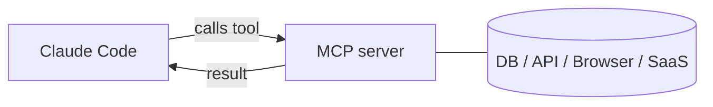

<LevelBadge level="advanced" />

<VerifyNote lastVerified="2026-11-10" source="https://code.claude.com/docs/en/mcp">
`claude mcp` 命令、配置作用域和传输方式都在不断演进——请在 Claude Code 官方 MCP 文档和 modelcontextprotocol.io 中确认。下文的四种传输方式、作用域存储路径、SSE 的弃用以及项目审批行为，均来自该页面。
</VerifyNote>

**Model Context Protocol（MCP）** 是一个用于把 AI 连接到外部工具和数据的开放标准。**MCP 服务器**对外暴露各种能力（查询数据库、创建 GitHub PR、操控浏览器）；Claude Code 连接到它，并能在会话中**调用这些工具**。这就是让 Claude 的能力超出你的文件系统和 shell 的方式。

<Callout type="objectives" items={["解释什么是 MCP 服务器，以及 Claude Code 如何调用它的工具", "区分两种传输方式：本地 stdio 与远程 HTTP/SSE", "用 claude mcp add 添加服务器，并读懂它写入的 JSON", "根据谁能看到某个服务器，选择合适的作用域（local、project、user）", "把一个真实的数据库端到端地连接到 Claude", "避开大多数人都会踩的安全与配置陷阱"]} />

## 整体结构



你声明 Claude 可以使用的服务器；每个服务器发布一组带有 schema 的工具；Claude 像使用其他工具一样挑选并调用它们。

<Flashcards title="MCP 词汇" cards={[{front: "Model Context Protocol（MCP）", back: "一个用于把 AI 连接到外部工具和数据的开放标准。"}, {front: "MCP 服务器", back: "一个把各种能力——查询数据库、创建 GitHub PR、操控浏览器——作为可调用工具暴露出来的程序。"}, {front: "工具（Tool）", back: "MCP 服务器连同 schema 一起发布的一项能力；Claude 像使用其他工具一样挑选并调用它。"}, {front: "传输方式（Transport）", back: "Claude 访问服务器的方式：stdio（本地进程）、HTTP（托管型，通常配合 OAuth）、SSE（已弃用——HTTP 会自动回退到它），或 WebSocket ws/wss（持久连接、支持推送、仅支持请求头认证，没有 --transport 标志）。"}, {front: "作用域（Scope）", back: "谁能看到某个服务器：local（你，仅此项目）、project（通过提交共享给团队）或 user（你，所有地方）。"}]} />

## 传输方式

Claude 访问服务器有四种方式。根据服务器运行的位置和通信方式来选择。

- **stdio** — 由 Claude 启动的本地进程（非常适合本地工具/CLI）。没有 `type` 的 JSON 条目指的就是它。
- **HTTP** — 托管型服务器，通常配合 OAuth。任何远程服务的默认选择。
- **SSE** — **已弃用**；能用 HTTP 就用 HTTP。有些服务仍然只提供 SSE 端点，而从 Claude Code v2.1.265 起，`--transport http` 会先尝试 HTTP，并自行切换到 SSE，因此你很少需要显式使用 `--transport sse`。
- **WebSocket**（`ws` / `wss`）— 持久的双向连接，适用于会主动推送事件的服务器。`--transport` *不*接受 `ws`：请用 `claude mcp add-json '{"type":"ws","url":"wss://…"}'` 添加，或直接写入 `.mcp.json`。不支持 OAuth——认证仅通过请求头。

<Callout type="warning" items={["有 url 却没有 type 的 JSON 条目是配置错误，而不是合理的默认值：Claude Code 会把没有 type 的条目当作 stdio 服务器来读取，直接跳过它，并报告它有 \"url\" 却没有 \"type\"。手写远程服务器时，务必设置 \"type\": \"http\"（或 \"sse\" / \"ws\"）。"]} />

## 配置服务器

最快的方式是 `claude mcp add` 命令——它会替你写好配置。按照下面的顺序，就能从零走到一个已连接的服务器。

<Steps items={[{title: "添加本地 stdio 服务器", body: "运行 claude mcp add——-- 之后的所有内容都是 Claude 替你执行的启动命令。"}, {title: "或者添加远程 HTTP 服务器", body: "传入 --transport http 和一个作用域，然后是服务器 URL。远程服务器通常是托管型的，并使用 OAuth。"}, {title: "查看已连接的服务器", body: "运行 claude mcp list，查看已配置的服务器及其连接状态。"}, {title: "检查并认证", body: "在会话中使用 /mcp 来检查服务器的工具，并对远程服务器进行认证。"}]} />

<PromptCard title="添加本地 stdio 服务器">{`# A local stdio server (everything after -- is the launch command)
claude mcp add filesystem -- npx -y @modelcontextprotocol/server-filesystem ~/code/myproject`}</PromptCard>

<PromptCard title="添加远程 HTTP 服务器（与项目共享）">{`# A remote HTTP server, shared with everyone on the project
claude mcp add --transport http --scope project github https://api.githubcopilot.com/mcp/`}</PromptCard>

底层其实就是 JSON。**project** 作用域的服务器会写入仓库根目录的 `.mcp.json`——把它提交后，队友一旦信任该工作区，就能获得同样的工具：

```json
{
  "mcpServers": {
    "github": { "type": "http", "url": "https://api.githubcopilot.com/mcp/" }
  }
}
```

<Callout type="warning" items={["不要使用旧教程里那些 @modelcontextprotocol/server-github、-postgres、-slack 或 -puppeteer 包。它们已被归档，并带有一条 npm 弃用通知：\"Archived and unmaintained; no security guarantees\"。有厂商自己的服务器时就用它——GitHub 的就是上面的 HTTP 端点，而浏览器控制已转移到 @playwright/mcp。在 TypeScript 参考服务器中，仍在维护的只有 filesystem、memory、everything 和 sequential-thinking。"]} />

### 作用域决定谁能看到服务器

| 作用域 | 存储位置 | 加载范围 | 适用场景 |
|---|---|---|---|
| `local`（默认） | `~/.claude.json`，位于此项目路径下 | 仅此项目 | 个人实验、机密信息 |
| `project` | 仓库中的 `.mcp.json`（已提交） | 仅此项目，与团队共享 | 整个团队都应共享的工具 |
| `user` | `~/.claude.json` | 你的所有项目 | 你希望随处可用的服务器 |

<Callout type="warning" items={["MCP 的“local 作用域”和本地设置不是一回事。local 作用域的 MCP 服务器保存在你主目录下的 ~/.claude.json 中——而不是项目的 .claude/settings.local.json。在项目文件夹里找它是白费力气。"]} />

运行 `claude mcp list` 查看已连接的内容，在会话中用 `/mcp` 检查工具并认证远程服务器。可复制粘贴的起步模板见 [MCP 配置与服务器脚手架](/docs/templates/mcp-config)。

## 实战示例：让 Claude 访问你的数据库

假设你想让 Claude 直接针对本地 Postgres 回答问题，而不是由你来粘贴查询结果。用 project 作用域添加服务器，这样队友也能用上。

数据库正是已归档服务器问题最严重的地方：旧的 `@modelcontextprotocol/server-postgres` 已无人维护，也没有官方的替代品，所以包名是唯一需要你自己做出的决定。挑一个仍在维护的社区服务器，[先审查它](/docs/security/reviewing-third-party-code)，然后接入——无论选哪个，形式都一样：

<PromptCard title="以 project 作用域添加 Postgres 服务器">{`# Replace the package with a maintained Postgres MCP server you have reviewed.
# The connection string is read-only on purpose — see below.
claude mcp add --scope project db -- npx -y <postgres-mcp-server> "postgresql://readonly@localhost/app"`}</PromptCard>

现在在会话中，你可以用日常语言提问，让 Claude 替你完成查询循环：

<PromptCard title="向数据库提问">{`How many users signed up last week? Check the DB.`}</PromptCard>

Claude 会调用服务器发布的查询工具，取回数据行并作答——不再需要复制粘贴的来回。除非 Claude 确实需要写入，否则请保持连接字符串为只读。而且如果你只想执行一次查询，请注意通过 Bash 运行 `psql -c '…'` 消耗的 token 只是其零头；[MCP 的 Token 税](/docs/claude-code/mcp-token-cost)介绍了两者各自何时更划算。

由于是 project 作用域，拉取仓库的队友会获得同样的能力——但**不是悄无声息，也不是立刻生效**。已提交的 `.mcp.json` 中的服务器会停留在 `⏸ Pending approval`，直到队友在该文件夹中运行 `claude` 并接受工作区信任对话框。克隆下来的仓库无法预先批准它自己的服务器：提交到项目 `.claude/settings.json` 中的 `enableAllProjectMcpServers` 或 `enabledMcpjsonServers`，在不受信任的文件夹中会被*忽略*。来自用户级 `~/.claude/settings.json`、托管设置，或通过 `--settings` 传入的批准，在那里则依然有效。这通常就是“为什么我的队友看不到这个服务器？”的答案。

## 信任与安全

<Callout type="warning" items={["MCP 服务器会运行代码，并能读取数据、执行操作——只连接你信任的服务器。", "给每个服务器它所需的最小权限。", "服务器返回的任何外部内容都可能携带提示词注入。", "连接第三方服务器之前先审查它们。"]} />

:::warning[把 MCP 服务器当作安装软件来对待]
MCP 服务器会运行代码，并能读取数据、执行操作。只连接你信任的服务器，给予它们所需的**最小权限**，并记住它们返回的任何外部内容都可能携带[提示词注入](/docs/security/prompt-injection)。请先审查第三方服务器——参见[审查第三方代码](/docs/security/reviewing-third-party-code)。
:::

## 应用中同样有 MCP

MCP 也为 Claude 应用中的**连接器**提供支持——同一个标准，不同的界面。参见[应用中的连接器（MCP）](/docs/claude-app/connectors)，以及面向 API 的 [MCP 与连接工具](/docs/api/mcp)。

## 常见错误

- **作用域选错。** 以 `local` 作用域添加的服务器不会出现在队友那里；只想自己用的服务器也不该以 `project` 作用域提交。请有意识地选择。
- **服务器太多，工具太多。** 工具搜索默认开启，所以一个已连接的服务器通常每轮只消耗它的工具*名称*和服务器说明，而不是完整的 schema——但这仍是每轮都要交的税，而且 Claude 一旦去搜索，这些 schema 就会进入上下文。连接任务所需的，而不是你的整个目录。真实数字、`ENABLE_TOOL_SEARCH` 的各种模式，以及代码执行如何削减第二项成本，见 [MCP 的 Token 税](/docs/claude-code/mcp-token-cost)。
- **权限过大的连接。** 除非 Claude 确实需要写入，否则给数据库服务器一个只读角色。MCP 让能力变得真实——请收窄它们。
- **忘记注入风险。** 服务器返回的任何内容（网页、issue 正文、一行数据）都是不受信任的文本，可能携带[提示词注入](/docs/security/prompt-injection)。不要在没想清楚的情况下，把一个强大的可写服务器与一个不受信任的可读服务器放在一起。

<Quiz title="自我检测" questions={[{q: "哪种传输方式是由 Claude 自己启动的本地进程？", options: ["远程 HTTP/SSE", "stdio", "OAuth"], answer: 1, explain: "stdio 是由 Claude 启动的本地进程——非常适合本地工具和 CLI。另外三个都是远程的：HTTP（通常配合 OAuth）、已弃用的 SSE，以及 WebSocket。"}, {q: "project 作用域的服务器写到哪里？队友需要做什么？", options: ["你的用户设置；只有你能看到", "仓库根目录的 .mcp.json；拉取之后，他们仍须信任该工作区，服务器才会脱离 Pending approval", "一个隐藏的全局缓存；谁也无法编辑"], answer: 1, explain: "project 作用域会写入仓库根目录中已提交的 .mcp.json。但克隆下来的仓库无法批准它自己的服务器——已提交的 enableAllProjectMcpServers 在不受信任的文件夹中会被忽略，所以服务器会停在 Pending approval，直到队友接受工作区信任对话框。"}, {q: "Claude 只需要读取时，为什么要让数据库连接保持只读？", options: ["这样查询运行得更快", "最小权限——MCP 让能力变得真实，因此除非确有必要，否则不要授予写入权限", "协议要求必须只读"], answer: 1, explain: "给服务器它所需的最小权限。MCP 让能力变得真实，所以只读角色可以避免意外写入。"}]} />

<Callout type="takeaways" items={["MCP 是开放标准；MCP 服务器暴露的工具，Claude Code 会像调用其他工具一样调用。", "四种传输方式：stdio（由 Claude 启动的进程）、HTTP（远程的默认选择）、SSE（已弃用——HTTP 会自行切换到它）和 WebSocket ws/wss（推送、请求头认证、仅能通过 add-json 添加）。", "claude mcp add 会替你写入配置；底层就是 JSON。project 作用域存放在已提交的 .mcp.json 中，队友的那份会停留在 Pending approval，直到他们信任该工作区。", "作用域控制可见性：local（你，仅此项目）、project（提交给团队）、user（你，所有地方）。", "把服务器当作安装软件来对待：信任、最小权限，并警惕它们返回的任何内容中的提示词注入。"]} />

## 下一步

- [构建并接入你的第一个 MCP 服务器（分步指南）](/docs/walkthroughs/first-mcp-server)
- [MCP 配置与服务器脚手架](/docs/templates/mcp-config)
- [保护智能体与工具](/docs/security/securing-agents)
