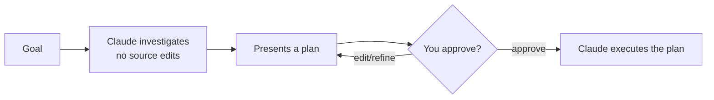

<LevelBadge level="beginner" />

<Callout type="objectives" items={["说明规划模式会阻止什么，以及它仍允许 Claude 运行什么", "用三种不同方式进入和退出规划模式", "走一遍“调查—提出方案—批准—执行”的循环", "区分规划模式与权限（Permissions），并配合使用"]} />

<VerifyNote lastVerified="2026-10-09" source="https://code.claude.com/docs/en/permission-modes">
进入规划模式的方式（快捷键/标志），以及它在规划期间究竟允许 Claude 运行哪些 shell 命令，会随版本变化——请查阅 Claude Code 官方文档。
</VerifyNote>

## 核心思路

想象一下：是直接把家门钥匙交给装修师傅，还是先请他走一遍现场，写下他打算改*什么*。规划模式就是那次现场勘查。

**规划模式**让 Claude **只研究并提出改动方案，而不实际改动**：它会读取文件、运行 shell 命令来探查、撰写方案——但**不会编辑你的源代码**。在你批准方案之前，编辑一直处于被阻止的状态。

<Callout type="tip" items={["规划模式意味着 Claude 只“调查”而不“改动”你的源代码——它产出一份方案，然后等你点头。"]} />

### 它并非严格只读

探查有时需要执行命令，所以规划模式的重点是*不编辑*，而不是*不执行*。规划期间 shell 命令会被如何处理取决于会话——以第一个匹配的情形为准：

<Steps items={[{title: "可使用 bypass permissions 的交互式终端会话", body: "规划模式的限制不会被强制执行。Claude 仍被指示在不编辑的前提下做规划，但它在规划期间尝试的编辑或命令会不经询问直接运行。在其他场景下规划模式仍保持其限制——无头 -p 运行、Agent SDK，以及 VS Code 扩展的聊天面板。"}, {title: "auto mode 可用且 useAutoModeDuringPlan 开启（默认）", body: "除关键路径的删除外，shell 命令由分类器审查，而不是向你询问。获批的命令会运行，被拒绝的会被阻止。"}, {title: "auto mode 不可用，或 useAutoModeDuringPlan 关闭", body: "超出内置只读集合的命令会提示你批准。"}]} />

<Callout type="warning" items={["如果你是用 --allow-dangerously-skip-permissions 启动的，规划模式只是一条强指令，而不是硬性护栏。请把它当作规划约定，而不是沙箱。"]} />

## 为什么这是最安全的起点

对于任何大型、有风险或不熟悉的工作，你都希望在 Claude 碰你的仓库之前，先看到它*打算做什么*。规划模式把**思考**与**动手**分开：

好处是：你能在错误的假设变成错误的代码*之前*就发现它们。

## 何时使用

<Callout type="tip" items={["大型或涉及多个文件的改动、迁移、重构时，一律使用", "在你还不完全了解的代码库中工作时", "当你想要一份可供评审、能分享给同事的方案时"]} />

对于微小、显而易见的编辑可以跳过——但拿不准时，先做规划。

## 实际如何运作

跟着这个循环走。每一步都为下一步铺路——只有在你批准*之后*，Claude 才会切换到编辑。

<Steps items={[{title: "进入规划模式并说明目标", body: "按 Shift+Tab 循环切换权限模式，直到状态栏显示 'plan mode on'；或在单条提示前加上 /plan 前缀。若想一开始就处于该模式，用 claude --permission-mode plan 启动。然后描述你想达成的目标。"}, {title: "Claude 进行调查", body: "它会读取相关文件、运行探查命令，并提出澄清问题。"}, {title: "Claude 返回分步方案", body: "包括要改动的文件、做法，以及如何验证结果。按 Ctrl+G 可在编辑器中打开提议的方案并直接修改。"}, {title: "你批准或要求细化", body: "选择 'Yes, and use auto mode'、'Yes, manually approve edits' 或 'No, keep planning'。批准会退出规划模式，进入该选项所描述的权限模式，Claude 随即开始编辑。"}]} />

若想不批准方案就退出规划模式，再按一次 `Shift+Tab`。若想让它成为项目终端会话的默认模式，请在 `.claude/settings.json` 中把 `defaultMode` 设为 `plan`——参见[设置](/docs/claude-code/settings)。

### 亲自试试

把下面这段复制到一次真实的规划会话里，看这个循环如何运转：

<PromptCard title="开始一次规划会话">{`I want to migrate our auth from sessions to JWT. Stay in Plan Mode: investigate the current setup, ask anything you need, then propose a step-by-step plan with files to change and how to verify — don't edit anything yet.`}</PromptCard>

:::tip[与 CLAUDE.md 搭配使用]
一份好的 [CLAUDE.md](/docs/claude-code/claude-md) 会让方案更精准——Claude 在规划时已经把你的约定和护栏放在心里。
:::

## 规划模式与权限

一个经典的混淆点。它们解决的是不同的问题，而且可以配合使用：

- **规划模式** = “先调查并提出方案，暂不编辑。”（本页内容。）
- **[权限（Permissions）](/docs/claude-code/permissions)** = 一旦开始行动，*哪些*操作无需询问即可执行。

可以这样理解：**现在要不要行动**（规划模式）与**行动时允许哪些操作**（权限）。

<Flashcards cards={[{front: "规划模式会让 Claude Code 处于什么状态？", back: "研究并提出方案：它读取文件、运行 shell 命令来探查、撰写方案，但不编辑你的源代码。在你批准之前，编辑一直被阻止。"}, {front: "如何进入和退出规划模式？", back: "用 Shift+Tab、在单条提示前加 /plan 前缀，或用 claude --permission-mode plan 进入。不批准而退出，再按一次 Shift+Tab。"}, {front: "规划模式的循环是什么？", back: "调查 → 提出方案 → 你批准或要求细化 → Claude 执行。"}, {front: "何时应该使用规划模式？", back: "对大型、有风险或不熟悉的工作（多文件改动、迁移、重构、陌生代码库）默认使用。只有微小、显而易见的编辑才可跳过。"}, {front: "规划模式 vs 权限？", back: "规划模式决定是否现在就行动；权限决定行动时允许哪些操作。"}]} />

<Callout type="takeaways" items={["规划模式是“研究并提出方案”：Claude 会读取并运行探查命令，但在你批准方案之前不会编辑你的源代码", "它并非严格只读——规划期间的命令要么由分类器审查，要么需要你确认，要么（在交互式终端且可使用 bypass permissions 时）完全不受阻止", "用 Shift+Tab、/plan 前缀或 --permission-mode plan 进入；批准后，会话会切换到所选批准选项所指明的模式", "对大型、有风险或不熟悉的工作默认使用；只跳过微小、显而易见的编辑", "规划模式决定是否现在就行动；权限决定行动时允许哪些操作"]} />

<Quiz title="自我检测" questions={[{q: "在规划模式下，Claude Code 可以做什么？", options: ["编辑文件并运行任何命令", "读取文件并运行 shell 命令来探查——但在你批准之前不编辑你的源代码", "只能回答问题，完全不能访问文件"], answer: 1, explain: "规划模式的重点是不编辑，而不是不执行。Claude 会读取文件并运行探查命令（视会话而定，由分类器审查或提示你确认），但对源代码的编辑在你批准方案之前一直被阻止。"}, {q: "何时应该使用规划模式？", options: ["仅用于一行的拼写修正", "用于大型或多文件改动、迁移、重构，或不熟悉的代码库", "永远不用——它只会拖慢你"], answer: 1, explain: "对于大型或多文件改动、迁移或重构，以及在你还不完全了解的代码库中工作时，都应一律使用。微小、显而易见的编辑可以跳过。"}, {q: "规划模式循环的正确顺序是什么？", options: ["先执行，再调查，然后批准", "在不编辑的情况下调查，提出方案，你批准或要求细化，然后 Claude 执行", "先批准，然后 Claude 调查并编辑"], answer: 1, explain: "Claude 在不编辑源代码的情况下调查，提出方案，由你批准或要求细化，之后才切换到执行方案。"}, {q: "规划模式与权限有何不同？", options: ["它们是同一个功能的两个名字", "规划模式 = 先调查并提出方案，暂不编辑；权限 = 一旦开始行动，哪些操作无需询问即可执行", "权限决定是否做规划；规划模式决定编辑哪些文件"], answer: 1, explain: "规划模式把思考与动手分开。权限控制 Claude 开始行动后哪些操作无需询问即可执行。两者配合使用。"}]} />

## 下一步

- [权限与权限模式](/docs/claude-code/permissions)
- [上下文管理](/docs/claude-code/context-management)——让长会话保持高效
- [实战演练：为真实仓库定制 Claude Code](/docs/walkthroughs/customize-claude-code)
