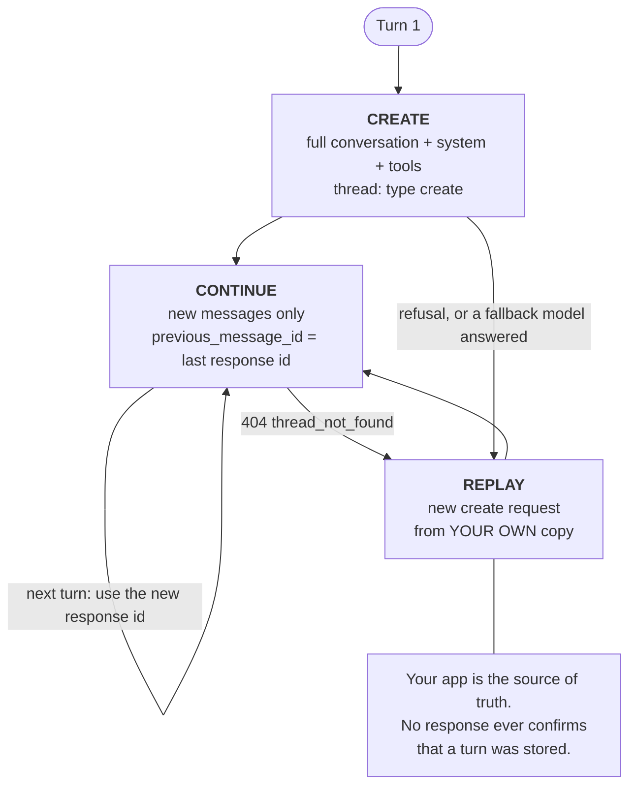

# Message Threads — Invia solo il nuovo turno

> Source: https://derob98.github.io/ailmanac/it/docs/api/message-threads · AILmanac (CC BY 4.0) · last verified 2026-11-03

La Messages API può tenere la conversazione sul server e farti inviare a ogni turno solo i nuovi messaggi. Cosa fa risparmiare davvero (byte e latenza, non token), il percorso di replay da costruire prima del rilascio, i tre gruppi di campi e il limite di 4 breakpoint di cache.

<LevelBadge level="advanced" />

<Callout type="objectives" items={[
  "Dire con precisione cosa fa risparmiare un thread — byte di richiesta e time to first token — e cosa no: i token, e quindi il denaro",
  "Eseguire il ciclo di vita a tre stati: create, continue, replay — e costruire il percorso di replay prima del rilascio, non dopo",
  "Classificare ogni parametro come create-only, fixed o free e riconoscere a colpo d'occhio un thread_fingerprint_mismatch",
  "Mantenere attivo il prompt caching su un thread entro il budget di 4 breakpoint",
  "Continuare in sicurezza un turno in streaming e capire perché continuare prima di message_stop restituisce un 404",
  "Gestire i cinque errori dei thread, più i due casi in cui devi avviare un thread completamente nuovo invece di recuperare",
  "Decidere se il tuo carico di lavoro è di quelli in cui i thread aiutano davvero"
]} />

<VerifyNote lastVerified="2026-11-03" source="https://platform.claude.com/docs/en/build-with-claude/message-threads">
I message threads sono entrati in **beta pubblica il 2 novembre 2026** dietro l'header `anthropic-beta: message-threads-2026-08-12`. Nomi dei campi, codici di errore, finestre di scadenza ed elenco delle funzioni non supportate sono citati dal riferimento ufficiale e possono cambiare finché la funzione è in beta — ricontrolla prima del rilascio. Disponibilità al momento della scrittura: Claude API, Claude Platform on AWS, Claude Models on Google Cloud (gestito da Anthropic) e Claude in Microsoft Foundry. **Non** disponibile su Amazon Bedrock. Il supporto dei modelli è ampio — vedi [l'elenco ufficiale dei modelli supportati](https://platform.claude.com/docs/en/build-with-claude/message-threads) e [Modelli e prezzi](/docs/whats-new/models-and-pricing).
</VerifyNote>

Un lungo agent loop paga una tassa silenziosa che con il modello non c'entra nulla. Al turno 40 la tua richiesta è di nuovo l'intera conversazione: ogni file letto, ogni screenshot, ogni risultato di tool. L'API deve riceverla tutta, validarla tutta e tokenizzarla tutta prima che il modello possa emettere anche un solo token. La conversazione ha smesso di essere l'*input* ed è diventata l'*upload*.

Un **message thread** elimina l'upload. Invii la conversazione completa una volta sola. Da quel momento ogni richiesta porta solo i nuovi messaggi più l'`id` della risposta precedente, e l'API ricostruisce la conversazione dal proprio lato prima di chiamare il modello.

## Cosa fa risparmiare davvero un thread

Leggi questa sezione prima di pianificare una migrazione, perché quasi ogni resoconto di seconda mano su questa funzione la riporta in modo sbagliato.

<Callout type="warning" items={[
  "I thread NON riducono il conto dei token. Anthropic è esplicita: Claude legge comunque l'intera conversazione a ogni turno, quindi l'uso dei token resta lo stesso. Prezzi e rate limit non cambiano.",
  "I numeri spettacolari che potresti aver visto citati — da centinaia di kilobyte a un paio di kilobyte — sono dimensioni del payload della richiesta, non token. Un upload più piccolo è un vero guadagno di latenza. Non è una fattura più leggera.",
  "La leva sui costi resta il prompt caching, e un thread non lo attiva al posto tuo. Vedi 'Prompt caching su un thread' più sotto."
]} />

Quello che ottieni è latenza e banda. Il dato misurato che Anthropic pubblica: per richieste nella fascia **500k–1M token**, il time to first token mediano scende di **circa il 35%**.

<VerifyNote lastVerified="2026-11-03" source="https://claude.com/resources/articles/message-threads">
Il dato di circa il 35% sul TTFT mediano vale specificamente per richieste da 500k–1M token; secondo Anthropic, più contesto porta un agente, più i thread aiutano. Le conversazioni brevi guadagnano poco — c'era poco upload da eliminare. La stessa fonte dichiara senza ambiguità che l'uso dei token resta lo stesso perché Claude legge comunque l'intera conversazione a ogni turno.
</VerifyNote>

Quindi la regola decisionale onesta:

| Il tuo carico di lavoro | I thread valgono la pena? |
|---|---|
| Coding agent lungo — ogni risultato di tool e modifica di file fa crescere la conversazione | **Sì.** È il caso per cui sono stati progettati. |
| Computer-use agent che carica uno screenshot a ogni turno | **Sì.** Gli screenshot restano nel thread invece di essere ricaricati. |
| Flusso multi-turno pesante su documenti o immagini | **Sì.** La riduzione di payload maggiore. |
| Chat con pochi turni brevi | **No.** Non c'è nulla di significativo da eliminare e ti prendi la complessità del replay. |
| Job batch, conteggio dei token, compaction on demand | **Impossibile.** Vedi [Funzioni che i thread non supportano](#funzioni-che-i-thread-non-supportano). |
| Ti serve zero data retention su questo traffico | **No.** I thread non sono idonei a ZDR. Vedi [Conservazione dei dati](#conservazione-dei-dati). |

:::tip[Thread e sessioni sono funzioni diverse]
I message threads vivono sulla Messages API. I **session threads** sono un concetto separato dentro [Claude Managed Agents](/docs/api/managed-agents). Stessa parola, livello diverso — non lasciare che il risultato di una ricerca per l'uno ti porti all'altro.
:::

## Il ciclo di vita a tre stati

<Steps items={[
  {title: "Create", body: "Invia la prima richiesta esattamente come fai oggi — conversazione completa, system, tools — e aggiungi il parametro thread con type 'create'. L'API memorizza la conversazione più la risposta di Claude sotto l'id della risposta. Invia l'header beta message-threads-2026-08-12 in questa e in ogni richiesta successiva del thread."},
  {title: "Continue", body: "Invia solo i messaggi successivi alla risposta precedente, con thread type 'continue' e previous_message_id impostato sull'id di quella risposta. Lascia FUORI system e tools — il thread mantiene i valori della richiesta create, e reinviare uno dei due, anche come null, è un errore 400. Usa ogni nuovo id di risposta per il turno successivo."},
  {title: "Replay", body: "Un thread è best-effort. Scade 5 minuti dopo la sua ultima richiesta e viene eliminato al massimo 1 ora dopo l'ultimo utilizzo; ogni risposta memorizzata fa ripartire i 5 minuti. Quando l'API non può più continuare, una richiesta continue restituisce 404 thread_not_found. Reinvia la conversazione completa in una nuova richiesta create e continua dall'id di quella risposta."}
]} />

### Create, poi continue

<PromptCard title="curl — create a thread, then send only the new turn">{`# Turn 1 — full conversation, system, tools, and thread: create
curl https://api.anthropic.com/v1/messages \\
  -H "x-api-key: $ANTHROPIC_API_KEY" \\
  -H "anthropic-version: 2023-06-01" \\
  -H "anthropic-beta: message-threads-2026-08-12" \\
  -H "content-type: application/json" \\
  -d '{
    "model": "claude-opus-5-5",
    "max_tokens": 1024,
    "cache_control": {"type": "ephemeral"},
    "system": "You are a support agent for Acme. Keep replies short.",
    "messages": [{"role": "user", "content": "Hi! I have a question about an order."}],
    "thread": {"type": "create"}
  }'

# Turn 2 — only the new message. No system, no tools.
# message_id is the id from the turn-1 response.
curl https://api.anthropic.com/v1/messages \\
  -H "x-api-key: $ANTHROPIC_API_KEY" \\
  -H "anthropic-version: 2023-06-01" \\
  -H "anthropic-beta: message-threads-2026-08-12" \\
  -H "content-type: application/json" \\
  -d '{
    "model": "claude-opus-5-5",
    "max_tokens": 1024,
    "cache_control": {"type": "ephemeral"},
    "messages": [{"role": "user", "content": "How long does standard shipping usually take?"}],
    "thread": {"type": "continue", "previous_message_id": "'"$message_id"'"}
  }'`}</PromptCard>

Gli SDK ufficiali includono un **thread helper** che costruisce queste richieste per te — aggiunge l'header beta, esegue create al primo turno, continue dopo, omette `system` e `tools` e riesegue il replay una volta su un 404. È la scelta predefinita giusta. La forma grezza qui sopra serve quando usi l'API da un linguaggio senza helper, da un gateway o da `curl`.

## I tre gruppi di campi

È la tabella da appendere sopra la scrivania. Ogni parametro di una richiesta thread appartiene esattamente a un gruppo, e il gruppo decide se puoi inviarlo, devi inviarlo o puoi cambiarlo.

| Gruppo | Campi | Regola |
|---|---|---|
| **Create-only** | `system`, `tools` | Da inviare **solo nella richiesta create**, con gli eventuali breakpoint `cache_control` su di essi. Inviarli in una richiesta continue — anche come `null` — restituisce un 400. |
| **Fixed** | `model`, `tool_choice`, `thinking`, `mcp_servers` (tranne il token di autorizzazione di ciascun server), `context_management`, `output_config`, le `skills` dentro `container`, il `cache_control` di primo livello e l'insieme dei valori `anthropic-beta` | Da inviare in **ogni** richiesta, con lo **stesso valore** della richiesta create. Un valore diverso restituisce 400 `thread_fingerprint_mismatch`, e il messaggio di errore indica i campi che differiscono. |
| **Free** | `max_tokens`, `stop_sequences`, `stream`, `metadata`, `service_tier` e tutto ciò che non è nominato sopra | Si possono cambiare liberamente da un turno all'altro. |

Due eccezioni da ricordare:

- **Gli URL dei server MCP, i token di autorizzazione MCP e l'`id` del container non vengono memorizzati.** Invia `mcp_servers` e `container` in ogni richiesta che li usa. Il token di autorizzazione può cambiare tra una richiesta e l'altra.
- **`fallbacks` è tutto o niente.** Se usi il [server-side fallback](/docs/api/server-side-fallbacks), invia `fallbacks` in ogni richiesta del thread oppure in nessuna. Aggiungerlo o toglierlo a metà thread è un `thread_fingerprint_mismatch`. Il suo *valore* può cambiare.

Per cambiare un campo create-only o fixed non modifichi il thread — ne avvii uno nuovo con una richiesta create che porta i nuovi valori.

:::warning[Cambiare `system` o `tools` può invalidare il thinking preservato]
Su Claude Fable 5.1, Mythos 5.1, Opus 5.5, Sonnet 5.5 e Haiku 5.5, avviare un thread nuovo con un `system` o dei `tools` diversi rende non validi i blocchi `thinking` e `redacted_thinking` già presenti nella conversazione, e la richiesta create può restituire un 400. La soluzione: rimuovi ogni blocco `thinking` e `redacted_thinking` dalla conversazione che invii. Il modello risponde allora senza quel ragionamento precedente. Vedi [Thinking e effort](/docs/api/thinking-and-effort).
:::

## Il percorso di replay non è opzionale

<Callout type="warning" items={[
  "La tua applicazione resta la fonte di verità. Tieni una tua copia di ogni messaggio.",
  "Nessuna risposta — né create né continue — ti dice se l'API ha memorizzato quel turno. Lo scopri alla richiesta continue SUCCESSIVA, quando funziona oppure restituisce 404.",
  "Il thread helper dell'SDK tiene la sua copia in memoria finché l'oggetto helper è in vita, e non la salva altrove. Se la conversazione deve sopravvivere al tuo processo, persistila tu.",
  "Costruisci il replay dal primo giorno. Un thread che non è mai scaduto in sviluppo scadrà in produzione alla prima chiamata a un tool lenta."
]} />

Un 404 con `error.details.error_code` impostato a `thread_not_found` significa "non posso continuare questo", e la risposta deliberatamente non dice perché. Le cause documentate:

- Il thread è scaduto (5 minuti di inattività).
- L'API ha servito il turno precedente ma **non lo ha memorizzato** — per esempio una risposta che termina con una chiamata a un tool troncata da `max_tokens`.
- Un **modello di fallback** ha scritto la risposta precedente.
- La risposta precedente è **ancora in generazione**.
- La richiesta proviene da un'organizzazione, un workspace, un utente o un service account diverso. Un thread creato con una chiave del workspace resta legato a quella chiave.
- I nuovi messaggi aggiungono qualcosa che la conversazione memorizzata non può accettare — l'esempio classico è la **prima immagine** in una conversazione che non ne aveva.

:::tip[Controlla il codice di errore prima di fare il replay]
Anche la richiesta di un modello inesistente restituisce 404. Ramifica su `error.details.error_code`, mai sul solo status.
:::

Per recuperare: invia la conversazione completa dalla tua copia in una **nuova richiesta create**, con `system` e `tools`, poi continua dall'`id` della nuova risposta. Prima rimuovi i breakpoint `cache_control` dai messaggi precedenti (vedi il budget di 4 breakpoint più sotto) — l'helper dell'SDK lo fa per te.

**Se una create di replay riesce ma la continue immediatamente successiva restituisce di nuovo 404**, l'API potrebbe non essere in grado di memorizzare quella conversazione — per esempio perché è molto grande. Smetti di usare `thread` per quella conversazione e invia richieste normali. L'helper dell'SDK automatizza esattamente questo se lo costruisci con `unsupported_request_behavior` impostato a `continue_unthreaded`; senza questa impostazione farà il replay a ogni singolo turno, il che è strettamente peggio che non usare un thread.

### Append-only, e una sola continue per `id`

Un thread cresce soltanto. Ogni `id` di risposta può essere continuato **esattamente una volta**, e continui sempre dall'`id` **più recente**. Ne derivano tre conseguenze:

- **Niente modifiche, niente ramificazioni.** Per cambiare un messaggio precedente o esplorare un'alternativa, avvia un nuovo thread.
- **Niente riassunto sul posto.** In un thread non si possono sostituire i primi turni con un riassunto. Per compattare, scrivi il riassunto nel tuo codice e invialo come normale messaggio in una **nuova** richiesta create. La [compaction on demand](/docs/api/compaction) non è disponibile con i thread.
- **Ritentare una continue non è idempotente.** Se lanci due volte la stessa continue, la seconda riceve `thread_already_continued` o `thread_continue_in_flight`.

L'API **non** deduplica i messaggi che invii in una continue. Se reinvii un messaggio può comparire due volte nella conversazione, oppure dare errore. Una richiesta continue che inizia con la *risposta* precedente dà errore a priori.

### Il caso particolare di `pause_turn`

Quando una risposta si ferma con `stop_reason: "pause_turn"`, riprendila con una richiesta continue dall'`id` di quella risposta e una lista `messages` **vuota**:

<PromptCard title="Resume a paused turn — empty messages, same thread">{`{
  "model": "claude-opus-5-5",
  "max_tokens": 1024,
  "cache_control": {"type": "ephemeral"},
  "messages": [],
  "thread": {"type": "continue", "previous_message_id": "msg_01..."}
}`}</PromptCard>

**Non** inviare un nuovo messaggio utente mentre il turno è in pausa — l'API lo rifiuta. Se la ripresa restituisce 404, rifai il replay dell'intera conversazione *inclusa la risposta in pausa* in una nuova richiesta create. Con l'helper dell'SDK, chiama `send()` senza messaggi.

### Dopo un rifiuto, ricomincia

Quando una risposta ha `stop_reason: "refusal"`, **non continuare il thread.** L'API potrebbe già conservare il turno rifiutato, e una continue non può rimuoverlo. Avvia un nuovo thread con una richiesta create che ometta o riformuli il turno che ha causato il rifiuto. Vedi [Rifiuti e sicurezza](/docs/api/refusals-and-safety). L'helper dell'SDK se ne occupa: scarta il turno rifiutato e la sua chiamata successiva avvia un nuovo thread.

## Prompt caching su un thread

Un thread e una cache sono ortogonali. **Un thread non mette in cache il tuo prompt al posto tuo** — il [prompt caching](/docs/api/prompt-caching) si comporta esattamente come senza thread, e sei tu a decidere dove mettere i breakpoint. Se lo salti, ottieni un thread più veloce da caricare e costoso come prima.

La ricetta semplice: invia un **`cache_control` di primo livello** in ogni richiesta del thread. L'API lo applica all'ultimo blocco cacheable dei `messages` di quella richiesta, così ogni turno legge dalla cache la conversazione precedente e vi scrive il nuovo turno. Ricorda che il `cache_control` di primo livello è un campo **fixed** — stesso valore in ogni richiesta, altrimenti ottieni un fingerprint mismatch.

Se posizioni tu i breakpoint sui blocchi, valgono quattro regole:

1. I breakpoint inviati nella richiesta create continuano a funzionare nei turni successivi se stanno su `tools`, su `system` o su un blocco di messaggio che non è l'ultimo. Un breakpoint sull'**ultimo** blocco di una richiesta scrive la cache in *quella* richiesta — quindi per mettere in cache ogni nuovo turno, ne invii uno in ogni richiesta.
2. **Non puoi spostare né rimuovere** un breakpoint dopo averlo inviato, perché una richiesta continue non può mai reinviare un messaggio precedente.
3. **Il budget è di 4 breakpoint per richiesta thread.** Il `cache_control` di primo livello ne conta uno. I breakpoint su `system` e `tools` della richiesta create contano **di nuovo a ogni richiesta continue**. I breakpoint sui messaggi *memorizzati* precedenti non contano. Se lo superi ottieni 400 `thread_unsupported_request` con `unsupported: ["cache_control"]`.
4. Quando fai il replay, rimuovi i breakpoint dai messaggi precedenti e tienine uno sull'ultimo blocco — altrimenti è il replay stesso a sforare il budget.

:::tip[Fai il conto una volta]
`cache_control` di primo livello (1) + un breakpoint su `system` (2) + uno su `tools` (3) ti lascia esattamente **uno** spare in ogni richiesta continue. È un budget attorno a cui si può progettare, ma non da usare con leggerezza.
:::

Per la versione cross-provider di questo compromesso, vedi [Prompt caching tra provider](/docs/models/prompt-caching-across-providers).

## Streaming

I thread funzionano con lo [streaming](/docs/api/streaming), con una regola di tempismo facile da sbagliare.

L'`id` della risposta arriva presto, nell'evento `message_start`. **Non continuare da esso finché non hai ricevuto `message_stop`.** Una continue inviata prima può restituire 404, perché la risposta precedente è ancora in generazione.

Se lo stream di una richiesta continue cade prima di `message_stop`, reinvia la stessa identica richiesta continue. Se *quella* restituisce `thread_already_continued` o `thread_continue_in_flight`, rifai il replay dell'intera conversazione in una nuova richiesta create. L'ambiguità è intrinseca: la tua connessione può essere caduta prima che il server salvasse la risposta, oppure dopo. Il replay è sempre sicuro; il retry a volte no.

L'helper dell'SDK **non** ritenta una continue dopo uno stream interrotto. Conserva i blocchi completati e il testo arrivato, e il turno successivo rifà il replay dell'intera conversazione. Per reinviare invece il turno interrotto, chiama `send()` senza messaggi. E leggi ogni stream fino alla fine — l'helper registra la risposta a `message_stop`, quindi abbandonare uno stream a metà lascia il thread occupato finché non lo chiudi (esci dal blocco `with` in Python, `abort()` in TypeScript, `Close`/`close()` altrove).

## Errori

Tutti e cinque vengono restituiti **prima che il modello giri**: la richiesta non consuma token, e né il thread né la sua scadenza cambiano.

| Status | `error_code` | Significato | Cosa fare |
|---|---|---|---|
| 404 | `thread_not_found` | L'API non può continuare il thread. | Replay: conversazione completa in una nuova richiesta create. |
| 400 | `thread_fingerprint_mismatch` | Un campo fixed differisce dal valore memorizzato. Il messaggio dice quale. | Mantieni identici i campi fixed, oppure avvia un nuovo thread per cambiarne uno. |
| 400 | `thread_already_continued` | Quell'`id` di risposta è già stato continuato. | Continua dall'`id` più recente. Se il tuo client non ha mai visto quella risposta, fai il replay. |
| 400 | `thread_continue_in_flight` | Un'altra continue da questo `id` è ancora in corso — di solito un tuo stesso retry. | Lasciala finire e continua dalla sua risposta, oppure fai il replay. |
| 400 | `thread_unsupported_request` | La richiesta usa una funzione o un'impostazione dell'organizzazione che i thread non supportano. `error.details.unsupported` la nomina quando presente. | Rimuovi la funzione, oppure invia la richiesta senza `thread`. |

`error.type` è `invalid_request_error` per i 400 e `not_found_error` per il 404. Alcuni 400 sulle richieste thread **non** portano alcun `error_code` — una continue senza `previous_message_id`, o una che include `system` o `tools`.

<PromptCard title="A thread error body — note where error_code actually lives">{`{
  "type": "error",
  "error": {
    "type": "invalid_request_error",
    "message": "thread: a maximum of 4 blocks with cache_control may be provided when \`thread\` is set. Found 5.",
    "details": {
      "error_code": "thread_unsupported_request",
      "unsupported": ["cache_control"]
    }
  },
  "request_id": "req_011CSHoEeqs5C35K2UUqR7Fy"
}`}</PromptCard>

I valori documentati di `error.details.unsupported` sono `context_management`, `cache_control`, `fallbacks`, `hipaa` e `inference_hooks`. Anthropic può aggiungerne — quindi tratta un valore non riconosciuto come "invia questa richiesta senza `thread`" e non come un bug del tuo client. Una richiesta che incappa in più condizioni ne riceve segnalata una sola.

## Funzioni che i thread non supportano

- **[Message Batches](/docs/api/message-batches).** Un elemento di batch che contiene `thread` fallisce con un `invalid_request_error` nei risultati.
- **Conteggio dei token.** Una richiesta di conteggio dei token con `thread` è un 400. Conta invece la conversazione completa, con `system` e `tools`. Vedi [Token e prezzi](/docs/api/tokens-and-pricing).
- **[Compaction](/docs/api/compaction).** La compaction on demand non è disponibile con i thread.
- **[Context editing](/docs/api/memory-and-context-editing)** — con una sola eccezione: `clear_thinking_20251015` con `keep: "all"`.
- **Organizzazioni con la HIPAA readiness attiva.**
- **Organizzazioni con gli [Inference hooks](/docs/api/inference-hooks) attivi.** Da segnalare a chi gestisce la tua organizzazione: un'impostazione a livello di piattaforma abilitata da qualcun altro può rendere i thread inutilizzabili per tutto il tuo team.

Altri due limiti rigidi: **non esiste alcuna API per elencare, leggere o eliminare un thread**, e i thread non sono disponibili su Amazon Bedrock.

## Conservazione dei dati

I message threads **non sono idonei a ZDR**. Usarli non influisce sull'uso delle altre funzioni idonee a ZDR — l'ambito è questo traffico, non il tuo account.

Cosa contiene il thread: la conversazione inviata al modello, `system` e `tools` della richiesta create e un fingerprint dei campi fixed. È tenuto **in memoria, cifrato con una chiave gestita dal server, mai scritto su storage durevole, ed eliminato al massimo 1 ora dopo l'ultimo utilizzo del thread.** I file sono tenuti **per riferimento**, quindi ogni file usato dalla conversazione deve restare disponibile finché usi il thread.

Se la tua postura di compliance richiede ZDR su un carico di lavoro, quel carico non può usare i thread. Vedi [Privacy](/docs/foundations/privacy).

## Errori comuni

| Errore | Sintomo | Soluzione |
|---|---|---|
| Aspettarsi una fattura più bassa | Fattura invariata | I thread tagliano byte e TTFT, non token. Aggiungi il [prompt caching](/docs/api/prompt-caching) per i costi. |
| Reinviare `system` in una continue | 400, senza `error_code` | È create-only. Omettilo — anche `null` fallisce. |
| Ritoccare `thinking` o `tool_choice` a metà thread | `thread_fingerprint_mismatch` | Campi fixed. Avvia un nuovo thread per cambiarne uno. |
| Considerare la risposta una prova di memorizzazione | 404 a sorpresa più tardi | Nulla conferma la memorizzazione. Costruisci il replay. |
| Continuare da `message_start` | 404 intermittenti sotto carico | Aspetta `message_stop`. |
| Retry alla cieca di una continue interrotta | `thread_already_continued` | Riprova una volta, poi fai il replay. Il replay è sempre sicuro. |
| Continuare dopo un rifiuto | Conversazione compromessa | Avvia un nuovo thread senza quel turno. |
| Breakpoint su `system` + `tools` + primo livello + per turno | `thread_unsupported_request` | Il budget è 4, e i breakpoint di `system`/`tools` si ricontano a ogni turno. |
| Inviare un nuovo messaggio utente durante `pause_turn` | Rifiutato | Continua con `"messages": []`. |
| Helper che fa il replay a ogni singolo turno | Latenza *peggiore* che senza thread | Imposta `unsupported_request_behavior` a `continue_unthreaded`. |

<Quiz questions={[
  {
    q: "Sposti un coding agent da 40 turni sui message threads e i payload delle richieste passano da ~600 KB a ~2 KB. Cosa succede alla tua fattura API mensile?",
    options: [
      "Scende più o meno in proporzione, dato che invii molti meno dati",
      "Resta uguale — Claude legge comunque l'intera conversazione a ogni turno, quindi l'uso dei token non cambia",
      "Scende di circa il 35%, in linea con il miglioramento del TTFT",
      "Sale, perché l'API addebita lo storage dei thread"
    ],
    answer: 1,
    explain: "Anthropic lo dice chiaramente: Claude legge comunque l'intera conversazione a ogni turno, quindi l'uso dei token resta lo stesso, e i thread non cambiano prezzi né rate limit. Le cifre in kilobyte sono dimensioni del payload della richiesta. Il ~35% è il time to first token mediano su richieste da 500k–1M token, non un dato di costo. La leva sui costi resta il prompt caching — e un thread non lo attiva al posto tuo."
  },
  {
    q: "Al turno 12 di un thread arriva un 404 con error_code thread_not_found. Qual è il recupero corretto?",
    options: [
      "Ripetere la stessa richiesta continue — è un errore transitorio",
      "Continuare invece dall'id di risposta di due turni prima",
      "Inviare la conversazione completa dalla propria copia in una nuova richiesta create, con system e tools, poi continuare dal nuovo id di risposta",
      "Chiamare l'endpoint di eliminazione del thread e creare un thread nuovo"
    ],
    answer: 2,
    explain: "Un thread è best-effort e il 404 non dice mai perché — può essere scadenza, un turno non memorizzato, un modello di fallback, una chiave API diversa o contenuto nuovo che la conversazione memorizzata non può accettare. L'unico recupero è il replay dalla propria copia in una nuova richiesta create, con system e tools ripristinati, rimuovendo i breakpoint cache_control dai messaggi precedenti. Non esiste alcuna API per elencare, leggere o eliminare un thread."
  },
  {
    q: "La tua richiesta create mette un breakpoint cache_control su system, uno su tools e invia un cache_control di primo livello. Quanti breakpoint restano disponibili in ogni richiesta continue?",
    options: [
      "Tre — si porta dietro solo quello di primo livello",
      "Uno — il limite è 4, quello di primo livello ne conta uno e i breakpoint di system e tools si ricontano a ogni turno",
      "Quattro — i breakpoint sui campi create-only non contano nelle richieste continue",
      "Zero — i breakpoint di system e tools consumano l'intero budget"
    ],
    answer: 1,
    explain: "Una richiesta thread ammette al massimo 4 breakpoint cache_control. Il cache_control di primo livello ne conta uno, e i breakpoint su system e tools della richiesta create contano di nuovo a ogni richiesta continue — 3 usati, 1 libero. Solo i breakpoint sui messaggi memorizzati precedenti sono gratuiti. Superare il limite restituisce 400 thread_unsupported_request con unsupported: [\"cache_control\"]."
  },
  {
    q: "Quale di queste cose puoi fare su un thread esistente?",
    options: [
      "Sostituire i primi venti turni con un riassunto usando la compaction on demand",
      "Ramificare la conversazione continuando due volte dallo stesso id di risposta",
      "Cambiare max_tokens da un turno al successivo",
      "Passare il modello da Sonnet a Opus per un singolo turno difficile"
    ],
    answer: 2,
    explain: "max_tokens è un campo free e può cambiare a ogni turno. model è fixed (un cambio è thread_fingerprint_mismatch). Un thread è append-only e ogni id di risposta può essere continuato esattamente una volta, quindi ramificare è impossibile. La compaction on demand è esplicitamente non supportata con i thread — per compattare, scrivi tu il riassunto e invialo come normale messaggio in una nuova richiesta create."
  }
]} />

<Callout type="takeaways" items={[
  "Un thread scambia upload con stato: invii la conversazione una volta, poi solo i nuovi messaggi più previous_message_id. Header beta message-threads-2026-08-12 in ogni richiesta.",
  "Compra byte e latenza — circa il 35% di TTFT mediano in meno su richieste da 500k–1M token — e nient'altro. Uso dei token, prezzi e rate limit non cambiano.",
  "Classifica ogni parametro: system e tools sono create-only; model, thinking, tool_choice, context_management, output_config e il cache_control di primo livello sono fixed; max_tokens e simili sono free.",
  "La tua app è la fonte di verità. Nessuna risposta conferma la memorizzazione, un thread scade dopo 5 minuti di inattività e l'unico recupero è rifare il replay dell'intera conversazione in una nuova richiesta create.",
  "Append-only, una continue per id di risposta: niente modifiche, niente ramificazioni, niente compaction sul posto. Cambiare qualcosa di fixed significa un nuovo thread.",
  "Il caching resta compito tuo. Il cache_control di primo livello in ogni richiesta è la ricetta semplice, dentro un budget rigido di 4 breakpoint in cui system e tools si ricontano a ogni turno.",
  "Streaming: continua solo dopo message_stop. Ritenta una continue interrotta una volta; poi fai il replay — il replay è sempre sicuro.",
  "Non per batch, conteggio dei token, compaction, la maggior parte del context editing, organizzazioni con HIPAA attivo, organizzazioni con inference hooks attivi, Amazon Bedrock, o qualunque carico di lavoro che richieda ZDR."
]} />

## Fonti e approfondimenti

- [Anthropic: Message threads](https://platform.claude.com/docs/en/build-with-claude/message-threads) — il riferimento autorevole: il parametro `thread`, i tre gruppi di campi, la tabella degli errori, il contratto dell'helper SDK, l'elenco delle funzioni non supportate e la dichiarazione sulla conservazione dei dati.
- [Anthropic API release notes](https://platform.claude.com/docs/en/release-notes/api) — la voce della beta pubblica del 2 novembre 2026, con finestre di scadenza e disponibilità per piattaforma.
- [Anthropic: Make long-running agents faster with message threads](https://claude.com/resources/articles/message-threads) — il dato di circa il 35% sul TTFT mediano per richieste da 500k–1M token, i tre carichi di lavoro che ne beneficiano di più e la dichiarazione che l'uso dei token resta lo stesso.
- [Anthropic: Prompt caching](https://platform.claude.com/docs/en/build-with-claude/prompt-caching) — la lunghezza minima cacheable che un `cache_control` di primo livello deve raggiungere prima di avere effetto.
- Pagine collegate di AILmanac: [Prompt Caching e ottimizzazione dei costi](/docs/api/prompt-caching) · [Conversation Compaction](/docs/api/compaction) · [Streaming](/docs/api/streaming) · [Server-Side Fallbacks](/docs/api/server-side-fallbacks)

## Avanti

- [Stato della conversazione lato server tra provider](/docs/models/server-side-conversation-state) — OpenAI e Google hanno rilasciato la stessa idea con contratti di durabilità, conservazione e fatturazione completamente diversi. Leggila prima di costruire un'astrazione sopra tutti e tre.
- [Prompt Caching e ottimizzazione dei costi](/docs/api/prompt-caching) — la funzione che abbassa davvero la fattura, e quella che un thread lascia interamente a te
- [Conversation Compaction](/docs/api/compaction) — cosa fare quando la conversazione è troppo grande per essere inviata, cosa che nessun thread può risolvere
