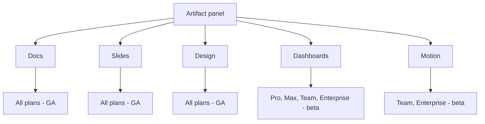

# Claude Dashboards e Claude Motion

> Source: https://derob98.github.io/ailmanac/it/docs/claude-app/dashboards-and-motion · AILmanac (CC BY 4.0) · last verified 2026-10-20

L'8 ottobre 2026 Claude ha ottenuto due nuovi template per gli artifact: Dashboards, che scrive una query SQL per grafico sul tuo data warehouse, e Motion, che anima tramite codice modificabile invece di video generato. Cosa sono davvero, la matrice dei piani, il modello di condivisione che confonde tutti e quando non usarli.

<LevelBadge level="beginner" />

<VerifyNote lastVerified="2026-10-20" source="https://support.claude.com/en/articles/17153992-what-are-artifacts-and-how-do-i-use-them">
Annunciati l'**8 ottobre 2026**. **Claude Dashboards** è in beta su **Pro, Max, Team ed Enterprise**; **Claude Motion** è in beta solo su **Team ed Enterprise**. Lo stesso giorno **Docs, Slides e Design sono usciti dalla beta e sono diventati disponibili su ogni piano, Free incluso** — su Enterprise sono stati attivati di default il **15 ottobre 2026**. Entrambe le beta sono disattivate di default su Enterprise finché un owner non le abilita. Disponibilità ed elenchi dei connettori cambiano in fretta: conferma nel Help Center prima di costruire su qualsiasi cosa qui descritta.
</VerifyNote>

Due nuovi **template** sono arrivati nel pannello degli artifact l'8 ottobre 2026, e non sono varianti di quelli già presenti. **Claude Dashboards** si spinge *fuori* dalla conversazione, nel tuo data warehouse. **Claude Motion** produce qualcosa che gli altri template non possono: un'immagine in movimento — e la produce come codice, non come video.

Lo stesso annuncio ha chiuso in silenzio la beta di **Docs, Slides e Design**, che ora sono su ogni piano, Free incluso. Se leggi una pagina di AILmanac (o la guida di chiunque altro) scritta prima dell'8 ottobre che dice che quei tre sono "a pagamento, in beta", quella frase ora è sbagliata.

<Callout type="objectives" items={[
  "Distinguere Dashboards e Motion dai template che hai già e da un artifact semplice",
  "Sapere esattamente quale piano ottiene cosa e cosa deve attivare un owner Enterprise",
  "Capire l'unico meccanismo dietro ciascuno: una query SQL per grafico e un'animazione compilata da codice modificabile",
  "Evitare la trappola della condivisione — chi vede cosa quando condividi una dashboard e perché un artifact collegato a un connettore non può mai avere un link pubblico",
  "Riconoscere i tre lavori per cui questi sono lo strumento sbagliato",
  "Agire sulla scadenza del 14 dicembre 2026 di Claude Design prima che passi"
]} />

## I cinque template, a colpo d'occhio

| Template | Cosa produce | Piani | Stato |
| --- | --- | --- | --- |
| **Docs** | Un documento vivo a più schede | Tutti, Free incluso | GA |
| **Slides** | Una presentazione pronta da mostrare | Tutti, Free incluso | GA |
| **Design** | Visual, mockup, prototipi | Tutti, Free incluso | GA |
| **Dashboards** | Grafici guidati da query dal vivo sui tuoi dati | Pro, Max, Team, Enterprise | Beta |
| **Motion** | Una breve animazione, esportata in MP4 | Team, Enterprise | Beta |

Su **Enterprise**, entrambi i nuovi template sono **disattivati finché un owner non li attiva** nelle impostazioni dell'organizzazione, sotto Artifacts — e un owner può limitare l'accesso a gruppi specifici con ruoli personalizzati. Su **Team**, Motion è **attivo di default**.

## Claude Dashboards

### Il meccanismo, in una frase

Fai una domanda in linguaggio naturale; **Claude scrive una query SQL per ogni grafico e la esegue sulla tua fonte di dati.** Questo è tutto il prodotto, e capirlo spiega ogni punto di forza e ogni limite che seguono.

Data warehouse supportati: **Amazon Redshift, BigQuery, ClickHouse, Databricks e Snowflake**. Può anche leggere le app che hai già collegato a Claude, con **Salesforce** in primo piano.

### Perché la query per grafico conta

Poiché ogni grafico poggia su una query nominata e non sul ricordo di un modello, una dashboard è **verificabile in un modo che una risposta in chat non è**. Ogni grafico mostra **la propria query** e **quando i suoi dati sono stati aggiornati l'ultima volta**. Questo capovolge il solito problema di fiducia: invece di chiederti "Claude ha allucinato questo numero?", clicchi sul grafico e leggi l'SQL che lo ha prodotto.

È l'unica abitudine che vale la pena formare dal primo giorno.

<Steps items={[
  {title: "Chiedi la decisione, non il grafico", body: "\"Costruisci una dashboard della pipeline di questo trimestre per regione\" ti dà un grafico. \"Devo decidere dove spostare due commerciali il prossimo trimestre — mostrami cosa me lo direbbe\" ti dà un grafico più il confronto che lo rende utilizzabile. L'indicazione di Anthropic stessa è di dire cosa vuoi sapere, non solo cosa disegnare."},
  {title: "Nomina le tabelle o l'app", body: "Di' dove stanno i dati. Indicare una tabella specifica del warehouse o un'app collegata fa la differenza tra una query e tre tentativi a vuoto."},
  {title: "Apri la query di ogni grafico prima di fidarti del numero", body: "È il passaggio che le persone saltano. Leggi l'SQL: controlla l'intervallo di date, il filtro, il join e se conta righe o somma una colonna. Un numero dall'aria corretta ottenuto con il filtro sbagliato è il vero modo di fallire qui, non l'invenzione."},
  {title: "Perfeziona in modo conversazionale", body: "\"Aggiungi un filtro per regione\", \"separa nuovo e rinnovo\", \"usa i trimestri fiscali\". Claude riscrive la query invece di ridisegnare un'immagine statica."},
  {title: "Passa il testimone quando si fa profondo", body: "L'impostazione di Anthropic è esplicita: le dashboard sono pensate per domande rapide ed esplorative. Quando una domanda richiede un'analisi vera, manda la dashboard a uno strumento fatto per questo."}
]} />

<PromptCard title="Una richiesta di dashboard che produce qualcosa su cui agire">{`Build me a dashboard from our Snowflake warehouse (schema: SALES_PROD).

The decision I'm making: which two regions get the next headcount.

Show me:
  1. Closed-won revenue by region, last 4 fiscal quarters, as a trend
  2. Win rate by region over the same period
  3. Average deal cycle in days by region
  4. Open pipeline by region, split new business vs renewal

Rules:
- Use fiscal quarters, not calendar.
- Exclude deals marked is_test = true.
- For every chart, label the exact table you queried.
- If a field I named doesn't exist, say so and ask — do not substitute
  a similar-sounding column.`}</PromptCard>

Quest'ultima regola si è guadagnata il posto. L'errore più subdolo di una dashboard non è un grafico rotto — è un grafico plausibile costruito su `amount` quando intendevi `amount_arr`.

### Inviare una dashboard altrove

Una dashboard è un punto di partenza, non una casa. Anthropic elenca destinazioni successive tra cui **Amplitude, Grafana, Hex, Mixpanel, Omni, Perplexity, PostHog e Sigma**, con **Databricks Genie, Looker, monday.com e Tableau** indicati come in arrivo.

Leggi quell'elenco come una dichiarazione d'intenti: Dashboards è posizionata come il **modo più rapido per fare una domanda**, e non come sostituto dello strumento di BI in cui vivono le tue metriche governate.

### Il modello di condivisione — leggi questo prima di condividere qualsiasi cosa

Le dashboard partono **private, solo per te**. Condividerne una la rende un artifact che chiama un connettore, e gli artifact collegati a un connettore seguono regole che sorprendono quasi tutti:

<Callout type="warning" items={[
  "Le query girano come il visualizzatore, non come te. Secondo Anthropic: \"When someone opens your artifact, it connects to their connectors and data sources.\" Due colleghi possono aprire la stessa dashboard e vedere legittimamente numeri diversi.",
  "Un visualizzatore senza accesso vede un errore, non i tuoi dati: \"If they don't have access to an underlying data source, that part of the artifact shows an error instead of your data.\" Significa che la funzione sta funzionando correttamente — ed è anche il motivo per cui la tua dashboard sembra rotta alla persona a cui l'hai mandata.",
  "Non esiste un link pubblico. \"There are no external or public links and no per-person recipient selection. Anyone in your organization who has the link can open the artifact.\" Dati dal vivo e accesso esterno senza login si escludono a vicenda sulla stessa pagina.",
  "Collegare app a un artifact è una funzione web e desktop su Pro, Max, Team ed Enterprise. Non pianificare un ciclo di revisione mobile-first attorno a essa."
]} />

La conseguenza pratica: **una dashboard è uno strumento interno, non un prodotto da consegnare a un cliente.** Se un destinatario esterno ha bisogno dei numeri, esporta le cifre in un Doc, in una presentazione o in un file generato e invia quello.

## Claude Motion

### Non è un modello video

Questo è il fatto che la maggior parte delle cronache sbaglia, quindi vale la pena dirlo chiaramente: **Motion non genera video.** Claude scrive **codice modificabile** che anima testo, numeri, forme, immagini e grafici, e l'artifact si riproduce come un breve video. La conseguenza diretta, nelle parole di Anthropic, è che **non può creare filmati realistici o persone**.

Quella restrizione è anche tutto il vantaggio. Poiché l'animazione *è* un programma:

- Puoi cambiare **una parola, un numero o un valore di tempo** e tutto il resto resta esattamente com'era.
- Lo stesso brief, ri-renderizzato dopo una correzione dei dati, è ancora la stessa animazione — non un nuovo lancio di dadi.
- Puoi dirigerla in prosa ("rallenta la seconda scena") o modificarla direttamente nell'editor.

Se il meccanismo ti suona familiare, è la stessa idea della più ampia [pipeline di video esplicativi guidata dal codice](/docs/models/ai-explainer-videos-code-driven) — Motion è la sua versione di prima parte, senza configurazione.

### Usarlo bene

<Steps items={[
  {title: "Sceglilo al posto di una presentazione solo quando il movimento porta significato", body: "Una sequenza, un processo, un valore che cambia nel tempo, un percorso passo passo. Se il contenuto è un elenco, crea invece Slides — animare un elenco è più lento da produrre e più lento da leggere."},
  {title: "Dichiara in anticipo pubblico, luogo e durata", body: "\"30 secondi, per un all-hands, su un grande schermo dietro di me\" e \"90 secondi, per l'email di onboarding dei nuovi clienti\" producono animazioni legittimamente diverse. Allega il report o i dati di partenza invece di riscriverli."},
  {title: "Crealo dalla chat, o scegli il template", body: "Chiedilo in qualsiasi conversazione, scegli Output e poi Motion nella casella dei messaggi, oppure parti da un template Motion nella scheda Artifacts. Scegli esplicitamente quando Claude continua a produrre una presentazione."},
  {title: "Itera su una cosa alla volta", body: "\"Rallenta la seconda scena\", \"fai arrivare la cifra del fatturato dopo che il grafico ha finito di disegnarsi\". Le singole modifiche vanno a buon fine in modo affidabile; un elenco di cinque raramente."},
  {title: "Esporta in MP4 e rifinisci altrove se serve", body: "Anthropic cita Adobe, Descript, HeyGen, Higgsfield, invideo, Luma AI e Runway come strumenti in cui puoi aprire l'output, con Canva e Captions indicati come in arrivo. Voce fuori campo, sottotitoli e musica non sono documentati come funzioni di Motion — pianifica di aggiungerli a valle."}
]} />

<PromptCard title="Descrivi un'animazione che non richieda un secondo tentativo">{`Turn the attached Q3 report into a 30-second animated explainer.

Audience: the whole company at an all-hands, on a projector behind
a speaker. It plays once, with no narration from the file itself.

Structure, four scenes:
  1. The one number that matters (revenue, with last quarter for contrast)
  2. Where the growth came from — animate the regional chart drawing in
  3. The one thing that got worse, stated plainly
  4. What we're doing about it next quarter, three short lines

Constraints:
- Readable from the back of a room: large type, high contrast,
  no more than seven words on screen at once.
- No decorative motion. Every movement should mean something changed.
- Use only figures from the attached report. If a number I asked for
  isn't in it, leave the slot empty and tell me.`}</PromptCard>

## Quando sono lo strumento sbagliato

Un riferimento onesto dice in cosa una funzione è scadente. Tre casi:

| Vuoi… | Non usare | Usa invece |
| --- | --- | --- |
| Una metrica governata su cui riferisce tutta l'azienda | Dashboards — risponde a domande, non definisce metriche | Il tuo livello di BI; mandaci la dashboard |
| Una pagina di dati dal vivo che un cliente apre senza fare login | Dashboards — gli artifact collegati a un connettore non hanno link pubblico | Esporta le cifre in un [Doc o in una presentazione](/docs/claude-app/one-claude-docs-and-slides), o in un [file generato](/docs/claude-app/generating-files) |
| Filmati, un presentatore, un busto parlante | Motion — dietro non c'è alcun modello video | Uno strumento video; l'MP4 di Motion può esserne un componente |

E una nota sui costi che vale per entrambi: **non c'è un prezzo separato.** Dashboards e Motion contano nei limiti d'uso del tuo piano come qualsiasi altra cosa, e Anthropic segnala che animazioni più lunghe o complesse consumano più della tua quota. La pagina [piani e fatturazione](/docs/claude-app/plans-and-billing) ne dà il quadro generale.

## Una scadenza da segnare sul calendario

Le modifiche dell'8 ottobre sono arrivate con una chiusura. **Il sito autonomo di Claude Design chiude il 14 dicembre 2026**, dopodiché `claude.ai/design` ti porta semplicemente su Claude.

Se il tuo team lo ha mai usato, questa è una vera attività da fare con una data:

<Steps items={[
  {title: "Migra i design system dalla pagina Artifacts", body: "Apri Artifacts in Claude e clicca \"Migrate team design systems\", dal banner o dal menu di Claude Design. Ogni design system migrato mantiene il proprio owner e le persone con cui era condiviso. Chiunque possa usare Claude Design può avviare la migrazione — non è riservata agli owner."},
  {title: "Sappi cosa non verrà trasferito", body: "I design system vuoti e quelli costruiti a partire da un tema iniziale integrato non vengono migrati. Non lo sono nemmeno le tue chat con Claude, né i commenti su progetti e design system — restano nella versione autonoma e vengono eliminati alla sua chiusura."},
  {title: "Salva ciò che ti serve da chat e commenti", body: "È la parte irreversibile. Anche i link pubblici ai progetti nella versione autonoma smettono di funzionare dopo la chiusura."},
  {title: "Controlla un effetto collaterale sulla visibilità", body: "Un design system pubblicato e non privato diventa visibile in tutta l'organizzazione dopo la migrazione. Controlla a quali si applica prima di cliccare."},
  {title: "Enterprise: conferma prima gli interruttori", body: "Artifacts deve essere abilitato, e su Enterprise i design system sono disattivati di default finché un amministratore non li attiva. Fallo prima della migrazione, non dopo."}
]} />

## Termini da conoscere

<Flashcards cards={[
  {front: "Template", back: "Una forma di partenza per un artifact, non un'app separata. Ora sono cinque: Docs, Slides, Design (tutti GA, su ogni piano) più Dashboards e Motion (entrambi in beta)."},
  {front: "Claude Dashboards", back: "Un template in beta su Pro, Max, Team ed Enterprise. Chiedi in linguaggio naturale; Claude scrive una query SQL per grafico e la esegue su Redshift, BigQuery, ClickHouse, Databricks, Snowflake, o su un'app collegata come Salesforce."},
  {front: "Query per grafico", back: "Ogni grafico della dashboard espone l'SQL che lo ha prodotto, più il momento dell'ultimo aggiornamento dei dati. Leggerla è il modo per verificare un numero invece di fidarsene."},
  {front: "Claude Motion", back: "Un template in beta su Team ed Enterprise che produce una breve animazione come codice modificabile — non video generato — ed esporta in MP4. Non può creare filmati realistici o persone."},
  {front: "Artifact collegato a un connettore", back: "Un artifact che chiama un connettore quando viene visualizzato. Le sue query girano con le connessioni del visualizzatore e non può mai avere un link esterno o pubblico."},
  {front: "Domande rapide ed esplorative", back: "L'ambito che Anthropic stessa dà a Dashboards. È un modo veloce di chiedere, non un sostituto del livello di BI in cui vivono le metriche governate."},
  {front: "14 dicembre 2026", back: "La data in cui chiude il sito autonomo di Claude Design. Migra i design system dalla pagina Artifacts prima di allora; chat, commenti e link pubblici ai progetti della versione autonoma vengono eliminati."}
]} />

## Quiz

<Quiz questions={[
  {q: "Costruisci una dashboard dal tuo warehouse Snowflake e la condividi con un collega che ha permessi sul warehouse più ristretti dei tuoi. Cosa vede?", options: ["I tuoi numeri, perché la dashboard mette in cache i risultati di chi l'ha creata", "I suoi numeri dove ha accesso, e un errore nelle parti a cui non ha accesso", "Niente — condividere un artifact collegato a un connettore non è supportato", "Una richiesta di accesso inviata a te per l'approvazione"], answer: 1, explain: "Un artifact condiviso si collega ai connettori e alle fonti di dati del visualizzatore, quindi due persone possono vedere legittimamente risultati diversi. Dove un visualizzatore non ha accesso a una fonte sottostante, quella parte dell'artifact mostra un errore invece dei tuoi dati."},
  {q: "Un cliente chiede un link alla tua dashboard dal vivo che possa aprire senza un account Claude. Qual è il percorso supportato?", options: ["Generare un link pubblico dalla finestra Condividi", "Pubblicarla come artifact esterno in sola lettura", "Non esiste un link pubblico per un artifact collegato a un connettore — esporta le cifre in un documento, una presentazione o un file e invia quello", "Declassare la dashboard a istantanea, poi condividerla pubblicamente"], answer: 2, explain: "Gli artifact collegati a un connettore non hanno link esterni o pubblici né selezione dei destinatari per persona — chiunque nella tua organizzazione abbia il link può aprirlo, e nessuno fuori può. Dati dal vivo e accesso esterno senza login si escludono a vicenda sulla stessa pagina."},
  {q: "Quale affermazione su Claude Motion è vera?", options: ["Genera video con un modello video, quindi può produrre presentatori realistici", "Scrive codice modificabile che anima testo, grafici e forme, quindi non può produrre filmati realistici o persone", "Trasforma automaticamente le Slides in video", "È disponibile su ogni piano, Free incluso"], answer: 1, explain: "Motion scrive codice invece di chiamare un modello di generazione video. Per questo non può creare filmati realistici o persone — e per questo puoi cambiare una parola, un numero o un valore di tempo senza disturbare il resto. È in beta solo su Team ed Enterprise."},
  {q: "Sei sul piano Free. Quali di questi puoi usare oggi?", options: ["Dashboards, perché è uscita dalla beta l'8 ottobre", "Motion, perché è attivo di default", "Docs, Slides e Design — tutti e tre sono usciti dalla beta l'8 ottobre e sono su ogni piano, Free incluso", "Nessuno dei template"], answer: 2, explain: "L'8 ottobre 2026 ha portato Docs, Slides e Design fuori dalla beta su ogni piano, Free incluso (su Enterprise sono stati attivati di default il 15 ottobre). Dashboards è rimasta in beta sui piani a pagamento, e Motion è in beta solo su Team ed Enterprise."}
]} />

<Callout type="takeaways" items={[
  "8 ottobre 2026: Dashboards e Motion sono arrivati in beta; Docs, Slides e Design sono usciti dalla beta e hanno raggiunto ogni piano, Free incluso. Qualsiasi guida che chiami ancora quei tre 'a pagamento, in beta' è superata.",
  "Dashboards scrive una query SQL per grafico. Apri la query prima di fidarti del numero — il vero modo di fallire è una cifra dall'aria corretta ottenuta con il filtro o la colonna sbagliati.",
  "Le dashboard condivise girano come il visualizzatore. Persone diverse vedono dati diversi, e un visualizzatore senza accesso vede un errore — per progetto.",
  "Nessun artifact collegato a un connettore può avere un link pubblico. Una dashboard è uno strumento interno; per i destinatari esterni, esporta.",
  "Motion è codice, non video: infinitamente modificabile e perfettamente ripetibile, ma non può mai produrre filmati o persone. Voce fuori campo e sottotitoli non sono documentati — aggiungili a valle.",
  "Anthropic limita Dashboards a domande rapide ed esplorative e cita destinazioni successive come Grafana, Hex e Sigma. Consideralo il modo più veloce di chiedere, non il tuo livello di BI.",
  "Da segnare sul calendario: il sito autonomo di Claude Design chiude il 14 dicembre 2026. Migra i design system dalla pagina Artifacts e salva prima chat e commenti — vengono eliminati."
]} />

## Fonti e letture ulteriori

- Anthropic — [Build live dashboards and animate explainers with Claude](https://claude.com/resources/articles/dashboards-and-motion) (annuncio, 8 ottobre 2026; elenchi di connettori e destinazioni successive)
- Anthropic Help Center — [What are artifacts and how do I use them?](https://support.claude.com/en/articles/17153992-what-are-artifacts-and-how-do-i-use-them) (i cinque template e l'esatta disponibilità per piano)
- Anthropic Help Center — [Get started with Claude Dashboards](https://support.claude.com/en/articles/17454700-get-started-with-claude-dashboards) (creazione, query per grafico, condivisione, ambito e limiti d'uso)
- Anthropic Help Center — [Get started with Claude Motion](https://support.claude.com/en/articles/17454997-get-started-with-claude-motion) (creazione, modifica, esportazione MP4, impostazioni di piano e organizzazione)
- Anthropic Help Center — [Use live artifacts](https://support.claude.com/en/articles/14729249-use-live-artifacts-in-claude-cowork) (le cui connessioni girano alla visualizzazione, e perché non c'è un link pubblico)
- Anthropic Help Center — [Migrate from standalone Claude Design to Claude](https://support.claude.com/en/articles/17440474-migrate-from-standalone-claude-design-to-claude) (la chiusura del 14 dicembre 2026 e cosa non viene migrato)

## Prossimi passi

- [Artifact: output dal vivo ed eseguibili](/docs/claude-app/artifacts) — il pannello in cui si renderizzano tutti e cinque i template
- [One Claude: l'unificazione, Claude Docs e Claude Slides](/docs/claude-app/one-claude-docs-and-slides) — i tre template GA in profondità, e i loro limiti
- [Connettori](/docs/claude-app/connectors) — collegare le fonti di dati che Dashboards interroga
- [Playbook di analisi dei dati](/docs/playbooks/data-analysis) — il lavoro di analisi a cui una dashboard passa il testimone
