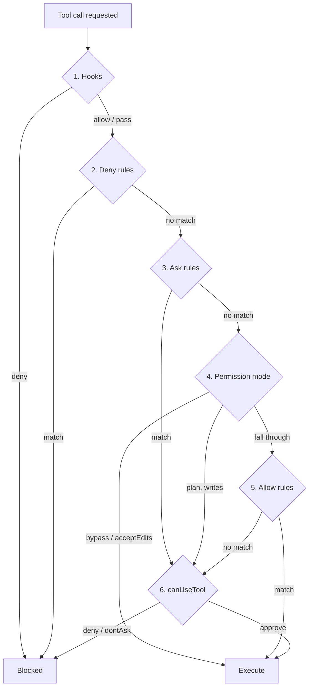

# Permessi dell'Agent SDK: l'ordine in sei passi

> Source: https://derob98.github.io/ailmanac/it/docs/claude-code/agent-sdk-permissions · AILmanac (CC BY 4.0) · last verified 2026-10-21

Ogni bug di permessi in un agente headless è un bug di ordine. I sei passi che l'Agent SDK valuta — quali possono solo negare, quali solo consentire, e i cinque modi in cui allowedTools non fa nulla in silenzio.

<LevelBadge level="advanced" />

<Callout type="objectives" items={[
  "I sei passi che l'Agent SDK percorre per ogni chiamata a uno strumento, in ordine",
  "Quali passi possono solo negare, quali solo consentire e quali entrambe le cose — il modello mentale che rende ovvio il resto",
  "Perché uno strumento approvato presto non raggiunge mai la tua callback canUseTool, e cosa usare invece quando un controllo deve girare a ogni chiamata",
  "Le cinque configurazioni in cui allowedTools sembra un lucchetto e non lo è",
  "In cosa differiscono le regole deny quando nomini uno strumento rispetto a quando limiti un pattern al suo interno",
  "Cosa eredita un subagent — e l'unica modalità che rifiuta di ereditare",
  "L'interruttore di sicurezza che nessuna regola, modalità o hook può scavalcare"
]} />

Quasi tutti configurano i permessi di un agente come configurerebbero un firewall: scrivono le regole e presumono che vinca la più specifica. Il Claude Agent SDK non funziona così. Percorre una **pipeline fissa di sei passi** per ogni chiamata a uno strumento, e ogni passo ha un *potere* diverso — alcuni possono solo bloccare, altri solo approvare, e solo due possono fare entrambe le cose.

Sbaglia l'ordine e distribuisci un agente che sembra blindato e non lo è. È la classe più comune di bug di harness, e quasi mai è un refuso in una regola.

<VerifyNote lastVerified="2026-10-21" source="https://code.claude.com/docs/en/agent-sdk/permissions">
L'ordine di valutazione, il comportamento delle modalità e i vincoli di versione qui sotto provengono dal riferimento sui permessi dell'Agent SDK di Anthropic e dal riferimento sulle modalità di permesso. Le superfici dei permessi cambiano spesso e diversi comportamenti dipendono da versioni specifiche di Claude Code (indicate nel testo) — ricontrolla entrambe le pagine prima di fare affidamento su un'eccezione.
</VerifyNote>

## I sei passi

<Steps items={[
  {title: "Hook", body: <>Il tuo hook <code>PreToolUse</code> gira <strong>per primo</strong>, prima di ogni altro controllo. Il deny di un hook è definitivo — blocca la chiamata anche in modalità <code>bypassPermissions</code>. Un <code>allow</code> di un hook, invece, <em>non</em> è definitivo: i passi 2 e 3 girano comunque.</>},
  {title: "Regole deny", body: <>Provengono da <code>disallowedTools</code> e <code>settings.json</code>. Una corrispondenza blocca la chiamata in ogni modalità, <code>bypassPermissions</code> compresa.</>},
  {title: "Regole ask", body: <>Provengono da <code>settings.json</code>. Una corrispondenza non approva né blocca — <em>instrada</em> la chiamata fino al passo 6, la tua callback, anche in modalità <code>bypassPermissions</code>.</>},
  {title: "Modalità di permesso", body: <>La modalità attiva dice la sua qui. <code>bypassPermissions</code> approva ciò che la raggiunge; <code>acceptEdits</code> approva le operazioni sui file nell'ambito consentito; <code>plan</code> costringe gli strumenti di modifica file e di scrittura da shell a passare dalla tua callback a prescindere dalle regole allow. Le altre modalità lasciano passare.</>},
  {title: "Regole allow", body: <>Provengono da <code>allowedTools</code> e <code>settings.json</code>. Una corrispondenza approva la chiamata. Anche le chiamate che lo strumento approva da sé si risolvono qui, senza bisogno di regole — una lettura di file dentro le tue cartelle di lavoro, un comando Bash di sola lettura.</>},
  {title: "canUseTool", body: <>Tutto ciò che è ancora irrisolto raggiunge la tua callback per una decisione. In modalità <code>dontAsk</code> questo passo viene saltato e la chiamata viene <strong>negata</strong>.</>}
]} />

## Il modello che dà senso a tutto

Dimentica la precedenza. Chiediti invece: *cosa può fare questo passo?*

| Passo | Può negare | Può approvare | Può instradare alla tua callback |
|---|---|---|---|
| **1. Hook** | Sì — definitivo, sopravvive a `bypassPermissions` | Sì, ma i passi 2–3 girano comunque | — |
| **2. Regole deny** | Sì — definitivo, sopravvive a `bypassPermissions` | No | — |
| **3. Regole ask** | No | No | Sì — sopravvive a `bypassPermissions` |
| **4. Modalità di permesso** | No | Sì (`bypassPermissions`, `acceptEdits`) | Sì (`plan`, per le scritture) |
| **5. Regole allow** | No | Sì | No |
| **6. canUseTool** | Sì | Sì | — |

Tre conseguenze discendono direttamente da quella tabella, e spiegano quasi ogni sorpresa:

- **Deny batte tutto.** Le regole deny e i rifiuti degli hook stanno a monte della modalità, quindi non esiste modalità che le sblocchi. È l'unico meccanismo su cui puoi contare per *togliere* capacità.
- **Allow non batte niente.** Le regole allow stanno al passo 5, *sotto* la modalità. Non possono limitare una modalità permissiva — si limitano a pre-approvare lavoro che altrimenti avrebbe richiesto conferma.
- **La tua callback è l'ultima risorsa, non il cancello.** Gira solo sulle chiamate che nulla più in alto ha risolto. Ogni controllo che metti al suo interno viene saltato per tutto ciò che è stato approvato prima.

<Callout type="warning">
Se scrivi controlli di sicurezza dentro `canUseTool`, li hai messi nel posto sbagliato. Una chiamata approvata da una regola allow, da `acceptEdits` o da `bypassPermissions` non raggiunge mai la callback — il tuo controllo non fallisce, semplicemente non gira. I controlli che devono valere per **ogni** chiamata vanno in un hook `PreToolUse`, che gira al passo 1 e il cui rifiuto sopravvive persino a `bypassPermissions`.
</Callout>

## Cinque modi in cui `allowedTools` non è un lucchetto

`allowedTools` si legge come una allowlist. È una **lista di pre-approvazione**. Tutto ciò che lasci fuori è comunque disponibile a Claude; semplicemente ricade nella modalità e poi nella tua callback. Cinque trappole specifiche:

### 1. Non vincola `bypassPermissions`

È la più grossa. Gli strumenti non elencati non corrispondono ad alcuna regola allow, quindi ricadono al passo 4 — dove `bypassPermissions` li approva.

<PromptCard title="Sembra blindato. Approva Bash, Write ed Edit.">{`// WRONG — bypassPermissions approves everything unlisted
const options = {
  allowedTools: ["Read"],
  permissionMode: "bypassPermissions"
};`}</PromptCard>

Se ti serve `bypassPermissions` ma vuoi eliminare strumenti specifici, l'unica leva che funziona è `disallowedTools` — atterra al passo 2, a monte della modalità.

### 2. `dontAsk` è la modalità che rende esatta una allowlist

Per ottenere "questi strumenti e nient'altro", abbina la pre-approvazione a una modalità che nega invece di chiedere.

<PromptCard title="Un agente di sola lettura, per davvero">{`const options = {
  allowedTools: ["Read", "Glob", "Grep"],
  permissionMode: "dontAsk"
};`}</PromptCard>

Gli strumenti elencati girano. Tutto il resto che avrebbe richiesto conferma viene negato, e `canUseTool` non viene mai chiamata. Nota cosa gira comunque senza essere elencato: i comandi Bash di sola lettura, le letture di file dentro le tue cartelle di lavoro e strumenti come `Agent` che non chiedono prima di partire. Per togliere uno di questi del tutto dalla richiesta, aggiungi il suo nome semplice a `disallowedTools`.

### 3. Un nome semplice approva *l'intero* strumento

La copertura dipende dalla forma della voce, e la differenza è grande:

| Voce | Cosa pre-approva |
|---|---|
| `"Read"` | Ogni chiamata `Read` (tranne le letture da percorsi di rete) |
| `"Bash(npm test *)"` | Solo le chiamate `Bash` corrispondenti. Le altre chiamate `Bash` ricadono comunque nella tua callback |

L'ambito è tutto. `"Bash"` in una allow list è una postura di sicurezza diversa da `"Bash(npm test *)"`, e il sistema di tipi non te lo dirà.

### 4. I glob non ancorati vengono ignorati in silenzio

Le regole allow accettano glob sui nomi degli strumenti **solo** dopo un prefisso letterale `mcp__<server>__`, e il segmento del server deve essere privo di glob.

| Voce | Effetto |
|---|---|
| `"mcp__puppeteer__*"` | Funziona — ogni strumento del server `puppeteer` |
| `"mcp__github__get_*"` | Funziona — gli strumenti `get_` di quel server |
| `"*"` o `"mcp__*"` | **Ignorata.** Non pre-approva nulla |

L'ultima riga fallisce nella direzione silenziosa e sicura — ottieni più richieste, non più permessi — ma se l'hai scritta aspettandoti un'approvazione generale, ci perderai un pomeriggio.

### 5. TypeScript ti avverte, su un canale che non stai ascoltando

Se passi una callback `canUseTool` in una configurazione in cui l'SDK sa che la callback verrà oscurata, emette un avviso di processo Node una tantum con il codice `CLAUDE_SDK_CAN_USE_TOOL_SHADOWED`. Lo innescano due configurazioni: `permissionMode: "bypassPermissions"` e ogni voce **semplice** di `allowedTools` come `"Read"`.

<PromptCard title="Porta l'avviso di oscuramento nei tuoi log">{`process.on("warning", (w) => {
  if (w.code === "CLAUDE_SDK_CAN_USE_TOOL_SHADOWED") {
    console.error("[harness] canUseTool will be skipped:", w.message);
  }
});`}</PromptCard>

Le voci con ambito come `Bash(ls *)` e la modalità `acceptEdits` non lo innescano, e le regole allow provenienti dai file di impostazioni sono invisibili al controllo — quindi un'esecuzione pulita non prova che la tua callback sia raggiungibile.

## Regole deny: nominare uno strumento o limitarlo al suo interno

Le voci deny si comportano in modo diverso a seconda della forma, e la differenza riguarda *ciò che Claude può vedere*, non solo ciò che può fare.

| Voce | Effetto |
|---|---|
| `disallowedTools: ["Bash"]` | La definizione dello strumento `Bash` viene **rimossa dalla richiesta**. Claude non vede mai lo strumento e non può tentarlo |
| `disallowedTools: ["Bash(rm *)"]` | `Bash` resta disponibile. Le chiamate che corrispondono a `rm *` *come scritto* vengono negate in ogni modalità. Le altre chiamate `Bash` — compresa `/bin/rm` — ricadono |
| `disallowedTools: ["*"]` | Ogni definizione di strumento viene rimossa. I glob sui nomi degli strumenti **sono** supportati nelle regole deny: `"mcp__*"` corrisponde a ogni strumento MCP di tutti i server |

Due cose da interiorizzare. Primo, la forma semplice è strettamente più forte: togliere lo strumento dal contesto batte il negare le sue chiamate, perché uno strumento che Claude non vede non genera tentativi falliti né nuovi tentativi lungo un altro percorso. Secondo, `Bash(rm *)` corrisponde **alla stringa come scritta** — il buco di `/bin/rm` non è un bug, è l'ambito documentato di una regola testuale. Tratta i rifiuti Bash con ambito come protezioni contro l'ovvio, mai come un confine di sicurezza.

### Regole sui percorsi: quattro ancoraggi e una lettera morta

Le regole `Read` e `Edit` con ambito accettano un pattern di percorso, e due dettagli fregano tutti:

- **`Edit(path)` governa ogni strumento integrato che scrive file** — compresi `Write` e `NotebookEdit`. Una regola `Write(path)` **non viene mai confrontata** dai controlli di permesso sui file. Se hai scritto `Write(//secrets/**)`, non hai scritto nulla.
- **Una doppia barra significa il filesystem.** `Edit(//secrets/**)` blocca le scritture ovunque sotto `/secrets` sul disco. Una singola barra iniziale ancora invece alla *sorgente* della regola — per una regola passata tramite `allowedTools` o `disallowedTools`, è la cartella di lavoro della sessione, quindi `Edit(/secrets/**)` **non** protegge `/secrets` sul disco.

<PromptCard title="Blocca le scritture su un vero percorso del filesystem">{`// // = absolute filesystem path. One slash anchors at the rule's source.
const options = {
  disallowedTools: ["Edit(//etc/**)", "Edit(//secrets/**)", "Read(//secrets/**)"]
};`}</PromptCard>

## Le modalità, e cosa compra davvero ciascuna

<Flashcards cards={[
  {front: "default", back: "Nessuna approvazione automatica basata sulla modalità. Le chiamate che richiedono approvazione e non corrispondono ad alcuna regola allow vanno a canUseTool. Da Claude Code v2.1.302, è da qui che parte la tua app, a meno che tu imposti una modalità o un file di impostazioni fornisca permissions.defaultMode."},
  {front: "dontAsk", back: "Ogni chiamata che richiederebbe conferma viene negata — canUseTool non viene mai chiamata. Gli strumenti pre-approvati e le chiamate che non richiedono approvazione girano comunque. La modalità che trasforma una lista di pre-approvazione in una allowlist esatta."},
  {front: "acceptEdits", back: "Approva automaticamente le modifiche ai file più mkdir, touch, rm, rmdir, mv, cp, sed — ma solo dentro la cartella di lavoro o additionalDirectories. Il Bash che non riguarda il filesystem richiede i normali permessi."},
  {front: "plan", back: "Gli strumenti di sola lettura si comportano come in default. Le modifiche ai file non vengono mai approvate automaticamente — né da una regola allow né da un allow di PreToolUse. Raggiungono canUseTool. Da v2.1.212, lo stesso vale per i comandi di shell che modificano file."},
  {front: "bypassPermissions", back: "Approva ciò che raggiunge il passo 4. Hook, regole deny e regole ask girano comunque a monte. Su Linux e macOS rifiuta di avviarsi come root o sotto sudo fuori da una sandbox riconosciuta."},
  {front: "auto", back: "Un modello classificatore esamina azioni come comandi di shell e richieste di rete e consente o blocca ciascuna. Richiede un modello supportato; passare a uno non supportato riporta la sessione alla modalità default."}
]} />

Due comportamenti da fissare bene perché in produzione mordono:

**La modalità `auto` degrada in modo quasi silenzioso.** Se passi con `setModel()` o `applyFlagSettings()` a un modello che `auto` non supporta, la sessione passa alla modalità `default`. Ricevi un messaggio `system` con sottotipo `status` e `permissionMode: "default"` — tipizzato come `SDKStatusMessage` in TypeScript — e da quel momento le chiamate raggiungono la tua callback. Tornare al modello precedente **non** ripristina `auto`; devi chiamare di nuovo `setPermissionMode("auto")`. (v2.1.299 o successive.)

**I subagent ereditano, con un rifiuto.** Un subagent gira nella modalità di permesso del genitore, a meno che tu imposti `permissionMode` sulla sua `AgentDefinition` *e* il genitore sia in `default`, `dontAsk` o `plan`. Anche in quel caso, Claude Code non applica mai un valore `"bypassPermissions"` preso da una `AgentDefinition` — un subagent gira in `bypassPermissions` solo quando lo fa la sessione genitore stessa (v2.1.267+). Questa eccezione esiste perché i subagent hanno spesso prompt di sistema diversi e un comportamento più lasco del tuo agente principale, quindi ereditare il bypass consegnerebbe pieno accesso autonomo al sistema alla parte meno supervisionata del tuo harness. Vedi [Subagent](/docs/claude-code/subagents).

## L'interruttore di sicurezza che nulla scavalca

Le rimozioni con `rm` e `rmdir` che puntano a un **percorso critico** non vengono mai approvate da una regola allow né da un hook `PreToolUse` che restituisce `allow`. I percorsi critici sono la radice del filesystem, qualsiasi figlio diretto della radice (`/usr`, `/etc`, `/data`), la tua home directory, le radici dei drive Windows e le loro cartelle di primo livello, e la tua cartella di lavoro e le sue superiori. Una regola deny corrispondente blocca comunque il comando del tutto; il punto è che nessun percorso di *approvazione* può sbloccarlo.

Cosa succede invece dipende dalla modalità:

| Modalità | Esito per la rimozione di un percorso critico |
|---|---|
| `default`, `acceptEdits`, `bypassPermissions` | Chiede approvazione |
| `auto` | Chiede nel terminale, con un limite di tempo. **Altrove — compresa ogni sessione dell'Agent SDK — la nega** |
| `dontAsk` | La nega |

La riga centrale è quella che conta per un harness: una sessione dell'Agent SDK in modalità `auto` nega le rimozioni di percorsi critici **senza chiamare la tua callback**, e dice a Claude di riferire cosa voleva cancellare. Se il tuo agente comincia all'improvviso a raccontare cancellazioni che non ha eseguito, è per questo — non per una regressione del modello.

Il controllo arriva anche dentro i costrutti in cui una variabile non impostata si espanderebbe in una cancellazione della radice: `rm -rf "$DIR"/*`, `rm -rf "$1"/*` senza niente che leghi `$1`, `D=$(pwd); rm -rf "$D"`, e rimozioni annidate in subshell, sostituzioni di comando o script `bash -c`. La correzione documentata è proteggere l'espansione in modo che la shell dia errore se è vuota invece di cancellare la radice.

<PromptCard title="Fai passare una rimozione con glob il controllo dei percorsi critici">{`# Flagged: expands to a removal from / when DIR is unset
rm -rf "$DIR"/*

# Passes: :? makes the shell exit with an error instead
rm -rf "\${DIR:?}"/*`}</PromptCard>

## Altre cose che nessuna modalità approva automaticamente

Oltre alle rimozioni di percorsi critici, queste sfuggono sempre a una modalità permissiva — nella maggior parte delle modalità raggiungono la tua callback, e in `dontAsk` vengono **negate** perché quella modalità non chiede mai:

- Gli strumenti corrispondenti a una **regola ask** esplicita
- **`AskUserQuestion`**, e gli strumenti MCP il cui server imposta `_meta["anthropic/requiresUserInteraction"]` (v2.1.199+)
- **Gli strumenti dei connettori che la tua organizzazione ha impostato su `ask`** — la callback riceve il motivo `Your organization requires approval for this tool`
- Le letture da **percorsi di rete**, che nessuna regola allow approva

Quindi "ho impostato `bypassPermissions`, perché mi viene ancora chiesto?" ha quattro risposte prima di arrivare a una segnalazione di bug. E nell'SDK TypeScript c'è una quinta leva: `permissionPrompts: "none"` (v2.1.259+) impedisce del tutto che la tua callback venga chiamata al passo 6 — un hook `PermissionRequest` ha comunque una possibilità, e se rinuncia a decidere, la chiamata viene negata.

## Due ricette

### Un cancello che gira davvero a ogni chiamata

Quando un controllo deve essere incondizionato — registro di audit, scanner di percorsi segreti, tetto di costo — mettilo al passo 1.

Un hook `PreToolUse` ha due modi per bloccare, entrambi disponibili per un hook di comando che puoi eseguire anche fuori dall'SDK: **exit code 2**, dove ciò che scrivi su stderr diventa il motivo che Claude vede, oppure **JSON su stdout** con un `permissionDecision` pari a `"deny"` più un `permissionDecisionReason`.

<PromptCard title="Hook PreToolUse: l'unico cancello incondizionato">{`# Runs before deny rules, ask rules, the mode, and allow rules.
# A deny here survives bypassPermissions.
# Wire it to hooks.PreToolUse in settings.json, or pass it in the SDK's hooks option.
jq -e '.tool_input | tostring | test("AKIA|BEGIN PRIVATE KEY|ghp_")' >/dev/null \\
  && { echo "secret material in tool input" >&2; exit 2; } || exit 0`}</PromptCard>

La forma di callback in-process accettata dagli SDK TypeScript e Python restituisce gli stessi campi di decisione invece di un exit code. Conferma la forma del wrapper sul [riferimento degli hook](/docs/claude-code/hooks) per la versione del tuo SDK prima di distribuire — la *posizione* di valutazione è la parte stabile, la firma del gestore un po' meno.

### Stringere man mano che cresce la fiducia

La modalità di permesso non è una decisione una tantum. In una sessione in streaming puoi partire restrittivo e allentare dopo aver rivisto le prime mosse dell'agente, con `set_permission_mode()` in Python o `setPermissionMode()` in TypeScript. La nuova modalità si applica subito a tutte le richieste successive agli strumenti.

<PromptCard title="Parti da default, allenta dopo aver rivisto l'approccio">{`const q = query({
  prompt: "Refactor the auth module",
  options: {permissionMode: "default"}
});

// ...review the first turns, then:
await q.setPermissionMode("acceptEdits");`}</PromptCard>

La mossa inversa è più interessante per un'esecuzione lunga: stringi a `dontAsk` quando l'agente entra in una fase che non dovrebbe richiedere nuove capacità.

## Da dove possono venire le regole

Le regole allow, deny e ask possono anche stare in modo dichiarativo in `.claude/settings.json`. L'SDK le legge quando la fonte di impostazioni `project` è abilitata, cosa che accade per le opzioni predefinite di `query()` — **ma se imposti `settingSources` in modo esplicito, devi includere `"project"` o le regole dei file di impostazioni smettono di applicarsi in silenzio.** È un classico incidente: qualcuno aggiunge `settingSources: ["user"]` per riproducibilità ed elimina in silenzio l'intera deny list del progetto. Vedi [Impostazioni](/docs/claude-code/settings) per la precedenza dei file, e ricorda che anche le regole allow dei file di impostazioni sono invisibili al controllo `CLAUDE_SDK_CAN_USE_TOOL_SHADOWED`.

<Quiz questions={[
  {
    q: "Imposti allowedTools: [\"Read\"] e permissionMode: \"bypassPermissions\". L'agente può eseguire Bash?",
    options: [
      "No — solo Read è nella allowlist",
      "Sì — Bash non corrisponde ad alcuna regola allow, quindi ricade nella modalità, che lo approva",
      "Solo i comandi Bash di sola lettura",
      "Sì, ma prima viene chiamata canUseTool"
    ],
    answer: 1,
    explain: "Le regole allow sono il passo 5, sotto la modalità del passo 4. allowedTools pre-approva; non limita mai. Per bloccare uno strumento sotto bypassPermissions, usa disallowedTools, che atterra al passo 2 — a monte della modalità."
  },
  {
    q: "Un controllo di sicurezza deve girare su ogni singola chiamata a uno strumento, senza eccezioni. Dove va messo?",
    options: [
      "Nella callback canUseTool",
      "In una regola ask in settings.json",
      "In un hook PreToolUse",
      "In permissionMode: \"dontAsk\""
    ],
    answer: 2,
    explain: "Gli hook sono il passo 1 — prima delle regole deny, della modalità e delle regole allow — e il rifiuto di un hook sopravvive persino a bypassPermissions. canUseTool è il passo 6 e viene saltata del tutto per ciò che è stato approvato prima, quindi i controlli messi lì in silenzio non girano per gli strumenti approvati automaticamente."
  },
  {
    q: "Quale voce deny impedisce a Claude persino di vedere lo strumento Bash?",
    options: [
      "disallowedTools: [\"Bash(*)\"]",
      "disallowedTools: [\"Bash\"]",
      "allowedTools: [] con permissionMode: \"dontAsk\"",
      "Una regola deny in settings.json per Bash(rm *)"
    ],
    answer: 1,
    explain: "Una regola deny con nome semplice rimuove la definizione dello strumento dalla richiesta prima che inizi la valutazione, quindi Claude non lo vede mai. Una regola con ambito come Bash(rm *) lascia Bash disponibile e nega solo le chiamate che corrispondono a quel pattern come scritto — /bin/rm ricade."
  }
]} />

<Callout type="takeaways" items={[
  "Sei passi, ordine fisso: hook, regole deny, regole ask, modalità di permesso, regole allow, canUseTool.",
  "Deny è a monte della modalità e quindi assoluto. Allow è a valle e può solo pre-approvare.",
  "allowedTools è una lista di pre-approvazione, non una allowlist — abbinala a dontAsk per renderla esatta.",
  "I controlli in canUseTool non girano per le chiamate approvate automaticamente. I controlli incondizionati vanno in un hook PreToolUse.",
  "Edit(path) copre Write e NotebookEdit; una regola Write(path) non corrisponde a nulla. // ancora al filesystem, una singola / alla sorgente della regola.",
  "Un subagent eredita la modalità del genitore ma non eredita mai un valore bypassPermissions dalla propria definizione.",
  "Le rimozioni rm di percorsi critici sono un interruttore di sicurezza che nessuna regola allow o allow di hook può sbloccare — e una sessione dell'Agent SDK in modalità auto le nega senza chiamarti.",
  "Impostare settingSources senza \"project\" scarta in silenzio ogni regola di .claude/settings.json."
]} />

## Prossimi passi

- [Permessi e modalità di permesso](/docs/claude-code/permissions) — il lato interattivo dello stesso sistema, incluso perché `auto` è diventata la modalità iniziale
- [Hook](/docs/claude-code/hooks) — il passo 1, l'unico cancello incondizionato della pipeline
- [Rendere sicure le esecuzioni autonome](/docs/security/hardening-autonomous-runs) — la checklist che le primitive di questa pagina implementano
- [Modalità headless e Agent SDK](/docs/claude-code/headless-and-agent-sdk) — far partire il ciclo in primo luogo
