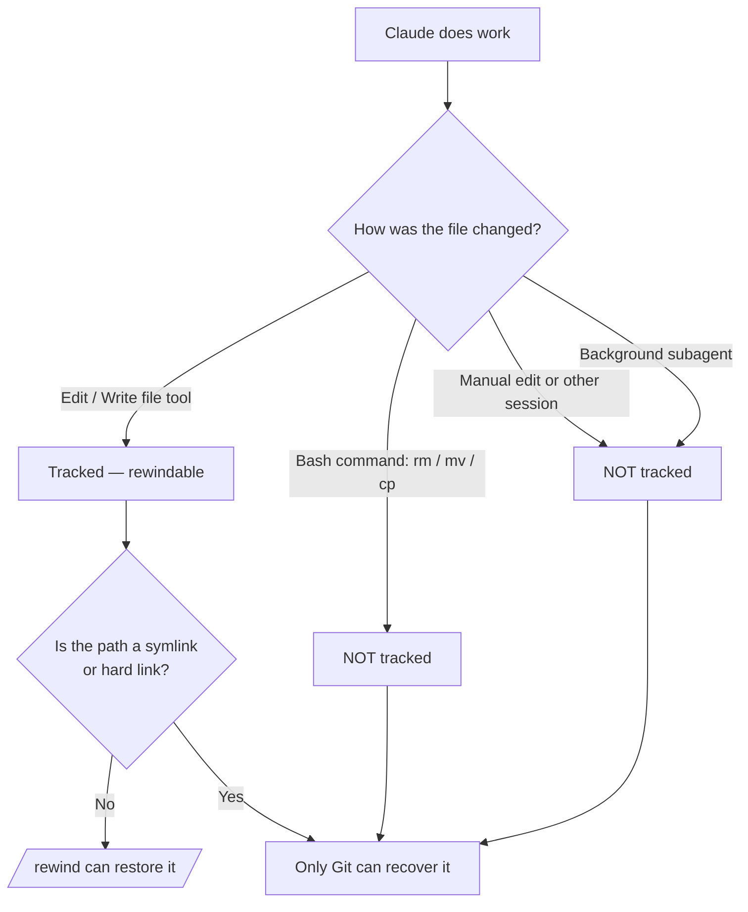

# Checkpoint e Rewind

> Source: https://derob98.github.io/ailmanac/it/docs/claude-code/checkpoints-and-rewind · AILmanac (CC BY 4.0) · last verified 2026-10-20

Annulla le modifiche di Claude, torna indietro di un'intera sessione e comprimi il contesto con /rewind — la rete di sicurezza per le esecuzioni più ambiziose.

<LevelBadge level="intermediate" />

<Callout type="objectives" items={["Capire cosa cattura un checkpoint — e cosa silenziosamente non cattura", "Aprire il menu di rewind in due modi e scegliere ogni volta l'azione di ripristino giusta", "Distinguere 'restore' (annulla lo stato) da 'summarize' (comprimi il contesto)", "Sapere esattamente perché i checkpoint completano Git ma non lo sostituiscono mai"]} />

<VerifyNote lastVerified="2026-10-20" source="https://code.claude.com/docs/en/checkpointing">
Il comportamento dei checkpoint, le azioni del menu di rewind, il limite di snapshot e la conservazione cambiano tra una release e l'altra — verifica nella documentazione ufficiale.
</VerifyNote>

## L'idea di fondo

Quando lasci Claude libero su una modifica ambiziosa e di ampia portata, la domanda più temibile è "e se qualcosa va storto a tre modifiche di distanza?". I **checkpoint** sono la risposta: Claude Code scatta automaticamente uno snapshot del tuo codice prima di ogni modifica, così puoi tornare a uno stato precedente invece di sbrogliare a mano un refactoring lasciato a metà.

Pensalo come un **annulla locale per l'intera sessione** — una rete di sicurezza che ti permette di dire "sì, prova l'approccio audace" senza timore.

## Come vengono creati i checkpoint

I checkpoint non si creano: nascono in automatico.

<Steps items={[{title: "Ogni prompt che avvia un turno = un checkpoint", body: "Ogni prompt che avvia un turno cattura lo stato del tuo codice prima che gli strumenti di modifica dei file di Claude entrino in azione. Nessun comando, nessuna configurazione, nessuna cerimonia."}, {title: "Vengono conservati solo i 100 più recenti", body: "Claude Code conserva gli snapshot dei file per i 100 checkpoint più recenti di una sessione. Quelli più vecchi vengono scartati, quindi una sessione molto lunga non può essere riavvolta fino al suo inizio."}, {title: "Persistono tra le sessioni", body: "I checkpoint vengono salvati insieme alla conversazione, quindi puoi usare /rewind anche dopo aver ripreso una sessione, non solo in quella attiva."}, {title: "Si ripuliscono da soli", body: "Gli snapshot dei file di una sessione vengono eliminati nella pulizia periodica della conservazione, per impostazione predefinita circa 30 giorni dopo l'ultima volta che la sessione ne ha salvato uno. Tornare a un checkpoint i cui snapshot non esistono più fallisce con 'No files were restored' — aumenta cleanupPeriodDays per conservarli più a lungo."}]} />

## Aprire il menu di rewind

Ci sono due modi per entrarci:

<Steps items={[{title: "Esegui /rewind — o i suoi alias /checkpoint e /undo", body: "Digita il comando slash dal prompt. Funziona sempre. /checkpoint e /undo sono alias dello stesso comando, quindi usa il nome che ti viene in mente."}, {title: "Premi Esc due volte — ma solo con l'input vuoto", body: "Il doppio Esc apre il menu di rewind quando la casella del prompt è vuota. Se contiene del testo, il doppio Esc cancella invece quel testo (il testo cancellato viene salvato nella cronologia degli input, quindi premi Su per recuperarlo)."}]} />

<PromptCard title="Apri il menu di rewind">{`/rewind`}</PromptCard>

<Callout type="warning" items={["I nomi degli alias sono più amichevoli che letterali: /checkpoint non scatta uno snapshot su richiesta (gli snapshot sono automatici) e /undo non annulla da solo l'ultima modifica. Tutti e tre i nomi aprono lo stesso menu, dove scegli comunque il punto e l'azione."]} />

Il menu elenca **ogni prompt che hai inviato in questa sessione**. Scegli il punto su cui agire, poi scegli un'azione.

## Restore e summarize: la distinzione chiave

È qui che si fa confusione. Il menu offre due *tipi* di azione:

- Le azioni **Restore** cambiano lo stato su disco e/o nella conversazione — annullano.
- Le azioni **Summarize** non toccano mai i tuoi file — comprimono la conversazione per liberare spazio nella finestra di contesto.

<Callout type="warning" items={["Restore = annulla (ripristina codice, conversazione o entrambi). Summarize = comprimi il contesto (i file su disco restano intatti).", "Usa restore quando una modifica ha rotto qualcosa. Usa summarize quando la sessione è gonfia ma il codice va bene."]} />

### Le azioni di restore

<Steps items={[{title: "Restore code and conversation", body: "Ripristina sia i file sia la cronologia della chat al punto selezionato — un vero 'riavvolgimento del tempo' a quel momento."}, {title: "Restore conversation", body: "Riavvolge la chat a quel messaggio ma mantiene il codice attuale. Utile per rifare una domanda senza perdere le modifiche che vuoi tenere."}, {title: "Restore code", body: "Ripristina le modifiche ai file ma mantiene la conversazione. Annulli le modifiche, conservi la discussione che le riguarda."}]} />

Le due opzioni di restore del **codice** compaiono solo quando il checkpoint selezionato ha effettivamente modifiche ai file tracciate da ripristinare. Se dopo quel punto non è stata catturata alcuna modifica ai file, il menu offre solo **Restore conversation**, le due opzioni summarize e **Never mind** (che torna all'elenco dei messaggi senza cambiare nulla).

Dopo aver ripristinato la conversazione (o scelto "Summarize from here"), il prompt originale del messaggio selezionato viene rimesso nel campo di input così puoi reinviarlo o modificarlo.

### Le azioni di summarize

Entrambe comprimono una parte della conversazione in un riassunto generato dall'AI — come un **`/compact` mirato** in cui scegli quale lato del messaggio selezionato comprimere.

<Steps items={[{title: "Summarize from here", body: "I messaggi PRIMA di quello selezionato restano intatti. Il messaggio selezionato e tutto ciò che segue diventano un riassunto. Usalo per scartare una digressione mantenendo il contesto iniziale in pieno dettaglio."}, {title: "Summarize up to here", body: "I messaggi PRIMA di quello selezionato diventano un riassunto; il messaggio selezionato e tutto ciò che segue restano intatti. Rimani alla fine della conversazione. Usalo per comprimere i discorsi iniziali di setup mantenendo il lavoro recente alla lettera."}]} />

In entrambi i casi i messaggi originali restano nella trascrizione della sessione, quindi Claude può ancora consultarne i dettagli, e dove c'erano i messaggi compressi compare un indicatore **Summarized conversation**. Per orientare su cosa si concentra il riassunto, evidenzia un'opzione **Summarize** con le frecce e scrivi le istruzioni dove la riga riporta **add context (optional)**, poi premi Invio — scegliere l'opzione con il suo tasto numerico riassume subito, senza istruzioni.

Per l'intero flusso, vedi [Gestione del contesto](/docs/claude-code/context-management) — le azioni summarize di `/rewind` sono un bisturi, dove `/compact` è un pennello largo.

<Callout type="note" items={["Summarize ti tiene nella stessa sessione. Per diramarti e provare un approccio diverso lasciando intatta la sessione originale, usa invece /branch oppure claude --continue --fork-session."]} />

## Tornare indietro oltre un `/clear`

Se hai eseguito `/clear` in precedenza nello stesso processo di Claude Code, il menu di rewind mostra una voce in più in alto: `/resume <session-id> (previous session)`. Selezionala per tornare alla conversazione che era attiva prima di `/clear`.

<VerifyNote lastVerified="2026-10-20" source="https://code.claude.com/docs/en/checkpointing">
Quella voce è disponibile solo finché non esci da Claude Code o non riprendi un'altra sessione. Quando sparisce, esegui `/resume` e scegli la sessione precedente dall'elenco.
</VerifyNote>

## Dove i checkpoint si fermano — i limiti che fanno male

I checkpoint sembrano magici finché non lo sono più. Queste lacune contano:

<Steps items={[{title: "Le modifiche via bash sono invisibili", body: "I file toccati dai comandi shell che Claude esegue — rm, mv, cp, generatori di codice, formattatori — NON sono tracciati. Solo le modifiche dirette tramite gli strumenti di modifica file di Claude finiscono nei checkpoint. Un file cancellato con rm, per il rewind, è perso."}, {title: "La maggior parte delle modifiche dei subagent non viene ripristinata", body: "Un subagent modifica con gli stessi strumenti per i file, ma la tua sessione di solito non cattura quelle modifiche. L'eccezione è una skill forkata in primo piano (context: fork con background: false), che modifica durante il tuo turno e si riavvolge normalmente. Qualsiasi altro subagent — compresa una skill forkata in background, che è l'impostazione predefinita — richiede Git per annullare. Vedi /docs/claude-code/subagents."}, {title: "Le modifiche esterne e concorrenti sono invisibili", body: "Le modifiche manuali fatte fuori da Claude Code e quelle di altre sessioni concorrenti normalmente non vengono catturate — a meno che non tocchino gli stessi file modificati dalla sessione corrente."}, {title: "I messaggi a metà turno non ottengono un checkpoint", body: "Un messaggio che metti in coda mentre Claude lavora e che lo raggiunge durante il turno in corso si unisce a quel turno invece di avviarne uno nuovo, quindi non ha un checkpoint suo — il menu di rewind lo segna con 'No code restore'. Per annullare ciò che è venuto dopo, torna al prompt che ha avviato il turno, il che riavvolge l'intero turno, compreso il lavoro svolto prima che il tuo messaggio arrivasse. Selezionare il messaggio contrassegnato offre comunque Restore conversation, lasciando i tuoi file come sono."}, {title: "Symlink e hard link vengono saltati", body: "Il restore salta qualsiasi percorso tracciato che sia un symlink o un hard link e avvisa 'Restored the code, but skipped N files'; quei file mantengono il contenuto attuale. I symlink dei gestori di dotfile e gli hard link di pnpm ricadono entrambi in questo caso. Esegui /debug prima di ripristinare per avere i percorsi saltati indicati nel log di debug."}, {title: "È a livello di sessione, non è cronologia", body: "I checkpoint sono un recupero rapido e locale. Non sono commit, non sono branch e non si condividono con il tuo team."}]} />

## Checkpoint e Git: usali entrambi

Risolvono problemi diversi, quindi abbinali.

| | Checkpoint (`/rewind`) | Git |
|---|---|---|
| Ambito | Una sessione | Cronologia dell'intero progetto |
| Granularità | Per prompt che avvia un turno, automatica | Per commit, deliberata |
| Traccia le modifiche fatte via bash? | No | Sì (una volta in staging/commit) |
| Durata | Ultimi 100 checkpoint, ripuliti ~30 giorni dopo la sessione | Permanente |
| Condivisibile / collaborativo | No | Sì |
| Modello mentale | "Annulla locale" | "Cronologia permanente" |

<Callout type="tip" items={["Fai commit con Git degli stati funzionanti prima di un'esecuzione rischiosa e di ampia portata — è il tuo pavimento durevole.", "Usa /rewind per recuperare rapidamente nella sessione tra un commit e l'altro senza inquinare la cronologia Git.", "Se Claude eseguirà bash distruttivo (rm/mv), generatori o subagent in background, affidati a Git — il rewind non salverà quei file."]} />

## Quando usarlo

<Steps items={[{title: "Esplorare alternative", body: "Prova un'implementazione audace e, se non ti piace, ripristina codice e conversazione al punto di biforcazione e prova un'altra strada."}, {title: "Rimediare a una modifica sbagliata", body: "Una modifica ha introdotto un bug tre prompt fa? Ripristina il codice a subito prima invece di fare il debug dei detriti."}, {title: "Iterare su una funzionalità", body: "Sperimenta varianti, sapendo sempre che uno stato funzionante è a un /rewind di distanza."}, {title: "Liberare spazio di contesto", body: "Una deviazione di debug prolissa ha mangiato la tua finestra di contesto? Fai summarize dal punto centrale in avanti e mantieni le istruzioni originali in pieno dettaglio."}]} />

<Quiz title="Verifica te stesso" questions={[{q: "Claude ha eseguito `rm config.old.json` tramite un comando bash e vuoi riaverlo. `/rewind` può ripristinarlo?", options: ["Sì — ogni modifica fatta da Claude finisce in un checkpoint", "No — le modifiche fatte via bash non sono tracciate; solo le modifiche dirette con gli strumenti per i file lo sono", "Solo se esegui /rewind entro 30 secondi"], answer: 1, explain: "I checkpoint catturano solo le modifiche fatte tramite gli strumenti di modifica file di Claude. I file cambiati dai comandi bash (rm, mv, cp) non sono tracciati — è esattamente per questo che esiste Git."}, {q: "Il tuo codice va bene, ma una lunga digressione di debug ha riempito la finestra di contesto. Quale azione è adatta?", options: ["Restore code and conversation a prima della digressione", "Restore code", "Summarize from here all'inizio della digressione"], answer: 2, explain: "Le azioni summarize comprimono la conversazione senza toccare i file. 'Summarize from here' trasforma la digressione in un riassunto mantenendo intatto il contesto precedente — libera spazio di contesto senza alcuna modifica al codice."}, {q: "Come viene creato un checkpoint?", options: ["Eseguendo /checkpoint, che scatta uno snapshot del codice su richiesta", "In automatico — ogni prompt che avvia un turno ne crea uno", "Solo quando fai commit in Git"], answer: 1, explain: "I checkpoint sono automatici: ogni prompt che avvia un turno cattura lo stato del codice prima delle modifiche. Non c'è alcun passaggio manuale — il comando /checkpoint esiste, ma è solo un alias di /rewind e apre il menu invece di scattare uno snapshot. Nota anche che un messaggio che arriva a metà turno si unisce al turno in corso e non ottiene un checkpoint suo."}]} />

<Flashcards title="Vocabolario di checkpoint e rewind" cards={[{front: "Checkpoint", back: "Uno snapshot automatico del tuo codice scattato prima di ogni prompt che avvia un turno. Limitato alla sessione, ne vengono conservati 100, ripuliti ~30 giorni dopo la sessione."}, {front: "/rewind", back: "Apre il menu di rewind che elenca ogni prompt della sessione, così puoi fare restore o summarize da qualsiasi punto. Alias: /checkpoint e /undo. Raggiungibile anche con doppio Esc su un input vuoto."}, {front: "Azione restore", back: "Ripristina lo stato — codice, conversazione o entrambi — al punto selezionato. È l'«annulla». Le opzioni sul codice compaiono solo quando quel checkpoint ha modifiche tracciate."}, {front: "Azione summarize", back: "Comprime parte della conversazione in un riassunto AI per liberare contesto. I file su disco non vengono mai toccati."}, {front: "Punto cieco di bash", back: "I file cambiati dai comandi shell (rm/mv/cp) NON finiscono nei checkpoint — solo le modifiche dirette con gli strumenti per i file. Per quelli usa Git."}, {front: "Punto cieco dei subagent", back: "Si riavvolgono solo le modifiche di una skill forkata in primo piano. I subagent in background (compreso il fork in background predefinito) richiedono Git."}]} />

<Callout type="takeaways" items={["I checkpoint sono snapshot automatici scattati prima di ogni prompt che avvia un turno — un annulla locale per la sessione. Ne vengono conservati 100, poi ripuliti ~30 giorni dopo la sessione.", "Apri il menu di rewind con /rewind (alias: /checkpoint, /undo) o con doppio Esc su un input vuoto; elenca ogni prompt che hai inviato.", "Le azioni restore annullano lo stato (codice, conversazione o entrambi); le azioni summarize comprimono il contesto e non toccano mai i file.", "Le modifiche fatte via bash, esterne, concorrenti e la maggior parte di quelle dei subagent NON sono tracciate — e i percorsi con symlink o hard link vengono saltati al restore.", "I checkpoint completano Git, non lo sostituiscono: pensa 'annulla locale' contro 'cronologia permanente e condivisibile'."]} />

## Avanti

- [Gestione del contesto](/docs/claude-code/context-management) — `/compact`, `/clear` e come si inserisce summarize nel quadro generale
- [Plan Mode](/docs/claude-code/plan-mode) — indaga e approva un piano prima che le modifiche partano, così fai rewind più di rado
- [Permessi](/docs/claude-code/permissions) — l'altra metà dell'esecuzione sicura di compiti ambiziosi
