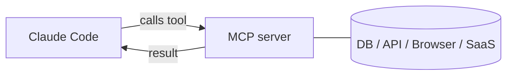

# Server MCP in Claude Code

> Source: https://derob98.github.io/ailmanac/it/docs/claude-code/mcp · AILmanac (CC BY 4.0) · last verified 2026-06-23

Collega database, GitHub, browser e altro tramite il Model Context Protocol.

<LevelBadge level="advanced" />

<VerifyNote lastVerified="2026-06-23" source="https://code.claude.com/docs/en/mcp">
I comandi `claude mcp`, gli scope di configurazione e i trasporti evolvono nel tempo — verifica nella documentazione ufficiale di Claude Code MCP e su modelcontextprotocol.io.
</VerifyNote>

Il **Model Context Protocol (MCP)** è uno standard aperto per collegare l'AI a strumenti e dati esterni. Un **server MCP** espone funzionalità (interrogare un database, aprire una PR su GitHub, pilotare un browser); Claude Code si connette a esso e può **chiamare quegli strumenti** durante una sessione. È così che estendi Claude oltre il tuo filesystem e la tua shell.

<Callout type="objectives" items={["Spiegare cos'è un server MCP e come Claude Code chiama i suoi strumenti", "Distinguere i due trasporti: stdio locale vs HTTP/SSE remoto", "Aggiungere un server con claude mcp add e leggere il JSON che scrive", "Scegliere lo scope giusto (local, project, user) per chi vede un server", "Collegare un vero database a Claude dall'inizio alla fine", "Evitare le trappole di sicurezza e configurazione in cui cade la maggior parte delle persone"]} />

## Come è strutturato



Dichiari i server che Claude può usare; ogni server pubblica un insieme di strumenti con i relativi schemi; Claude li sceglie e li chiama come qualsiasi altro strumento.

<Flashcards title="Vocabolario MCP" cards={[{front: "Model Context Protocol (MCP)", back: "Uno standard aperto per collegare l'AI a strumenti e dati esterni."}, {front: "Server MCP", back: "Un programma che espone funzionalità — interrogare un database, aprire una PR su GitHub, pilotare un browser — come strumenti chiamabili."}, {front: "Strumento", back: "Una funzionalità che un server MCP pubblica con uno schema; Claude la sceglie e la chiama come qualsiasi altro strumento."}, {front: "Trasporto", back: "Come Claude raggiunge un server: stdio (processo locale) o HTTP/SSE remoto (in hosting, spesso con OAuth)."}, {front: "Scope", back: "Chi vede un server: local (tu, questo progetto), project (committato per il team) o user (tu, ovunque)."}]} />

## Trasporti

Ci sono due modi in cui Claude raggiunge un server. Scegli in base a dove gira il server.

- **stdio** — un processo locale che Claude avvia (ottimo per strumenti/CLI locali).
- **Remoto (HTTP/SSE)** — un server in hosting, spesso con OAuth.

## Configurare i server

Il percorso più veloce è il comando `claude mcp add` — scrive la configurazione al posto tuo. Segui questa sequenza per passare da zero a un server connesso.

<Steps items={[{title: "Aggiungi un server stdio locale", body: "Esegui claude mcp add — tutto ciò che viene dopo il -- è il comando di avvio che Claude esegue per te."}, {title: "Oppure aggiungi un server HTTP remoto", body: "Passa --transport http e uno scope, poi l'URL del server. I server remoti sono spesso in hosting e usano OAuth."}, {title: "Vedi cosa è connesso", body: "Esegui claude mcp list per visualizzare i server configurati e il loro stato di connessione."}, {title: "Ispeziona e autenticati", body: "Usa /mcp all'interno di una sessione per ispezionare gli strumenti di un server e autenticarti ai server remoti."}]} />

<PromptCard title="Aggiungi un server stdio locale">{`# A local stdio server (everything after -- is the launch command)
claude mcp add github -- npx -y @modelcontextprotocol/server-github`}</PromptCard>

<PromptCard title="Aggiungi un server HTTP remoto (condiviso con il progetto)">{`# A remote HTTP server, shared with everyone on the project
claude mcp add --transport http --scope project linear https://mcp.linear.app/mcp`}</PromptCard>

Sotto il cofano è solo JSON. Un server con scope **project** finisce in un `.mcp.json` nella radice del repo — committalo e tutto il tuo team ottiene gli stessi strumenti:

```json
{
  "mcpServers": {
    "github": { "command": "npx", "args": ["-y", "@modelcontextprotocol/server-github"] }
  }
}
```

### Lo scope decide chi vede il server

| Scope | Risiede in | Da usare per |
|---|---|---|
| `local` (predefinito) | le tue impostazioni utente, solo questo progetto | esperimenti personali, segreti |
| `project` | `.mcp.json` nel repo (committato) | strumenti che tutto il team dovrebbe condividere |
| `user` | le tue impostazioni utente, tutti i progetti | server che vuoi ovunque |

Esegui `claude mcp list` per vedere cosa è connesso e `/mcp` all'interno di una sessione per ispezionare gli strumenti e autenticarti ai server remoti. Vedi [Configurazione MCP e scaffold di server](/docs/templates/mcp-config) per dei punti di partenza copia-incolla.

## Esempio pratico: dai a Claude il tuo database

Supponi di voler far rispondere a Claude alle domande interrogando un Postgres locale invece di incollare tu i risultati delle query. Aggiungi il server (scope project, così i compagni di team lo ereditano):

<PromptCard title="Aggiungi un server Postgres con scope project">{`claude mcp add --scope project db -- npx -y @modelcontextprotocol/server-postgres "postgresql://localhost/app"`}</PromptCard>

Ora in una sessione puoi porre la domanda in linguaggio naturale e lasciare che sia Claude a fare il ciclo di query per te:

<PromptCard title="Poni una domanda al database">{`How many users signed up last week? Check the DB.`}</PromptCard>

Claude chiama lo strumento `query` del server, ottiene le righe e risponde — niente ciclo di copia-incolla. Poiché ha scope project, un compagno di team che fa il pull del repo ottiene la stessa capacità nel momento in cui apre Claude Code. Mantieni la stringa di connessione in sola lettura se vuoi solo letture.

## Fiducia e sicurezza

<Callout type="warning" items={["Un server MCP esegue codice e può leggere dati e compiere azioni — connetti solo server di cui ti fidi.", "Dai a ogni server il privilegio minimo di cui ha bisogno.", "Qualsiasi contenuto esterno che un server restituisce può veicolare prompt injection.", "Esamina i server di terze parti prima di connetterli."]} />

:::warning Tratta i server MCP come l'installazione di software
Un server MCP esegue codice e può leggere dati e compiere azioni. Connetti solo server di cui ti fidi, dai loro il **privilegio minimo** necessario, e ricorda che qualsiasi contenuto esterno che restituiscono può veicolare [prompt injection](/docs/security/prompt-injection). Esamina prima i server di terze parti — vedi [Esaminare il codice di terze parti](/docs/security/reviewing-third-party-code).
:::

## MCP anche nelle app

MCP alimenta anche i **Connettori** nelle app di Claude — stesso standard, superficie diversa. Vedi [Connettori (MCP) nelle app](/docs/claude-app/connectors) e, per l'API, [MCP e connessione agli strumenti](/docs/api/mcp).

## Errori comuni

- **Scope sbagliato.** Un server aggiunto con scope `local` non comparirà per i compagni di team; uno che volevi solo per te non dovrebbe essere committato con scope `project`. Scegli con cura.
- **Troppi server, troppi strumenti.** Ogni server connesso aggiunge i propri schemi di strumenti al contesto. Connetti ciò che serve al task, non l'intero catalogo.
- **Connessioni con privilegi eccessivi.** Dai a un server di database un ruolo in sola lettura a meno che Claude non abbia davvero bisogno di scrivere. MCP rende reali le capacità — riducile allo stretto necessario.
- **Dimenticare il rischio di injection.** Tutto ciò che un server restituisce (una pagina web, il corpo di una issue, una riga) è testo non attendibile che può veicolare [prompt injection](/docs/security/prompt-injection). Non collegare un potente server con capacità di scrittura accanto a uno non attendibile con capacità di lettura senza averci riflettuto bene.

<Quiz title="Mettiti alla prova" questions={[{q: "Quale trasporto è un processo locale che Claude avvia da sé?", options: ["HTTP/SSE remoto", "stdio", "OAuth"], answer: 1, explain: "stdio è un processo locale che Claude avvia — ideale per strumenti e CLI locali. L'HTTP/SSE remoto è un server in hosting, spesso con OAuth."}, {q: "Dove viene scritto un server con scope project, e qual è il vantaggio?", options: ["Nelle tue impostazioni utente; lo vedi solo tu", "In un .mcp.json nella radice del repo; committalo e tutto il team ottiene gli stessi strumenti", "In una cache globale nascosta; nessuno può modificarlo"], answer: 1, explain: "Lo scope project finisce in un .mcp.json committato nella radice del repo, così i compagni di team che fanno il pull del repo ereditano gli stessi strumenti."}, {q: "Perché mantenere una connessione al database in sola lettura quando a Claude serve solo leggere?", options: ["Rende le query più veloci", "Privilegio minimo — MCP rende reali le capacità, quindi non concedere accesso in scrittura a meno che non sia davvero necessario", "La sola lettura è richiesta dal protocollo"], answer: 1, explain: "Dai ai server il privilegio minimo di cui hanno bisogno. MCP rende reali le capacità, quindi un ruolo in sola lettura evita scritture indesiderate."}]} />

<Callout type="takeaways" items={["MCP è uno standard aperto; un server MCP espone strumenti che Claude Code chiama come qualsiasi altro strumento.", "Due trasporti: stdio locale (un processo che Claude avvia) e HTTP/SSE remoto (in hosting, spesso OAuth).", "claude mcp add scrive la configurazione al posto tuo; sotto il cofano è JSON, e lo scope project risiede in un .mcp.json committato.", "Lo scope controlla la visibilità: local (tu, questo progetto), project (committato per il team), user (tu, ovunque).", "Tratta i server come l'installazione di software: fiducia, privilegio minimo e attenzione alla prompt injection in tutto ciò che restituiscono."]} />

## Prossimi passi

- [Costruisci e collega il tuo primo server MCP (guida passo passo)](/docs/walkthroughs/first-mcp-server)
- [Configurazione MCP e scaffold di server](/docs/templates/mcp-config)
- [Mettere in sicurezza agenti e strumenti](/docs/security/securing-agents)
