# Stato della conversazione lato server tra provider

> Source: https://derob98.github.io/ailmanac/it/docs/models/server-side-conversation-state · AILmanac (CC BY 4.0) · last verified 2026-11-03

Anthropic, OpenAI e Google ora tengono la tua conversazione sui loro server — e hanno rilasciato tre contratti incompatibili. Uno è un trucco di latenza effimero per cui devi scrivere un percorso di replay; due sono storage durevole ATTIVO per impostazione predefinita, per 30 e 55 giorni. L'asse che decide davvero il tuo design.

<LevelBadge level="advanced" />

<Callout type="objectives" items={[
  "Nominare le tre API e i loro parametri di continuazione senza confonderli",
  "Separare i due prodotti nascosti dietro una sola espressione: un'ottimizzazione di latenza effimera contro uno storage durevole delle conversazioni",
  "Leggere la riga sulla conservazione prima del rilascio — su due provider su tre, memorizzare le conversazioni è il DEFAULT, non una scelta fatta da te",
  "Smettere di aspettarsi che una qualunque di queste funzioni tagli il conto dei token, e sapere quale lo fa davvero",
  "Applicare l'unica regola di design che vale per tutti e tre: il tuo log è la fonte di verità, lo stato del provider è una cache",
  "Individuare i tre punti in cui un'astrazione sopra tutti e tre i provider perde"
]} />

<VerifyNote lastVerified="2026-11-03" source="https://platform.claude.com/docs/en/build-with-claude/message-threads">
Ogni nome di parametro, valore predefinito e finestra di conservazione in questa pagina è citato dalla documentazione del provider stesso alla data indicata. Due delle tre funzioni sono giovani — quella di Anthropic è entrata in beta pubblica il 2026-11-02 — e le policy di conservazione in particolare sono il tipo di cosa che i provider rivedono. Ricontrolla ciascuna prima di fare un'affermazione di compliance: [Anthropic](https://platform.claude.com/docs/en/build-with-claude/message-threads) · [OpenAI](https://developers.openai.com/api/docs/guides/conversation-state) · [Google](https://aistudio.google.com/docs/interactions-overview).
</VerifyNote>

Per anni ogni API di chat è stata stateless per progetto. La conversazione la tenevi tu, la rinviavi a ogni turno, e il contratto finiva lì. Nel corso del 2026 tutti e tre i principali provider lo hanno rotto — e non sono convergenti.

Anthropic ha rilasciato i [message threads](/docs/api/message-threads). OpenAI ha rilasciato `previous_response_id` sulla Responses API e una Conversations API sopra di essa. Google ha rilasciato la Interactions API. Tutte e tre ti lasciano inviare solo il nuovo turno e puntare a ciò che c'era prima. Il pitch è identico sui tre siti.

Sotto il cofano, due hanno costruito **storage** e uno ha costruito una **cache**. Questa sola differenza decide se la tua applicazione deve tenere una propria copia della conversazione, per quanto tempo i messaggi dei tuoi utenti restano sul disco di qualcun altro e che aspetto ha il tuo percorso di errore alle 3 di notte.

## Le tre API a colpo d'occhio

```mermaid
flowchart TB
  subgraph A["Anthropic — message threads"]
    A1["POST /v1/messages<br/>thread: create / continue"] --> A2["previous_message_id"]
    A2 --> A3["In memory, encrypted<br/>Expires 5 min idle<br/>Deleted ≤ 1 hour"]
    A3 --> A4["No list / read / delete API"]
  end
  subgraph B["OpenAI — Responses + Conversations"]
    B1["POST /responses<br/>store: true by default"] --> B2["previous_response_id"]
    B2 --> B3["Responses kept 30 days"]
    B1 --> B5["POST /conversations<br/>durable container"]
    B5 --> B6["Not subject to the 30-day TTL"]
  end
  subgraph C["Google — Interactions API"]
    C1["POST /v1beta/interactions<br/>store: true by default"] --> C2["previous_interaction_id"]
    C2 --> C3["Paid: 55 days<br/>Free: 1 day"]
    C3 --> C4["delete method<br/>7 / 14 / 28 / 55 day options"]
  end
```

## La tabella di confronto

| | **Anthropic** (message threads) | **OpenAI** (Responses / Conversations) | **Google** (Interactions API) |
|---|---|---|---|
| **Stato** | Beta pubblica dal 2026-11-02, header `message-threads-2026-08-12` | Disponibilità generale | Posizionata come il nuovo standard per costruire con Gemini |
| **Endpoint** | `POST /v1/messages` con un campo `thread` | `POST /responses`; `POST /conversations` per i container | `POST /v1beta/interactions` (`interactions.create`) |
| **Parametro di continuazione** | `thread: {"type": "continue", "previous_message_id": …}` | `previous_response_id` | `previous_interaction_id` |
| **Opt-in o opt-out?** | **Opt-in.** Nessun campo `thread`, nessuno stato. | **Opt-out.** `store` ha default `true`. | **Opt-out.** `store` ha default `true`. |
| **Durabilità** | Best-effort. Tenuto in memoria, cifrato con una chiave gestita dal server, **mai scritto su storage durevole**. | Durevole. Response recuperabili tramite `id`. | Durevole. Interaction recuperabili tramite `id`. |
| **Conservazione** | Scade **5 minuti** dopo l'ultima richiesta; eliminato **al massimo 1 ora** dopo l'ultimo utilizzo. Ogni risposta memorizzata fa ripartire i 5 minuti. | Oggetti response salvati **30 giorni** per impostazione predefinita. Gli oggetti conversation e i loro item **non** sono soggetti al TTL di 30 giorni. | **Piano a pagamento: 55 giorni. Piano gratuito: 1 giorno.** Il piano a pagamento può configurare 7 / 14 / 28 / 55 giorni in AI Studio. |
| **Puoi eliminarlo?** | Nessuna API per elencare, leggere o eliminare un thread. | `store: false` per non persistere mai. | Metodo `delete`, in qualunque momento. |
| **Cosa viene memorizzato** | La conversazione inviata al modello, `system` e `tools` della richiesta create e un fingerprint dei campi fixed. File **per riferimento**. | Gli oggetti response nella catena; gli item di conversazione in un container. | L'intera cronologia di esecuzione: **thought** del modello, chiamate e risultati di tool lato server e lato client (`function_call`, `function_result`) e `model_output`. |
| **Fatturazione dei token** | Invariata. Claude legge comunque l'intera conversazione a ogni turno. | Invariata, e documentato esplicitamente: tutti i token di input precedenti nella catena sono fatturati come token di input. | Invariata come regola di fatturazione; Google presenta il percorso stateful come quello che permette al server di ottimizzare il caching. |
| **Ramificare / modificare / riassumere sul posto** | **No.** Append-only, e ogni `id` di risposta può essere continuato **una sola volta**. | Non verificato — vedi la nota qui sotto. | Non verificato — vedi la nota qui sotto. |
| **ZDR / HIPAA** | **Non idoneo a ZDR, non idoneo a HIPAA.** Non disponibile per le organizzazioni con HIPAA readiness attiva. | Controlla il tuo accordo. | Controlla il tuo accordo. |
| **Percorso di errore da scrivere** | 404 → replay della conversazione completa in una nuova richiesta create. Obbligatorio. | Scadenza della conservazione; `store: false` rende `previous_response_id` inutilizzabile. | Scadenza della conservazione; `store=false` disabilita sia `previous_interaction_id` sia l'esecuzione in background. |

:::warning[Cosa non ho potuto verificare, e non affermerò]
Anthropic documenta esplicitamente la restrizione append-only con una sola continue per `id`, quindi l'affermazione "niente ramificazioni" per i thread è solida. La documentazione di OpenAI e Google, alla data di verifica indicata sopra, **non** dichiara una restrizione analoga nelle pagine citate — il che non equivale a garantire la capacità. Se il tuo design dipende dal fare fork di una conversazione da un punto precedente su OpenAI o Google, provalo sull'API reale invece di dedurlo da questa tabella.
:::

## L'asse che conta davvero

Dimentica per un momento i nomi dei parametri. C'è una domanda che riorganizza l'intero confronto:

> **Se il provider perde lo stato, la tua applicazione è rotta?**

**Su Anthropic, la risposta è "no, per progetto."** Un thread è esplicitamente best-effort. La documentazione stessa di Anthropic dice che la tua applicazione resta la fonte di verità, che nessuna risposta — create o continue — ti dice mai se un turno è stato memorizzato e che lo scopri alla richiesta *successiva*, quando funziona oppure restituisce 404. Cinque minuti di inattività bastano a perderlo. Non è un difetto; è il prodotto. Anthropic ha costruito una **prefill cache con una chiave a forma di conversazione**, e l'ha prezzata a zero perché fa risparmiare lavoro anche a loro.

**Su OpenAI e Google, la risposta è "dipende da quanto ti sei fidato."** Entrambe ti danno un oggetto durevole, recuperabile, eliminabile, con un orologio di conservazione misurato in settimane. *Puoi* fare del provider la tua fonte di verità. Molti team lo faranno, perché è meno codice. Il conto di questa comodità arriva in tre modi: ora hai una copia di 30 o 55 giorni delle conversazioni degli utenti in un sistema di terzi, la tua storia di cancellazione dei dati passa dalla loro API, e cambiare provider significa esportare conversazioni invece di cambiare un base URL.

Nessuna delle due è sbagliata. Sono risposte a domande diverse — *"rendi più veloce il mio agent loop"* contro *"conserva le mie conversazioni per me."* L'errore è leggere la documentazione di un provider, formarsi un modello mentale e portarlo sul successivo.

## Il default che nessuno ha scelto

È il risultato su cui agire oggi, ed è assente da ogni post di confronto che abbiamo esaminato.

<Callout type="warning" items={[
  "Su OpenAI, store ha default true. Sulla Interactions API di Google, store ha default true.",
  "Se chiami una delle due API senza pensarci, le conversazioni vengono conservate lato server — 30 giorni su OpenAI per impostazione predefinita, 55 giorni sul piano a pagamento di Google, 1 giorno sul piano gratuito di Google.",
  "Nessuno nel tuo team l'ha deciso. È il default, e il comportamento stateless che potresti credere di avere è l'opt-out: store: false.",
  "Su Google, store=false disabilita anche previous_interaction_id e l'esecuzione in background — quindi l'impostazione sicura per la privacy ti costa due funzioni, non zero.",
  "Il default di Anthropic è l'opposto: nessun campo thread, nessuno stato. Fai opt-in."
]} />

Se hai una privacy policy, un DPA o un impegno di conservazione dei registri che descrive il tuo traffico LLM come transitorio, vai a controllare con quale di questi tre default gira il tuo codice. Quell'audit richiede dieci minuti ed è la cosa di maggior valore in questa pagina.

<PromptCard title="Audit prompt — point an agent at your own repo">{`Search this repository for every call to an LLM provider's chat or response API.
For each call site, report:

1. Provider and endpoint (Anthropic /v1/messages, OpenAI /responses, Google /interactions, other).
2. Whether server-side conversation state is in use: a "thread" field,
   "previous_response_id", "previous_interaction_id", or a conversation/thread id.
3. The value of any "store" parameter — and flag it when the parameter is ABSENT,
   because OpenAI and Google both default store to true.
4. Whether we keep our own durable copy of the conversation independent of the provider.

Output a table. Mark as HIGH RISK any call site that relies on provider-held state
with no local copy, and any call site that omits "store" on OpenAI or Google.
Do not change any code.`}</PromptCard>

## Nessuna di queste taglia il tuo conto dei token

Tutti e tre i provider sono insolitamente chiari su questo punto, e tutti e tre vengono riportati male.

- **Anthropic:** l'uso dei token resta lo stesso, perché Claude legge comunque l'intera conversazione a ogni turno. Prezzi e rate limit non cambiano. Il vantaggio pubblicato è la latenza — time to first token mediano in calo di circa il 35% su richieste da 500k–1M token.
- **OpenAI:** anche usando `previous_response_id`, tutti i token di input precedenti nella catena sono fatturati come token di input.
- **Google:** il percorso stateful è raccomandato in parte perché permette al server di ottimizzare il caching — che è un'affermazione sul caching, non uno sconto sui token della conversazione.

Ciò che queste funzioni eliminano è l'**upload**: i byte sul filo, e il lavoro di validazione e tokenizzazione che deve finire prima che esca il primo token. È un guadagno di latenza reale e a volte grande. Non è una voce di costo.

Ciò che abbassa la fattura è il prompt caching, su ognuno di questi provider — e su Anthropic un thread non lo attiva al posto tuo. Vedi [Prompt caching tra provider](/docs/models/prompt-caching-across-providers) per il meccanismo, i TTL e l'aritmetica del punto di pareggio, e [Quanto costa davvero l'AI tra provider](/docs/models/what-ai-costs-across-providers) per i numeri assoluti.

:::tip[Le due funzioni si compongono, e vengono spesso confuse]
Lo stato della conversazione lato server risponde a *"cosa devo inviare?"* Il prompt caching risponde a *"per cosa devo pagare?"* Le vuoi entrambe, e attivare la prima non attiva la seconda da nessuna parte.
:::

## La regola di design portabile

Una regola funziona su tutti e tre i provider, oggi e dopo il prossimo giro di cambiamenti:

<Steps items={[
  {title: "Tieni un tuo log di conversazione append-only, incondizionatamente", body: "Ogni messaggio, ogni chiamata a tool, ogni risultato di tool, nel tuo storage, prima di inviare qualsiasi cosa. Su Anthropic è obbligatorio — il percorso di replay non ha altra fonte. Su OpenAI e Google è ciò che ti mantiene portabile e tiene la tua storia di cancellazione nelle tue mani."},
  {title: "Tratta lo stato tenuto dal provider come una cache, mai come storage", body: "Una cache è qualcosa che puoi perdere in qualsiasi momento e ricostruire dalla fonte. Scrivi il codice che ricostruisce. Se perdere la copia del provider è un incidente invece di un retry, ne hai fatto uno storage."},
  {title: "Imposta il parametro store esplicitamente, su ogni provider, ogni volta", body: "Non affidarti mai a un default che non hai scelto. Su OpenAI e Google significa scrivere store: false a meno che tu non abbia un motivo per persistere, e documentare il motivo quando lo hai. Su Anthropic significa decidere per ogni carico di lavoro se il campo thread entra o meno, dato che i thread non sono idonei a ZDR."},
  {title: "Scrivi per primo il percorso di recupero, non per ultimo", body: "Su Anthropic: un gestore del 404 che rifà il replay dell'intera conversazione in una nuova richiesta create con system e tools ripristinati. Su OpenAI e Google: cosa succede quando l'id cade fuori dalla finestra di conservazione. Entrambi sono una funzione. Nessuno dei due viene scritto se lo rimandi."},
  {title: "Tieni costi e stato come decisioni separate", body: "Aggiungi il prompt caching deliberatamente, con i suoi breakpoint e la sua misurazione, e verifica l'hit rate dai campi usage della risposta. Non lasciare che una migrazione per la latenza venga rilasciata di nascosto come progetto di costo."}
]} />

## Dove un'astrazione sopra tutti e tre perde

Se stai costruendo un livello indipendente dal provider — o usi un [gateway](/docs/models/ai-gateways-litellm-openrouter-portkey) — questi sono i tre punti di giunzione da pianificare invece di scoprirli.

**1. La durabilità non è un dettaglio implementativo.** Una sola interfaccia `continueConversation(id, messages)` sopra Anthropic e OpenAI è una bugia: su un backend l'id può evaporare in cinque minuti di inattività e sull'altro sopravvive 30 giorni. O la tua interfaccia espone "questo potrebbe non esserci più" a ogni chiamante, oppure il tuo adapter Anthropic si porta in silenzio un percorso di replay completo e una copia locale della conversazione che il tuo adapter OpenAI non ha. Rendilo esplicito.

**2. L'immutabilità differisce.** I thread di Anthropic sono append-only con una sola continuazione per `id` di risposta — ritentare una continue *non* è idempotente e restituisce un errore distinto. Qualunque wrapper di retry generico che consideri sicuro "stessa richiesta, reinviala" corromperà un thread Anthropic mentre funziona bene altrove.

**3. Ciò che viene memorizzato differisce, e conta per la revisione.** La Interactions API di Google memorizza i **thought** del modello insieme a chiamate di tool e output. Il thread di Anthropic contiene la conversazione più `system` e `tools` della richiesta create, con i file per riferimento. "La conversazione" non è lo stesso oggetto su ogni provider, quindi una revisione della privacy che ne ha approvato uno non ha approvato gli altri.

Per il quadro più ampio della portabilità, vedi [Portare i prompt tra modelli](/docs/models/porting-prompts-across-models) e [API multi-agent native](/docs/models/native-multi-agent-apis).

<Quiz questions={[
  {
    q: "Stai portando un agente dalla Responses API di OpenAI ai message threads di Anthropic. Il tuo codice attuale non persiste mai la conversazione in locale — passa solo previous_response_id. Cosa si rompe?",
    options: [
      "Niente — previous_message_id è un equivalente drop-in di previous_response_id",
      "Solo il modello di costo, dato che Anthropic fattura i token della conversazione in modo diverso",
      "Il recupero. Un thread Anthropic è best-effort e scade 5 minuti dopo l'ultima richiesta, e l'unico recupero documentato è il replay dell'intera conversazione dalla tua copia — che non hai",
      "Lo streaming, che i message threads non supportano"
    ],
    answer: 2,
    explain: "I thread di Anthropic sono tenuti in memoria, mai scritti su storage durevole, scadono dopo 5 minuti di inattività e vengono eliminati entro un'ora. Nessuna risposta conferma la memorizzazione, e non esiste alcuna API per rileggere un thread. Il replay dalla propria copia è l'unico percorso di recupero, quindi un'applicazione senza log locale della conversazione non può essere portata così com'è. La fatturazione dei token è invariata su entrambi i provider, e i thread funzionano con lo streaming."
  },
  {
    q: "Il tuo team crede che il traffico LLM sia stateless perché nessuno ha scritto codice per memorizzare conversazioni. Chiami la Responses API di OpenAI e la Interactions API di Google. La convinzione è corretta?",
    options: [
      "Sì — lo stato lato server richiede un opt-in esplicito su entrambe",
      "No — store ha default true su entrambe, quindi le conversazioni vengono conservate: 30 giorni per impostazione predefinita su OpenAI, e 55 giorni sul piano a pagamento di Google oppure 1 giorno su quello gratuito",
      "Solo su Google, dove lo storage è il default",
      "Solo su OpenAI, dove le response sono conservate 30 giorni"
    ],
    answer: 1,
    explain: "Sia su OpenAI sia su Google, store ha default true — l'assenza di stato è l'opt-out, non il default. OpenAI salva gli oggetti response per 30 giorni per impostazione predefinita (gli oggetti conversation non sono affatto soggetti a quel TTL); Google conserva le interaction 55 giorni sul piano a pagamento e 1 giorno su quello gratuito, configurabili a 7/14/28/55 giorni. Anthropic è l'inverso: nessun campo thread significa nessuno stato."
  },
  {
    q: "Quale affermazione sulla fatturazione dei token è vera per le funzioni di stato lato server di tutti e tre i provider?",
    options: [
      "Tutti e tre fatturano solo i nuovi messaggi che invii, ed è il motivo principale per adottarle",
      "Nessuna riduce la fatturazione dei token di input — il modello elabora comunque l'intera conversazione a ogni turno; il prompt caching è la funzione separata che abbassa il costo",
      "Anthropic fattura l'intera conversazione, mentre OpenAI e Google fatturano solo il delta",
      "La fatturazione dipende dalla finestra di conservazione che scegli"
    ],
    answer: 1,
    explain: "Anthropic dichiara che l'uso dei token resta lo stesso perché Claude legge comunque l'intera conversazione a ogni turno, e che prezzi e rate limit non cambiano. OpenAI documenta che tutti i token di input precedenti nella catena sono fatturati come token di input anche con previous_response_id. Queste funzioni eliminano l'upload — byte, validazione e latenza di tokenizzazione — non i token. Il prompt caching è la leva sui costi, e va configurato separatamente."
  }
]} />

<Callout type="takeaways" items={[
  "Tre API, tre parametri: Anthropic thread + previous_message_id, OpenAI previous_response_id, Google previous_interaction_id. Il pitch è identico; i contratti no.",
  "Anthropic ha costruito una cache effimera — in memoria, scadenza a 5 minuti di inattività, eliminata entro un'ora, nessuna API di lettura o eliminazione, non idonea a ZDR e con un percorso di replay obbligatorio.",
  "OpenAI e Google hanno costruito storage durevole — recuperabile ed eliminabile tramite id, conservato 30 giorni per impostazione predefinita su OpenAI e 55 giorni (a pagamento) o 1 giorno (gratuito) su Google.",
  "store ha default true su OpenAI e Google. Se non ci hai mai pensato, stai conservando conversazioni. Fai l'audit oggi; richiede dieci minuti.",
  "Su Google, store=false disabilita anche previous_interaction_id e l'esecuzione in background — l'impostazione privata ti costa delle funzioni.",
  "Nessuna delle tre riduce la fatturazione dei token. Tutte e tre riducono la dimensione dell'upload e il time to first token. Il prompt caching è la leva sui costi, configurata separatamente, su ogni provider.",
  "L'unica regola portabile: tieni un tuo log di conversazione append-only, tratta lo stato del provider come una cache che puoi perdere, imposta store esplicitamente e scrivi per primo il percorso di recupero.",
  "Un'astrazione sopra tutte e tre perde in esattamente tre punti: garanzie di durabilità, idempotenza del retry (i thread Anthropic sono append-only, una continue per id) e cosa contiene davvero 'la conversazione'."
]} />

## Fonti e approfondimenti

- [Anthropic: Message threads](https://platform.claude.com/docs/en/build-with-claude/message-threads) — il parametro `thread`, `previous_message_id`, la scadenza a 5 minuti e l'eliminazione a 1 ora, le regole append-only e una-continue-per-`id`, la non idoneità a ZDR e HIPAA e la dichiarazione che prezzi e rate limit non cambiano.
- [Anthropic: Make long-running agents faster with message threads](https://claude.com/resources/articles/message-threads) — il dato di circa il 35% sul TTFT mediano per richieste da 500k–1M token, e la nota esplicita che l'uso dei token resta lo stesso.
- [OpenAI: Conversation state](https://developers.openai.com/api/docs/guides/conversation-state) — `previous_response_id`, il parametro `store` e il suo default `true`, la conservazione di 30 giorni degli oggetti response, la Conversations API come container durevole esente da quel TTL e la dichiarazione che tutti i token di input precedenti in una catena sono fatturati come token di input.
- [Google: Interactions API overview](https://aistudio.google.com/docs/interactions-overview) — l'endpoint `/v1beta/interactions`, `previous_interaction_id`, `store` con default `true`, cosa disabilita `store=false`, la conservazione di 55 giorni a pagamento e 1 giorno gratuita con opzioni di 7/14/28/55 giorni, il metodo `delete` e il fatto che le interaction memorizzate includono i thought del modello e i risultati dei tool.
- Pagine collegate di AILmanac: [Message Threads](/docs/api/message-threads) · [Prompt caching tra provider](/docs/models/prompt-caching-across-providers) · [Quanto costa davvero l'AI tra provider](/docs/models/what-ai-costs-across-providers) · [Privacy](/docs/foundations/privacy)

## Avanti

- [Message Threads](/docs/api/message-threads) — il lato Anthropic in profondità: i tre gruppi di campi, i cinque codici di errore, il budget di 4 breakpoint di cache e il percorso di replay
- [Prompt caching tra provider](/docs/models/prompt-caching-across-providers) — la funzione che abbassa davvero la fattura, e le cinque trappole quando un carico messo in cache cambia provider
- [API multi-agent native](/docs/models/native-multi-agent-apis) — il livello successivo, dove i provider hanno smesso di essere d'accordo anche su cosa sia una "sessione"
