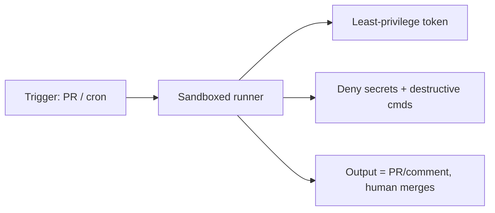

# Rendere sicure le esecuzioni autonome

> Source: https://derob98.github.io/ailmanac/it/docs/security/hardening-autonomous-runs · AILmanac (CC BY 4.0)

Blocca le esecuzioni headless/CI in modo che un agente non possa toccare segreti o produzione.

<LevelBadge level="advanced" />

<Callout type="objectives" items={[
  "I tre rischi specifici di un'esecuzione senza nessuno che guardi",
  "Una checklist di rafforzamento in otto punti, nell'ordine in cui applicarla",
  "Quale primitiva di permesso toglie davvero capacità — e quale si limita a pre-approvarla",
  "Perché un token a privilegio minimo conta più di un prompt accurato",
  "Come limitare un ciclo fuori controllo con un budget imposto dalla piattaforma invece di un'istruzione fiduciosa",
  "Perché i file di istruzioni persistenti vanno confrontati (diff) in un luogo in cui l'agente non può scrivere"
]} />

Eseguire Claude in modalità [headless](/docs/claude-code/headless-and-agent-sdk) o [programmata](/docs/claude-code/background-tasks) — in CI, in un cron job, in un hook di pre-commit — elimina la persona che normalmente intercetterebbe un'azione sbagliata. Questa comodità è esattamente il motivo per cui queste esecuzioni richiedono le protezioni più strette.

## I rischi specifici delle esecuzioni non presidiate

- **Nessuno che dica "no"** a una chiamata rischiosa a uno strumento sul momento.
- **Credenziali ambientali.** La CI ha spesso token potenti (deploy, registry dei pacchetti, cloud). Un agente lì dentro li eredita.
- **Input non fidati.** Un'esecuzione innescata da una PR o da una issue può elaborare contenuti scritti da un attaccante ([injection](/docs/security/prompt-injection)).

<Callout type="warning">
Il modo di fallire contro cui progettare non è un modello malevolo. È un modello ordinario, che possiede un token che non avrebbe mai dovuto avere, e agisce su un testo scritto da un attaccante. Ogni punto qui sotto rimuove uno di questi tre ingredienti.
</Callout>

## Una checklist di rafforzamento

<Steps items={[
  {title: "Nega esplicitamente i segreti", body: <>Blocca la lettura di <code>.env</code>, file di chiavi e percorsi di credenziali tramite le <a href="/docs/claude-code/permissions">regole deny dei permessi</a>. Non affidarti al modello per evitarli. Le regole deny sono l'<em>unica</em> primitiva che toglie capacità — vedi <a href="/docs/claude-code/agent-sdk-permissions">l'ordine di valutazione in sei passi</a> per capire perché una allow list non può fare questo lavoro.</>},
  {title: "Non usare mai la modalità bypass/yolo su una macchina con accessi reali", body: <>Riserva "salta tutte le richieste" a sandbox usa e getta. E sappi cosa <em>non</em> scavalca: le regole deny, le regole ask e gli hook <code>PreToolUse</code> girano tutti a monte della modalità.</>},
  {title: "Limita l'ambito del token", body: <>Dai all'esecuzione un token a privilegio minimo (sola lettura dove possibile), non le tue credenziali ad accesso completo. È il punto di maggior leva dell'elenco, perché è l'unico che un'istruzione iniettata non può aggirare con le parole.</>},
  {title: "Usa una sandbox e tienila effimera", body: <>Esegui in un container che viene distrutto al termine; nessun accesso persistente alla produzione. Abbinala al <a href="/docs/claude-code/sandbox-credential-masking">mascheramento delle credenziali</a>, così un valore trapelato è inutile fuori dall'esecuzione.</>},
  {title: "Metti in allowlist comandi e domini", body: <>Consenti i comandi di test/lint/build; nega quelli di rete o distruttivi. Dai un ambito alle regole — <code>Bash(npm test *)</code>, non un <code>Bash</code> nudo.</>},
  {title: "Metti dei limiti", body: <>Iterazioni massime, budget di tempo, budget di token/costo — così un ciclo o un agente manipolato non può sfuggire di mano. Sul loop ospitato da Anthropic, usa i <a href="/docs/api/managed-agents-session-budgets">Session Budgets di Managed Agents</a> per un tetto in USD rigido, imposto dalla piattaforma, che mette in pausa la sessione con <code>stop_reason: "budget_reached"</code>.</>},
  {title: "Rendi gli output rivedibili, non applicati in automatico", body: <>Preferisci "apri una PR / pubblica un commento" a "fai push su main". Il merge lo fa una persona. Questo trasforma ogni fallimento da incidente a diff respinto.</>},
  {title: "Confronta (diff) i file di memoria persistente tra le sessioni", body: <><code>CLAUDE.md</code>, <code>.cursorrules</code>, <code>SOUL.md</code>, <code>MEMORY.md</code>, file di skill dell'agente — tutto ciò che viene iniettato automaticamente come istruzione — va confrontato e registrato in un luogo in cui l'agente non può scrivere. Vedi <a href="/docs/security/mind-viruses-agent-to-agent-propagation">Mind Viruses</a> per il meccanismo di diffusione misurato da cui ci si difende.</>}
]} />

## Deny toglie, allow pre-approva soltanto

L'errore più comune in un'esecuzione rafforzata è scegliere la leva sbagliata. Una allow list sembra un lucchetto e non lo è: tutto ciò che lasci fuori è ancora disponibile all'agente e ricade semplicemente nella modalità di permesso della sessione.

<PromptCard title="Toglie la capacità — lo strumento sparisce dalla richiesta">{`claude -p "run the test suite" \\
  --disallowedTools "Bash(curl *)" "Read(//.ssh/**)" "Edit(//etc/**)"`}</PromptCard>

<PromptCard title="Rende esatta una lista di pre-approvazione — tutto il resto è negato, non richiesto">{`claude -p "run the test suite" \\
  --permission-mode dontAsk \\
  --allowedTools "Bash(npm test)" "Read"`}</PromptCard>

La seconda forma è quella che vuoi per la CI: `dontAsk` trasforma ogni richiesta in un rifiuto, così un'esecuzione che incontra qualcosa di imprevisto fallisce in modo evidente invece di bloccarsi o di ripiegare silenziosamente su un'impostazione permissiva.

## Un controllo che gira a ogni chiamata

Le regole allow e deny confrontano dei pattern. Quando serve un controllo che ispezioni il *contenuto* di una chiamata — una stringa dalla forma di un segreto in un argomento, un hostname inatteso — mettilo in un [hook](/docs/claude-code/hooks) `PreToolUse`. Gli hook girano prima di ogni altro passo di permesso, e il rifiuto di un hook tiene anche in modalità bypass.

<PromptCard title="Rifiuta qualsiasi chiamata a uno strumento che contenga materiale segreto">{`# .claude/settings.json -> hooks.PreToolUse
# Exit code 2 blocks the call and tells Claude why.
jq -e '.tool_input | tostring | test("AKIA|BEGIN PRIVATE KEY|ghp_")' >/dev/null \\
  && { echo "secret material in tool input" >&2; exit 2; } || exit 0`}</PromptCard>

## Esempio: un revisore CI sicuro

Un bot di revisione delle PR dovrebbe: fare il checkout del codice in sola lettura, **non** avere accesso a deploy o segreti, girare in un container e **commentare** i suoi risultati — senza mai modificare i branch protetti. Vedi la [guida passo passo alla revisione delle PR](/docs/walkthroughs/pr-review-action).

<Quiz questions={[
  {
    q: "La tua esecuzione CI usa bypassPermissions dentro un container. Quale di questi blocca ancora una chiamata a uno strumento?",
    options: [
      "Una voce di allowedTools che hai dimenticato di aggiungere",
      "Una regola deny, una regola ask o un hook PreToolUse",
      "Niente — bypass significa bypass",
      "Il giudizio del modello stesso"
    ],
    answer: 1,
    explain: "Le regole deny, le regole ask e gli hook vengono tutti valutati prima della modalità di permesso, quindi sopravvivono a bypassPermissions. allowedTools sta dopo la modalità e non può limitare nulla."
  },
  {
    q: "Quale singola misura limita di più il danno di una prompt injection riuscita in un'esecuzione CI?",
    options: [
      "Un prompt di sistema più lungo e deciso che dice all'agente di ignorare le istruzioni nel testo della PR",
      "Un token a privilegio minimo limitato a ciò che il job richiede davvero",
      "Chiedere all'agente di riassumere l'input non fidato prima di agire",
      "Alzare il limite di iterazioni perché abbia margine per autocorreggersi"
    ],
    answer: 1,
    explain: "Le difese a livello di prompt si possono aggirare con le parole; un token che non può fare deploy non può fare deploy. Limita l'ambito della credenziale e il caso peggiore si riduce, a prescindere da cosa l'agente sia stato convinto a tentare."
  },
  {
    q: "Perché CLAUDE.md e i file di skill vanno confrontati (diff) in una posizione in cui l'agente non può scrivere?",
    options: [
      "Per tenere pulita la cronologia git",
      "Perché vengono iniettati automaticamente come istruzioni, quindi una modifica silenziosa cambia ogni esecuzione futura",
      "Per ridurre l'uso di token a ogni esecuzione",
      "Perché Claude Code si rifiuta di avviarsi se cambiano"
    ],
    answer: 1,
    explain: "Tutto ciò che viene iniettato automaticamente come istruzione è un canale di persistenza. Se l'agente può scrivere il file e anche tenere il log, una compromissione può modificare le istruzioni e cancellare le prove — quindi il log deve stare fuori dalla sua portata."
  }
]} />

<Callout type="takeaways" items={[
  "Le esecuzioni non presidiate perdono il veto umano, ereditano credenziali ambientali e spesso leggono testo scritto da un attaccante — rimuovi un ingrediente alla volta.",
  "Le regole deny e gli hook tolgono capacità; le allow list si limitano a pre-approvare. Abbina allowedTools a dontAsk per renderla esatta.",
  "Limita l'ambito del token prima di rifinire il prompt. È la difesa che un'injection non può aggirare con le parole.",
  "Limita costo e iterazioni con un budget imposto dalla piattaforma, non con un'istruzione.",
  "Consegna gli output come una PR o un commento, così il merge umano resta nel ciclo.",
  "Confronta (diff) i file di istruzioni iniettati automaticamente in uno spazio di archiviazione in cui l'agente non può scrivere."
]} />

## Prossimi passi

- [Permessi dell'Agent SDK: l'ordine in sei passi](/docs/claude-code/agent-sdk-permissions) — esattamente quale primitiva vince, e i cinque modi in cui una allowlist non fa nulla in silenzio
- [Permessi e modalità di permesso](/docs/claude-code/permissions)
- [Mettere in sicurezza agenti e strumenti](/docs/security/securing-agents)
- [Modalità headless e Agent SDK](/docs/claude-code/headless-and-agent-sdk)
- [La CLI claude: i flag che cambiano i risultati](/docs/claude-code/cli-flags) — l'insieme di flag per esecuzioni limitate, e `--restricted` per una macchina condivisa
