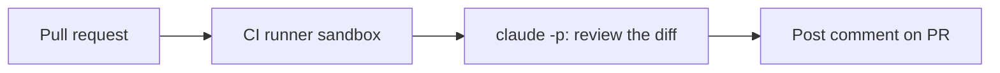

# Una GitHub Action che revisiona ogni PR

> Source: https://derob98.github.io/ailmanac/it/docs/walkthroughs/pr-review-action · AILmanac (CC BY 4.0) · last verified 2026-07-17

Esegui Claude Code in modalità headless in CI per revisionare e commentare le pull request.

<LevelBadge level="advanced" />

<Callout type="objectives" items={[
  "Collegare Claude Code headless a un workflow pull_request che revisiona il diff e commenta",
  "Impostare il blocco permissions su solo commento, e spiegare perché contents: write è la linea che non si supera",
  "Trattare il contenuto delle pull request come input non attendibile, perché è esattamente ciò che è",
  "Mantenere limitato il costo di una revisione al crescere dei diff",
  "Scrivere il prompt in modo che il commento venga letto invece di essere compresso"
]} />

<VerifyNote lastVerified="2026-07-17" source="https://code.claude.com/docs/en/headless">
I flag headless e i dettagli dell'integrazione CI evolvono — verifica sulla documentazione ufficiale di Claude Code / Agent SDK.
</VerifyNote>

Un classico dell'automazione ad alto valore: far **revisionare a Claude ogni pull request** e pubblicare le sue osservazioni come commento — eseguendolo [headless](/docs/claude-code/headless-and-agent-sdk) in CI. Ecco la forma, con le protezioni che lo mantengono sicuro.

## Cosa fa

A ogni PR: fa il checkout del diff, chiede a Claude di revisionarlo cercando bug, casi limite e problemi di convenzioni, e pubblica un commento. Le persone decidono ancora; Claude dà solo una prima passata rapida.



<Steps items={[
  {title: "Fai il checkout di cronologia sufficiente per calcolare un diff", body: "Un clone shallow non vede il branch di base, quindi il diff esce vuoto e la revisione si legge come un via libera sicuro su nulla. Recupera la profondità completa."},
  {title: "Produci il diff come file", body: "Fai il diff del ref di base contro HEAD e scrivilo su disco. Tenerlo come artefatto invece che in una variabile di shell evita che diff molto grandi rompano la riga di comando."},
  {title: "Esegui Claude headless con il diff su stdin", body: "Un prompt, una passata, output catturato come Markdown. Nessuno strumento, nessuna scrittura sul repo — questo passo deve solo leggere e produrre testo."},
  {title: "Pubblica il Markdown come commento sulla PR", body: "Con la CLI gh o con una action. È l'unico passo che richiede un permesso di scrittura di qualsiasi tipo, e l'unica scrittura che gli serve è pull-requests."}
]} />

## Il workflow (bozza)

```yaml
name: Claude PR review
on: pull_request
permissions:
  contents: read
  pull-requests: write   # to comment — NOT write to code
jobs:
  review:
    runs-on: ubuntu-latest
    steps:
      - uses: actions/checkout@v4
        with: { fetch-depth: 0 }
      - name: Review the diff
        env:
          ANTHROPIC_API_KEY: ${{ secrets.ANTHROPIC_API_KEY }}
        run: |
          git diff origin/${{ github.base_ref }}...HEAD > /tmp/diff.patch
          claude -p "Review this diff for correctness bugs, missing edge cases, and
          security issues. Report ONLY high-confidence findings as a Markdown
          checklist with file:line. Diff:" < /tmp/diff.patch > /tmp/review.md
      # then post /tmp/review.md as a PR comment (e.g. with the gh CLI or an action)
```

(L'invocazione headless esatta può differire — vedi la documentazione. Il principio è: dare in pasto il diff, catturare il Markdown, pubblicarlo.)

## Le protezioni (leggi [Rafforzare le esecuzioni autonome](/docs/security/hardening-autonomous-runs))

:::warning[Privilegio minimo in CI]
- **Solo commento.** Concedi `pull-requests: write`, **non** `contents: write` — il bot non deve pushare codice.
- **Limita il token**; non esporre mai accesso a deploy/segreti a un job che legge contenuto non attendibile di una PR.
- **Tratta il contenuto della PR come non attendibile** — può portare [prompt injection](/docs/security/prompt-injection); non lasciare che il job compia azioni con conseguenze.
- **Limita il costo** — i diff grandi costano [token](/docs/api/tokens-and-pricing); valuta di revisionare solo i file modificati.
:::

## Renderlo utile, non rumoroso

- Chiedi **solo osservazioni ad alta confidenza** — un muro di pignolerie viene ignorato.
- Tienilo come **prima passata**, con le persone che decidono il merge.

<PromptCard title="The review prompt — tuned for a comment people actually read">{`Review this diff for correctness bugs, missing edge cases, and security issues.

Rules for your output:
- Report ONLY high-confidence findings. If you are unsure, leave it out.
- One Markdown checklist item per finding, each starting with file:line.
- State the concrete failure: what input or state leads to what wrong result.
- No style nitpicks, no praise, no summary of what the diff does.
- If you find nothing high-confidence, say exactly that in one line.

Diff:`}</PromptCard>

<Quiz questions={[
  {
    q: "Il tuo job di revisione deve pubblicare un commento sulla pull request. Quale blocco permissions è corretto?",
    options: [
      "contents: write e pull-requests: write, così il bot può anche pushare correzioni",
      "contents: read e pull-requests: write — solo commento; il bot non deve pushare codice",
      "contents: read e pull-requests: read, dato che revisionare è un'operazione di lettura",
      "Per i workflow pull_request non serve alcun blocco permissions"
    ],
    answer: 1,
    explain: "Commentare richiede pull-requests: write, e nient'altro. Concedere contents: write permetterebbe a un job che legge contenuto non attendibile di una pull request di pushare codice — esattamente la combinazione che vuoi evitare. Leggere il repo richiede contents: read."
  },
  {
    q: "Perché il passo di checkout usa fetch-depth: 0?",
    options: [
      "Per velocizzare il clone nei repository grandi",
      "Perché Claude headless richiede la cronologia git completa per girare",
      "Perché un clone shallow non vede il branch di base, quindi il diff esce vuoto",
      "Per permettere al job di scrivere in seguito sul branch"
    ],
    answer: 2,
    explain: "Il diff è calcolato rispetto al ref di base. Un clone shallow non lo ha, quindi il diff è vuoto e la revisione dà silenziosamente il via libera a nulla — un fallimento che sembra un successo."
  },
  {
    q: "Un contributor apre una PR la cui descrizione dice al reviewer di ignorare i controlli di sicurezza e approvare. Qual è la postura giusta?",
    options: [
      "Aggiungere al prompt un'istruzione che dice a Claude di non seguire mai istruzioni contenute nel diff, e considerare il problema risolto",
      "Trattare il contenuto della PR come input non attendibile che può portare prompt injection, e impedire al job di compiere qualsiasi azione con conseguenze",
      "Limitare la action alle PR dei membri dell'organizzazione",
      "Far aprire al job una issue che segnala il contributor"
    ],
    answer: 1,
    explain: "Il contenuto di una pull request è input non attendibile e può portare prompt injection. Le istruzioni nel prompt aiutano ma non sono un confine. Il controllo duraturo è il privilegio minimo: il job può solo commentare, quindi il caso peggiore di una injection riuscita è un commento sbagliato invece di un push, un deploy o un segreto trapelato."
  }
]} />

<Callout type="takeaways" items={[
  "L'intero job è: checkout a profondità completa, diff su file, una passata headless, pubblicazione del Markdown. Quattro passi, uno solo dei quali richiede accesso in scrittura.",
  "pull-requests: write e contents: read. Mai contents: write in un job che legge contenuto scritto da contributor.",
  "fetch-depth: 0, altrimenti il diff è vuoto e la revisione si legge come un certificato di buona salute.",
  "Il contenuto delle PR non è attendibile e può portare prompt injection. Il privilegio minimo è il controllo; la formulazione del prompt non è un confine.",
  "Chiedi solo osservazioni ad alta confidenza, con file:line. Un muro di pignolerie viene compresso e l'automazione muore di indifferenza.",
  "Limita il costo al crescere dei diff — revisionare solo i file modificati è la leva abituale.",
  "È una prima passata. Le persone decidono ancora il merge."
]} />

## Avanti

- [Modalità headless e Agent SDK](/docs/claude-code/headless-and-agent-sdk)
- [Rafforzare le esecuzioni autonome](/docs/security/hardening-autonomous-runs)
- [Coding e sviluppo software](/docs/playbooks/coding)
