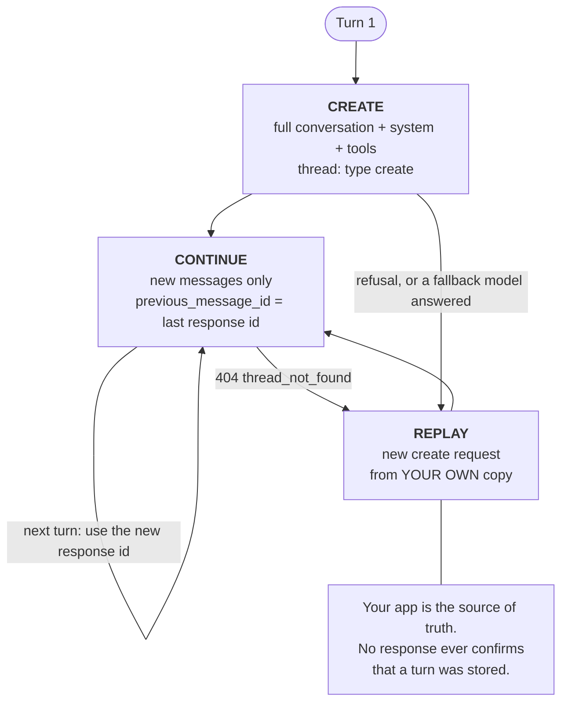

# Message Threads — 新しいターンだけを送る

> Source: https://derob98.github.io/ailmanac/ja/docs/api/message-threads · AILmanac (CC BY 4.0) · last verified 2026-11-03

Messages API は会話をサーバー側に保持でき、各ターンで新しいメッセージだけを送れば済みます。実際に節約できるもの(バイト数とレイテンシであり、トークンではない)、リリース前に必ず作るべきリプレイ経路、3 つのフィールドグループ、そして 4 ブレークポイントのキャッシュ上限。

<LevelBadge level="advanced" />

<Callout type="objectives" items={[
  "スレッドが節約するもの(リクエストのバイト数と time to first token)と、節約しないもの(トークン、つまりお金)を正確に言える",
  "create、continue、replay の 3 状態ライフサイクルを回し、リプレイ経路をリリース後ではなくリリース前に作る",
  "すべてのパラメータを create-only、fixed、free のいずれかに分類し、thread_fingerprint_mismatch を一目で見分ける",
  "4 ブレークポイントの予算内で、スレッド上でもプロンプトキャッシュを機能させ続ける",
  "ストリーミングされたターンを安全に continue し、message_stop より前に continue すると 404 が返る理由を理解する",
  "5 つのスレッドエラーと、復旧せずに新しいスレッドを始めるべき 2 つのケースを扱う",
  "自分のワークロードがスレッドの恩恵を受けるタイプかどうかを判断する"
]} />

<VerifyNote lastVerified="2026-11-03" source="https://platform.claude.com/docs/en/build-with-claude/message-threads">
Message threads は **2026 年 11 月 2 日にパブリックベータ**となり、`anthropic-beta: message-threads-2026-08-12` ヘッダーの背後で提供されています。フィールド名、エラーコード、有効期限、非対応機能の一覧は公式リファレンスからの引用であり、ベータの間は変わる可能性があります — リリース前に再確認してください。執筆時点での提供状況: Claude API、Claude Platform on AWS、Claude Models on Google Cloud(Anthropic 管理)、Claude in Microsoft Foundry。Amazon Bedrock では**利用できません**。対応モデルは幅広く、[公式の対応モデル一覧](https://platform.claude.com/docs/en/build-with-claude/message-threads)と[モデルと料金](/docs/whats-new/models-and-pricing)を参照してください。
</VerifyNote>

長いエージェントループには、モデルとは無関係の静かな税金があります。40 ターン目のリクエストは、またしても会話全体です。読んだすべてのファイル、撮ったすべてのスクリーンショット、すべてのツール結果。モデルが 1 トークンを出力する前に、API はそのすべてを受信し、検証し、トークナイズしなければなりません。会話は*入力*ではなく*アップロード*になってしまったのです。

**メッセージスレッド**はアップロードをなくします。会話全体を 1 回だけ送ります。それ以降、各リクエストは新しいメッセージと直前のレスポンスの `id` だけを運び、API はモデルを呼び出す前に自分の側で会話を再構築します。

## スレッドが実際に節約するもの

移行を計画する前にこのセクションを読んでください。この機能について人づてに書かれた記事は、ほぼ例外なくここを間違えています。

<Callout type="warning" items={[
  "スレッドはトークン課金を減らしません。Anthropic は明言しています: Claude は毎ターン会話全体を読むため、トークン使用量は同じです。料金とレート制限も変わりません。",
  "引用されているのを見かけるかもしれない劇的な数字 — 数百キロバイトから数キロバイトへ — はリクエストのペイロードサイズであり、トークンではありません。アップロードが小さくなるのはレイテンシにとって本物の利点ですが、請求書が小さくなるわけではありません。",
  "コストを下げるレバーは依然としてプロンプトキャッシュであり、スレッドがキャッシュを代わりに有効にしてくれるわけではありません。下の「スレッド上のプロンプトキャッシュ」を参照してください。"
]} />

得られるのはレイテンシと帯域です。Anthropic が公表している実測値: **50 万〜100 万トークン**のリクエストでは、time to first token の中央値が**約 35%** 短縮されます。

<VerifyNote lastVerified="2026-11-03" source="https://claude.com/resources/articles/message-threads">
TTFT 中央値の約 35% という数字は、50 万〜100 万トークンのリクエストに限った話です。Anthropic の説明では、エージェントが抱えるコンテキストが多いほど、スレッドの効果が大きくなります。短い会話ではほとんど効果がありません — 取り除けるアップロードがそもそも少ないからです。同じ情報源は、Claude が毎ターン会話全体を読むためトークン使用量は同じままだと、はっきり述べています。
</VerifyNote>

したがって、正直な判断ルールはこうです:

| ワークロード | スレッドは有効か? |
|---|---|
| 長いコーディングエージェント — ツール結果やファイル編集のたびに会話が膨らむ | **はい。**想定されている主要ケースです。 |
| 毎ターンスクリーンショットをアップロードする computer-use エージェント | **はい。**スクリーンショットは再アップロードされず、スレッドに残ります。 |
| ドキュメントや画像が多いマルチターンのワークフロー | **はい。**ペイロード削減が最大になります。 |
| 短いターンが数回のチャット | **いいえ。**取り除くものがほとんどなく、リプレイの複雑さだけを背負うことになります。 |
| バッチジョブ、トークンカウント、オンデマンドのコンパクション | **不可能です。**[スレッドが対応しない機能](#スレッドが対応しない機能)を参照。 |
| このトラフィックでゼロデータ保持(ZDR)が必要 | **いいえ。**スレッドは ZDR の対象外です。[データ保持](#データ保持)を参照。 |

:::tip[スレッドとセッションは別の機能です]
Message threads は Messages API 上にあります。**セッションスレッド**は [Claude Managed Agents](/docs/api/managed-agents) 内の別の概念です。同じ言葉でもレイヤーが違います — 一方の検索結果でもう一方に迷い込まないようにしてください。
:::

## 3 状態ライフサイクル

<Steps items={[
  {title: "Create", body: "最初のリクエストは今と全く同じように送ります — 会話全体、system、tools — そこに type 'create' の thread パラメータを追加します。API は会話と Claude の返信をレスポンス id のもとに保存します。このスレッドのこのリクエストと以降のすべてのリクエストで、message-threads-2026-08-12 ベータヘッダーを送ってください。"},
  {title: "Continue", body: "直前のレスポンス以降のメッセージだけを、thread type 'continue' と、そのレスポンスの id を設定した previous_message_id とともに送ります。system と tools は含めません — スレッドは create リクエストの値を保持しており、どちらかを再送すると、null であっても 400 エラーになります。次のターンでは新しいレスポンス id を使います。"},
  {title: "Replay", body: "スレッドはベストエフォートです。最後のリクエストから 5 分で失効し、最後の使用から遅くとも 1 時間以内に削除されます。レスポンスが保存されるたびに 5 分がリセットされます。API が continue できなくなると、continue リクエストは 404 thread_not_found を返します。新しい create リクエストで会話全体を再送し、そのレスポンスの id から continue を続けます。"}
]} />

### Create、そして continue

<PromptCard title="curl — create a thread, then send only the new turn">{`# Turn 1 — full conversation, system, tools, and thread: create
curl https://api.anthropic.com/v1/messages \\
  -H "x-api-key: $ANTHROPIC_API_KEY" \\
  -H "anthropic-version: 2023-06-01" \\
  -H "anthropic-beta: message-threads-2026-08-12" \\
  -H "content-type: application/json" \\
  -d '{
    "model": "claude-opus-5-5",
    "max_tokens": 1024,
    "cache_control": {"type": "ephemeral"},
    "system": "You are a support agent for Acme. Keep replies short.",
    "messages": [{"role": "user", "content": "Hi! I have a question about an order."}],
    "thread": {"type": "create"}
  }'

# Turn 2 — only the new message. No system, no tools.
# message_id is the id from the turn-1 response.
curl https://api.anthropic.com/v1/messages \\
  -H "x-api-key: $ANTHROPIC_API_KEY" \\
  -H "anthropic-version: 2023-06-01" \\
  -H "anthropic-beta: message-threads-2026-08-12" \\
  -H "content-type: application/json" \\
  -d '{
    "model": "claude-opus-5-5",
    "max_tokens": 1024,
    "cache_control": {"type": "ephemeral"},
    "messages": [{"role": "user", "content": "How long does standard shipping usually take?"}],
    "thread": {"type": "continue", "previous_message_id": "'"$message_id"'"}
  }'`}</PromptCard>

公式 SDK には、これらのリクエストを組み立ててくれる**スレッドヘルパー**が付属しています — ベータヘッダーを追加し、最初のターンで create、以降は continue を行い、`system` と `tools` を省略し、404 のときは 1 回だけリプレイします。これが適切なデフォルトです。上の素の形式が必要になるのは、ヘルパーのない言語から、ゲートウェイ経由で、あるいは `curl` から API を直接使う場合です。

## 3 つのフィールドグループ

机の上に貼っておきたい表です。スレッドリクエストのすべてのパラメータはちょうど 1 つのグループに属し、そのグループが、送ってよいか、送らなければならないか、変更してよいかを決めます。

| グループ | フィールド | ルール |
|---|---|---|
| **Create-only** | `system`, `tools` | **create リクエストでのみ**送ります。それらに付ける `cache_control` ブレークポイントも同様です。continue リクエストで送ると — `null` であっても — 400 が返ります。 |
| **Fixed** | `model`, `tool_choice`, `thinking`, `mcp_servers`(各サーバーの認証トークンを除く)、`context_management`, `output_config`, `container` 内の `skills`, トップレベルの `cache_control`, および `anthropic-beta` の値の集合 | **すべての**リクエストで、create リクエストと**同じ値**を送ります。異なる値だと 400 `thread_fingerprint_mismatch` が返り、エラーメッセージに異なるフィールド名が示されます。 |
| **Free** | `max_tokens`, `stop_sequences`, `stream`, `metadata`, `service_tier`, および上に挙げていないすべて | ターンごとに自由に変更できます。 |

覚えておくべき例外が 2 つあります:

- **MCP サーバーの URL、MCP の認証トークン、コンテナの `id` は保存されません。**これらを使うリクエストでは毎回 `mcp_servers` と `container` を送ってください。認証トークンはリクエスト間で変えても構いません。
- **`fallbacks` はオールオアナッシングです。**[サーバーサイドフォールバック](/docs/api/server-side-fallbacks)を使うなら、スレッドのすべてのリクエストで `fallbacks` を送るか、まったく送らないかのどちらかです。スレッドの途中で追加したり外したりすると `thread_fingerprint_mismatch` になります。ただし*値*は変更できます。

create-only や fixed のフィールドを変えたいときは、スレッドを変更するのではなく、新しい値を載せた create リクエストで新しいスレッドを始めます。

:::warning[`system` や `tools` を変えると、保持された thinking が無効になることがあります]
Claude Fable 5.1、Mythos 5.1、Opus 5.5、Sonnet 5.5、Haiku 5.5 では、`system` または `tools` を変えて新しいスレッドを始めると、会話にすでに含まれている `thinking` と `redacted_thinking` ブロックが無効になり、create リクエストが 400 を返すことがあります。対処法: 送る会話からすべての `thinking` と `redacted_thinking` ブロックを取り除きます。するとモデルは、以前の推論なしで回答します。[Thinking と effort](/docs/api/thinking-and-effort)を参照してください。
:::

## リプレイ経路は省略できません

<Callout type="warning" items={[
  "真実の源はあくまでアプリケーションです。すべてのメッセージを自分で保持してください。",
  "どのレスポンスも — create も continue も — API がそのターンを保存したかどうかを教えてくれません。それは次の continue リクエストで、成功するか 404 になるかで初めて分かります。",
  "SDK のスレッドヘルパーは、ヘルパーオブジェクトが生きている間だけ自分のコピーをメモリに保持し、他のどこにも保存しません。会話をプロセスより長く残す必要があるなら、自分で永続化してください。",
  "リプレイは初日から作ってください。開発中に一度も失効しなかったスレッドは、本番で最初の遅いツール呼び出しの間に失効します。"
]} />

`error.details.error_code` が `thread_not_found` の 404 は「これは continue できない」という意味で、レスポンスは意図的に理由を教えません。文書化されている原因:

- スレッドが失効した(5 分間の無操作)。
- API は直前のターンを処理したが**保存しなかった** — たとえば、`max_tokens` で打ち切られてツール呼び出しで終わったレスポンス。
- **フォールバックモデル**が直前のレスポンスを書いた。
- 直前のレスポンスが**まだ生成中**である。
- リクエストが別の組織、ワークスペース、ユーザー、またはサービスアカウントから来ている。ワークスペースキーで作成されたスレッドは、そのキーに紐づいたままです。
- 新しいメッセージが、保存済みの会話が受け付けられない内容を追加している — 典型例は、画像がなかった会話に追加される**最初の画像**。

:::tip[リプレイする前にエラーコードを確認する]
存在しないモデルへのリクエストも 404 を返します。ステータスだけで判断せず、必ず `error.details.error_code` で分岐してください。
:::

復旧するには、自分のコピーから会話全体を、`system` と `tools` を付けて**新しい create リクエスト**で送り、新しいレスポンスの `id` から continue を続けます。先に、以前のメッセージから `cache_control` ブレークポイントを取り除いてください(下の 4 ブレークポイント予算を参照)— SDK ヘルパーはこれを自動で行います。

**リプレイした create が成功したのに、直後の continue がまた 404 になる場合**、API がその会話をそもそも保存できない可能性があります — たとえば非常に大きな会話です。その会話には `thread` を使うのをやめて、通常のリクエストを送ってください。SDK ヘルパーは、`unsupported_request_behavior` を `continue_unthreaded` に設定して構築するとこれを自動化します。この設定がないと毎ターンリプレイしてしまい、スレッドを使わないより厳密に悪い結果になります。

### Append-only、そして `id` ごとに continue は 1 回だけ

スレッドは増える一方です。各レスポンス `id` は**ちょうど 1 回**だけ continue でき、常に**最新**の `id` から continue します。そこから 3 つの帰結が生じます:

- **編集も分岐もできません。**以前のメッセージを変更したり別の案を試したりするには、新しいスレッドを始めます。
- **その場での要約はできません。**スレッドの初期のターンを要約に置き換えることはできません。コンパクトにしたいなら、自分のコードで要約を書き、**新しい** create リクエストの通常のメッセージとして送ります。[オンデマンドのコンパクション](/docs/api/compaction)はスレッドでは一切使えません。
- **continue のリトライは冪等ではありません。**同じ continue を 2 回送ると、2 回目は `thread_already_continued` か `thread_continue_in_flight` を受け取ります。

API は continue で送ったメッセージの重複排除を**行いません**。メッセージを再送すると、会話に 2 回現れることもあれば、エラーになることもあります。直前の*レスポンス*から始まる continue リクエストは、即座にエラーになります。

### `pause_turn` の特殊ケース

レスポンスが `stop_reason: "pause_turn"` で止まったら、そのレスポンスの `id` からの continue リクエストと**空の** `messages` リストで再開します:

<PromptCard title="Resume a paused turn — empty messages, same thread">{`{
  "model": "claude-opus-5-5",
  "max_tokens": 1024,
  "cache_control": {"type": "ephemeral"},
  "messages": [],
  "thread": {"type": "continue", "previous_message_id": "msg_01..."}
}`}</PromptCard>

ターンが一時停止している間は、新しいユーザーメッセージを送**らないで**ください — API は拒否します。その再開が 404 を返したら、*一時停止したレスポンスを含めた*会話全体を新しい create リクエストでリプレイします。SDK ヘルパーでは、メッセージなしで `send()` を呼びます。

### 拒否の後は、最初からやり直す

レスポンスが `stop_reason: "refusal"` なら、**スレッドを continue しないでください。**API はすでに拒否されたターンを保持している可能性があり、continue ではそれを取り除けません。拒否を引き起こしたターンを省くか言い換えた create リクエストで、新しいスレッドを始めます。[拒否と安全性](/docs/api/refusals-and-safety)を参照してください。SDK ヘルパーがこれを処理します: 拒否されたターンを破棄し、次の呼び出しで新しいスレッドを始めます。

## スレッド上のプロンプトキャッシュ

スレッドとキャッシュは直交しています。**スレッドがプロンプトを代わりにキャッシュしてくれることはありません** — [プロンプトキャッシュ](/docs/api/prompt-caching)はスレッドなしの場合とまったく同じ挙動で、ブレークポイントをどこに置くかはあなたが決めます。これを飛ばすと、アップロードは速くなったのにコストは以前と同じ、というスレッドになります。

簡単なレシピ: スレッドの**すべてのリクエストでトップレベルの `cache_control`** を送ります。API はそれをそのリクエストの `messages` の最後のキャッシュ可能ブロックに適用するので、各ターンは以前の会話をキャッシュから読み、新しいターンをそこに書き込みます。トップレベルの `cache_control` は **fixed** フィールドであることを忘れずに — すべてのリクエストで同じ値でなければ、フィンガープリント不一致になります。

ブロックに自分でブレークポイントを置く場合は、4 つのルールがあります:

1. create リクエストで送ったブレークポイントは、`tools`、`system`、または最後ではないメッセージブロックに置かれているなら、後のターンでも機能し続けます。リクエストの**最後の**ブロックにあるブレークポイントは*そのリクエストで*キャッシュを書き込みます — したがって新しいターンごとにキャッシュしたいなら、リクエストごとに 1 つ送ります。
2. 送ったブレークポイントを**移動も削除もできません**。continue リクエストは以前のメッセージを二度と再送できないからです。
3. **予算はスレッドリクエストあたり 4 ブレークポイントです。**トップレベルの `cache_control` が 1 つ分を消費します。create リクエストの `system` と `tools` に置いたブレークポイントは、**continue リクエストのたびにまた数えられます**。以前の*保存済み*メッセージのブレークポイントは数えられません。超過すると、`unsupported: ["cache_control"]` を伴う 400 `thread_unsupported_request` になります。
4. リプレイするときは、以前のメッセージからブレークポイントを取り除き、最後のブロックに 1 つだけ残します — そうしないと、リプレイ自体が予算を超えます。

:::tip[計算は一度だけやっておく]
トップレベルの `cache_control`(1)+ `system` のブレークポイント(2)+ `tools` のブレークポイント(3)で、すべての continue リクエストにちょうど**1 つ**の余裕が残ります。設計の余地はありますが、気軽に使える予算ではありません。
:::

プロバイダー横断で見たこのトレードオフについては、[プロバイダー間のプロンプトキャッシュ](/docs/models/prompt-caching-across-providers)を参照してください。

## ストリーミング

スレッドは[ストリーミング](/docs/api/streaming)と併用できますが、間違えやすいタイミングのルールが 1 つあります。

レスポンスの `id` は、`message_start` イベントで早い段階に届きます。**`message_stop` を受信するまで、その id から continue しないでください。**それより前に送った continue は 404 を返すことがあります。直前のレスポンスがまだ生成中だからです。

continue リクエストのストリームが `message_stop` の前に切れたら、同一の continue リクエストを再送します。*それが* `thread_already_continued` や `thread_continue_in_flight` を返したら、新しい create リクエストで会話全体をリプレイします。この曖昧さは本質的なものです: 接続がサーバーのレスポンス保存の前に切れたのか、後に切れたのか分かりません。リプレイは常に安全ですが、リトライはそうとは限りません。

SDK ヘルパーはストリームが切れた後の continue を**リトライしません**。完了したブロックと届いたテキストを保持し、次のターンで会話全体をリプレイします。中断したターンを代わりに再送するには、メッセージなしで `send()` を呼びます。また、すべてのストリームを最後まで読んでください — ヘルパーは `message_stop` でレスポンスを記録するので、ストリームを途中で放棄すると、閉じるまでスレッドが占有されたままになります(Python では `with` ブロックを抜ける、TypeScript では `abort()`、それ以外では `Close`/`close()`)。

## エラー

この 5 つはすべて**モデルが実行される前に**返されます: リクエストはトークンを消費せず、スレッドも有効期限も変わりません。

| ステータス | `error_code` | 意味 | 対処 |
|---|---|---|---|
| 404 | `thread_not_found` | API がスレッドを continue できない。 | リプレイ: 新しい create リクエストで会話全体を送る。 |
| 400 | `thread_fingerprint_mismatch` | fixed フィールドが保存された値と異なる。メッセージにどれかが示される。 | fixed フィールドを同一に保つか、変更したければ新しいスレッドを始める。 |
| 400 | `thread_already_continued` | そのレスポンス `id` はすでに continue 済み。 | 最新の `id` から continue する。クライアントがそのレスポンスを見ていないなら、リプレイする。 |
| 400 | `thread_continue_in_flight` | この `id` からの別の continue がまだ実行中 — たいていは自分自身のリトライ。 | 終わるのを待ってそのレスポンスから continue するか、リプレイする。 |
| 400 | `thread_unsupported_request` | リクエストがスレッド非対応の機能または組織設定を使っている。該当するとき `error.details.unsupported` がそれを示す。 | その機能を外すか、`thread` なしでリクエストを送る。 |

`error.type` は 400 では `invalid_request_error`、404 では `not_found_error` です。スレッドリクエストの 400 の中には、`error_code` が**まったくない**ものもあります — `previous_message_id` のない continue や、`system` あるいは `tools` を含む continue がそうです。

<PromptCard title="A thread error body — note where error_code actually lives">{`{
  "type": "error",
  "error": {
    "type": "invalid_request_error",
    "message": "thread: a maximum of 4 blocks with cache_control may be provided when \`thread\` is set. Found 5.",
    "details": {
      "error_code": "thread_unsupported_request",
      "unsupported": ["cache_control"]
    }
  },
  "request_id": "req_011CSHoEeqs5C35K2UUqR7Fy"
}`}</PromptCard>

`error.details.unsupported` に文書化されている値は `context_management`、`cache_control`、`fallbacks`、`hipaa`、`inference_hooks` です。Anthropic はこの一覧に追加することがあるので、未知の値はクライアントのバグではなく「これは `thread` なしで送る」と扱ってください。複数の条件に該当するリクエストでも、通知されるのは 1 つだけです。

## スレッドが対応しない機能

- **[Message Batches](/docs/api/message-batches)。** `thread` を含むバッチ項目は、結果の中で `invalid_request_error` として失敗します。
- **トークンカウント。** `thread` 付きのトークンカウントリクエストは 400 です。代わりに `system` と `tools` を付けた会話全体をカウントしてください。[トークンと料金](/docs/api/tokens-and-pricing)を参照。
- **[コンパクション](/docs/api/compaction)。** オンデマンドのコンパクションはスレッドでは使えません。
- **[コンテキスト編集](/docs/api/memory-and-context-editing)** — ただし 1 つ例外があります: `keep: "all"` の `clear_thinking_20251015`。
- **HIPAA readiness が有効な組織。**
- **[Inference hooks](/docs/api/inference-hooks) がオンの組織。**組織を管理している人に伝えておく価値があります: 他の誰かが有効にしたプラットフォームレベルの設定によって、チーム全体でスレッドが使えなくなることがあります。

厳格な制限がさらに 2 つ: **スレッドを一覧、読み取り、削除する API は存在せず**、スレッドは Amazon Bedrock では利用できません。

## データ保持

Message threads は **ZDR の対象外**です。使っても、他の ZDR 対象機能の利用には影響しません — 範囲はこのトラフィックであり、アカウント全体ではありません。

スレッドが保持するもの: モデルに送られた会話、create リクエストの `system` と `tools`、および fixed フィールドのフィンガープリント。これは**メモリ上で、サーバー管理の鍵で暗号化され、永続ストレージには一切書き込まれず、スレッドの最後の使用から遅くとも 1 時間以内に削除されます。**ファイルは**参照**として保持されるため、会話が使うすべてのファイルは、スレッドを使っている間ずっと利用可能でなければなりません。

コンプライアンス上ワークロードに ZDR が必要なら、そのワークロードにスレッドは使えません。[プライバシー](/docs/foundations/privacy)を参照してください。

## よくある間違い

| 間違い | 症状 | 対処 |
|---|---|---|
| 請求額が減ると期待する | 請求書が変わらない | スレッドが削るのはバイト数と TTFT であり、トークンではない。コストには[プロンプトキャッシュ](/docs/api/prompt-caching)を追加する。 |
| continue で `system` を再送する | 400、`error_code` なし | create-only。省略する — `null` でも失敗する。 |
| スレッドの途中で `thinking` や `tool_choice` を少し変える | `thread_fingerprint_mismatch` | fixed フィールド。変えるなら新しいスレッドを始める。 |
| レスポンスを保存の証拠とみなす | 後で突然の 404 | 保存を確認するものは何もない。リプレイを作る。 |
| `message_start` から continue する | 負荷時に断続的な 404 | `message_stop` を待つ。 |
| 切れた continue を闇雲にリトライする | `thread_already_continued` | 1 回リトライし、それからリプレイ。リプレイは常に安全。 |
| 拒否の後に continue する | 会話が汚染される | そのターンを除いて新しいスレッドを始める。 |
| `system` + `tools` + トップレベル + ターンごとにブレークポイント | `thread_unsupported_request` | 予算は 4 で、`system`/`tools` のブレークポイントは毎ターン数え直される。 |
| `pause_turn` 中に新しいユーザーメッセージを送る | 拒否される | `"messages": []` で continue する。 |
| ヘルパーが毎ターンリプレイしている | スレッドなしより遅延が*悪化* | `unsupported_request_behavior` を `continue_unthreaded` に設定する。 |

<Quiz questions={[
  {
    q: "40 ターンのコーディングエージェントをメッセージスレッドに移行したところ、リクエストのペイロードが約 600 KB から約 2 KB に減りました。月々の API 請求額はどうなりますか?",
    options: [
      "送るデータが大幅に減るので、おおよそ比例して下がる",
      "変わらない — Claude は毎ターン会話全体を読むので、トークン使用量は同じ",
      "TTFT の改善に合わせて、約 35% 下がる",
      "API がスレッドの保存に課金するので、上がる"
    ],
    answer: 1,
    explain: "Anthropic は明言しています: Claude は毎ターン会話全体を読むのでトークン使用量は同じままで、スレッドは料金もレート制限も変えません。キロバイトの数字はリクエストのペイロードサイズです。約 35% は 50 万〜100 万トークンのリクエストにおける time to first token の中央値であって、コストの数字ではありません。コストを下げるレバーは依然としてプロンプトキャッシュであり、スレッドがそれを代わりに有効にしてくれるわけではありません。"
  },
  {
    q: "スレッドの 12 ターン目で、error_code が thread_not_found の 404 が返りました。正しい復旧方法はどれですか?",
    options: [
      "同じ continue リクエストをリトライする — 一時的なエラーである",
      "代わりに 2 ターン前のレスポンス id から continue する",
      "自分のコピーから会話全体を system と tools を付けて新しい create リクエストで送り、新しいレスポンス id から continue する",
      "スレッド削除エンドポイントを呼び出して、新しいスレッドを作る"
    ],
    answer: 2,
    explain: "スレッドはベストエフォートで、404 は理由を決して教えません — 失効、保存されなかったターン、フォールバックモデル、別の API キー、あるいは保存済みの会話が受け付けられない新しい内容のいずれかです。唯一の復旧は、自分のコピーから、system と tools を復元し、以前のメッセージから cache_control ブレークポイントを取り除いた新しい create リクエストでリプレイすることです。スレッドを一覧、読み取り、削除する API はありません。"
  },
  {
    q: "create リクエストで system に cache_control ブレークポイントを 1 つ、tools に 1 つ置き、さらにトップレベルの cache_control を送りました。各 continue リクエストで使えるブレークポイントはいくつ残りますか?",
    options: [
      "3 つ — トップレベルのものだけが引き継がれる",
      "1 つ — 上限は 4 で、トップレベルが 1 つ分を消費し、system と tools のブレークポイントは毎ターン数え直される",
      "4 つ — create-only フィールドのブレークポイントは continue リクエストでは数えられない",
      "0 — system と tools のブレークポイントが予算をすべて消費する"
    ],
    answer: 1,
    explain: "スレッドリクエストで許される cache_control ブレークポイントは最大 4 つです。トップレベルの cache_control が 1 つ分を消費し、create リクエストの system と tools に置いたブレークポイントは continue リクエストのたびにまた数えられます — 3 つ使用、1 つ余り。数えられないのは、以前の保存済みメッセージにあるブレークポイントだけです。超過すると、unsupported: [\"cache_control\"] を伴う 400 thread_unsupported_request が返ります。"
  },
  {
    q: "既存のスレッドに対してできることはどれですか?",
    options: [
      "オンデマンドのコンパクションで、最初の 20 ターンを要約に置き換える",
      "同じレスポンス id から 2 回 continue して、会話を分岐させる",
      "あるターンから次のターンへ max_tokens を変更する",
      "難しい 1 ターンだけ、モデルを Sonnet から Opus に切り替える"
    ],
    answer: 2,
    explain: "max_tokens は free フィールドで、毎ターン変更できます。model は fixed です(変更は thread_fingerprint_mismatch)。スレッドは append-only で、各レスポンス id は ちょうど 1 回しか continue できないため、分岐は不可能です。オンデマンドのコンパクションはスレッドでは明示的に非対応です — コンパクトにするには、自分で要約を書き、新しい create リクエストの通常のメッセージとして送ります。"
  }
]} />

<Callout type="takeaways" items={[
  "スレッドはアップロードと引き換えに状態を持ちます: 会話は 1 回だけ送り、その後は新しいメッセージと previous_message_id だけを送る。ベータヘッダー message-threads-2026-08-12 をすべてのリクエストに付ける。",
  "得られるのはバイト数とレイテンシ — 50 万〜100 万トークンのリクエストで TTFT 中央値が約 35% 低下 — だけです。トークン使用量、料金、レート制限は変わりません。",
  "すべてのパラメータを分類する: system と tools は create-only、model、thinking、tool_choice、context_management、output_config、トップレベルの cache_control は fixed、max_tokens などは free。",
  "アプリが真実の源です。どのレスポンスも保存を確認せず、スレッドは 5 分の無操作で失効し、唯一の復旧は新しい create リクエストで会話全体をリプレイすること。",
  "Append-only で、レスポンス id ごとに continue は 1 回: 編集も分岐もその場でのコンパクションもなし。fixed なものを変えるなら新しいスレッド。",
  "キャッシュは依然としてあなたの仕事です。すべてのリクエストにトップレベルの cache_control を付けるのが簡単なレシピで、4 ブレークポイントという厳格な予算の中で system と tools は毎ターン数え直される。",
  "ストリーミング: continue は message_stop の後だけ。切れた continue は 1 回リトライし、その後はリプレイ — リプレイは常に安全。",
  "バッチ、トークンカウント、コンパクション、ほとんどのコンテキスト編集、HIPAA 有効の組織、inference hooks 有効の組織、Amazon Bedrock、ZDR が必要なワークロードには使えません。"
]} />

## 出典とさらなる読み物

- [Anthropic: Message threads](https://platform.claude.com/docs/en/build-with-claude/message-threads) — 信頼できるリファレンス: `thread` パラメータ、3 つのフィールドグループ、エラー表、SDK ヘルパーの契約、非対応機能の一覧、データ保持に関する記述。
- [Anthropic API release notes](https://platform.claude.com/docs/en/release-notes/api) — 2026 年 11 月 2 日のパブリックベータの項目。有効期限とプラットフォームごとの提供状況を含む。
- [Anthropic: Make long-running agents faster with message threads](https://claude.com/resources/articles/message-threads) — 50 万〜100 万トークンのリクエストでの TTFT 中央値約 35% という数字、最も効果が大きい 3 つのワークロード、トークン使用量は同じままだという記述。
- [Anthropic: Prompt caching](https://platform.claude.com/docs/en/build-with-claude/prompt-caching) — トップレベルの `cache_control` が効果を持つために超えなければならない、最小のキャッシュ可能な長さ。
- AILmanac の関連ページ: [プロンプトキャッシュとコスト最適化](/docs/api/prompt-caching) · [会話のコンパクション](/docs/api/compaction) · [ストリーミング](/docs/api/streaming) · [サーバーサイドフォールバック](/docs/api/server-side-fallbacks)

## 次へ

- [プロバイダー間のサーバーサイド会話状態](/docs/models/server-side-conversation-state) — OpenAI と Google は同じ発想を、耐久性、保持、課金の契約がまったく異なる形で出しました。3 社にまたがる抽象化を作る前に読んでください。
- [プロンプトキャッシュとコスト最適化](/docs/api/prompt-caching) — 請求額を実際に下げる機能であり、スレッドがすべてあなたに任せている機能
- [会話のコンパクション](/docs/api/compaction) — 会話が大きすぎて送ることすらできないときの対処。どのスレッドにも解決できません
