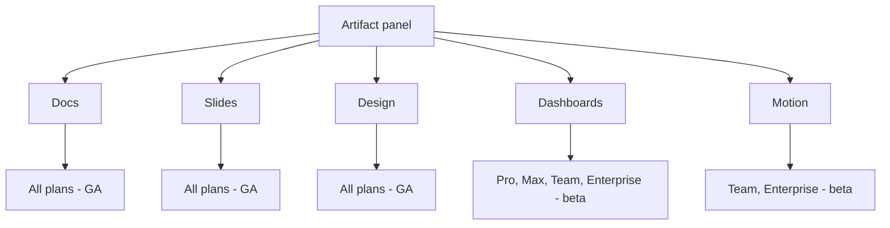

# Claude Dashboards と Claude Motion

> Source: https://derob98.github.io/ailmanac/ja/docs/claude-app/dashboards-and-motion · AILmanac (CC BY 4.0) · last verified 2026-10-20

2026 年 10 月 8 日、Claude に 2 つの新しいアーティファクトテンプレートが加わりました。データウェアハウスに対してチャートごとに SQL クエリを書く Dashboards と、生成された動画ではなく編集可能なコードとしてアニメーションを作る Motion です。それぞれが実際に何であるか、プランごとの対応表、誰もがつまずく共有モデル、そして使うべきでない場面を解説します。

<LevelBadge level="beginner" />

<VerifyNote lastVerified="2026-10-20" source="https://support.claude.com/en/articles/17153992-what-are-artifacts-and-how-do-i-use-them">
**2026 年 10 月 8 日**に発表されました。**Claude Dashboards** は **Pro、Max、Team、Enterprise** でベータ、**Claude Motion** は **Team と Enterprise** のみでベータです。同日、**Docs、Slides、Design はベータを終了し、Free を含むすべてのプランで利用可能になりました**。Enterprise では **2026 年 10 月 15 日**にデフォルトで有効になりました。Enterprise では、どちらのベータもオーナーが有効にするまでデフォルトでオフです。提供状況とコネクタの一覧は変化が速いので、ここにあるものを前提に構築する前にヘルプセンターで確認してください。
</VerifyNote>

2026 年 10 月 8 日、アーティファクトパネルに 2 つの新しい**テンプレート**が加わりました。すでにあるものの派生ではありません。**Claude Dashboards** は会話の*外側*、つまりデータウェアハウスに手を伸ばします。**Claude Motion** は、他のテンプレートにはできないもの、つまり動く画像を生成します。しかも動画としてではなく、コードとして生成します。

同じ発表で、**Docs、Slides、Design** のベータも静かに終了し、これらは Free を含むすべてのプランで使えるようになりました。10 月 8 日より前に書かれた AILmanac のページ（あるいは他の誰かのガイド）が、この 3 つを「有料、ベータ」と述べているなら、その文はもう誤りです。

<Callout type="objectives" items={[
  "Dashboards と Motion を、すでに持っているテンプレートや通常のアーティファクトと区別する",
  "どのプランで何が使えるか、Enterprise のオーナーが何を有効にしなければならないかを正確に知る",
  "それぞれの背後にある唯一の仕組みを理解する: チャートごとの SQL クエリと、編集可能なコードからコンパイルされるアニメーション",
  "共有の罠を避ける: ダッシュボードを共有したとき誰に何が見えるのか、そしてコネクタを使うアーティファクトに公開リンクを付けられない理由",
  "これらが不向きな 3 つの仕事を見分ける",
  "2026 年 12 月 14 日の Claude Design の期限に、過ぎる前に対応する"
]} />

## 5 つのテンプレートを一覧で

| テンプレート | 生成するもの | プラン | ステータス |
| --- | --- | --- | --- |
| **Docs** | 複数タブからなる生きたドキュメント | Free を含むすべて | GA |
| **Slides** | プレゼンできるデッキ | Free を含むすべて | GA |
| **Design** | ビジュアル、モックアップ、プロトタイプ | Free を含むすべて | GA |
| **Dashboards** | データに対するライブクエリで動くチャート | Pro、Max、Team、Enterprise | ベータ |
| **Motion** | MP4 としてエクスポートされる短いアニメーション | Team、Enterprise | ベータ |

**Enterprise** では、2 つの新しいテンプレートは、組織設定の Artifacts で**オーナーがオンにするまでオフ**です。オーナーはカスタムロールで特定のグループにアクセスを絞ることもできます。**Team** では Motion は**デフォルトでオン**です。

## Claude Dashboards

### 仕組みを一文で

平易な言葉で質問すると、**Claude がチャートごとに SQL クエリを書き、データソースに対して実行します。** これが製品のすべてであり、これを理解すれば、以降のあらゆる強みと限界が説明できます。

対応データウェアハウスは **Amazon Redshift、BigQuery、ClickHouse、Databricks、Snowflake** です。Claude にすでに接続したアプリも読み取れ、その代表が **Salesforce** です。

### チャートごとのクエリが重要な理由

各チャートは、モデルの記憶ではなく名前付きのクエリに裏付けられているので、ダッシュボードはチャットの回答にはない形で**監査可能**です。すべてのチャートには、**自身のクエリ**と**データが最後に更新された時刻**が表示されます。これによって、いつもの信頼の問題が裏返ります。「Claude がこの数字を幻覚したのか」と問う代わりに、チャートをクリックして、それを生んだ SQL を読めばよいのです。

初日に身につける価値のある習慣は、これ一つです。

<Steps items={[
  {title: "チャートではなく、判断を依頼する", body: "「今四半期の地域別パイプラインのダッシュボードを作って」ではチャートが得られます。「来四半期に 2 人の営業をどこへ動かすか決めたい。それを判断できる材料を見せて」では、チャートに加えて、それを実行可能にする比較が得られます。Anthropic 自身のガイダンスも、何をプロットするかだけでなく、何を知りたいかを伝えることです。"},
  {title: "テーブルやアプリの名前を挙げる", body: "データがどこにあるかを伝えます。特定のウェアハウスのテーブルや接続済みのアプリを指すかどうかが、1 回のクエリと 3 回の当て推量の違いです。"},
  {title: "数字を信じる前に、すべてのチャートのクエリを開く", body: "人が飛ばしがちなステップです。SQL を読みます。日付範囲、フィルタ、結合、行数を数えているのか列を合計しているのかを確認します。誤ったフィルタから出た正しく見える数字こそが、ここでの本当の失敗モードであり、でっち上げではありません。"},
  {title: "会話で絞り込む", body: "「地域のフィルタを追加して」「新規と更新で分けて」「会計四半期を使って」。Claude は静止画を描き直すのではなく、クエリを書き換えます。"},
  {title: "深くなったら引き渡す", body: "Anthropic の位置づけは明確です。ダッシュボードは、素早い探索的な質問のために作られています。質問に本格的な分析が必要になったら、そのための道具にダッシュボードを送り出します。"}
]} />

<PromptCard title="行動につながるものを生み出すダッシュボードの指示書">{`Build me a dashboard from our Snowflake warehouse (schema: SALES_PROD).

The decision I'm making: which two regions get the next headcount.

Show me:
  1. Closed-won revenue by region, last 4 fiscal quarters, as a trend
  2. Win rate by region over the same period
  3. Average deal cycle in days by region
  4. Open pipeline by region, split new business vs renewal

Rules:
- Use fiscal quarters, not calendar.
- Exclude deals marked is_test = true.
- For every chart, label the exact table you queried.
- If a field I named doesn't exist, say so and ask — do not substitute
  a similar-sounding column.`}</PromptCard>

最後のルールは存在価値があります。最悪のダッシュボードのエラーは壊れたチャートではありません。`amount_arr` のつもりで `amount` に基づいて作られた、もっともらしいチャートです。

### ダッシュボードを別の場所へ送る

ダッシュボードは出発点であって、住処ではありません。Anthropic は送り先として **Amplitude、Grafana、Hex、Mixpanel、Omni、Perplexity、PostHog、Sigma** を挙げており、**Databricks Genie、Looker、monday.com、Tableau** が近日対応とされています。

この一覧は意思表明として読んでください。Dashboards は**質問するための最速の手段**と位置づけられており、統制された指標が置かれる BI ツールの代替では明示的にありません。

### 共有モデル — 何かを共有する前に読むこと

ダッシュボードは最初は**あなただけのもの**です。共有すると、コネクタを呼び出すアーティファクトになり、コネクタを使うアーティファクトには、ほぼ誰もが驚くルールが適用されます。

<Callout type="warning" items={[
  "クエリはあなたとしてではなく、閲覧者として実行される。Anthropic によれば: \"When someone opens your artifact, it connects to their connectors and data sources.\" 2 人の同僚が同じダッシュボードを開いて、正当に異なる数字を見ることがあります。",
  "アクセス権のない閲覧者に見えるのは、あなたのデータではなくエラー: \"If they don't have access to an underlying data source, that part of the artifact shows an error instead of your data.\" 機能が正しく働いている状態ですが、送った相手にとってダッシュボードが壊れて見える理由でもあります。",
  "公開リンクはない。\"There are no external or public links and no per-person recipient selection. Anyone in your organization who has the link can open the artifact.\" ライブデータと、ログイン不要の外部アクセスは、同じページでは両立しません。",
  "アーティファクトへのアプリ接続は、Pro、Max、Team、Enterprise の Web とデスクトップの機能です。それを軸にモバイルファーストのレビューループを計画してはいけません。"
]} />

実務上の帰結は、**ダッシュボードは社内向けの道具であり、クライアントへの納品物ではない**ということです。外部の受け手が数字を必要とするなら、数値を Doc、デッキ、生成ファイルにエクスポートして、それを送ってください。

## Claude Motion

### 動画モデルではない

ほとんどの報道が間違えている事実なので、はっきり述べます。**Motion は動画を生成しません。** Claude が、テキスト、数値、図形、画像、チャートをアニメーションさせる**編集可能なコード**を書き、アーティファクトは短い動画のように再生されます。直接の帰結は、Anthropic の言葉では、**リアルな映像や人物を作れない**ことです。

その制約が、そのまま利点のすべてでもあります。アニメーションが*プログラム*なので:

- **1 つの単語、1 つの数字、1 つのタイミング値**だけを変更でき、それ以外はまったくそのままです。
- データの訂正後に同じ指示書で再レンダリングしても、同じアニメーションのままです。新しくサイコロを振り直すことはありません。
- 文章で演出する（「2 番目のシーンを遅くして」）か、エディタで直接編集できます。

この仕組みに見覚えがあれば、それは[コード駆動の解説動画パイプライン](/docs/models/ai-explainer-videos-code-driven)の広い考え方と同じです。Motion はそのファーストパーティで、セットアップ不要のバージョンです。

### うまく使う

<Steps items={[
  {title: "動きが意味を運ぶときだけ、デッキの代わりに選ぶ", body: "手順、プロセス、時間による値の変化、ステップのウォークスルー。内容が箇条書きなら、代わりに Slides を作ります。箇条書きをアニメーションにするのは、作るのも読むのも遅くなります。"},
  {title: "対象、会場、長さを最初に伝える", body: "「30 秒、全社会議向け、話者の後ろの大画面で再生」と「90 秒、新規顧客のオンボーディングメール向け」では、まったく違うアニメーションになります。元のレポートやデータは、打ち直さずに添付します。"},
  {title: "チャットから作るか、テンプレートを選ぶ", body: "任意の会話で依頼するか、メッセージボックスで Output から Motion を選ぶか、Artifacts タブの Motion テンプレートから始めます。Claude がデッキばかり作るときは、明示的に選んでください。"},
  {title: "一度に一つのことを繰り返し調整する", body: "「2 番目のシーンを遅くして」「売上の数字は、チャートの描画が終わってから出して」。単一の変更は確実に反映され、5 つの一覧はめったにそうなりません。"},
  {title: "MP4 でエクスポートし、必要なら別の場所で仕上げる", body: "Anthropic は、出力を開ける道具として Adobe、Descript、HeyGen、Higgsfield、invideo、Luma AI、Runway を挙げ、Canva と Captions を近日対応としています。ナレーション、字幕、音楽は Motion の機能としては文書化されていません。後工程で追加する前提で計画してください。"}
]} />

<PromptCard title="2 回目の試行が要らないアニメーションの指示書">{`Turn the attached Q3 report into a 30-second animated explainer.

Audience: the whole company at an all-hands, on a projector behind
a speaker. It plays once, with no narration from the file itself.

Structure, four scenes:
  1. The one number that matters (revenue, with last quarter for contrast)
  2. Where the growth came from — animate the regional chart drawing in
  3. The one thing that got worse, stated plainly
  4. What we're doing about it next quarter, three short lines

Constraints:
- Readable from the back of a room: large type, high contrast,
  no more than seven words on screen at once.
- No decorative motion. Every movement should mean something changed.
- Use only figures from the attached report. If a number I asked for
  isn't in it, leave the slot empty and tell me.`}</PromptCard>

## これらが不向きな場面

誠実なリファレンスは、機能が何を苦手とするかを述べます。3 つのケースです。

| 欲しいもの… | 使わない | 代わりに使う |
| --- | --- | --- |
| 会社全体が報告に使う、統制された指標 | Dashboards — 質問には答えるが、指標を定義はしない | BI 層。ダッシュボードをそこへ送る |
| クライアントがログインなしで開けるライブデータのページ | Dashboards — コネクタを使うアーティファクトに公開リンクはない | 数値を [Doc かデッキ](/docs/claude-app/one-claude-docs-and-slides)、または[生成ファイル](/docs/claude-app/generating-files)にエクスポートする |
| 実写映像、プレゼンター、トーキングヘッド | Motion — 背後に動画モデルはない | 動画ツール。Motion の MP4 はその中の部品になりうる |

そして両方に当てはまるコストの注記が一つ。**別料金はありません。** Dashboards と Motion は、他のものと同様にプランの使用上限に算入され、Anthropic は、長いまたは複雑なアニメーションほど枠を多く使うと注記しています。全般的な枠組みは[プランと請求](/docs/claude-app/plans-and-billing)のページにあります。

## カレンダーに入れておくべき期限

10 月 8 日の変更には終了の予定が付いていました。**単体の Claude Design サイトは 2026 年 12 月 14 日に閉鎖され**、その後 `claude.ai/design` は Claude に移動するだけになります。

チームが一度でも使っていたなら、これは日付付きの本物の ToDo です。

<Steps items={[
  {title: "Artifacts ページからデザインシステムを移行する", body: "Claude の Artifacts を開き、バナーまたは Claude Design メニューから \"Migrate team design systems\" をクリックします。移行された各デザインシステムは、オーナーと共有相手が引き継がれます。Claude Design を使える人なら誰でも移行を開始できます。オーナー専用ではありません。"},
  {title: "引き継がれないものを知る", body: "空のデザインシステムと、組み込みのスターターテーマから作られたものは移行されません。Claude とのチャットや、プロジェクトとデザインシステムへのコメントも同様で、これらは単体版に残り、閉鎖時に削除されます。"},
  {title: "チャットとコメントから必要なものを保存する", body: "元に戻せない部分です。単体版のプロジェクトへの公開リンクも、閉鎖後は機能しなくなります。"},
  {title: "可視性の副作用を一つ確認する", body: "公開された、非プライベートのデザインシステムは、移行後に組織全体から見えるようになります。クリックする前に、どれが該当するかを確認してください。"},
  {title: "Enterprise: 先にトグルを確認する", body: "Artifacts が有効でなければならず、Enterprise ではデザインシステムは管理者がオンにするまでデフォルトでオフです。移行の後ではなく、前にそれを行ってください。"}
]} />

## 知っておきたい用語

<Flashcards cards={[
  {front: "テンプレート", back: "アーティファクトの出発点となる形であり、別のアプリではありません。現在 5 つあります。Docs、Slides、Design（すべて GA、全プラン）に加えて Dashboards と Motion（どちらもベータ）。"},
  {front: "Claude Dashboards", back: "Pro、Max、Team、Enterprise のベータテンプレート。平易な言葉で質問すると、Claude がチャートごとに SQL クエリを書き、Redshift、BigQuery、ClickHouse、Databricks、Snowflake、または Salesforce などの接続済みアプリに対して実行します。"},
  {front: "チャートごとのクエリ", back: "ダッシュボードのすべてのチャートは、それを生んだ SQL とデータの最終更新時刻を公開します。それを読むことが、数字を信じる代わりに検証する方法です。"},
  {front: "Claude Motion", back: "Team と Enterprise のベータテンプレート。生成動画ではなく、編集可能なコードとして短いアニメーションを生み出し、MP4 でエクスポートします。リアルな映像や人物は作れません。"},
  {front: "コネクタを使うアーティファクト", back: "閲覧時にコネクタを呼び出すアーティファクト。クエリは閲覧者自身の接続で実行され、外部リンクや公開リンクを付けることは決してできません。"},
  {front: "素早い探索的な質問", back: "Dashboards に対する Anthropic 自身のスコープ。質問するための速い手段であり、統制された指標が置かれる BI 層の代替ではありません。"},
  {front: "2026 年 12 月 14 日", back: "単体の Claude Design サイトが閉鎖される日。それまでに Artifacts ページからデザインシステムを移行すること。単体版のチャット、コメント、公開プロジェクトリンクは削除されます。"}
]} />

## クイズ

<Quiz questions={[
  {q: "Snowflake ウェアハウスからダッシュボードを作り、あなたより狭いウェアハウス権限を持つチームメイトに共有しました。相手には何が見えますか。", options: ["あなたの数字。ダッシュボードが作成者の結果をキャッシュするため", "アクセス権のある部分は自分の数字、ない部分はエラー", "何も見えない。コネクタを使うアーティファクトの共有はサポートされない", "承認のためにあなたへ送られるアクセス申請の画面"], answer: 1, explain: "共有されたアーティファクトは閲覧者自身のコネクタとデータソースに接続するので、2 人が正当に異なる結果を見ることがあります。閲覧者が基になるソースにアクセスできない場合、その部分はあなたのデータの代わりにエラーを表示します。"},
  {q: "クライアントが、Claude アカウントなしで開けるライブダッシュボードへのリンクを求めています。サポートされている方法は何ですか。", options: ["共有ダイアログから公開リンクを生成する", "読み取り専用の外部アーティファクトとして公開する", "コネクタを使うアーティファクトに公開リンクはない。数値をドキュメント、デッキ、ファイルにエクスポートして、それを送る", "ダッシュボードをスナップショットにダウングレードしてから公開共有する"], answer: 2, explain: "コネクタを使うアーティファクトには外部リンクも公開リンクも、個人ごとの受信者指定もありません。リンクを持つ組織内の誰でも開けて、外部の誰も開けません。ライブデータと、ログイン不要の外部アクセスは、同じページでは両立しません。"},
  {q: "Claude Motion について正しい記述はどれですか。", options: ["動画モデルで動画を生成するので、リアルなプレゼンターを作れる", "テキスト、チャート、図形をアニメーションさせる編集可能なコードを書くので、リアルな映像や人物は作れない", "Slides を自動的に動画にレンダリングする", "Free を含むすべてのプランで利用できる"], answer: 1, explain: "Motion は動画生成モデルを呼び出すのではなく、コードを書きます。だからリアルな映像や人物を作れず、同時に、残りを乱さずに 1 つの単語、数字、タイミング値を変えられるのです。Team と Enterprise のみでベータです。"},
  {q: "Free プランです。今日使えるのはどれですか。", options: ["Dashboards。10 月 8 日にベータを終了したから", "Motion。デフォルトでオンだから", "Docs、Slides、Design。3 つとも 10 月 8 日にベータを終了し、Free を含むすべてのプランで使える", "どのテンプレートも使えない"], answer: 2, explain: "2026 年 10 月 8 日に Docs、Slides、Design はベータを終了し、Free を含むすべてのプランで使えるようになりました（Enterprise では 10 月 15 日にデフォルトで有効）。Dashboards は有料プランでのベータのままで、Motion は Team と Enterprise のみのベータです。"}
]} />

<Callout type="takeaways" items={[
  "2026 年 10 月 8 日: Dashboards と Motion がベータで登場し、Docs、Slides、Design はベータを終えて Free を含むすべてのプランに届いた。この 3 つをまだ「有料、ベータ」と呼ぶガイドは古い。",
  "Dashboards はチャートごとに SQL クエリを書く。数字を信じる前にクエリを開くこと。本当の失敗モードは、誤ったフィルタや列から出た正しく見える数字。",
  "共有されたダッシュボードは閲覧者として実行される。人によって見えるデータが異なり、アクセス権のない閲覧者にはエラーが見える。設計どおりである。",
  "コネクタを使うアーティファクトに公開リンクは付けられない。ダッシュボードは社内の道具であり、外部の受け手にはエクスポートする。",
  "Motion は動画ではなくコード。いくらでも編集でき、完全に再現できるが、映像や人物は決して作れない。ナレーションや字幕は文書化されていない。後工程で追加する。",
  "Anthropic は Dashboards を素早い探索的な質問に位置づけ、Grafana、Hex、Sigma などの送り先を挙げている。BI 層ではなく、質問するための最速の手段として扱うこと。",
  "カレンダーの項目: 単体の Claude Design サイトは 2026 年 12 月 14 日に閉鎖される。Artifacts ページからデザインシステムを移行し、先にチャットとコメントを保存すること。それらは削除される。"
]} />

## 出典と参考資料

- Anthropic — [Build live dashboards and animate explainers with Claude](https://claude.com/resources/articles/dashboards-and-motion)（発表、2026 年 10 月 8 日。コネクタと送り先の一覧）
- Anthropic Help Center — [What are artifacts and how do I use them?](https://support.claude.com/en/articles/17153992-what-are-artifacts-and-how-do-i-use-them)（5 つのテンプレートと正確なプラン対応）
- Anthropic Help Center — [Get started with Claude Dashboards](https://support.claude.com/en/articles/17454700-get-started-with-claude-dashboards)（作成、チャートごとのクエリ、共有、スコープ、使用上限）
- Anthropic Help Center — [Get started with Claude Motion](https://support.claude.com/en/articles/17454997-get-started-with-claude-motion)（作成、編集、MP4 エクスポート、プランと組織の設定）
- Anthropic Help Center — [Use live artifacts](https://support.claude.com/en/articles/14729249-use-live-artifacts-in-claude-cowork)（閲覧時に誰の接続が使われるか、公開リンクがない理由）
- Anthropic Help Center — [Migrate from standalone Claude Design to Claude](https://support.claude.com/en/articles/17440474-migrate-from-standalone-claude-design-to-claude)（2026 年 12 月 14 日の閉鎖と、移行されないもの）

## 次へ

- [アーティファクト: ライブで実行できる出力](/docs/claude-app/artifacts) — 5 つのテンプレートすべてがレンダリングされるパネル
- [One Claude: 統合、Claude Docs、Claude Slides](/docs/claude-app/one-claude-docs-and-slides) — 3 つの GA テンプレートの詳細と、その限界
- [コネクタ](/docs/claude-app/connectors) — Dashboards がクエリするデータソースの接続
- [データ分析プレイブック](/docs/playbooks/data-analysis) — ダッシュボードが引き渡す先の分析作業
