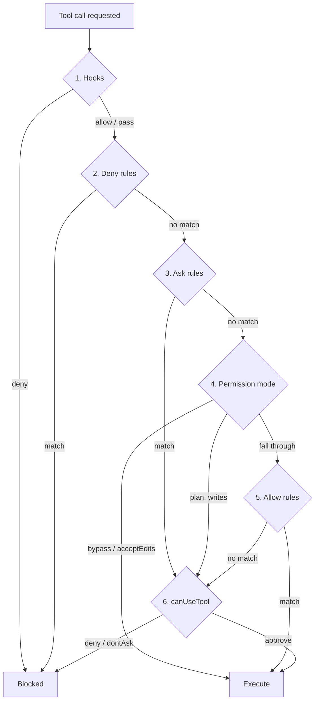

# Agent SDK の権限: 6 ステップの順序

> Source: https://derob98.github.io/ailmanac/ja/docs/claude-code/agent-sdk-permissions · AILmanac (CC BY 4.0) · last verified 2026-10-21

ヘッドレスエージェントの権限に関するバグは、すべて順序のバグです。Agent SDK が評価する 6 つのステップ、拒否しかできないもの、許可しかできないもの、そして allowedTools が黙って何もしない 5 つのケースを解説します。

<LevelBadge level="advanced" />

<Callout type="objectives" items={[
  "Agent SDK がすべてのツール呼び出しに対して順に辿る 6 つのステップ",
  "拒否しかできないステップ、許可しかできないステップ、両方できるステップ。残りを明白にするメンタルモデル",
  "早い段階で承認されたツールが canUseTool コールバックに届かない理由と、すべての呼び出しでチェックを走らせたいときに代わりに使うもの",
  "allowedTools が鍵に見えて鍵ではない 5 つの構成",
  "ツールを名指しする場合と、その内部のパターンに絞る場合で、拒否ルールがどう違うか",
  "サブエージェントが何を継承するか、そして継承を拒否する唯一のモード",
  "どのルールもモードもフックも上書きできないサーキットブレーカー"
]} />

多くの人は、エージェントの権限をファイアウォールのように設定します。ルールを書いて、最も具体的なものが勝つと考えるのです。Claude Agent SDK はそう動きません。すべてのツール呼び出しに対して**固定された 6 ステップのパイプライン**を辿り、各ステップは異なる*権限*を持ちます。ブロックしかできないもの、承認しかできないもの、どちらもできるのは 2 つだけです。

順序を間違えると、ロックダウンされているように見えて実はそうでないエージェントを出荷することになります。これはハーネスのバグで最も一般的な種類で、ルールのタイプミスであることはほとんどありません。

<VerifyNote lastVerified="2026-10-21" source="https://code.claude.com/docs/en/agent-sdk/permissions">
以下の評価順序、モードの挙動、バージョン制約は、Anthropic の Agent SDK 権限リファレンスとパーミッションモードのリファレンスによるものです。権限まわりは頻繁に変わり、いくつかの挙動は特定の Claude Code バージョンに依存しています（文中に記載）。例外ルールに頼る前に、両方のページを再確認してください。
</VerifyNote>

## 6 つのステップ

<Steps items={[
  {title: "Hooks", body: <>あなたの <code>PreToolUse</code> フックが、他のすべてのチェックの<strong>前に</strong>最初に実行されます。フックの拒否は最終的で、<code>bypassPermissions</code> モードでも呼び出しをブロックします。一方、フックの <code>allow</code> は最終的では<em>ありません</em>。ステップ 2 と 3 がなお実行されます。</>},
  {title: "Deny rules", body: <><code>disallowedTools</code> と <code>settings.json</code> から。一致すれば、<code>bypassPermissions</code> を含むすべてのモードで呼び出しをブロックします。</>},
  {title: "Ask rules", body: <><code>settings.json</code> から。一致しても承認もブロックもせず、<code>bypassPermissions</code> モードであっても、呼び出しをステップ 6、つまりあなたのコールバックへ<em>回します</em>。</>},
  {title: "Permission mode", body: <>ここで現在のモードが発言します。<code>bypassPermissions</code> は届いたものを承認し、<code>acceptEdits</code> はスコープ内のファイル操作を承認し、<code>plan</code> は allow ルールに関係なく、ファイル編集とシェル書き込みのツールをあなたのコールバックへ回します。その他のモードは素通りします。</>},
  {title: "Allow rules", body: <><code>allowedTools</code> と <code>settings.json</code> から。一致すれば呼び出しを承認します。ツール自身が承認する呼び出し（作業ディレクトリ内のファイル読み取りや読み取り専用の Bash コマンドなど）もルールなしでここで解決されます。</>},
  {title: "canUseTool", body: <>まだ解決されていないものはすべて、判断のためにあなたのコールバックへ届きます。<code>dontAsk</code> モードではこのステップはスキップされ、呼び出しは<strong>拒否されます</strong>。</>}
]} />

## すべてに筋を通すモデル

優先順位は忘れてください。代わりにこう問います。*このステップには何ができるのか。*

| ステップ | 拒否できる | 承認できる | コールバックへ回せる |
|---|---|---|---|
| **1. Hooks** | はい — 最終的、`bypassPermissions` でも有効 | はい、ただしステップ 2〜3 はなお実行される | — |
| **2. Deny rules** | はい — 最終的、`bypassPermissions` でも有効 | いいえ | — |
| **3. Ask rules** | いいえ | いいえ | はい — `bypassPermissions` でも有効 |
| **4. Permission mode** | いいえ | はい（`bypassPermissions`、`acceptEdits`） | はい（`plan`、書き込みに対して） |
| **5. Allow rules** | いいえ | はい | いいえ |
| **6. canUseTool** | はい | はい | — |

この表から三つの帰結がそのまま導かれ、ほぼすべての意外な挙動を説明します。

- **拒否はすべてに勝つ。** 拒否ルールとフックによる拒否はモードより上流にあるので、それを解除するモードはありません。能力を*取り除く*ために頼れる唯一の仕組みです。
- **許可は何にも勝たない。** 許可ルールはモードの*下*のステップ 5 にあります。寛容なモードを制限することはできず、本来なら確認が出る作業を事前承認するだけです。
- **コールバックは関門ではなく最後の手段。** それより上で何も解決しなかった呼び出しに対してのみ実行されます。その中に置いたチェックはすべて、早い段階で承認されたものについてはスキップされます。

<Callout type="warning">
`canUseTool` の内部にセキュリティチェックを書いているなら、置き場所が間違っています。許可ルール、`acceptEdits`、`bypassPermissions` によって承認された呼び出しはコールバックに届きません。チェックが失敗するのではなく、単に実行されないのです。**すべての**呼び出しに適用しなければならないチェックは、ステップ 1 で実行され、その拒否が `bypassPermissions` でも有効な `PreToolUse` フックに置きます。
</Callout>

## `allowedTools` が鍵ではない 5 つのケース

`allowedTools` は許可リストのように読めますが、**事前承認リスト**です。リストから外したものも Claude は引き続き使えます。単にモード、次いであなたのコールバックへ素通りするだけです。具体的な 5 つの罠です。

### 1. `bypassPermissions` を制約しない

最大の問題です。リストにないツールはどの許可ルールにも一致しないのでステップ 4 に素通りし、そこで `bypassPermissions` が承認します。

<PromptCard title="ロックダウンされているように見える。Bash、Write、Edit を承認する。">{`// WRONG — bypassPermissions approves everything unlisted
const options = {
  allowedTools: ["Read"],
  permissionMode: "bypassPermissions"
};`}</PromptCard>

`bypassPermissions` が必要で、特定のツールだけ取り除きたい場合、効く手段は `disallowedTools` だけです。モードの上流のステップ 2 に位置するからです。

### 2. `dontAsk` が許可リストを厳密にするモード

「これらのツールとそれ以外はなし」を実現するには、事前承認を、確認する代わりに拒否するモードと組み合わせます。

<PromptCard title="本当に読み取り専用のエージェント">{`const options = {
  allowedTools: ["Read", "Glob", "Grep"],
  permissionMode: "dontAsk"
};`}</PromptCard>

リストにあるツールは実行されます。確認が出るはずだったそれ以外はすべて拒否され、`canUseTool` は呼ばれません。リストになくても実行されるものに注意してください。読み取り専用の Bash コマンド、作業ディレクトリ内のファイル読み取り、実行前に確認しない `Agent` のようなツールです。これらをリクエストから完全に取り除くには、その素の名前を `disallowedTools` に追加します。

### 3. 素の名前はツール*全体*を承認する

カバー範囲はエントリの形で決まり、その差は大きいです。

| エントリ | 事前承認されるもの |
|---|---|
| `"Read"` | すべての `Read` 呼び出し（ネットワークパスからの読み取りを除く） |
| `"Bash(npm test *)"` | 一致する `Bash` 呼び出しのみ。他の `Bash` 呼び出しは引き続きコールバックへ素通りする |

スコープの指定がすべてです。許可リスト上の `"Bash"` は `"Bash(npm test *)"` とはセキュリティ上の姿勢が違い、型システムはそれを教えてくれません。

### 4. アンカーのないグロブは黙って無視される

許可ルールがツール名のグロブを受け付けるのは、リテラルの `mcp__<server>__` プレフィックスの後**だけ**で、サーバー部分にはグロブを含められません。

| エントリ | 効果 |
|---|---|
| `"mcp__puppeteer__*"` | 動作する — `puppeteer` サーバーのすべてのツール |
| `"mcp__github__get_*"` | 動作する — そのサーバーの `get_` ツール |
| `"*"` または `"mcp__*"` | **無視される。** 何も事前承認しない |

最後の行は静かな方向に倒れて失敗します。権限が増えるのではなく確認が増えるだけです。ただし包括的な承認を期待して書いたなら、午後を丸ごと費やすことになります。

### 5. TypeScript は警告するが、聞いていないチャンネルで

SDK がコールバックを覆い隠すと分かっている構成で `canUseTool` コールバックを渡すと、コード `CLAUDE_SDK_CAN_USE_TOOL_SHADOWED` の Node プロセス警告が一度だけ出ます。トリガーは二つの構成です。`permissionMode: "bypassPermissions"` と、`"Read"` のような**素の** `allowedTools` の各エントリです。

<PromptCard title="覆い隠し警告を自分のログに出す">{`process.on("warning", (w) => {
  if (w.code === "CLAUDE_SDK_CAN_USE_TOOL_SHADOWED") {
    console.error("[harness] canUseTool will be skipped:", w.message);
  }
});`}</PromptCard>

`Bash(ls *)` のようなスコープ付きエントリや `acceptEdits` モードはこれを発火させず、設定ファイル由来の許可ルールはこのチェックから見えません。したがって警告が出ないことは、コールバックに到達できる証明にはなりません。

## 拒否ルール: ツールを名指しする場合と、その内部に絞る場合

拒否エントリは形によって挙動が違い、その差は Claude が何を*できるか*だけでなく、何が*見えるか*にあります。

| エントリ | 効果 |
|---|---|
| `disallowedTools: ["Bash"]` | `Bash` のツール定義が**リクエストから取り除かれる**。Claude はそのツールを見ることがなく、試みることもできない |
| `disallowedTools: ["Bash(rm *)"]` | `Bash` は引き続き使える。`rm *` に*書かれたとおり*一致する呼び出しは、あらゆるモードで拒否される。`/bin/rm` を含む他の `Bash` 呼び出しは素通りする |
| `disallowedTools: ["*"]` | すべてのツール定義が取り除かれる。ツール名のグロブは拒否ルールで**サポートされる**: `"mcp__*"` はすべてのサーバーのすべての MCP ツールに一致する |

押さえておくべきことが二つあります。第一に、素の形のほうが厳密に強力です。コンテキストからツールを取り除くほうが、その呼び出しを拒否するより優れています。Claude に見えないツールは、失敗した試行も、別の経路での再試行も生まないからです。第二に、`Bash(rm *)` は**書かれた文字列**に一致します。`/bin/rm` の抜け穴はバグではなく、文字列ベースのルールの文書化された適用範囲です。スコープ付きの Bash 拒否は、明白なものに対するガードレールとして扱い、決してセキュリティ境界として扱わないでください。

### パスルール: 4 つのアンカーと 1 つの死文

スコープ付きの `Read` と `Edit` ルールはパスパターンを取り、二つの細部が誰もがつまずくところです。

- **`Edit(path)` は、ファイルを書き込むすべての組み込みツールを管理する**。`Write` と `NotebookEdit` も含みます。`Write(path)` ルールはファイル権限チェックに**まったく一致しません**。`Write(//secrets/**)` と書いたなら、何も書いていないのと同じです。
- **ダブルスラッシュはファイルシステムを意味する。** `Edit(//secrets/**)` は、ディスク上の `/secrets` 以下のあらゆる場所への書き込みをブロックします。先頭が単一のスラッシュだと、代わりにルールの*出所*にアンカーされます。`allowedTools` や `disallowedTools` 経由で渡されたルールでは、それはセッションの作業ディレクトリなので、`Edit(/secrets/**)` はディスク上の `/secrets` を**保護しません**。

<PromptCard title="実際のファイルシステムのパスへの書き込みをブロックする">{`// // = absolute filesystem path. One slash anchors at the rule's source.
const options = {
  disallowedTools: ["Edit(//etc/**)", "Edit(//secrets/**)", "Read(//secrets/**)"]
};`}</PromptCard>

## モードと、それぞれが実際に買うもの

<Flashcards cards={[
  {front: "default", back: "モードによる自動承認なし。許可ルールに一致しない、承認が必要な呼び出しは canUseTool へ。Claude Code v2.1.302 以降、モードを設定するか、設定ファイルが permissions.defaultMode を提供しない限り、アプリはここから始まります。"},
  {front: "dontAsk", back: "確認が出るはずの呼び出しはすべて拒否され、canUseTool は呼ばれない。事前承認されたツールと承認不要の呼び出しは引き続き実行される。事前承認リストを厳密な許可リストに変えるモード。"},
  {front: "acceptEdits", back: "ファイル編集に加えて mkdir、touch、rm、rmdir、mv、cp、sed を自動承認する。ただし作業ディレクトリまたは additionalDirectories の内側のみ。ファイルシステム以外の Bash は通常の権限が必要。"},
  {front: "plan", back: "読み取り専用ツールは default と同様に動作する。ファイル編集は自動承認されない。許可ルールでも PreToolUse の allow でも不可。canUseTool に届く。v2.1.212 以降、ファイルを変更するシェルコマンドも同様。"},
  {front: "bypassPermissions", back: "ステップ 4 に届いたものを承認する。Hooks、deny ルール、ask ルールは上流で引き続き実行される。Linux と macOS では、認識されたサンドボックスの外では root または sudo 下での起動を拒否する。"},
  {front: "auto", back: "分類器モデルがシェルコマンドやネットワークリクエストなどのアクションをレビューし、個々に許可またはブロックする。対応モデルが必要。非対応のモデルに切り替えるとセッションは default モードに落ちる。"}
]} />

本番で噛みつくので、押さえておく価値のある挙動が二つあります。

**`auto` モードはほぼ静かに劣化する。** `setModel()` や `applyFlagSettings()` で `auto` が対応していないモデルに切り替えると、セッションは `default` モードに変わります。サブタイプ `status`、`permissionMode: "default"` の `system` メッセージ（TypeScript では `SDKStatusMessage` と型付けされる）が届き、以降の呼び出しはコールバックに届きます。モデルを元に戻しても `auto` は**復元されません**。`setPermissionMode("auto")` をもう一度呼ぶ必要があります。（v2.1.299 以降。）

**サブエージェントは継承するが、一つだけ拒否する。** サブエージェントは、その `AgentDefinition` に `permissionMode` を設定し、*かつ*親が `default`、`dontAsk`、`plan` のいずれかである場合を除き、親の権限モードで動作します。その場合でも、Claude Code は `AgentDefinition` の `"bypassPermissions"` の値を決して適用しません。サブエージェントが `bypassPermissions` で動くのは、親セッション自体がそうであるときだけです（v2.1.267 以降）。この例外があるのは、サブエージェントがメインのエージェントとは異なるシステムプロンプトとより緩い挙動を持つことが多く、bypass を継承すると、ハーネスの中で最も監督の薄い部分に完全な自律的システムアクセスを渡してしまうからです。[サブエージェント](/docs/claude-code/subagents)を参照してください。

## 何も上書きできないサーキットブレーカー

**クリティカルパス**を対象にした `rm` と `rmdir` の削除は、許可ルールにも、`allow` を返す `PreToolUse` フックにも、決して承認されません。クリティカルパスとは、ファイルシステムのルート、ルート直下のすべての子（`/usr`、`/etc`、`/data`）、ホームディレクトリ、Windows のドライブルートとその最上位ディレクトリ、そして作業ディレクトリとその親です。一致する拒否ルールはコマンドを完全にブロックし続けます。要点は、どの*承認*経路もそれを通せないということです。

代わりに何が起きるかはモードによります。

| モード | クリティカルパスの削除の結果 |
|---|---|
| `default`、`acceptEdits`、`bypassPermissions` | 承認を求める |
| `auto` | ターミナルで時間制限付きで求める。**それ以外では、すべての Agent SDK セッションを含め、拒否する** |
| `dontAsk` | 拒否する |

真ん中の行がハーネスにとって重要です。`auto` モードの Agent SDK セッションは、クリティカルパスの削除を**コールバックを呼ばずに**拒否し、代わりに削除したかったものを報告するよう Claude に伝えます。エージェントが実行していない削除を突然語り始めたなら、原因はこれであって、モデルの劣化ではありません。

このチェックは、未設定の変数がルート削除に展開されうる構造の内側にも及びます。`rm -rf "$DIR"/*`、`$1` を束縛するものがない `rm -rf "$1"/*`、`D=$(pwd); rm -rf "$D"`、そしてサブシェル、コマンド置換、`bash -c` スクリプト内にネストされた削除です。文書化された対策は、シェルがルートを削除する代わりに空の場合にエラーになるよう、展開をガードすることです。

<PromptCard title="グロブによる削除をクリティカルパスのチェックに通す">{`# Flagged: expands to a removal from / when DIR is unset
rm -rf "$DIR"/*

# Passes: :? makes the shell exit with an error instead
rm -rf "\${DIR:?}"/*`}</PromptCard>

## どのモードも自動承認しないその他のもの

クリティカルパスの削除以外にも、次のものは寛容なモードを常にすり抜けます。ほとんどのモードでコールバックに届き、`dontAsk` では確認しないため**拒否されます**。

- 明示的な **ask ルール**に一致したツール
- **`AskUserQuestion`**、およびサーバーが `_meta["anthropic/requiresUserInteraction"]` を設定する MCP ツール（v2.1.199 以降）
- **組織が `ask` に設定したコネクタツール**。コールバックは理由 `Your organization requires approval for this tool` を受け取ります
- **ネットワークパス**からの読み取り。どの許可ルールも承認しません

つまり「`bypassPermissions` を設定したのに、なぜまだ確認されるのか」には、バグ報告に手を伸ばす前に四つの答えがあります。そして TypeScript SDK には五つ目の手段があります。`permissionPrompts: "none"`（v2.1.259 以降）は、ステップ 6 でのコールバックの呼び出しを完全に止めます。`PermissionRequest` フックには引き続き機会があり、それが判断を見送れば呼び出しは拒否されます。

## 二つのレシピ

### すべての呼び出しで本当に実行されるゲート

チェックが無条件でなければならない場合（監査ログ、シークレットパスのスキャナー、コスト上限）は、ステップ 1 に置きます。

`PreToolUse` フックにはブロックする方法が二つあり、どちらも SDK の外でも実行できるコマンドフックで使えます。**終了コード 2**（stderr に書いた内容が Claude に見える理由になる）と、`permissionDecision` が `"deny"` で `permissionDecisionReason` を伴う **stdout の JSON** です。

<PromptCard title="PreToolUse フック: 唯一の無条件ゲート">{`# Runs before deny rules, ask rules, the mode, and allow rules.
# A deny here survives bypassPermissions.
# Wire it to hooks.PreToolUse in settings.json, or pass it in the SDK's hooks option.
jq -e '.tool_input | tostring | test("AKIA|BEGIN PRIVATE KEY|ghp_")' >/dev/null \\
  && { echo "secret material in tool input" >&2; exit 2; } || exit 0`}</PromptCard>

TypeScript と Python の SDK が受け付けるインプロセスのコールバック形式は、終了コードではなく同じ判断フィールドを返します。出荷する前に、お使いの SDK バージョンについて[フックのリファレンス](/docs/claude-code/hooks)でラッパーの形を確認してください。評価の*位置*は安定した部分で、ハンドラーのシグネチャはそれほどではありません。

### 信頼が育つにつれて締める

権限モードは一度きりの決定ではありません。ストリーミングセッションでは、制限的に始めて、エージェントの最初の動きを確認した後に、Python の `set_permission_mode()` や TypeScript の `setPermissionMode()` で緩められます。新しいモードは、以降のすべてのツールリクエストに即座に適用されます。

<PromptCard title="default で開始し、アプローチを確認してから緩める">{`const q = query({
  prompt: "Refactor the auth module",
  options: {permissionMode: "default"}
});

// ...review the first turns, then:
await q.setPermissionMode("acceptEdits");`}</PromptCard>

長時間の実行では逆の動きのほうが面白いです。新しい能力が不要なはずのフェーズにエージェントが入ったら、`dontAsk` に締めるのです。

## ルールの出所

許可、拒否、ask のルールは `.claude/settings.json` に宣言的に置くこともできます。SDK は `project` 設定ソースが有効なときにそれらを読み、デフォルトの `query()` オプションでは有効です。**ただし `settingSources` を明示的に設定する場合は `"project"` を含めなければなりません。さもないと設定ファイルのルールは黙って適用されなくなります。** よくある事故です。再現性のために `settingSources: ["user"]` を追加した人が、プロジェクトの拒否リスト全体を静かに削除してしまいます。ファイルの優先順位は[設定](/docs/claude-code/settings)を参照してください。設定ファイル由来の許可ルールは `CLAUDE_SDK_CAN_USE_TOOL_SHADOWED` チェックからも見えないことを忘れないでください。

<Quiz questions={[
  {
    q: "allowedTools: [\"Read\"] と permissionMode: \"bypassPermissions\" を設定しました。エージェントは Bash を実行できますか。",
    options: [
      "いいえ — 許可リストにあるのは Read だけ",
      "はい — Bash はどの許可ルールにも一致しないのでモードに素通りし、モードが承認する",
      "読み取り専用の Bash コマンドだけ",
      "はい、ただし先に canUseTool が呼ばれる"
    ],
    answer: 1,
    explain: "許可ルールはステップ 5 で、ステップ 4 のモードより下です。allowedTools は事前承認するだけで、制限はしません。bypassPermissions の下でツールをブロックするには、モードの上流のステップ 2 に位置する disallowedTools を使います。"
  },
  {
    q: "セキュリティチェックを、例外なくすべてのツール呼び出しで実行しなければなりません。どこに置くべきですか。",
    options: [
      "canUseTool コールバック",
      "settings.json の ask ルール",
      "PreToolUse フック",
      "permissionMode: \"dontAsk\""
    ],
    answer: 2,
    explain: "フックはステップ 1 で、拒否ルール、モード、許可ルールより前にあり、フックの拒否は bypassPermissions でも有効です。canUseTool はステップ 6 で、早い段階で承認されたものはすべて完全にスキップされるため、そこに置いたチェックは自動承認されたツールでは黙って実行されません。"
  },
  {
    q: "Claude に Bash ツールが見えなくなるのは、どの拒否エントリですか。",
    options: [
      "disallowedTools: [\"Bash(*)\"]",
      "disallowedTools: [\"Bash\"]",
      "allowedTools: [] と permissionMode: \"dontAsk\"",
      "settings.json の Bash(rm *) に対する拒否ルール"
    ],
    answer: 1,
    explain: "素の名前の拒否ルールは、評価が始まる前にリクエストからツール定義を取り除くので、Claude はそれを見ることがありません。Bash(rm *) のようなスコープ付きのルールは Bash を使える状態のままにし、書かれたとおりのパターンに一致する呼び出しだけを拒否します。/bin/rm は素通りします。"
  }
]} />

<Callout type="takeaways" items={[
  "6 ステップ、固定順序: フック、拒否ルール、ask ルール、権限モード、許可ルール、canUseTool。",
  "拒否はモードの上流にあるので絶対的。許可は下流にあり、事前承認しかできない。",
  "allowedTools は許可リストではなく事前承認リスト。厳密にするには dontAsk と組み合わせる。",
  "canUseTool 内のチェックは自動承認された呼び出しでは実行されない。無条件のチェックは PreToolUse フックに置く。",
  "Edit(path) は Write と NotebookEdit を含む。Write(path) ルールは何にも一致しない。// はファイルシステムに、単一の / はルールの出所にアンカーされる。",
  "サブエージェントは親のモードを継承するが、自身の定義の bypassPermissions の値は決して継承しない。",
  "クリティカルパスの rm 削除は、許可ルールもフックの allow も通せないサーキットブレーカー。auto モードの Agent SDK セッションは、あなたを呼ばずにそれを拒否する。",
  "settingSources を \"project\" なしで設定すると、.claude/settings.json のすべてのルールが黙って無効になる。"
]} />

## 次へ

- [権限とパーミッションモード](/docs/claude-code/permissions) — 同じ仕組みの対話的な側面。`auto` が開始モードになった理由を含む
- [フック](/docs/claude-code/hooks) — ステップ 1。パイプラインで唯一の無条件ゲート
- [自律実行の堅牢化](/docs/security/hardening-autonomous-runs) — このページのプリミティブが実装するチェックリスト
- [ヘッドレスモードと Agent SDK](/docs/claude-code/headless-and-agent-sdk) — そもそもループを動かすために
