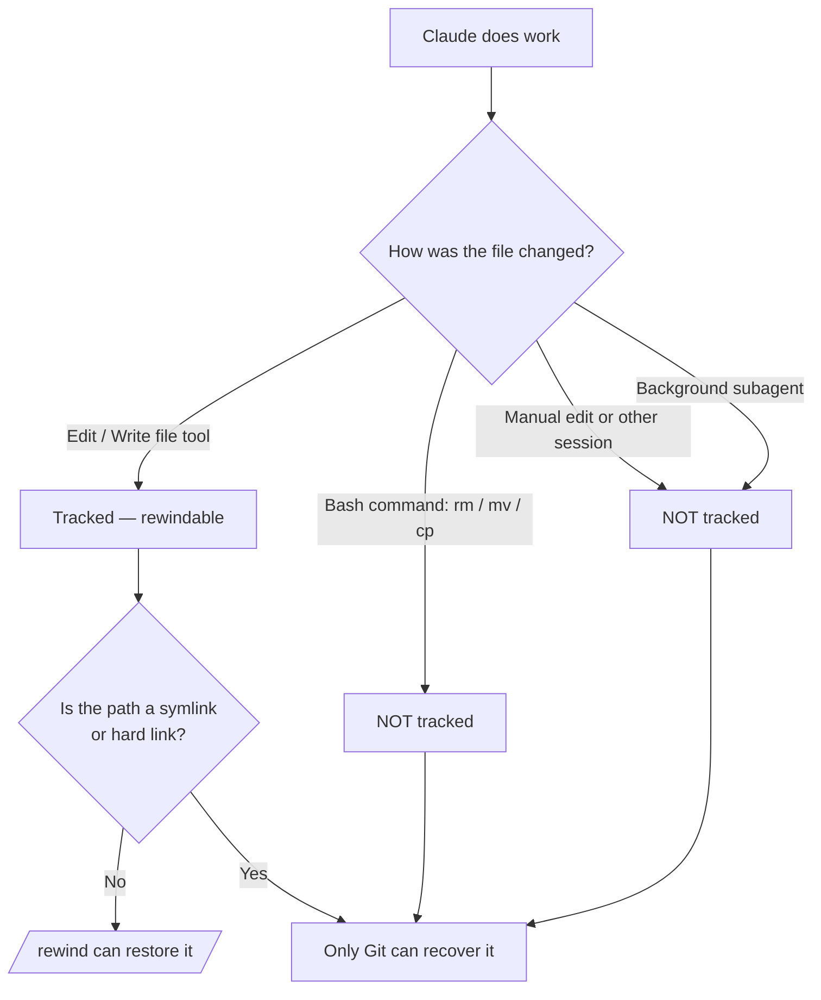

# チェックポイントと巻き戻し

> Source: https://derob98.github.io/ailmanac/ja/docs/claude-code/checkpoints-and-rewind · AILmanac (CC BY 4.0) · last verified 2026-10-20

Claude の編集を取り消し、セッション全体を巻き戻し、/rewind でコンテキストを圧縮する — 大がかりな実行のためのセーフティネット。

<LevelBadge level="intermediate" />

<Callout type="objectives" items={["チェックポイントが何を記録し、何を黙って記録しないのかを理解する", "巻き戻しメニューを2通りの方法で開き、毎回適切な復元アクションを選ぶ", "「restore」（状態を元に戻す）と「summarize」（コンテキストを圧縮する）を区別する", "チェックポイントが Git を補完こそすれ、決して置き換えない理由を正確に知る"]} />

<VerifyNote lastVerified="2026-10-20" source="https://code.claude.com/docs/en/checkpointing">
チェックポイントの挙動、巻き戻しメニューのアクション、スナップショットの上限や保持期間はリリースごとに変わります。公式ドキュメントで確認してください。
</VerifyNote>

## 基本の考え方

大規模で野心的な変更を Claude に任せるとき、いちばん怖いのは「3回編集したところで失敗したらどうしよう？」という点です。**チェックポイント**はその答えです。Claude Code は編集のたびに事前のコードを自動でスナップショットするので、中途半端なリファクタリングを手作業でほどく代わりに、以前の状態へ巻き戻せます。

**セッション全体のローカルな元に戻す機能**と考えてください。「よし、大胆な方法を試そう」と、怖がらずに言えるセーフティネットです。

## チェックポイントの作られ方

チェックポイントは自分で作るものではなく、自動で作られます。

<Steps items={[{title: "ターンを開始するプロンプトごとに1つのチェックポイント", body: "ターンを開始する各プロンプトは、Claude のファイル編集ツールが動く前のコードの状態を記録します。コマンドも設定も儀式も不要です。"}, {title: "保持されるのは直近の100個だけ", body: "Claude Code は、セッション内の直近100個のチェックポイント分のファイルスナップショットを保持します。それより古いものは破棄されるため、非常に長いセッションを最初まで巻き戻すことはできません。"}, {title: "セッションをまたいで残る", body: "チェックポイントは会話と一緒に保存されるので、セッションを再開した後でも、実行中のセッションだけでなく /rewind を使えます。"}, {title: "自動的に整理される", body: "セッションのファイルスナップショットは、保持期間のクリーンアップで削除されます。デフォルトでは、そのセッションが最後にスナップショットを保存してから約30日後です。スナップショットが消えたチェックポイントに巻き戻そうとすると 'No files were restored' で失敗します。長く保持したい場合は cleanupPeriodDays を引き上げてください。"}]} />

## 巻き戻しメニューを開く

入り方は2通りあります。

<Steps items={[{title: "/rewind を実行する — またはエイリアスの /checkpoint・/undo", body: "プロンプトでスラッシュコマンドを入力します。常に使えます。/checkpoint と /undo は同じコマンドのエイリアスなので、思い浮かんだ名前で構いません。"}, {title: "Esc を2回押す — ただし入力欄が空のときだけ", body: "プロンプト欄が空のとき、Esc の2回押しで巻き戻しメニューが開きます。テキストが入っている場合、2回押しはそのテキストを消去します（消去したテキストは入力履歴に保存されるので、↑ キーで呼び戻せます）。"}]} />

<PromptCard title="巻き戻しメニューを開く">{`/rewind`}</PromptCard>

<Callout type="warning" items={["エイリアス名は、字面ほど文字どおりではありません。/checkpoint はその場でスナップショットを取るわけではなく（スナップショットは自動です）、/undo も直前の編集を単独で取り消すわけではありません。3つの名前はどれも同じメニューを開き、そこで時点とアクションを選びます。"]} />

メニューには、このセッションで送信した**すべてのプロンプト**が並びます。操作したい時点を選び、アクションを1つ選びます。

## restore と summarize：重要な区別

ここで混乱しやすくなります。メニューには2*種類*のアクションがあります。

- **Restore** アクションは、ディスク上や会話の状態を変えます — 元に戻す操作です。
- **Summarize** アクションは、ファイルには一切触れません — 会話を圧縮してコンテキストウィンドウの空きを増やします。

<Callout type="warning" items={["Restore = 元に戻す（コード、会話、または両方を巻き戻す）。Summarize = コンテキストを圧縮する（ディスク上のファイルは変わらない）。", "編集で何かが壊れたら restore を使う。セッションが肥大化したがコードは問題ないなら summarize を使う。"]} />

### restore アクション

<Steps items={[{title: "Restore code and conversation", body: "ファイルとチャット履歴の両方を選択した時点まで戻します。その瞬間への、きれいな「時間の巻き戻し」です。"}, {title: "Restore conversation", body: "チャットをそのメッセージまで巻き戻しつつ、現在のコードは保持します。残したい編集を失わずに質問をやり直したいときに便利です。"}, {title: "Restore code", body: "ファイルの変更を元に戻しつつ、会話は保持します。編集は取り消し、それについての議論は残します。"}]} />

2つの**コード**の restore オプションは、選択したチェックポイントに、元に戻せる追跡済みのファイル変更が実際にある場合にだけ表示されます。その時点以降にファイル編集が記録されていなければ、メニューには **Restore conversation**、2つの summarize オプション、**Never mind**（何も変更せずメッセージ一覧に戻る）だけが表示されます。

会話を復元した後（または "Summarize from here" を選んだ後）、選択したメッセージの元のプロンプトが入力欄に戻されるので、再送信や編集ができます。

### summarize アクション

どちらも会話の一部を AI が生成した要約に圧縮します — 選択したメッセージのどちら側を圧縮するかを選べる、**対象を絞った `/compact`** のようなものです。

<Steps items={[{title: "Summarize from here", body: "選択したメッセージより前のメッセージはそのまま残ります。選択したメッセージとそれ以降が要約になります。脇道の議論を捨てつつ、初期のコンテキストを詳細のまま残したいときに使います。"}, {title: "Summarize up to here", body: "選択したメッセージより前のメッセージが要約になり、選択したメッセージとそれ以降はそのまま残ります。会話の末尾にとどまります。序盤のセットアップのやり取りを圧縮しつつ、最近の作業を一字一句そのまま残したいときに使います。"}]} />

どちらの場合も、元のメッセージはセッションの記録に残るため、Claude は詳細を参照でき、圧縮されたメッセージのあった場所には **Summarized conversation** のマーカーが表示されます。要約の焦点を指示するには、矢印キーで **Summarize** オプションを選択し、**add context (optional)** と表示された行に指示を入力して Enter を押します。数字キーでオプションを選ぶと、指示なしですぐに要約されます。

全体の流れは [Context Management](/docs/claude-code/context-management) を参照してください。`/rewind` の summarize アクションが外科用メスなら、`/compact` は太い刷毛です。

<Callout type="note" items={["Summarize は同じセッションにとどまります。元のセッションをそのまま残して別のアプローチを試したい場合は、代わりに /branch または claude --continue --fork-session を使ってください。"]} />

## `/clear` を越えて巻き戻す

同じ Claude Code プロセス内で以前に `/clear` を実行した場合、巻き戻しメニューの先頭に `/resume <session-id> (previous session)` という項目が追加で表示されます。これを選ぶと、`/clear` の前にアクティブだった会話に戻れます。

<VerifyNote lastVerified="2026-10-20" source="https://code.claude.com/docs/en/checkpointing">
この項目は、Claude Code を終了するか別のセッションを再開するまでの間だけ利用できます。消えた後は、`/resume` を実行して一覧から以前のセッションを選んでください。
</VerifyNote>

## チェックポイントの限界 — 痛い目に遭うポイント

チェックポイントは魔法のように思えますが、そうでなくなる瞬間があります。次の穴は重要です。

<Steps items={[{title: "Bash による変更は見えない", body: "Claude が実行するシェルコマンド — rm、mv、cp、コードジェネレーター、フォーマッター — が触れたファイルは追跡されません。チェックポイントの対象になるのは、Claude のファイル編集ツールによる直接の編集だけです。rm で削除されたファイルは、巻き戻しの観点では失われたままです。"}, {title: "サブエージェントの編集の多くは復元されない", body: "サブエージェントは同じファイルツールで編集しますが、通常、あなたのセッションはその編集を記録しません。例外は、フォアグラウンドのフォークされたスキル（background: false の context: fork）で、あなた自身のターン中に編集するため通常どおり巻き戻せます。それ以外のサブエージェント — デフォルトであるバックグラウンドのフォークされたスキルも含む — は、元に戻すのに Git が必要です。/docs/claude-code/subagents を参照してください。"}, {title: "外部や並行する変更は見えない", body: "Claude Code の外で行った手動の編集や、並行する他のセッションによる編集は、通常は記録されません — 現在のセッションが編集したのと同じファイルに触れた場合を除きます。"}, {title: "ターンの途中のメッセージにはチェックポイントがない", body: "Claude の作業中にキューに入れ、実行中のターン内で届いたメッセージは、新しいターンを始めるのではなくそのターンに合流するため、自分専用のチェックポイントを持ちません — 巻き戻しメニューでは「No code restore」と表示されます。その後に起きたことを取り消すには、そのターンを開始したプロンプトまで巻き戻します。つまり、あなたのメッセージが届く前に行われた作業を含め、ターン全体が巻き戻されます。この印の付いたメッセージ自体を選んだ場合は、Restore conversation が選べ、ファイルはそのまま残ります。"}, {title: "シンボリックリンクとハードリンクはスキップされる", body: "Restore は、追跡対象のうちシンボリックリンクまたはハードリンクであるパスをスキップし、'Restored the code, but skipped N files' と警告します。それらのファイルは現在の内容のままです。dotfile マネージャーのシンボリックリンクと pnpm のハードリンクのどちらもこれに該当します。復元の前に /debug を実行すると、スキップされるパスがデバッグログに明記されます。"}, {title: "履歴ではなくセッション単位", body: "チェックポイントは素早いローカルの復旧手段です。コミットでもブランチでもなく、チームと共有することもできません。"}]} />

## チェックポイントと Git：両方使う

解決する問題が違うので、組み合わせましょう。

| | チェックポイント (`/rewind`) | Git |
|---|---|---|
| 範囲 | 1つのセッション | プロジェクト全体の履歴 |
| 粒度 | ターンを開始するプロンプトごと、自動 | コミットごと、意図的 |
| bash による変更を追跡する？ | いいえ | はい（ステージ/コミット後） |
| 保持期間 | 直近100個のチェックポイント、セッションの約30日後に整理 | 永続 |
| 共有 / 共同作業 | 不可 | 可 |
| イメージ | 「ローカルの元に戻す」 | 「永続的な履歴」 |

<Callout type="tip" items={["危険で大規模な実行の前に、動作する状態を Git でコミットしておく — それが永続的な最低ラインになる。", "コミットの合間の素早いセッション内復旧には /rewind を使い、Git の履歴を汚さない。", "Claude が破壊的な bash（rm/mv）、ジェネレーター、バックグラウンドのサブエージェントを実行する場合は Git に頼る — 巻き戻しではそれらのファイルは救えない。"]} />

## 使いどころ

<Steps items={[{title: "代替案を探る", body: "大胆な実装を試し、気に入らなければ分岐点までコードと会話を restore して別の方法を試します。"}, {title: "悪い編集から復旧する", body: "3プロンプト前の編集がバグを持ち込んだ？ 残骸をデバッグする代わりに、その直前までコードを restore します。"}, {title: "機能を反復開発する", body: "バリエーションを試しつつ、動作確認済みの状態がいつでも /rewind 1回で戻れると分かっていられます。"}, {title: "コンテキストの空きを作る", body: "冗長なデバッグの寄り道でコンテキストウィンドウが埋まった？ 途中から先を summarize し、最初の指示は詳細のまま残します。"}]} />

<Quiz title="理解度チェック" questions={[{q: "Claude が bash コマンドで `rm config.old.json` を実行し、そのファイルを取り戻したい。`/rewind` で復元できる？", options: ["はい — Claude による変更はすべてチェックポイントされる", "いいえ — bash による変更は追跡されない。追跡されるのはファイルツールによる直接の編集だけ", "30秒以内に /rewind を実行した場合のみ"], answer: 1, explain: "チェックポイントが記録するのは、Claude のファイル編集ツールによる編集だけです。bash コマンド（rm、mv、cp）で変更されたファイルは追跡されません — そのために Git があります。"}, {q: "コードは問題ないが、長いデバッグの寄り道でコンテキストウィンドウが埋まった。どのアクションが適切？", options: ["寄り道の前まで Restore code and conversation", "Restore code", "寄り道の開始点で Summarize from here"], answer: 2, explain: "Summarize アクションは、ファイルに触れずに会話を圧縮します。'Summarize from here' は寄り道を要約に変え、それ以前のコンテキストはそのまま残します — コードを変えずにコンテキストの空きを作れます。"}, {q: "チェックポイントはどのように作られる？", options: ["/checkpoint を実行する。コードのスナップショットをその場で取る", "自動 — ターンを開始するプロンプトごとに1つ作られる", "Git でコミットしたときだけ"], answer: 1, explain: "チェックポイントは自動です。ターンを開始するプロンプトごとに、編集前のコードの状態が記録されます。手動の手順はありません。/checkpoint コマンドは存在しますが、/rewind のエイリアスにすぎず、スナップショットを取るのではなくメニューを開きます。また、ターンの途中で届いたメッセージは実行中のターンに合流し、自分専用のチェックポイントは作られません。"}]} />

<Flashcards title="チェックポイントと巻き戻しの用語集" cards={[{front: "チェックポイント", back: "ターンを開始するプロンプトの前に取られる、コードの自動スナップショット。セッション単位で、直近100個を保持し、セッションの約30日後に整理される。"}, {front: "/rewind", back: "このセッションのすべてのプロンプトを一覧する巻き戻しメニューを開き、任意の時点から restore や summarize ができる。エイリアスは /checkpoint と /undo。空の入力欄で Esc を2回押しても開ける。"}, {front: "Restore アクション", back: "選択した時点まで、コード・会話・またはその両方の状態を戻す。いわゆる「元に戻す」。コード用オプションは、そのチェックポイントに追跡済みの変更がある場合にだけ表示される。"}, {front: "Summarize アクション", back: "会話の一部を AI の要約に圧縮してコンテキストを空ける。ディスク上のファイルには一切触れない。"}, {front: "Bash の死角", back: "シェルコマンド（rm/mv/cp）で変更されたファイルはチェックポイントされない — 対象はファイルツールによる直接の編集だけ。それには Git を使う。"}, {front: "サブエージェントの死角", back: "巻き戻せるのはフォアグラウンドのフォークされたスキルの編集だけ。バックグラウンドのサブエージェント（デフォルトのバックグラウンドフォークを含む）には Git が必要。"}]} />

<Callout type="takeaways" items={["チェックポイントは、ターンを開始するプロンプトごとに取られる自動スナップショットで、セッションのローカルな元に戻す機能。直近100個を保持し、セッションの約30日後に整理される。", "巻き戻しメニューは /rewind（エイリアス: /checkpoint、/undo）か、空の入力欄での Esc 2回押しで開く。送信したすべてのプロンプトが並ぶ。", "Restore アクションは状態（コード、会話、または両方）を元に戻し、summarize アクションはコンテキストを圧縮してファイルには触れない。", "bash による変更、外部の変更、並行する変更、そしてサブエージェントの変更の大半は追跡されない — シンボリックリンクやハードリンクのパスも restore ではスキップされる。", "チェックポイントは Git を補完するもので、置き換えるものではない。「ローカルの元に戻す」と「永続的で共有できる履歴」だと考えよう。"]} />

## 次へ

- [Context Management](/docs/claude-code/context-management) — `/compact`、`/clear`、そして summarize が全体像にどう収まるか
- [プランモード](/docs/claude-code/plan-mode) — 編集が走る前に調査して計画を承認し、巻き戻しの回数を減らす
- [権限（Permissions）](/docs/claude-code/permissions) — 大がかりなタスクを安全に実行するための、もう半分
