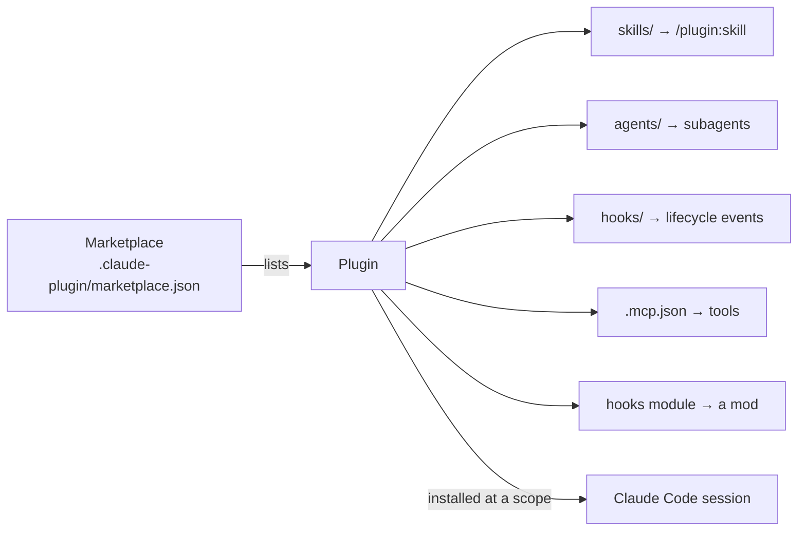

# プラグインとマーケットプレイス

> Source: https://derob98.github.io/ailmanac/ja/docs/claude-code/plugins-marketplaces · AILmanac (CC BY 4.0) · last verified 2026-10-26

スキル、エージェント、コマンド、フック、MCP をインストール可能な 1 つの単位にまとめ、他の人のものもインストールします。3 つのインストールスコープとその優先順位、3 つのマーケットプレイスの信頼レベル、有効なプラグインが常に課すコンテキストコスト、ライフサイクル全体をカバーする 8 つのコマンド。

<LevelBadge level="intermediate" />

<Callout type="objectives" items={[
  "本当にプラグインが必要なのか、単独のスキル・フック・MCP サーバーで十分なのかを判断する",
  "最初のプラグインをインストールし、インストールの要約から、このセッションですぐ使えるのか再読み込みが必要なのかを読み取る",
  "3 つのインストールスコープ(user、project、local)から正しいものを選び、どれがどれを上書きするかを把握する",
  "信頼する前にマーケットプレイスの信頼レベルを確認し、公式名とコミュニティ名が偽装できない理由を理解する",
  "有効なプラグインがすべてのターンで課す常時コンテキストコストを見積もり、使わなくなったプラグインを見つける",
  "シェルからライフサイクル全体を実行する: マーケットプレイスの追加、インストール、有効化、無効化、更新、アンインストール、prune",
  "--plugin-dir を使い、何も公開せずに自分のプラグインを開発する",
]} />

<VerifyNote lastVerified="2026-10-26" source="https://code.claude.com/docs/en/plugins">
公式の [Plugins overview](https://code.claude.com/docs/en/plugins) と [Install and manage plugins](https://code.claude.com/docs/en/plugins/install) のページで確認済みです。ここにあるコマンドのうち 2 つにはバージョンの下限があります。`/plugin install <plugin> --marketplace <source>` は Claude Code v2.1.275 以上、シェル版は v2.1.292 以上が必要です。プラグインの構造とマーケットプレイスの仕組みは今も急速に変化しています。配布の仕組みを作る前に、詳細を公式ドキュメントで確認してください。
</VerifyNote>

**プラグイン**は、複数のカスタマイズ — [スキル](/docs/claude-code/skills)、[サブエージェント](/docs/claude-code/subagents)、[スラッシュコマンド](/docs/claude-code/slash-commands)、[フック](/docs/claude-code/hooks)、[MCP サーバー](/docs/claude-code/mcp)、そして [**mod**](/docs/claude-code/mods)(JavaScript で書かれたフックで、ペインの描画やコマンドの追加もできます) — を、バージョン管理されたインストール可能な 1 つの単位にまとめたものです。**マーケットプレイス**は、プラグインの一覧と各プラグインの取得先を載せたカタログです。ホストされたストアではなくカタログであり、プラグイン自体は作者が置いた場所にあります。

## そもそもプラグインは必要か?

答えがいいえであることも多いので、ここから始めます。スキル、サブエージェント、フック、MCP サーバーは、それぞれ単独でも問題なく動きます。`~/.claude/skills/` の `SKILL.md` は、パッケージ化なしでマシン上のすべてのプロジェクトで使えます。

プラグインに手を伸ばすのは、**次の 3 つのどれかが当てはまるとき**です。

- 複数のコンポーネントを、1 回のインストール手順と 1 つのバージョン番号を持つ**1 つの単位**としてまとめたい。
- マーケットプレイスからの更新付きで、**他の人の**セットアップを使いたい。
- 自分のセットアップをチームメイトに**渡したい**、多くのプロジェクトにインストールしたい、あるいはバージョン付きのリリースを公開したい。

それ以外はスキルかフックであり、そのままにしておくべきです。

## 誰も警告してくれない点: 有効なプラグインは常にオン

便利そうだからと 5 つのプラグインをインストールする前に、最も心に留めておくべきことです。

**有効なプラグインは、使うセッションだけでなくすべてのセッションの一部です。** Claude が自分で呼び出せるスキル、エージェント、コマンドごとに、その*名前と説明*が**毎ターン** Claude のコンテキストに入り、Claude はそれが存在することを知ります。このトークンは利用量に数えられ、プラグインの機能が一度も動かないセッションでも[コンテキストウィンドウ](/docs/claude-code/context-management)を狭めます。全文が読み込まれるのは使用時だけです。

また、有効なセッションでは MCP サーバーも並行して動作し、フックはそれぞれのイベントで発火します。そして実行するものはすべて**あなた自身の権限で**実行されます。

ですから見積もりましょう。フットプリントを確認するタイミングは 3 つあります。

<Steps items={[
  {title: "インストールの前", body: "マーケットプレイス名を指定してプラグインを開きます — /plugin install <plugin>@<marketplace>、または Marketplaces タブです。Anthropic の公式マーケットプレイスのプラグインには、ここで Every turn と When invoked に分けたコンテキストコストの見積もりが表示されます。Discover の一覧から開く詳細ペインには、この数値は表示されません。"},
  {title: "インストールの後", body: "シェルで claude plugin details <name> を実行します。Always-on の行が、そのプラグインが有効なすべてのセッションに加えるトークン数で、コンポーネントごとの行から、どのスキルやエージェントが高コストかが分かります。"},
  {title: "定期的に、整理のために", body: "/plugin の Installed タブでは、最近使っていないプラグインが Not used recently の見出しの下にまとめられ、各プラグインの詳細には Last used の行があります。それらは今も毎ターンコンテキストを消費しています。無効化するかアンインストールしてください。"},
]} />

同じ理由で、各プラグインは**まとまりを持たせてください**。「チームの規約」プラグインや「Python ツールキット」プラグインのようにし、説明の一覧に常にコストを払うことになる寄せ集めにはしないことです。対になる読み物は [MCP のトークンコスト](/docs/claude-code/mcp-token-cost)で、ツール定義に同じ計算を当てはめています。

## インストールする

Anthropic の公式マーケットプレイス `claude-plugins-official` は、対話型ターミナルセッションを初めて開始したときに自動で追加されます(管理ポリシーでブロックされていない限り)。そのため、ここからのインストールではマーケットプレイスの追加手順を完全に省略できます。

<PromptCard title="Open a plugin's details to review it">{`/plugin install commit-commands@claude-plugins-official`}</PromptCard>

セッション内では、このコマンドは**すぐにはインストールしません**。そのプラグインの詳細で `/plugin` パネルを開くので、何が追加されるかを読み、先にスコープを選べます。引数なしの `/plugin` は代わりに **Discover** タブを開き、すべてのマーケットプレイスのプラグインを一覧して、入力で検索できます。

詳細ペインはレビューの手順です。**Will install** の一覧を読んでください。これから有効になるコマンド、エージェント、スキル、フック、MCP と LSP のサーバーが並んでいます。ローカルまたはカスタムのマーケットプレイスのプラグインでは、代わりに `Components will be discovered at installation` と表示されることがあり、これは中身を見ずに受け入れることを意味します。

次にスコープを選び、インストール要約の最後の一文を読んでください。何かが起きたかどうかを教えてくれるのはそこです。

| 要約の末尾 | 意味 |
| :--- | :--- |
| `Plugin is now active.` | 今すぐ使えます。再読み込み不要。 |
| `Plugin is now active.` + `Its bundled MCP server needs configuration before it can start` | **Installed** タブでプラグインを選び、**Configure** でサーバーのオプションを設定します。 |
| `Run /reload-plugins to apply.` | Claude Code が再読み込みを実行します。ただしプロンプトキャッシュが無効になる場合は警告してプラグインを保留にします。`/reload-plugins --force` なら、キャッシュなしのリクエストが 1 回発生する代わりに、とにかく有効化します。 |
| `The plugin couldn't be loaded` | 理由は `/plugin` の **Errors** タブで確認します。 |

`/` を入力し、プラグイン名で名前空間化されたスキル(`/commit-commands:commit`)を探して、動作を確認します。あるいはシェルで `claude plugin list` を実行すると、すべてのプラグインが `Version`、`Scope`、`Status` 付きで表示されます。

### 3 つのスコープと、どれが優先されるか

スコープは、**誰が**プラグインを得るか、そして**どの設定ファイル**に有効として記録されるかを決めます。これを間違えると、うっかりチーム全体にプラグインが有効になってしまいます。

| スコープ | 誰が得るか | 書き込み先 |
| :--- | :--- | :--- |
| **User** | あなた、このマシン上のすべてのプロジェクトで | `~/.claude/settings.json` の `enabledPlugins` |
| **Project** | このリポジトリで作業する全員 | `.claude/settings.json` — コミットするファイル |
| **Local** | あなた、このリポジトリだけで | `.claude/settings.local.json` |

**同じプラグインが複数のスコープで設定されている場合の優先順位: local が project を上書きし、project が user を上書きします。**

プロジェクトスコープの落とし穴は、はっきり言っておく価値があります。**エントリをコミットすると共同作業者にはプラグインが有効になりますが、彼らのマシンにダウンロードはされません。** 各共同作業者は、自分でインストールを一度実行する必要があります。

<PromptCard title="A collaborator picking up a project-scoped plugin">{`claude plugin install formatter@your-org --scope project`}</PromptCard>

関連する動作が 2 つあります。作者によって `defaultEnabled` がオフにされた状態で配布されるプラグインがあり、インストールされても `claude plugin enable <name>` を実行するまで無効のままです。また、リポジトリの `.claude/settings.json` が有効にしているプラグインを**アンインストール**すると、Claude Code がどちらの意味かを尋ねます。**y** は `.claude/settings.local.json` に `false` を書き込み、他の全員にはインストールされたままにします。**u** は共有設定から削除し、チーム全体で外します。

同じマシン上のターミナル、デスクトップアプリのローカルセッション、VS Code 拡張機能は同じ設定ファイルを読むので、どれかで行ったユーザースコープのインストールは、残りの 2 つにも現れます。

### プラグインが届かない場所

実際に混乱を招く盲点が 2 つあります。

- **[クラウドセッション](/docs/claude-code/cloud-sessions)はこれを一切読み込みません。** claude.ai/code を含むクラウドセッションにはプラグインブラウザがなく、手元のマシンのプラグインも、リポジトリの `.claude/settings.json` が有効にしているプラグインも読み込みません。届くのは、組織が管理設定で配布するプラグインだけです。ワークフローがプラグイン提供のコマンドに依存していると、クラウドでは動作が変わります。
- **`claude -p` などの非対話実行**では `/plugin` を開けません。Claude は `/plugin isn't available in this environment.` と返します。インストール済みのプラグインは読み込まれます。管理は代わりにシェルから行います。

## 信頼: マーケットプレイスの 3 つのレベル

マーケットプレイスとは、`.claude-plugin/marketplace.json` ファイルを含むリポジトリまたはディレクトリです。誰でも公開できます。インストールしたプラグインは、出どころに関係なく、あなたのユーザー権限でコードを実行できます。

マーケットプレイスの**名前**によって 3 つのレベルのどれかに位置づけられ、最初の 2 つは偽装できません。**Claude Code は、Anthropic の公式名とコミュニティ名を、`github.com/anthropics/` のリポジトリを出どころとするマーケットプレイスにのみ受け付けます。**

| レベル | 例 | 分かること |
| :--- | :--- | :--- |
| **Official** | `claude-plugins-official`、デモ用マーケットプレイス `claude-code-plugins` | 名前は Anthropic 由来のリポジトリ用に予約済み。自動更新がデフォルトでオン(例外 2 件あり)。 |
| **Community** | `claude-community` と、その他の Anthropic コミュニティ名 | こちらも名前は Anthropic 由来のリポジトリ用に予約済みだが、内容はコミュニティの投稿。自動更新はデフォルトで**オフ**。 |
| **Third-party** | それ以外すべて — 同僚のものや自分の組織のものも含む | 名前の保証なし。自動更新はデフォルトでオフ。 |

:::warning[プラグインは実行可能なコードを含みうる]
プラグイン内のフックと MCP サーバーは、そのプラグインが有効なすべてのセッションで、あなたの権限で動作します。信頼できる出どころからインストールし、承諾する前に **Will install** ペインを読んでください。[サードパーティコードのレビュー](/docs/security/reviewing-third-party-code)と[エージェントスキルの審査](/docs/security/vetting-agent-skills)を参照してください。
:::

プラグインマーケットプレイスが*何でないか*にも注意してください。[claude.com/marketplace](https://claude.com/marketplace) は、プラグイン、コネクタ、パートナーを閲覧するための Web サイトです。`/plugin marketplace add` で追加するものではありません。

### マーケットプレイスを追加する

マーケットプレイスの追加は一度だけです。その後は、そのプラグインが **Discover** に表示され、名前でインストールできます。ソースの形式は 4 つです。

| ソース | 入力するもの |
| :--- | :--- |
| GitHub リポジトリ | `owner/repo`。ブランチやタグを固定するなら `owner/repo#ref` |
| 任意の git ホスト | 完全なクローン URL。必要なら `#ref` 付き |
| ローカルのディレクトリまたはファイル | `.claude-plugin/marketplace.json` を含むディレクトリ、または JSON 自体へのパス — **相対パスは `./` で始める** |
| ホストされた JSON | `marketplace.json` への `https://` URL |

<PromptCard title="Add a marketplace, four ways">{`/plugin marketplace add anthropics/claude-code
/plugin marketplace add your-org/plugins#v1.2.0
/plugin marketplace add ./my-marketplace
/plugin marketplace add https://example.com/marketplace.json`}</PromptCard>

この表にはパース上の罠が 2 つあります。`name/name` のような素のパスは **GitHub の `owner/repo` の省略形**として解釈されるため、ローカルパスは `./` か `../` で始める必要があります。また、素の `gitlab.example.com/group/repo.git` も同様に解釈されて拒否されます。`https://` のプレフィックスを付けるか、`git@host:path` の SSH 形式を使ってください。(`/plugin market` は `/plugin marketplace` の有効な省略形です。)

まだ追加していないマーケットプレイスのプラグインなら、1 つのコマンドで両方を行えます。プラグイン名には `@marketplace` のサフィックスを**付けない**点に注意してください。

<PromptCard title="Add the marketplace and install in one step">{`# in a session (v2.1.275+); asks you to confirm the resolved source
/plugin install deploy-helper --marketplace your-org/plugins

# from your shell (v2.1.292+); no confirmation step
claude plugin install deploy-helper --marketplace your-org/plugins`}</PromptCard>

**プライベートマーケットプレイス**も同じコマンドで使え、マシンにすでにある git の認証情報でクローンされます。そして Claude Code は**決してプロンプトを出しません**。そのため要件は厳格です。HTTPS では認証情報ヘルパー(`gh auth login`、macOS のキーチェーン、`git-credential-store`)がすでに機能している必要があります。git のプロンプトと askpass プログラムは無効化されているからです。SSH では、ホストがすでに `known_hosts` にあり、鍵にパスフレーズが不要でなければなりません。GitHub の省略形での SSH の確認を飛ばして常に HTTPS でクローンするには、`CLAUDE_CODE_PLUGIN_PREFER_HTTPS=1` を設定します。

実行前に知っておくべき削除の動作が 1 つあります。**マーケットプレイスを削除すると、そこからインストールしたすべてのプラグインがアンインストールされ**、設定から `enabledPlugins` のエントリも取り除かれます。**Marketplaces** タブは、確認を求める前にそれらを列挙します。

## シェルからのライフサイクル全体

`/plugin` パネルでできることはすべて `claude plugin` で非対話的にできます。セットアップスクリプトや dotfiles のリポジトリで使いたいのは、こちらです。デフォルトのスコープは動詞によって異なります。`enable` と `disable` は、そのプラグインがすでに記載されている**最も具体的なスコープ**に作用し、`install` と `uninstall` は **user** スコープがデフォルトです。

<PromptCard title="The eight commands that cover everything">{`claude plugin marketplace add anthropics/claude-plugins-official
claude plugin install formatter@your-org --scope project
claude plugin list
claude plugin details formatter@your-org     # always-on token cost
claude plugin disable formatter@your-org
claude plugin enable formatter@your-org
claude plugin update formatter@your-org
claude plugin uninstall formatter@your-org --scope project`}</PromptCard>

デバッグの手間を省く注意点が 4 つあります。

- **新しいマシンでは公式マーケットプレイスがまだ登録されていません。** 誰も対話型セッションを開いていないからです。プロビジョニングスクリプトは、そこからインストールする前に `claude plugin marketplace add anthropics/claude-plugins-official` を実行する必要があります。
- **プラグインによっては、マーケットプレイスが指定するコマンドを実行してインストールします。** Claude Code はそれを表示して承諾を求めます。スクリプトには答える人がいないので、`--yes` を渡してください。
- **シェルからインストールしたプラグインは次回の起動時**、または開いているセッションで `/reload-plugins` を実行したときに読み込まれます。
- **「すべて更新」コマンドはありません。** `claude plugin update` は 1 つのプラグインを対象とします。まとめて行うには、**Marketplaces** タブの **Update marketplace** を使います。これは一覧を更新し、そこからインストールしたプラグインを更新します。名前なしの `claude plugin marketplace update` はすべての一覧を更新しますが、インストール済みのプラグインは現在のバージョンのままです。

### 依存関係

プラグインは、依存する他のプラグインを宣言でき、Claude Code はそれに従って動作します。

- **Install** は、宣言された依存関係も同じスコープでインストールして有効にします。成功メッセージにそれらが列挙されます。
- **Enable** は、インストール済みで無効な依存関係も有効にします。まったくインストールされていないものがある場合、有効化は失敗し、先にインストールするよう伝えられます。
- **Disable** は、指定したプラグインを他の有効なプラグインがまだ必要としている場合は拒否され、両方を正しい順序で無効化する連結コマンドが表示されます。
- **Uninstall** は、自動インストールされた依存関係をそのまま残します。それを片付けるのが `claude plugin prune` です。

## 何も公開せずに自分のものを開発する

プラグインの開発にマーケットプレイスは要りません。Claude Code にフォルダーを指定します。

<PromptCard title="Load a plugin from disk for one session">{`claude --plugin-dir ./my-plugin`}</PromptCard>

`.claude-plugin/plugin.json` のマニフェストは**任意**です。なければ Claude Code は標準レイアウトで見つかったものを読み込むので、`SKILL.md` だけが入ったフォルダーでもすでにプラグインとして読み込まれます。名前、バージョン、メタデータ、デフォルト以外のディレクトリにあるコンポーネント、ユーザーが設定できる `userConfig` オプションが必要なときにマニフェストを書きます。

中核のコンポーネント以外にも、プラグインはコードインテリジェンス用の [LSP サーバー](https://code.claude.com/docs/en/plugins/components)、バックグラウンドモニター、ワークフロー、実行ファイルの `bin/`、デフォルト設定をバンドルできます。

自然な進み方であり、意識して踏む価値があるのは次の流れです。`CLAUDE.md` → いくつかの[スキル](/docs/claude-code/skills)と[コマンド](/docs/claude-code/slash-commands) → それらをプラグインにまとめる → [`claude plugin eval`](/docs/claude-code/plugin-evals) で効果を実証する → チームやコミュニティ向けにマーケットプレイスで公開する。

## プラグインが表示されないとき

3 つの層が揃っている必要があり、誤りはほぼ必ずそのどれかにあります。

<Steps items={[
  {title: "設定", body: "設定には、追加したマーケットプレイスと有効なプラグインが記載されています。3 つのスコープすべてを確認してください。local が project を、project が user を上書きするので、.claude/settings.local.json の false が黙って優先されることを忘れずに。"},
  {title: "ディスク", body: "~/.claude/plugins/ には、Claude Code が実際に取得してインストールしたものが入っています。誰もダウンロードしていないプラグインをプロジェクト設定が有効にしている状態は典型的な不一致です。エントリはコミットされているのに、ファイルがありません。"},
  {title: "セッション", body: "プラグインは起動時に読み込まれます。セッション中にインストールしたプラグインには /reload-plugins が必要で、それでプロンプトキャッシュが無効になる場合は、/reload-plugins --force を実行するまで Claude Code は保留にします。"},
]} />

<Quiz title="理解度チェック" questions={[
  {q: "便利そうだという理由で 6 つのプラグインをインストールしましたが、実際に使うのは 1 つだけです。残りの 5 つのコストは?", options: ["なし — 呼び出されたときだけトークンを消費する", "有効なプラグインはすべて、呼び出し可能なスキルとエージェントの名前と説明を毎ターンコンテキストに入れ、すべてのセッションで MCP サーバーとフックを動かす", "ディスク容量だけ"], answer: 1, explain: "有効なプラグインは、使うセッションだけでなくすべてのセッションの一部です。名前と説明は Claude がその存在を知るために毎ターンコンテキストに入り、MCP サーバーは動作し、フックは各セッションで発火します。常時コストは claude plugin details <name> で確認し、外す候補は /plugin の Not used recently グループで探します。"},
  {q: "プロジェクトスコープのプラグインのエントリを .claude/settings.json にコミットしました。チームメイトは何をする必要がありますか?", options: ["何も — 次の pull で自動的にインストールされる", "自分でインストールを一度実行する: claude plugin install <name>@<marketplace> --scope project", "マーケットプレイスを追加する。それで中のすべてがインストールされる"], answer: 1, explain: "enabledPlugins のエントリをコミットすると共同作業者にはプラグインが有効になりますが、彼らのマシンにはダウンロードされません。それぞれが一度インストールする必要があります。設定がインストールされていないプラグインを有効にしている場合、Claude Code はその不一致を報告します。"},
  {q: "あるプラグインが user スコープで有効、.claude/settings.local.json で無効、コミット済みの .claude/settings.json で有効になっています。有効ですか?", options: ["はい — project の設定が優先される", "はい — user スコープが最初だった", "いいえ — local が project を上書きし、project が user を上書きする"], answer: 2, explain: "優先順位は local > project > user です。.claude/settings.local.json の false は他の 2 つの層より優先されます。これは、プロジェクトで有効なプラグインをアンインストールしたときの「自分だけ無効にする」オプションの仕組みそのものです。"},
  {q: "誰かが ./shared/plugins にあるマーケットプレイスを送ってきました。/plugin marketplace add shared/plugins を実行すると失敗します。なぜですか?", options: ["ローカルのマーケットプレイスはサポートされていない", "素の name/name は GitHub の owner/repo の省略形として解釈される — ローカルパスは ./ か ../ で始める必要がある", "marketplace.json ファイルを直接追加する必要がある"], answer: 1, explain: "Claude Code は素の name/name を GitHub の owner/repo として解釈します。相対パスは ./ か ../ で始めてください。同じパースの罠により、素の gitlab.example.com/group/repo.git も拒否されます。こちらは https:// のプレフィックスか git@host:path の SSH 形式が必要です。"},
  {q: "ワークフローがプラグイン提供のスラッシュコマンドに依存しています。同じタスクを claude.ai/code のクラウドセッションで実行すると、どうなりますか?", options: ["動く — プラグインはアカウントと同期される", "コマンドがない: クラウドセッションは、手元のプラグインもリポジトリの .claude/settings.json が有効にするプラグインも読み込まない", "プラグインがプロジェクトスコープの場合のみ動く"], answer: 1, explain: "クラウドセッションにはプラグインブラウザがなく、手元のマシンのプラグインも、リポジトリの enabledPlugins も読み込みません。届くのは、組織の管理設定で配布されるプラグインだけです。ワークフローをクラウドで動かす必要があるなら、同等のスキルとコマンドを .claude/ にコミットしてください。"},
]} />

<Callout type="takeaways" items={[
  "プラグインを使うのは、複数のコンポーネントをバージョン付きの 1 つの単位としてまとめる、他の人のセットアップを利用する、または自分のものを配布する場合だけです。単独のスキルやフックにプラグインは不要です。",
  "有効なプラグインは常にオンです。呼び出し可能なスキルとエージェントの名前と説明が毎ターンコンテキストに入り、MCP サーバーが動き、フックが発火します — 使う使わないに関係なくすべてのセッションで。claude plugin details で測定し、Not used recently グループで整理します。",
  "スコープは 3 つで、優先順位は local > project > user です。user は ~/.claude/settings.json、project はコミットされる .claude/settings.json、local は .claude/settings.local.json に書き込みます。project スコープはチームに対して有効にしますが、各チームメイトは一度ずつインストールが必要です。",
  "信頼レベルは名前による 3 つです。Anthropic の公式名とコミュニティ名は github.com/anthropics/ のリポジトリを出どころとするマーケットプレイスにのみ受け付けられ、それ以外はサードパーティです。どのプラグインもあなたとしてコードを実行できます — 先に Will install ペインを読んでください。",
  "マーケットプレイスの追加時のパースの罠が 2 つ: ローカルパスは ./ で始める必要があり、GitHub 以外の git ホストには https:// のプレフィックスが必要です。素の name/name は常に GitHub の省略形として解釈されます。",
  "マーケットプレイスを削除すると、そこから入れたすべてのプラグインがアンインストールされ、設定のエントリも取り除かれます。プロジェクトで有効なプラグインをアンインストールすると、「自分だけ」か「全員」かを尋ねられます。",
  "クラウドセッションは、ローカルやリポジトリで有効なプラグインを一切読み込まず、組織が管理するものだけを読み込みます。クラウドのワークフローが依存する場合は、同等のものを .claude/ にコミットします。",
  "開発は claude --plugin-dir ./my-plugin で行います。マーケットプレイスもマニフェストも不要です。公開する前に claude plugin eval で、コンテキストコストに見合うことを実証します。",
]} />

## 次へ

- [Mod: プロセス内拡張](/docs/claude-code/mods) — Claude Code の*内部*で動作し、組み込みの動作を置き換えられる唯一のプラグインコンポーネント
- [プラグイン評価](/docs/claude-code/plugin-evals) — 公開する前に `claude plugin eval` でプラグインの効果を実証する
- [MCP のトークンコスト](/docs/claude-code/mcp-token-cost) — 同じコンテキストの計算を、ツール定義に当てはめたもの
- [スキル](/docs/claude-code/skills) · [サブエージェント](/docs/claude-code/subagents) · [MCP](/docs/claude-code/mcp)
- [サードパーティコードのレビュー](/docs/security/reviewing-third-party-code) · AILmanac の[スキルパック](/docs/templates/skills)
