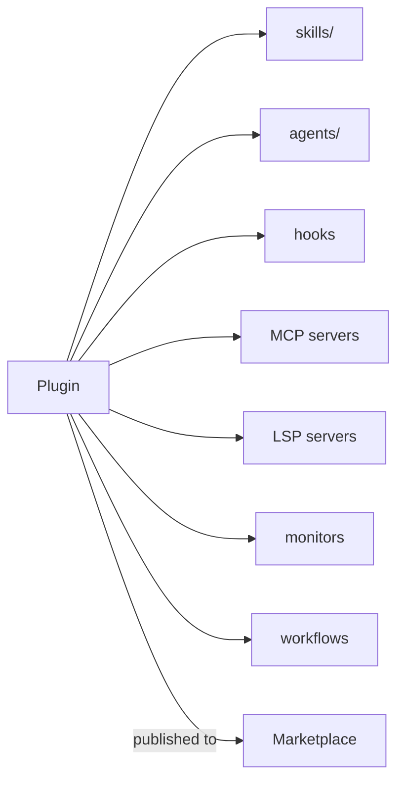

# プラグインとマーケットプレイス

> Source: https://derob98.github.io/ailmanac/ja/docs/claude-code/plugins-marketplaces · AILmanac (CC BY 4.0) · last verified 2026-10-22

スキル、エージェント、コマンド、フック、MCP を、インストール可能な 1 つの単位にまとめます。

<LevelBadge level="advanced" />

<VerifyNote lastVerified="2026-10-22" source="https://code.claude.com/docs/en/plugins">
プラグインの構造とマーケットプレイスの仕組みは急速に進化しています。詳細は Claude Code の公式ドキュメントで確認してください。
</VerifyNote>

**プラグイン**は、複数のカスタマイズ — [スキル](/docs/claude-code/skills)、[サブエージェント](/docs/claude-code/subagents)、[スラッシュコマンド](/docs/claude-code/slash-commands)、[フック](/docs/claude-code/hooks)、[MCP サーバー](/docs/claude-code/mcp)、そして Claude Code v2.1.287 以降は [**mod**](/docs/claude-code/mods) — を、バージョン管理されたインストール可能な 1 つの単位にまとめたものです。**マーケットプレイス**は、人々が見つけてインストールできるプラグインのカタログです。

## プラグインが重要な理由

- **チームのツールキットを 1 ステップで配布。** 全員に 5 つのファイルをコピーしてもらう代わりにプラグインを公開すれば、チームメイトはインストールするだけで同じコマンド、フック、エージェント、MCP 接続を使えます。
- **バージョン管理。** プラグインを更新すれば、全員が新しいバージョンを取得します。
- **配布。** マーケットプレイスによって、あなた(または他の人)のツールキットが見つけやすくなります。

## 通常、何が入っているか

プラグインはコンポーネントを収めた構造化されたフォルダです。`.claude-plugin/plugin.json` マニフェストは**任意**です。なくても、Claude Code は[標準レイアウト](https://code.claude.com/docs/en/plugins-reference#standard-layout)で見つかったものを読み込みます。つまり `SKILL.md` だけを置いたフォルダでもプラグインとして読み込まれます。メタデータやバージョンが欲しいとき、コンポーネントを既定のディレクトリ外に置きたいとき、またはユーザーが設定できる値が必要なときにマニフェストを書きます。

スキル以外にも、プラグインはサブエージェント、フック、MCP サーバーをまとめられます。さらに最近では、コードインテリジェンス用の [LSP サーバー](https://code.claude.com/docs/en/plugins-reference#lspservers)、バックグラウンドの[モニター](https://code.claude.com/docs/en/plugins-reference#monitors)、[ワークフロー](https://code.claude.com/docs/en/workflows#distribute-a-workflow-in-a-plugin)、実行ファイルを入れる `bin/`、既定の設定も含められます。各プラグインは**まとまりのある**ものにしましょう — 「チーム規約」プラグインや「Python ツールキット」プラグインのように、寄せ集めにはしないでください。

## インストール前に信頼を確認する

:::warning[プラグインは実行可能なコードを含むことがあります]
プラグイン内のフックと MCP サーバーは、あなたの権限で実行されます。信頼できる提供元からインストールし、先にプラグインの動作を確認してください — [サードパーティコードのレビュー](/docs/security/reviewing-third-party-code)を参照してください。
:::

## セットアップを拡張していく道筋

自然な流れは次のとおりです。`CLAUDE.md` → いくつかの[スキル](/docs/claude-code/skills)と[コマンド](/docs/claude-code/slash-commands) → それらをプラグインにまとめる → チームやコミュニティ向けにマーケットプレイスで公開する。この最後のステップは、AILmanac がエコシステムの成長を後押ししたい方法の一部です。

## 次へ

- [Mod:インプロセス拡張](/docs/claude-code/mods) — Claude Code の*内部*で動作し、組み込みの動作を置き換えられる、唯一のプラグインコンポーネント
- [プラグイン評価(Plugin Evals)](/docs/claude-code/plugin-evals) — 公開する前に `claude plugin eval` でプラグインが役立つことを証明する
- [スキル](/docs/claude-code/skills) · [サブエージェント](/docs/claude-code/subagents) · [MCP](/docs/claude-code/mcp)
- [サードパーティコードのレビュー](/docs/security/reviewing-third-party-code)
- AILmanac の[スキルパック](/docs/templates/skills)
