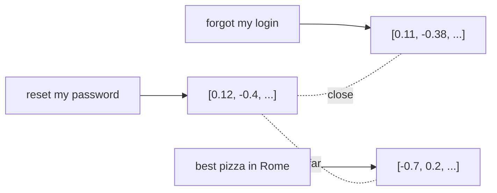

# 埋め込みとベクトル検索

> Source: https://derob98.github.io/ailmanac/ja/docs/foundations/embeddings · AILmanac (CC BY 4.0)

意味をベクトルとして扱う方法、そしてセマンティック検索の仕組み。

<LevelBadge level="intermediate" />

**埋め込み（embedding）**は、テキストの一片を、その*意味*を捉えた数値のリスト（**ベクトル**）に変換します。意味が似たテキストは、たとえ共通する単語がなくても、互いに近いベクトルになります。これが**セマンティック検索**と[RAG](/docs/foundations/rag)の背後にある仕掛けです。

<Callout type="objectives" items={[
  "埋め込みを、似た意味が互いに近くに並ぶように配置された空間内の一点として思い描く",
  "キーワード検索とセマンティック検索を見分け、ハイブリッド検索が通常は勝つ理由を知る",
  "チャンク分割から最近傍探索まで、ベクトル検索の4つのステップをたどる",
  "検索品質を静かに損なう3つの失敗を避ける：不適切なチャンクサイズ、埋め込みモデルの混在、メタデータフィルタの欠如",
  "ベクトルデータベースが本当に必要な場面と、不要な場面を判断する"
]} />

## 直感的なイメージ

すべての文が、巨大な多次元空間の中の一点として配置されていると想像してください。**似た意味は互いに近くに並ぶ**ように配置されています。「パスワードをリセットするには？」は「ログイン情報を忘れた」の近くに、「ローマで一番おいしいピザ」からは遠くに位置します。

## セマンティック検索とキーワード検索

- **キーワード検索**は文字どおりの単語に一致します（「password」は「password」を見つけます）。
- **セマンティック検索**は*意味*に一致します — 「サインインできない」と検索すると、「パスワード」という単語がなくてもパスワードリセットの文書が見つかります。

多くの場合、両方を**組み合わせる**（ハイブリッド検索）と最良の結果が得られます。

## ベクトル検索の仕組み

<Steps items={[
  {
    "title": "文書を埋め込み、ベクトルを保存する",
    "body": "まず各文書をチャンクに分割し、次に各チャンクを埋め込んでベクトルをベクトルデータベースに保存します。これは事前に一度だけ行うステップです。"
  },
  {
    "title": "クエリを埋め込む",
    "body": "クエリ時には、ユーザーの質問を同じ埋め込みモデルに通し、チャンクと同じ空間に配置されるようにします。"
  },
  {
    "title": "最も近いベクトルを探す",
    "body": "クエリのベクトルを保存済みのベクトルとコサイン類似度または距離で比較し、最も近い一致を残します。"
  },
  {
    "title": "それらのチャンクを返す",
    "body": "通常は RAG に渡され、取得したテキストがモデルの回答のコンテキストになります。"
  }
]} />

## 実践上のメモ

- **チャンク分割は重要です。** 大きすぎるとノイズの多い一致になり、小さすぎると文脈が失われます。調整しましょう。
- **埋め込みモデルは一貫して1つを使う** — 異なるモデルのベクトルは比較できません。
- **メタデータ + フィルタ**（日付、ソース、種類）で、検索の精度が大きく上がります。
- ベクトルDBが常に必要なわけではありません — 小さなコーパスなら、単純なインメモリ検索で十分です。

<Flashcards cards={[
  { "front": "埋め込み（Embedding）", "back": "テキストの意味を表す数値のリスト（ベクトル）。意味が似たものは、テキストに共通する単語がなくても、近くに並ぶベクトルになる。" },
  { "front": "ベクトル", "back": "埋め込みが生成する数値のリスト — 近さが意味の類似を表すように配置された、巨大な多次元空間内の一点。" },
  { "front": "キーワード検索とセマンティック検索", "back": "キーワード検索は文字どおりの単語に一致する：「password」は「password」を見つける。セマンティック検索は意味に一致する：「サインインできない」は、「password」という単語がなくてもパスワードリセットの文書を見つける。" },
  { "front": "ハイブリッド検索", "back": "キーワード検索とセマンティック検索を組み合わせること。どちらか一方だけよりも、両方を合わせたときに最良の結果が出ることが多い。" },
  { "front": "チャンク", "back": "埋め込みの前に文書を分割する単位。大きすぎるとノイズの多い一致になり、小さすぎると文脈が失われる。そのまま受け入れるデフォルトではなく、調整するパラメータである。" },
  { "front": "ベクトルデータベース", "back": "クエリ時に最近傍のベクトルを検索できるよう、埋め込み済みのチャンクを保存しておく場所。常に必要とは限らない — 小さなコーパスなら単純なインメモリ検索で十分。" },
  { "front": "コサイン類似度 / 距離", "back": "クエリのベクトルに最も近いベクトルを見つけるために使う尺度 — ベクトル検索のステップ3。" },
  { "front": "埋め込みモデルを混在させてはいけない理由", "back": "異なるモデルのベクトルは比較できない。文書とクエリは、同じモデルで一貫して埋め込むこと。" },
  { "front": "メタデータとフィルタ", "back": "日付、ソース、種類などの属性を各ベクトルと一緒に保存したもの。それらで絞り込むと、類似度だけの場合よりも検索がはるかに正確になる。" }
]} />

<Quiz questions={[
  {
    "q": "ユーザーが「サインインできない」と検索したところ、「サインイン」という語を一切使っていないパスワードリセットの文書が返ってきました。これを可能にしたのは何ですか？",
    "options": [
      "文字どおりの単語に一致するキーワード検索",
      "単語ではなく意味に一致するセマンティック検索",
      "文書の種類に対するメタデータフィルタ",
      "より大きなチャンクサイズ"
    ],
    "answer": 1,
    "explain": "キーワード検索は文字どおりの単語に一致するため、「サインイン」では、その語を一度も使わない文書は見つかりません。セマンティック検索は意味を比較します：両方のテキストが近くのベクトルに埋め込まれるのです。多くの場合、この2つを組み合わせたハイブリッド検索が最良の結果を出します。"
  },
  {
    "q": "文書をより新しい埋め込みモデルで再埋め込みしたものの、既存のクエリ経路には手を加えていません。何が壊れますか？",
    "options": [
      "何も壊れない — 埋め込みは標準的な形式だから",
      "チャンク分割だけが、やり直しになる",
      "検索品質が落ちる。異なるモデルのベクトルは比較できないから",
      "メタデータフィルタだけ"
    ],
    "answer": 2,
    "explain": "異なるモデルのベクトルは比較できません — 別々の空間に存在するからです。文書とクエリは同じモデルで一貫して埋め込む必要があり、モデルを変えたら両側を再埋め込みすることになります。"
  },
  {
    "q": "取得したチャンクは話題としては合っているのに、回答に必要だった細部をたびたび取りこぼします。最初に疑うべき調整項目はどれですか？",
    "options": [
      "チャンクサイズ — 小さすぎて文脈が失われた",
      "ベクトルデータベースのベンダー",
      "コサイン類似度。キーワード一致に置き換えるべき",
      "埋め込みの次元数"
    ],
    "answer": 0,
    "explain": "調整すべきはチャンク分割です：大きすぎるとノイズの多い一致になり、小さすぎると回答が依存していた周囲の文脈が失われます。話題は合っているのに不完全な結果は、チャンクが細かく切られすぎていることを示しています。"
  }
]} />

<Callout type="takeaways" items={[
  "埋め込みとは、空間内の一点としての意味である — 近さは、共通する単語ではなく、似た意味を表す。",
  "セマンティック検索はキーワード検索が見逃すものを見つけるが、ハイブリッド検索は通常どちらか一方より優れる。",
  "4つのステップ：チャンクを埋め込んで保存し、クエリを埋め込み、最近傍ベクトルを探し、チャンクを返す。",
  "埋め込みモデルは1つを、両側で一貫して使う。異なるモデルのベクトルは比較できない。",
  "検索品質には、ベクトルデータベースの選択よりも、チャンクサイズとメタデータフィルタのほうが効く。",
  "小さなコーパスなら、単純なインメモリ検索で十分 — ベクトルDBは必須ではない。"
]} />

## 次へ

- [検索拡張生成（RAG）](/docs/foundations/rag)
- [ファインチューニング vs プロンプト vs RAG](/docs/foundations/finetune-vs-prompt-vs-rag)
- [ハルシネーションとその軽減方法](/docs/foundations/hallucinations)
