# プロバイダー間のサーバーサイド会話状態

> Source: https://derob98.github.io/ailmanac/ja/docs/models/server-side-conversation-state · AILmanac (CC BY 4.0) · last verified 2026-11-03

Anthropic、OpenAI、Google はいずれも会話を自社サーバーに保持するようになりましたが、出てきたのは互換性のない 3 つの契約です。1 つはリプレイ経路を自分で書く必要がある一時的なレイテンシ対策、残る 2 つはデフォルトで有効な 30 日・55 日の耐久ストレージ。設計を実際に左右する軸。

<LevelBadge level="advanced" />

<Callout type="objectives" items={[
  "3 つの API と、その継続パラメータを混同せずに言える",
  "1 つの言葉の裏に隠れた 2 つのプロダクト — 一時的なレイテンシ最適化と、耐久的な会話ストレージ — を区別する",
  "リリース前に保持期間の行を読む — 3 社のうち 2 社では、会話の保存は自分で選んだ結果ではなくデフォルトである",
  "どれもトークン課金を削減しないと理解し、実際に削減する機能がどれかを知る",
  "3 社すべてに通用する 1 つの設計ルールを適用する: 自分のログが真実の源、プロバイダーの状態はキャッシュ",
  "3 社にまたがる抽象化が漏れる 3 か所を見つける"
]} />

<VerifyNote lastVerified="2026-11-03" source="https://platform.claude.com/docs/en/build-with-claude/message-threads">
このページのパラメータ名、デフォルト値、保持期間はすべて、上記の日付時点での各プロバイダー自身のドキュメントからの引用です。3 つの機能のうち 2 つは新しく — Anthropic のものは 2026-11-02 にパブリックベータとなりました — 特に保持ポリシーはプロバイダーが見直しがちな種類のものです。コンプライアンス上の主張をする前に、それぞれ再確認してください: [Anthropic](https://platform.claude.com/docs/en/build-with-claude/message-threads) · [OpenAI](https://developers.openai.com/api/docs/guides/conversation-state) · [Google](https://aistudio.google.com/docs/interactions-overview)。
</VerifyNote>

長年、あらゆるチャット API は設計上ステートレスでした。会話は自分で持ち、毎ターン再送する — それが契約のすべてでした。2026 年に主要 3 社がそろってそれを破りましたが、足並みはそろいませんでした。

Anthropic は[メッセージスレッド](/docs/api/message-threads)を出しました。OpenAI は Responses API の `previous_response_id` と、その上に Conversations API を出しました。Google は Interactions API を出しました。いずれも、新しいターンだけを送って、それ以前のものを指し示せます。売り文句は 3 社のサイトで同じに読めます。

しかし内部では、2 社が**ストレージ**を作り、1 社が**キャッシュ**を作りました。この 1 つの違いが、アプリケーションが会話の自前コピーを持たなければならないか、ユーザーのメッセージが他社のディスクにどれだけ長く置かれるか、午前 3 時の障害経路がどう見えるかを決めます。

## 3 つの API の概観

```mermaid
flowchart TB
  subgraph A["Anthropic — message threads"]
    A1["POST /v1/messages<br/>thread: create / continue"] --> A2["previous_message_id"]
    A2 --> A3["In memory, encrypted<br/>Expires 5 min idle<br/>Deleted ≤ 1 hour"]
    A3 --> A4["No list / read / delete API"]
  end
  subgraph B["OpenAI — Responses + Conversations"]
    B1["POST /responses<br/>store: true by default"] --> B2["previous_response_id"]
    B2 --> B3["Responses kept 30 days"]
    B1 --> B5["POST /conversations<br/>durable container"]
    B5 --> B6["Not subject to the 30-day TTL"]
  end
  subgraph C["Google — Interactions API"]
    C1["POST /v1beta/interactions<br/>store: true by default"] --> C2["previous_interaction_id"]
    C2 --> C3["Paid: 55 days<br/>Free: 1 day"]
    C3 --> C4["delete method<br/>7 / 14 / 28 / 55 day options"]
  end
```

## 比較表

| | **Anthropic**(message threads) | **OpenAI**(Responses / Conversations) | **Google**(Interactions API) |
|---|---|---|---|
| **ステータス** | 2026-11-02 からパブリックベータ、ヘッダー `message-threads-2026-08-12` | 一般提供 | Gemini で構築するための新しい標準として位置づけ |
| **エンドポイント** | `thread` フィールド付きの `POST /v1/messages` | `POST /responses`、コンテナ用に `POST /conversations` | `POST /v1beta/interactions`(`interactions.create`) |
| **継続パラメータ** | `thread: {"type": "continue", "previous_message_id": …}` | `previous_response_id` | `previous_interaction_id` |
| **オプトイン?オプトアウト?** | **オプトイン。**`thread` フィールドがなければ状態もない。 | **オプトアウト。**`store` のデフォルトは `true`。 | **オプトアウト。**`store` のデフォルトは `true`。 |
| **耐久性** | ベストエフォート。メモリ上に保持、サーバー管理の鍵で暗号化、**永続ストレージには一切書き込まれない**。 | 耐久的。レスポンスは `id` で取得可能。 | 耐久的。インタラクションは `id` で取得可能。 |
| **保持期間** | 最後のリクエストから **5 分**で失効、最後の使用から**遅くとも 1 時間以内**に削除。レスポンスが保存されるたびに 5 分がリセット。 | レスポンスオブジェクトはデフォルトで **30 日**保存。Conversation オブジェクトとその項目は 30 日 TTL の**対象外**。 | **有料プラン: 55 日。無料プラン: 1 日。**有料プランは AI Studio で 7 / 14 / 28 / 55 日を設定可能。 |
| **削除できるか?** | スレッドを一覧、読み取り、削除する API はない。 | 永続化したくなければ `store: false`。 | `delete` メソッドでいつでも可能。 |
| **何が保存されるか** | モデルに送られた会話、create リクエストの `system` と `tools`、fixed フィールドのフィンガープリント。ファイルは**参照**。 | チェーン内のレスポンスオブジェクト、コンテナ内の会話項目。 | 実行履歴の全体: モデルの**思考(thought)**、サーバー側・クライアント側のツール呼び出しと結果(`function_call`、`function_result`)、`model_output`。 |
| **トークン課金** | 変わらない。Claude は毎ターン会話全体を読む。 | 変わらない。明示的に文書化: チェーン内の過去の入力トークンはすべて入力トークンとして課金される。 | 課金ルールとしては変わらない。Google はステートフルな経路を、サーバーがキャッシュを最適化できる経路として説明。 |
| **分岐 / 編集 / その場での要約** | **不可。**Append-only で、各レスポンス `id` は**ちょうど 1 回**しか continue できない。 | 未検証 — 下の注記を参照。 | 未検証 — 下の注記を参照。 |
| **ZDR / HIPAA** | **ZDR 対象外、HIPAA 対象外。**HIPAA readiness が有効な組織では利用不可。 | 自社の契約を確認すること。 | 自社の契約を確認すること。 |
| **自分で書くべき障害経路** | 404 → 新しい create リクエストで会話全体をリプレイ。必須。 | 保持期間の失効。`store: false` にすると `previous_response_id` は使えなくなる。 | 保持期間の失効。`store=false` にすると `previous_interaction_id` とバックグラウンド実行の両方が無効になる。 |

:::warning[検証できなかったこと、そして断言しないこと]
Anthropic は append-only と `id` ごとに continue 1 回という制限を明示的に文書化しているので、スレッドに「分岐なし」という主張は確かです。OpenAI と Google のドキュメントには、上記の検証日時点で、引用したページに同等の制限は書かれて**いません** — だからといってその機能が保証されているわけではありません。OpenAI や Google で会話を以前の時点から分岐させる設計に依存するなら、この表から推測せず、実際の API で試してください。
:::

## 本当に重要な軸

パラメータ名はいったん忘れてください。この比較全体を組み替える問いが 1 つあります:

> **プロバイダーが状態を失ったとき、あなたのアプリケーションは壊れるか?**

**Anthropic では、答えは「壊れない。設計上そうなっている」です。**スレッドは明示的にベストエフォートです。Anthropic 自身のドキュメントは、アプリケーションが真実の源であり続けること、どのレスポンスも — create も continue も — ターンが保存されたかどうかを教えないこと、次のリクエストで成功するか 404 が返るかで初めて分かることを述べています。5 分間の無操作で失われます。それは欠陥ではなく、製品そのものです。Anthropic は**会話の形をしたキーを持つプレフィルキャッシュ**を作り、自社の作業も減るのでゼロ円で提供しました。

**OpenAI と Google では、答えは「どれだけ信頼したかによる」です。**どちらも、数週間単位の保持期限を持つ、耐久的で、取得でき、削除できるオブジェクトを提供します。プロバイダーを真実の源にする*こともできます*。コードが少なくて済むので、そうするチームは多いでしょう。その便利さの代償は 3 つの形で届きます: ユーザーの会話の 30 日または 55 日分のコピーが第三者のシステムに存在すること、データ削除の手順がその API を経由すること、プロバイダーを移るにはベース URL を切り替えるのではなく会話をエクスポートする必要があること。

どちらも間違いではありません。異なる問いへの答えです — *「エージェントループを速くしたい」*と*「会話を代わりに保管してほしい」*。間違いは、あるプロバイダーのドキュメントを読んでメンタルモデルを作り、それを次のプロバイダーにそのまま持ち込むことです。

## 誰も選んでいないデフォルト

これは今日行動に移す価値のある発見で、私たちが調べた比較記事のどれにも載っていません。

<Callout type="warning" items={[
  "OpenAI では store のデフォルトは true。Google の Interactions API でも store のデフォルトは true。",
  "どちらかの API を深く考えずに呼ぶと、会話はサーバー側に保持されます — OpenAI ではデフォルトで 30 日、Google の有料プランでは 55 日、Google の無料プランでは 1 日。",
  "チームの誰もこれを決めていません。それはデフォルトであり、あなたが持っていると思っているかもしれないステートレスな挙動の方がオプトアウトです: store: false。",
  "Google では store=false にすると previous_interaction_id とバックグラウンド実行も無効になります — つまりプライバシー上安全な設定は、2 つの機能を犠牲にします。",
  "Anthropic のデフォルトは逆です: thread フィールドがなければ状態もない。オプトインです。"
]} />

LLM トラフィックを一時的なものとして説明するプライバシーポリシー、DPA、記録保持の約束があるなら、自分のコードがこの 3 つのうちどのデフォルトで動いているかを確認してください。この監査は 10 分で終わり、このページで最も価値の高い作業です。

<PromptCard title="Audit prompt — point an agent at your own repo">{`Search this repository for every call to an LLM provider's chat or response API.
For each call site, report:

1. Provider and endpoint (Anthropic /v1/messages, OpenAI /responses, Google /interactions, other).
2. Whether server-side conversation state is in use: a "thread" field,
   "previous_response_id", "previous_interaction_id", or a conversation/thread id.
3. The value of any "store" parameter — and flag it when the parameter is ABSENT,
   because OpenAI and Google both default store to true.
4. Whether we keep our own durable copy of the conversation independent of the provider.

Output a table. Mark as HIGH RISK any call site that relies on provider-held state
with no local copy, and any call site that omits "store" on OpenAI or Google.
Do not change any code.`}</PromptCard>

## どれもトークン課金を削減しない

3 社とも、この点については異例なほど明確ですが、3 社とも誤って報じられます。

- **Anthropic:** Claude は毎ターン会話全体を読むため、トークン使用量は同じままです。料金とレート制限は変わりません。公表されている利点はレイテンシです — 50 万〜100 万トークンのリクエストで time to first token の中央値が約 35% 短縮。
- **OpenAI:** `previous_response_id` を使っても、チェーン内の過去の入力トークンはすべて入力トークンとして課金されます。
- **Google:** ステートフルな経路が推奨される理由の一部は、サーバーがキャッシュを最適化できるからです — これはキャッシュに関する説明であって、会話トークンの割引ではありません。

これらの機能が取り除くのは**アップロード**です: 回線上のバイト、そして最初のトークンが出る前に終えなければならない検証とトークナイズの作業。これは本物の、ときに大きなレイテンシ改善です。しかし請求項目ではありません。

請求額を下げるのは、どのプロバイダーでもプロンプトキャッシュです — そして Anthropic ではスレッドがそれを代わりに有効にはしません。仕組み、TTL、損益分岐の計算は[プロバイダー間のプロンプトキャッシュ](/docs/models/prompt-caching-across-providers)、絶対額は[プロバイダー間で見る AI の実際のコスト](/docs/models/what-ai-costs-across-providers)を参照してください。

:::tip[2 つの機能は組み合わさり、しばしば混同される]
サーバーサイドの会話状態は「何を送らなければならないか?」に答えます。プロンプトキャッシュは「何に対して支払わなければならないか?」に答えます。両方が必要で、前者をオンにしても後者はどこでもオンになりません。
:::

## 移植可能な設計ルール

今日も、次の変更の後も、3 社すべてで通用するルールが 1 つあります:

<Steps items={[
  {title: "自前の append-only な会話ログを、無条件に持つ", body: "すべてのメッセージ、すべてのツール呼び出し、すべてのツール結果を、何かを送る前に自分のストレージに保存します。Anthropic では必須です — リプレイ経路にはそれ以外の情報源がありません。OpenAI と Google では、これがあなたの可搬性を保ち、削除の筋道を自分の手元に置いておくものです。"},
  {title: "プロバイダーが持つ状態はキャッシュとして扱い、ストレージとして扱わない", body: "キャッシュとは、いつ失っても、情報源から再構築できるものです。再構築するコードを書いてください。プロバイダー側のコピーを失うことがリトライではなくインシデントになるなら、それをストレージにしてしまっています。"},
  {title: "store パラメータを、すべてのプロバイダーで、毎回、明示的に設定する", body: "自分で選んでいないデフォルトに頼らないこと。OpenAI と Google では、永続化する理由がない限り store: false と書き、理由があるときはそれを文書化するということです。Anthropic では、スレッドは ZDR 対象外なので、ワークロードごとに thread フィールドを入れるかどうか自体を決めるということです。"},
  {title: "復旧経路は最後ではなく最初に書く", body: "Anthropic では: system と tools を復元した新しい create リクエストで会話全体をリプレイする 404 ハンドラー。OpenAI と Google では: id が保持期間の外に出たときに何が起きるか。どちらも 1 つの関数です。後回しにすると、どちらも書かれません。"},
  {title: "コストと状態は別の判断として扱う", body: "プロンプトキャッシュは、専用のブレークポイントと専用の計測を伴って意図的に追加し、レスポンスの usage フィールドからヒット率を確認します。レイテンシのための移行を、こっそりコスト削減プロジェクトとして出荷してはいけません。"}
]} />

## 3 社にまたがる抽象化が漏れる場所

プロバイダー非依存のレイヤーを作る場合 — あるいは[ゲートウェイ](/docs/models/ai-gateways-litellm-openrouter-portkey)を使う場合 — 後で発見するのではなく、あらかじめ計画しておくべき継ぎ目が 3 つあります。

**1. 耐久性は実装の詳細ではありません。**Anthropic と OpenAI にまたがる単一の `continueConversation(id, messages)` インターフェースは嘘です: 一方のバックエンドでは id が 5 分の無操作で消えうるのに、もう一方では 30 日生き残ります。インターフェースがすべての呼び出し元に「これはなくなっているかもしれない」と公開するか、Anthropic のアダプターが、OpenAI のアダプターにはない完全なリプレイ経路と会話のローカルコピーを黙って抱え込むかのどちらかです。明示的にしてください。

**2. 不変性が異なります。**Anthropic のスレッドは append-only で、レスポンス `id` ごとに continue は 1 回です — continue のリトライは冪等では*なく*、別のエラーを返します。「同じリクエストをもう一度送れば安全」とみなす汎用のリトライラッパーは、他では問題なく動いても、Anthropic のスレッドを壊します。

**3. 保存されるものが異なり、レビューでは重要です。**Google の Interactions API は、ツール呼び出しや出力と並んでモデルの**思考(thought)**を保存します。Anthropic のスレッドは、会話に加えて create リクエストの `system` と `tools` を保持し、ファイルは参照です。「会話」はプロバイダーごとに同じオブジェクトではないので、一社を通したプライバシーレビューが他社を通したことにはなりません。

可搬性の全体像については、[モデル間でのプロンプトの移植](/docs/models/porting-prompts-across-models)と[ネイティブなマルチエージェント API](/docs/models/native-multi-agent-apis)を参照してください。

<Quiz questions={[
  {
    q: "OpenAI の Responses API から Anthropic のメッセージスレッドへエージェントを移植しています。現在のコードは会話をローカルに永続化せず、previous_response_id を渡すだけです。何が壊れますか?",
    options: [
      "何も — previous_message_id は previous_response_id のそのまま差し替えられる同等物である",
      "コストモデルだけ。Anthropic は会話トークンの課金方法が違うため",
      "復旧。Anthropic のスレッドはベストエフォートで最後のリクエストから 5 分で失効し、文書化された唯一の復旧は自分のコピーから会話全体をリプレイすることだが、そのコピーがない",
      "ストリーミング。メッセージスレッドは対応していない"
    ],
    answer: 2,
    explain: "Anthropic のスレッドはメモリ上に保持され、耐久ストレージには書き込まれず、5 分の無操作で失効し、1 時間以内に削除されます。どのレスポンスも保存を確認せず、スレッドを読み戻す API もありません。自分のコピーからのリプレイが唯一の復旧経路なので、ローカルの会話ログを持たないアプリケーションはそのままでは移植できません。トークン課金は両プロバイダーで変わらず、スレッドはストリーミングに対応しています。"
  },
  {
    q: "チームは、会話を保存するコードを誰も書いていないので LLM トラフィックはステートレスだと信じています。OpenAI の Responses API と Google の Interactions API を呼んでいます。この認識は正しいですか?",
    options: [
      "はい — サーバーサイドの状態は、どちらも明示的なオプトインが必要",
      "いいえ — store のデフォルトはどちらも true なので会話は保持されている: OpenAI ではデフォルトで 30 日、Google では有料プランで 55 日、無料プランで 1 日",
      "Google だけ。ストレージがデフォルトなのは Google",
      "OpenAI だけ。レスポンスが 30 日保持されるのは OpenAI"
    ],
    answer: 1,
    explain: "OpenAI も Google も store のデフォルトは true で、ステートレスであることはデフォルトではなくオプトアウトです。OpenAI はレスポンスオブジェクトをデフォルトで 30 日保存します(conversation オブジェクトはその TTL の対象外)。Google はインタラクションを有料プランで 55 日、無料プランで 1 日保持し、7/14/28/55 日に設定できます。Anthropic は逆で、thread フィールドがなければ状態もありません。"
  },
  {
    q: "3 社すべてのサーバーサイド状態機能について、トークン課金に関して正しい記述はどれですか?",
    options: [
      "3 社とも、送った新しいメッセージだけを課金する。それが導入の主な理由である",
      "どれも入力トークン課金を減らさない — モデルは毎ターン会話全体を処理する。コストを下げるのは別機能のプロンプトキャッシュである",
      "Anthropic は会話全体を課金し、OpenAI と Google は差分だけを課金する",
      "課金は選んだ保持期間に依存する"
    ],
    answer: 1,
    explain: "Anthropic は、Claude が毎ターン会話全体を読むためトークン使用量は同じままで、料金とレート制限は変わらないと述べています。OpenAI は、previous_response_id を使ってもチェーン内の過去の入力トークンはすべて入力トークンとして課金されると文書化しています。これらの機能が取り除くのはアップロード — バイト、検証、トークナイズのレイテンシ — であり、トークンではありません。コストを下げるレバーはプロンプトキャッシュで、別途設定が必要です。"
  }
]} />

<Callout type="takeaways" items={[
  "3 つの API、3 つのパラメータ: Anthropic は thread + previous_message_id、OpenAI は previous_response_id、Google は previous_interaction_id。売り文句は同じでも、契約は同じではない。",
  "Anthropic は一時的なキャッシュを作った — メモリ上、5 分の無操作で失効、1 時間以内に削除、読み取り・削除 API なし、ZDR 対象外、リプレイ経路が必須。",
  "OpenAI と Google は耐久ストレージを作った — id で取得・削除でき、OpenAI ではデフォルトで 30 日、Google では 55 日(有料)または 1 日(無料)保持される。",
  "store のデフォルトは OpenAI でも Google でも true。考えたことがないなら、会話を保持している。今日監査を。10 分で済む。",
  "Google では store=false にすると previous_interaction_id とバックグラウンド実行も無効になる — プライベートな設定は機能を犠牲にする。",
  "3 社のどれもトークン課金を減らさない。3 社とも、アップロードサイズと time to first token は減らす。コストのレバーはプロンプトキャッシュで、どのプロバイダーでも別に設定する。",
  "移植可能な唯一のルール: 自前の append-only な会話ログを持ち、プロバイダーの状態は失ってもよいキャッシュとして扱い、store を明示的に設定し、復旧経路を最初に書く。",
  "3 社にまたがる抽象化が漏れる場所はちょうど 3 つ: 耐久性の保証、リトライの冪等性(Anthropic のスレッドは append-only で id ごとに continue 1 回)、そして「会話」に実際に何が含まれるか。"
]} />

## 出典とさらなる読み物

- [Anthropic: Message threads](https://platform.claude.com/docs/en/build-with-claude/message-threads) — `thread` パラメータ、`previous_message_id`、5 分の失効と 1 時間での削除、append-only と `id` ごとに continue 1 回のルール、ZDR と HIPAA の対象外であること、料金とレート制限が変わらないという記述。
- [Anthropic: Make long-running agents faster with message threads](https://claude.com/resources/articles/message-threads) — 50 万〜100 万トークンのリクエストでの TTFT 中央値約 35% という数字と、トークン使用量は同じままだという明確な注記。
- [OpenAI: Conversation state](https://developers.openai.com/api/docs/guides/conversation-state) — `previous_response_id`、`store` パラメータとそのデフォルト `true`、レスポンスオブジェクトの 30 日保持、その TTL の対象外である耐久コンテナとしての Conversations API、チェーン内の過去の入力トークンはすべて入力トークンとして課金されるという記述。
- [Google: Interactions API overview](https://aistudio.google.com/docs/interactions-overview) — `/v1beta/interactions` エンドポイント、`previous_interaction_id`、デフォルトが `true` の `store`、`store=false` が無効にするもの、有料 55 日・無料 1 日の保持と 7/14/28/55 日の選択肢、`delete` メソッド、保存されたインタラクションにモデルの思考とツール結果が含まれるという事実。
- AILmanac の関連ページ: [Message Threads](/docs/api/message-threads) · [プロバイダー間のプロンプトキャッシュ](/docs/models/prompt-caching-across-providers) · [プロバイダー間で見る AI の実際のコスト](/docs/models/what-ai-costs-across-providers) · [プライバシー](/docs/foundations/privacy)

## 次へ

- [Message Threads](/docs/api/message-threads) — Anthropic 側の詳細: 3 つのフィールドグループ、5 つのエラーコード、4 ブレークポイントのキャッシュ予算、リプレイ経路
- [プロバイダー間のプロンプトキャッシュ](/docs/models/prompt-caching-across-providers) — 請求額を実際に下げる機能と、キャッシュを使うワークロードがプロバイダーを変えるときの 5 つの落とし穴
- [ネイティブなマルチエージェント API](/docs/models/native-multi-agent-apis) — 一段上のレイヤー。ここではプロバイダー同士が「セッション」とは何かについても合意しなくなった
