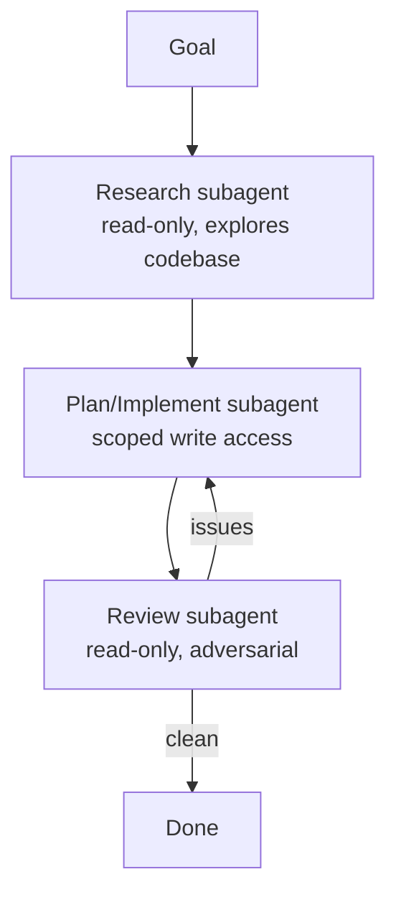

# マルチサブエージェントのワークフローを設計する

> Source: https://derob98.github.io/ailmanac/ja/docs/walkthroughs/multi-subagent-workflow · AILmanac (CC BY 4.0)

引き継ぎとレビューゲートで、調査・実装・レビューのエージェントをオーケストレーションする。

<LevelBadge level="advanced" />

<Callout type="objectives" items={[
  "各段階が独自のコンテキストと独自のツールセットを持つ、調査→実装→レビューのパイプラインを組む",
  "メインエージェントが指示されなくても適切なサブエージェントに委任できるよう、十分に絞った description を書く",
  "形だけの承認で終わらず、差し戻すレビューゲートを加える",
  "マルチエージェントの調整が得より損になる 3 つのケースを見分ける",
  "完了した実行を、分割が本当にうまくいったかを示す 4 つのシグナルで確認する"
]} />

大きなタスクは、すべてを 1 つのコンテキストに詰め込むより、目的を絞った[サブエージェント](/docs/claude-code/subagents)に分けたほうがうまくいきます。調査→実装→レビューのパイプラインを設計してみましょう。

## 全体像

各サブエージェントは**独自のコンテキスト**と**用途に合わせたツールセット**を持ち、メインセッションに戻るのは*結果*だけなので、メインセッションはきれいに保たれます。

## ステップ 1 — エージェントを定義する

`/agents` インターフェースで 3 つを定義します。それぞれに絞り込んだ `description`(メインエージェントが正しく委任できるように)と、範囲を限定したツールを持たせます:

<Steps items={[
  {title: "researcher — 読み取りと検索のみ", body: "関連するコードをマップ化し、調査結果を返します。書き込みツールは一切なく、だからこそ広く読ませても安全です。重い探索はここで行われるため、メインのコンテキストには入りません。"},
  {title: "implementer — ファイル編集とテスト実行ができる", body: "researcher の調査結果を入力として受け取るので、自分でコードベースを読み直すのではなく、地図から出発できます。書き込みは範囲限定: 触れられるファイルの集合が狭いほど、驚かされることが少なくなります。"},
  {title: "reviewer — 読み取り専用、敵対的", body: "バグ、抜けているケース、規約違反を探します。意図的に読み取り専用にします: 見つけたものを直せてしまうレビュアーは、報告をやめてパッチを当て始め、シグナルが失われます。"}
]} />

`description` フィールドはドキュメントではありません — メインエージェントが委任するかどうかを判断するときに読む、ルーティングキーです。曖昧な description は、定義したサブエージェントが一向に使われない最も一般的な理由です。

<PromptCard title="A reviewer description that actually gets delegated to">{`Use this agent to review a completed code change adversarially before it ships.
Invoke it after the implementer reports done, and before telling the user the
task is finished. It reads the diff and the surrounding code and reports
problems; it does not fix them.`}</PromptCard>

## ステップ 2 — 引き継ぎでオーケストレーションする

メインセッションは各段階の出力を次の段階に渡します: 調査→実装(調査結果を使う)→レビュー(実装を対象に)。**レビューゲート**を加えます: レビュアーが問題を見つけたら、完了する前に implementer に差し戻します。

<PromptCard title="The handoff instruction that creates the gate">{`Run this as three stages, and do not skip the gate:

1. Delegate the exploration to the researcher. Wait for its findings.
2. Give those findings to the implementer as its starting context.
   Do not ask it to re-explore.
3. Give the implementer's result to the reviewer. If the reviewer reports
   any issue, hand the issues back to the implementer and review again.
   Only report the task complete after a review that found nothing.`}</PromptCard>

## ステップ 3 — やってはいけないときを知る

:::warning[並列/マルチエージェントはタダではない]
- **逐次的な依存**(実装には調査が必要)は逐次のままにします — 順序が重要なところで枝分かれさせないでください。
- **共有ファイルへの書き込み**は衝突しえます — [git worktree](/docs/claude-code/worktrees)で隔離するか、直列化します。
- 小さなタスクでは、調整のオーバーヘッドが利益を上回ります。**規模が大きく、分解できる**作業に使ってください。
:::

## ステップ 4 — 検証する

よいマルチエージェントの実行では、次のことが見られます: 焦点の定まったメインコンテキスト(重い読み込みは researcher で行われた)、調査を反映した実装、そして実際に何かを捉えた(あるいは信頼できる形で承認した)レビュー。レビュアーが形だけの承認になっているなら、プロンプトを**敵対的**にします(「何が間違っているか探せ」)。

<Quiz questions={[
  {
    q: "reviewer サブエージェントを定義したのに、何度実行してもメインエージェントがそれに委任しません。最も可能性の高い原因はどれですか?",
    options: [
      "reviewer は呼び出される前に書き込みツールを必要とする",
      "description が曖昧すぎてルーティングキーとして機能していない — メインエージェントは description を読んでいつ委任するかを決める",
      "サブエージェントは、ユーザーが明示的なコマンドで呼び出した場合にしか呼び出せない",
      "3 つのサブエージェントは、パイプラインが対応できる数を超えている"
    ],
    answer: 1,
    explain: "description は、メインエージェントが委任するかどうかを判断するときに読むものなので、絞り込まれた description がサブエージェントを使われるようにします。reviewer は読み取り専用で敵対的であるべきです — 書き込みツールを与えると、報告せずにパッチを当ててしまい、シグナルを失います。"
  },
  {
    q: "タスクは小さいものです: 関数を 1 つリネームし、その 3 か所の呼び出し元を更新する。調査/実装/レビューのパイプラインを実行すべきですか?",
    options: [
      "はい — レビューゲートはどんな大きさのタスクでもミスを捉える",
      "はい、ただし researcher の段階は外す",
      "いいえ — 小さなタスクでは調整のオーバーヘッドが利益を上回る。このパターンは規模が大きく分解できる作業のためのもの",
      "いいえ、サブエージェントはファイルを編集できないから"
    ],
    answer: 2,
    explain: "マルチエージェントの調整はタダではありません。このページは避けるべき 3 つのケースを挙げています: 枝分かれできない逐次的な依存、衝突しうる共有ファイルへの書き込み、そしてオーバーヘッドが節約を上回る小さなタスク。"
  },
  {
    q: "2 つのサブエージェントが同時に同じファイルへ書き込む必要があります。解決策はどれですか?",
    options: [
      "両方にフルツールセットを与えて、衝突を自分たちで解決させる",
      "git worktree で隔離するか、書き込みを直列化する",
      "書き込みをメインセッションに移す",
      "衝突を後から見つけるために、2 人目の reviewer を追加する"
    ],
    answer: 1,
    explain: "共有ファイルへの書き込みは衝突しえます。対処法は隔離 — エージェントごとに git worktree — か、一度に 1 つだけが書くよう直列化することです。順序が実際に重要な場面で枝分かれさせるのが間違いであり、回避すべき対象ではありません。"
  }
]} />

<Callout type="takeaways" items={[
  "タスク名だけでなく、コンテキストとツールセットで分ける: researcher は読み取り専用、implementer は範囲限定の書き込み、reviewer は読み取り専用で敵対的。",
  "メインセッションに戻るのは結果だけで、これこそが要点 — 重い読み込みは researcher のコンテキストにとどまる。",
  "description はルーティングキー。曖昧だと、丁寧に定義したサブエージェントが一度も呼ばれない。",
  "レビューゲートは差し戻せてこそ機能する: 問題は implementer に戻り、何も見つからなかったレビューの後でのみタスクが完了する。",
  "reviewer は読み取り専用に保つ。書き込み権限を与えると報告せず修正してしまい、そのために作ったシグナルを失う。",
  "逐次だけの作業、隔離していない衝突する共有書き込み、小さなものには、このパターンを使わない。"
]} />

## さらに進むには

同じパターンをプログラムで行うのが[API でエージェントを構築する](/docs/api/building-agents)で、プロダクトの画面としては[Cowork と Agent Teams](/docs/api/cowork-and-agent-teams)があります。

## 次へ

- [サブエージェントと並列エージェント](/docs/claude-code/subagents)
- [Git Worktrees](/docs/claude-code/worktrees)
- [API でエージェントを構築する](/docs/api/building-agents)
