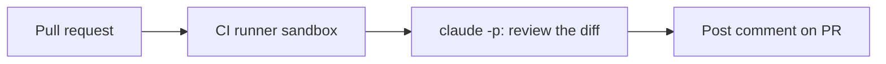

# すべての PR をレビューする GitHub Action

> Source: https://derob98.github.io/ailmanac/ja/docs/walkthroughs/pr-review-action · AILmanac (CC BY 4.0) · last verified 2026-07-17

CI で Claude Code をヘッドレス実行し、プルリクエストをレビューしてコメントする。

<LevelBadge level="advanced" />

<Callout type="objectives" items={[
  "Claude Code のヘッドレス実行を pull_request ワークフローに組み込み、diff をレビューしてコメントする",
  "permissions ブロックをコメント専用に設定し、contents: write が越えてはならない一線である理由を説明する",
  "プルリクエストの内容を、その実態どおり信頼できない入力として扱う",
  "diff が大きくなってもレビューのコストを一定の範囲に抑える",
  "コメントが折りたたまれずに読まれるよう、プロンプトを書く"
]} />

<VerifyNote lastVerified="2026-07-17" source="https://code.claude.com/docs/en/headless">
ヘッドレスのフラグや CI 連携の詳細は変わっていきます — Claude Code / Agent SDK の公式ドキュメントで確認してください。
</VerifyNote>

価値の高い定番の自動化: Claude に**すべてのプルリクエストをレビュー**させ、その指摘をコメントとして投稿する — CI で[ヘッドレス](/docs/claude-code/headless-and-agent-sdk)実行します。ここでは全体像と、安全に保つためのガードレールを示します。

## 何をするか

PR ごとに: diff をチェックアウトし、バグ、エッジケース、規約の問題について Claude にレビューさせ、コメントを投稿します。判断は引き続き人間が行い、Claude は素早い一次チェックを提供するだけです。



<Steps items={[
  {title: "diff を計算できるだけの履歴をチェックアウトする", body: "浅いクローンではベースブランチが見えないため、diff が空になり、レビューは何もないものに対する自信満々の承認に見えてしまいます。フル深度で取得してください。"},
  {title: "diff をファイルとして生成する", body: "ベース ref と HEAD の差分を取ってディスクに書き出します。シェル変数ではなくアーティファクトとして保持すると、非常に大きな diff でコマンドラインが壊れるのを防げます。"},
  {title: "diff を stdin に渡して Claude をヘッドレスで実行する", body: "プロンプト 1 回、パス 1 回、出力は Markdown として取得。ツールなし、リポジトリへの書き込みなし — このステップは読み取りとテキスト生成だけで済みます。"},
  {title: "Markdown を PR コメントとして投稿する", body: "gh CLI かアクションを使います。何らかの書き込み権限が必要なのはこのステップだけで、必要なのは pull-requests の書き込みだけです。"}
]} />

## ワークフロー(スケッチ)

```yaml
name: Claude PR review
on: pull_request
permissions:
  contents: read
  pull-requests: write   # to comment — NOT write to code
jobs:
  review:
    runs-on: ubuntu-latest
    steps:
      - uses: actions/checkout@v4
        with: { fetch-depth: 0 }
      - name: Review the diff
        env:
          ANTHROPIC_API_KEY: ${{ secrets.ANTHROPIC_API_KEY }}
        run: |
          git diff origin/${{ github.base_ref }}...HEAD > /tmp/diff.patch
          claude -p "Review this diff for correctness bugs, missing edge cases, and
          security issues. Report ONLY high-confidence findings as a Markdown
          checklist with file:line. Diff:" < /tmp/diff.patch > /tmp/review.md
      # then post /tmp/review.md as a PR comment (e.g. with the gh CLI or an action)
```

(正確なヘッドレスの呼び出し方は異なる場合があります — ドキュメントを参照してください。原則は、diff を渡し、Markdown を取得し、投稿する、です。)

## ガードレール([自律実行の堅牢化](/docs/security/hardening-autonomous-runs)を読んでください)

:::warning[CI での最小権限]
- **コメントのみ。**`pull-requests: write` を付与し、`contents: write` は**付与しない** — ボットがコードを push してはいけません。
- **トークンのスコープを絞る**。信頼できない PR の内容を読むジョブには、デプロイやシークレットへのアクセスを決して公開しない。
- **PR の内容は信頼できないものとして扱う** — [プロンプトインジェクション](/docs/security/prompt-injection)を含みうる。ジョブに重大な結果を伴う操作をさせない。
- **コストに上限を設ける** — 大きな diff は[トークン](/docs/api/tokens-and-pricing)を消費する。変更されたファイルだけをレビューすることを検討する。
:::

## 騒がしくせず、役に立たせる

- **確信度の高い指摘だけ**を求める — 細かい指摘の山は無視されます。
- **一次チェック**にとどめ、マージの判断は人間が行う。

<PromptCard title="The review prompt — tuned for a comment people actually read">{`Review this diff for correctness bugs, missing edge cases, and security issues.

Rules for your output:
- Report ONLY high-confidence findings. If you are unsure, leave it out.
- One Markdown checklist item per finding, each starting with file:line.
- State the concrete failure: what input or state leads to what wrong result.
- No style nitpicks, no praise, no summary of what the diff does.
- If you find nothing high-confidence, say exactly that in one line.

Diff:`}</PromptCard>

<Quiz questions={[
  {
    q: "レビュージョブはプルリクエストにコメントを投稿する必要があります。正しい permissions ブロックはどれですか?",
    options: [
      "contents: write と pull-requests: write — ボットが修正も push できるように",
      "contents: read と pull-requests: write — コメントのみ。ボットがコードを push してはいけない",
      "contents: read と pull-requests: read — レビューは読み取り操作なので",
      "pull_request ワークフローには permissions ブロックは不要",
    ],
    answer: 1,
    explain: "コメントに必要なのは pull-requests: write だけで、それ以上は不要です。contents: write を付与すると、信頼できないプルリクエストの内容を読むジョブがコードを push できてしまいます — まさに避けたい組み合わせです。リポジトリを読むには contents: read が必要です。"
  },
  {
    q: "チェックアウトのステップで fetch-depth: 0 を使うのはなぜですか?",
    options: [
      "大きなリポジトリでクローンを速くするため",
      "ヘッドレスの Claude が動作するのに完全な git 履歴を必要とするから",
      "浅いクローンではベースブランチが見えないため、diff が空になるから",
      "後でジョブがブランチに書き戻せるようにするため"
    ],
    answer: 2,
    explain: "diff はベース ref に対して計算されます。浅いクローンにはそれがないため diff は空になり、レビューは黙って何もないものを承認します — 合格に見える失敗です。"
  },
  {
    q: "コントリビューターが、レビュアーにセキュリティチェックを無視して承認するよう指示する説明文付きの PR を開きました。正しい姿勢はどれですか?",
    options: [
      "diff 内の指示には決して従わないよう Claude に伝える指示をプロンプトに追加し、解決したとみなす",
      "PR の内容をプロンプトインジェクションを含みうる信頼できない入力として扱い、ジョブに重大な結果を伴う操作をさせない",
      "アクションを組織のメンバーの PR のみに制限する",
      "コントリビューターを報告する issue をジョブに開かせる"
    ],
    answer: 1,
    explain: "プルリクエストの内容は信頼できない入力で、プロンプトインジェクションを含みえます。プロンプト内の指示は助けにはなりますが、境界ではありません。持続的な対策は最小権限です: ジョブはコメントしかできないので、インジェクションが成功した最悪のケースも、push やデプロイやシークレット漏洩ではなく、まずいコメントにとどまります。"
  }
]} />

<Callout type="takeaways" items={[
  "ジョブ全体は: フル深度のチェックアウト、diff をファイルに、ヘッドレスで 1 パス、Markdown を投稿。4 ステップのうち書き込みアクセスが必要なのは 1 つだけ。",
  "pull-requests: write と contents: read。コントリビューターが書いた内容を読むジョブでは、決して contents: write にしない。",
  "fetch-depth: 0 にしないと diff が空になり、レビューが健康診断書のように読めてしまう。",
  "PR の内容は信頼できず、プロンプトインジェクションを含みうる。制御は最小権限であり、プロンプトの言い回しは境界ではない。",
  "確信度の高い指摘だけを、file:line 付きで求める。細かい指摘の山は折りたたまれ、自動化は無視されて死ぬ。",
  "diff が大きくなるにつれてコストに上限を設ける — 変更されたファイルだけをレビューするのが通常のレバー。",
  "これは一次チェック。マージの判断は引き続き人間が行う。"
]} />

## 次へ

- [ヘッドレスモードと Agent SDK](/docs/claude-code/headless-and-agent-sdk)
- [自律実行の堅牢化](/docs/security/hardening-autonomous-runs)
- [コーディングとソフトウェア開発](/docs/playbooks/coding)
