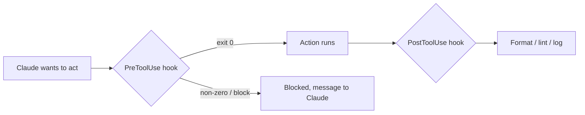

# 훅(Hooks): 결정론적 자동화

> Source: https://derob98.github.io/ailmanac/ko/docs/claude-code/hooks · AILmanac (CC BY 4.0) · last verified 2026-08-22

생명주기 이벤트에 명령을 실행해 포맷팅, 게이트, 안전장치를 강제한다.

<LevelBadge level="advanced" />

<VerifyNote lastVerified="2026-08-22" source="https://code.claude.com/docs/en/hooks">
Claude Code는 단계별로 묶인 30개 이상의 훅 이벤트를 문서화하고 있습니다. 전체 목록, 이벤트별 매처 문법, 공통 JSON 출력 필드는 공식 훅 레퍼런스에 있습니다. 이름과 페이로드 형태는 계속 바뀌므로, 특정 이벤트나 필드에 의존하기 전에 원문과 대조해 확인하세요.
</VerifyNote>

훅(Hooks)은 Claude Code가 생명주기의 정해진 지점에서 **자동으로 실행하는 셸 명령**입니다. [권한](/docs/claude-code/permissions)이 어떤 동작을 *허용할지*를 결정한다면, 훅은 그 동작 주위에서 *당신이* 결정론적 로직(포맷팅, 검증, 로깅, 게이트, 마스킹)을 실행하게 해 줍니다. "잊지 말고 해 줘"라고 부탁하는 대신 동작을 보장하는 방법입니다.

<Callout type="objectives" items={["지시, 권한, 스킬 대신 훅을 써야 할 때", "전체 생명주기: 세션, 프롬프트, 도구, 서브에이전트, 태스크, 컴팩션, 턴 종료 이벤트", "훅을 연결하는 방법: 이벤트, 매처, stdin의 JSON 페이로드", "훅이 동작을 차단하는 두 가지 방법 — 종료 코드 2 vs stdout의 JSON", "이벤트 전반에 공통인 JSON 출력 필드: continue, additionalContext, systemMessage, reloadSkills, sessionTitle, suppressOutput, updatedInput", "빠르고 안전한 훅과 굼뜨고 말 없는 훅을 가르는 모범 사례와 흔한 실수"]} />

## 훅을 써야 할 때

동작을 그저 요청하는 것이 아니라 *보장*하고 싶을 때 훅을 사용하세요. 흔한 작업은 각각 생명주기 이벤트에 대응합니다.

- 파일을 수정할 때마다 **자동 포맷/린트** (`Edit|Write`에 대한 `PostToolUse`).
- 규칙을 위반하는 동작을 실행 전에 **차단** (`PreToolUse`).
- 어시스턴트의 메시지가 터미널에 표시되기 전에 **마스킹** (`MessageDisplay`).
- `SessionStart` 이후 **스킬을 다시 불러오거나** **세션 제목**을 설정.
- 세션이 끝나거나, 태스크가 완료되거나, 턴이 실패했을 때 **알림 또는 로그 기록** (`Stop`, `StopFailure`, `SessionEnd`).
- 세션 시작 시 또는 지시 사항이 로드될 때 **컨텍스트 주입**.

## 동작 방식

훅은 [`settings.json`](/docs/claude-code/settings)에 등록하며, **이벤트**(그리고 흔히 매처 — 보통 도구 이름이고, 때로는 서브에이전트 유형, 컴팩션 트리거, 알림 종류)와 짝을 짓습니다. 이벤트가 발생하면 Claude가 당신의 명령을 실행하면서 **stdin으로 JSON 페이로드**(이벤트 이름, 세션, 도구 이름과 입력 같은 이벤트별 필드)를 전달합니다. 명령의 종료 코드와 stdout이 다음에 일어날 일을 결정합니다.

<Steps items={[{title: "이벤트 지정", body: "관심 있는 생명주기 이벤트 아래 settings.json에 훅을 등록합니다 — 예를 들어 도구 실행 후 자동화에는 PostToolUse, 마스킹에는 MessageDisplay."}, {title: "매처로 범위 좁히기", body: "관련 있을 때만 훅이 실행되도록 매처를 추가합니다. 예: 파일 수정에는 matcher \"Edit|Write\", SessionStart에는 matcher \"startup|resume\"."}, {title: "stdin에서 페이로드 읽기", body: "이벤트가 발생하면 Claude가 명령을 실행하고 stdin으로 JSON 페이로드를 파이프로 전달합니다 — 이벤트 이름, 세션, 이벤트별 필드(tool_name, tool_input, notification 등)."}, {title: "다음 동작 결정", body: "명령의 종료 코드와 출력이 결과를 정합니다. 동작을 그대로 진행시키거나, 자체 로직을 실행하거나, 차단하거나, Claude가 보는 내용을 바꾸는 구조화된 JSON을 반환할 수 있습니다."}]} />

```json
{
  "hooks": {
    "PostToolUse": [
      {
        "matcher": "Edit|Write",
        "hooks": [
          { "type": "command", "command": "jq -r '.tool_input.file_path' | xargs npx prettier --write" }
        ]
      }
    ]
  }
}
```

위 훅은 stdin JSON(`.tool_input.file_path`)에서 수정된 파일의 경로를 꺼내 포맷합니다. 환경 변수에 경로가 들어 있다고 가정하지 마세요 — **stdin에서 읽으세요.** 스크립트 위치를 찾는 데는 `${CLAUDE_PROJECT_DIR}` 같은 유용한 경로 플레이스홀더를 *쓸 수 있습니다*.

## 생명주기 한눈에 보기

Claude Code 훅은 도구 호출만이 아니라 세션 전체에 걸쳐 있습니다. 로직을 어디에 걸어야 하는지 알 수 있도록 단계별로 묶었습니다.

| 단계 | 이벤트 | 대표적인 용도 |
| --- | --- | --- |
| **세션** | `SessionStart`, `SessionEnd`, `Setup`, `InstructionsLoaded`, `ConfigChange`, `CwdChanged`, `DirectoryAdded`, `FileChanged` | 시작 시 컨텍스트 주입, 종료 시 스냅샷, `CLAUDE.md` 재로드나 디스크의 `.env` 변경에 반응 |
| **프롬프트** | `UserPromptSubmit`, `UserPromptExpansion` | Claude가 보기 전에 프롬프트를 걸러내거나 다시 쓰기 |
| **도구** | `PreToolUse`, `PermissionRequest`, `PermissionDenied`, `PostToolUse`, `PostToolUseFailure`, `PostToolBatch` | 동작 허용/거부, 사람에게 에스컬레이션, 수정 후 포맷, 자동 모드 거부 후 재시도 |
| **서브에이전트** | `SubagentStart`, `SubagentStop` | 시작/종료 로그, 서브에이전트가 결과를 반환하지 못하게 차단 |
| **태스크** | `TaskCreated`, `TaskCompleted` | 실수로 만든 태스크 롤백, 완료 게이트 |
| **컴팩션** | `PreCompact`, `PostCompact` | 컴팩션 전에 트랜스크립트 스냅샷, 이후 검증 |
| **모델** | `PreModelSwitch`, `PostModelSwitch` | 모델 전환이 적용되기 전에 차단, 전환 후(재개된 세션이 모델을 복원하는 경우 포함) 반응 |
| **턴** | `Stop`, `StopFailure`, `Notification`, `MessageDisplay` | 완료 시 알림, API 실패 시 경고, 표시되는 텍스트 마스킹 |
| **팀 + MCP** | `TeammateIdle`, `Elicitation`, `ElicitationResult`, `WorktreeCreate`, `WorktreeRemove` | 세션 간 조율, MCP elicitation 게이트, 워크트리 작업 래핑 |

각 이벤트의 정확한 stdin 필드, 매처 문법, 차단 규칙은 [공식 훅 레퍼런스](https://code.claude.com/docs/en/hooks)에 있습니다. 위 카탈로그는 지도이고, 레퍼런스는 현장입니다.

## 훅이 차단하는 방법

이벤트에 따라 두 가지 방법이 있습니다.

- **종료 코드 2** — 훅이 동작을 실패시키고, **stderr**에 쓴 내용이 Claude가 보는 메시지가 됩니다. 간단하며 차단 가능한 이벤트(`PreToolUse`, `UserPromptSubmit`, `UserPromptExpansion`, `Stop`, `SubagentStop`, `TeammateIdle`, `TaskCreated`, `TaskCompleted`, `ConfigChange`, `PostToolBatch`, `PreCompact`, `PreModelSwitch`, `Elicitation`, `ElicitationResult`, `WorktreeCreate`, `WorktreeRemove`)의 command 훅에서 동작합니다. `PermissionRequest`에서는 종료 코드 2가 무시되므로, 대신 `decision` 객체로 거부하세요.
- **stdout의 JSON (종료 코드 0)** — 구조화된 결정을 반환합니다. `PreToolUse`에서는 `permissionDecision`에 `"allow"`, `"deny"`, `"ask"`(호출을 사용자에게 보여 줌), `"defer"`(앱이 재개하는 `-p` 실행에서만 사용)를 지정하고 `permissionDecisionReason`을 붙입니다. 차단하지 않는 이벤트(`PostToolUse`, `Notification`, `MessageDisplay`, `StopFailure`, 대부분의 세션 이벤트)는 차단 시도를 무시하지만, JSON 출력으로 Claude가 다음에 보는 내용을 유도할 수는 있습니다.

아래 스크립트는 Bash 도구에 거는 `PreToolUse` 훅입니다. 위에서 아래로 읽어 보세요. stdin에서 명령을 꺼내고, 파괴적으로 보이면 stderr에 이유를 쓰고 종료 코드 2로 끝내 차단합니다.

```bash
#!/usr/bin/env bash
# PreToolUse hook on the Bash tool: refuse to delete things.
command=$(jq -r '.tool_input.command' < /dev/stdin)
if [[ "$command" == rm\ * || "$command" == *"rm -rf"* ]]; then
  echo "Blocked: destructive 'rm' is not allowed by policy." >&2
  exit 2
fi
exit 0
```

## 공통 JSON 출력 필드

대부분의 이벤트는 stdout으로 구조화된 JSON 객체를 받아 다음에 일어날 일을 유도합니다. 이는 `permissionDecision` 같은 이벤트별 결정 필드와는 별개입니다. 가장 유용한 것들:

| 필드 | 하는 일 | 동작하는 곳 |
| --- | --- | --- |
| **`continue`** | `false`이면 Claude가 처리를 완전히 중단합니다 — 이벤트별 모든 결정보다 우선합니다 | 대부분의 이벤트 |
| **`systemMessage`** | Claude의 컨텍스트/트랜스크립트에 메시지를 추가해 왜 개입했는지 알 수 있게 합니다 | 대부분의 차단 가능 이벤트 |
| **`additionalContext`** | Claude가 다음 턴에 읽고 활용할 수 있는 추가 컨텍스트를 주입합니다 | `SessionStart`, `UserPromptSubmit`, 그 외 |
| **`reloadSkills`** | 스킬 디렉터리를 다시 스캔해 방금 작성한 스킬을 세션이 인식하게 합니다 | `SessionStart`(및 다른 세션 이벤트) |
| **`sessionTitle`** | UI의 세션 제목을 설정합니다 — `SessionStart`에서는 `hookSpecificOutput` 아래에 둡니다 | `SessionStart` |
| **`suppressOutput`** | 도구의 출력을 Claude에게서 숨깁니다(출력이 많은 명령에 유용) | 도구 이벤트 |
| **`updatedInput`** | 실행 전에 도구의 입력을 다시 씁니다(예: `--dry-run` 플래그 추가) | `PreToolUse` |
| **`terminalSequence`** | 터미널 이스케이프 시퀀스(벨, 창 제목, 알림 배지)를 내보냅니다 | `Notification`, `StopFailure`, 그 외 |

이벤트별 결정 필드 — `PreToolUse`의 `permissionDecision`(`"allow"`, `"deny"`, `"ask"`, `"defer"` 및 `permissionDecisionReason`), `PermissionRequest`의 `decision.behavior`(`"allow"` 또는 `"deny"`), 거부된 호출을 Claude가 다시 시도하게 하는 `PermissionDenied`의 `retry: true` — 는 이러한 공통 필드 위에 얹어 사용합니다.

## 멘탈 모델

`PreToolUse` 훅은 동작 *전에* 실행되어 차단할 수 있고, `PostToolUse` 훅은 동작이 성공한 *후에* 실행되어 결과에 반응합니다.



<Flashcards title="훅 이벤트 한눈에 보기" cards={[{front: "PreToolUse", back: "동작이 실행되기 전에 발생합니다. 차단하거나 게이트를 걸 때 사용합니다 — 예: 파괴적인 명령을 실행 전에 거부. 결정 필드: permissionDecision."}, {front: "PostToolUse", back: "일치하는 동작 후에 발생합니다. 방금 바뀐 내용을 포맷, 린트, 로그할 때 사용합니다. 차단하지 않습니다."}, {front: "MessageDisplay", back: "어시스턴트 메시지 텍스트가 표시될 때 발생합니다. 터미널에서 비밀 정보나 PII를 마스킹할 때 사용합니다 — 표시 전용이며 차단할 수 없습니다."}, {front: "SessionStart", back: "세션이 시작(또는 재개)될 때 발생합니다. additionalContext로 컨텍스트를 주입하거나, 새 스킬이 추가된 뒤 reloadSkills, 또는 sessionTitle을 설정할 때 사용합니다."}, {front: "Stop / StopFailure", back: "Stop은 Claude가 턴을 정상적으로 마쳤을 때, StopFailure는 API 오류(rate_limit, overloaded, auth 등)로 턴이 끝났을 때 발생합니다. 실패 변형에서 알림을 보내거나 자동 재시도하세요."}, {front: "PreCompact / PostCompact", back: "컨텍스트 컴팩션 전후에 발생합니다. PreCompact는 차단(종료 코드 2)하거나 먼저 트랜스크립트를 스냅샷할 수 있고, PostCompact는 컴팩션된 상태에 반응합니다."}]} />

## 모범 사례

- **훅은 빠르고 멱등적으로 유지하세요** — 자주 실행됩니다. `SessionEnd` 훅은 모든 훅이 1.5초의 예산 하나를 공유하므로, 세션 종료 시 작업은 최소한으로 유지하세요.
- **진짜 문제에는 시끄럽게 실패**하되, 외관상의 문제로 차단하지는 마세요.
- **훅 출력을 Claude에게 주는 피드백으로 다루세요** — stderr(종료 코드 2)나 `systemMessage`(JSON)의 명확한 메시지는 Claude가 스스로 바로잡는 데 도움이 됩니다.
- "차단됨"보다 더 많은 말을 하고 싶다면 **종료 코드보다 JSON 출력을 선호하세요** — `PreToolUse`의 `permissionDecision: "ask"`는 문을 쾅 닫지 않고 사람에게 판단을 넘기며, `additionalContext`는 거부만 하는 대신 *유도*할 수 있게 해 줍니다.
- 훅은 셸의 권한으로 실행됩니다 — 직접 작성하지 않은 훅은 모두 검토하세요([서드파티 코드 검토](/docs/security/reviewing-third-party-code)).

## 흔한 실수

- **환경 변수에서 파일 경로 읽기.** 경로는 `$CLAUDE_FILE_PATH`가 아니라 stdin JSON(`.tool_input.file_path`)에 있습니다. stdin을 `jq`로 파이프하세요.
- **조용한 차단.** `PreToolUse` 훅이 stderr에 아무것도 쓰지 않고 종료 코드 2로 끝나면, Claude는 차단되었지만 *이유*를 몰라 적응할 수 없습니다. 항상 명확한 이유를 쓰세요(또는 `permissionDecisionReason` 사용).
- **차단하지 않는 이벤트를 차단하려고 하기.** `PostToolUse`는 도구가 실행된 *후에* 발생합니다 — 종료 코드 2는 Claude의 귀에 메시지를 넣을 뿐 동작을 되돌릴 수 없습니다. 게이트가 필요하면 `PreToolUse`에 거세요.
- **느린 훅.** `PostToolUse` 훅은 일치하는 *모든* 수정 뒤에 실행됩니다. 3초 걸리는 린터는 세션 전체를 굼뜨게 만듭니다 — 훅은 빠르게 유지하고, 가능하면 바뀐 부분에만 동작하세요.
- **너무 넓은 매처.** `matcher: ".*"`는 모든 도구에서 실행됩니다. 정확한 이름, `Edit|Write` 같은 목록, 또는 핸들러별 `if` 필드(예: `"if": "Bash(git push *)"`)로 좁히세요.
- **도구가 아닌 이벤트에도 매처가 있다는 것을 잊기.** `SessionStart`는 `startup|resume|clear|compact|fork`에, `Notification`은 `permission_prompt|idle_prompt|agent_completed` 같은 종류에, `PreCompact`는 `manual|auto`에 일치합니다. 엉뚱한 부분 집합에 연결된 훅은 너무 자주 실행되거나 아예 실행되지 않습니다.
- **직접 작성하지 않은 훅을 신뢰하기.** 훅은 임의의 셸을 당신의 권한으로 실행합니다. 플러그인이나 템플릿에서 가져온 훅은 먼저 검토하세요 — [서드파티 코드 검토](/docs/security/reviewing-third-party-code)를 참고하세요.

<Callout type="warning" items={["훅은 임의의 셸을 당신의 권한으로 실행합니다 — 플러그인이나 템플릿의 훅은 읽어 보지 않고 연결하지 마세요."]} />

## 가져다 쓸 만한 레시피

복사해서 붙여 넣을 수 있는 스타터는 [훅 & settings.json 레시피](/docs/templates/hooks-settings)에 있습니다. 최신 이벤트의 형태를 보여 주는 효과 큰 레시피 몇 가지:

<PromptCard title="수정한 파일 자동 포맷 (Edit|Write에 대한 PostToolUse)">{`{
  "hooks": {
    "PostToolUse": [
      {
        "matcher": "Edit|Write",
        "hooks": [
          { "type": "command", "command": "jq -r '.tool_input.file_path' | xargs npx prettier --write" }
        ]
      }
    ]
  }
}`}</PromptCard>

<PromptCard title="시작 시 프로젝트별 세션 제목 설정 (SessionStart)">{`{
  "hooks": {
    "SessionStart": [
      {
        "matcher": "startup|resume",
        "hooks": [
          {
            "type": "command",
            "command": "jq -nc --arg t \\"$(basename \\"$PWD\\") — $(git rev-parse --abbrev-ref HEAD 2>/dev/null || echo detached)\\" '{hookSpecificOutput:{sessionTitle:$t}}'"
          }
        ]
      }
    ]
  }
}`}</PromptCard>

<PromptCard title="SessionStart 후 스킬 다시 불러오기 (방금 작성한 스킬을 인식)">{`{
  "hooks": {
    "SessionStart": [
      {
        "matcher": "startup|resume",
        "hooks": [
          { "type": "command", "command": "printf '{\\"reloadSkills\\": true}\\n'" }
        ]
      }
    ]
  }
}`}</PromptCard>

<PromptCard title="표시되는 어시스턴트 텍스트에서 API 키 마스킹 (MessageDisplay)">{`{
  "hooks": {
    "MessageDisplay": [
      {
        "hooks": [
          {
            "type": "command",
            "command": "jq -r '.message.content' | sed -E 's/(sk-[A-Za-z0-9_-]{20,})/sk-***REDACTED***/g'"
          }
        ]
      }
    ]
  }
}`}</PromptCard>

<PromptCard title="턴 실패 시 알림 (StopFailure — 속도 제한, 과부하, 인증)">{`{
  "hooks": {
    "StopFailure": [
      {
        "matcher": "rate_limit|overloaded|authentication_failed|billing_error",
        "hooks": [
          { "type": "command", "command": "osascript -e 'display notification \\"Claude Code turn failed — check the terminal\\" with title \\"Claude Code\\"'" }
        ]
      }
    ]
  }
}`}</PromptCard>

<Quiz title="스스로 점검하기" questions={[{q: "훅은 방금 수정된 파일의 경로를 어디에서 찾나요?", options: ["$CLAUDE_FILE_PATH 환경 변수", "stdin의 JSON 페이로드, .tool_input.file_path", "Claude가 전달하는 명령줄 인자"], answer: 1, explain: "경로는 환경 변수가 아니라 stdin JSON(.tool_input.file_path)에 있습니다. stdin을 jq로 파이프해서 읽으세요."}, {q: "PreToolUse 훅이 종료 코드 2로 끝나면 어떻게 되나요?", options: ["동작이 허용되고 stdout이 로그에 기록된다", "동작이 차단되고, 훅이 stderr에 쓴 내용이 Claude가 보는 메시지가 된다", "종료 코드 2는 예약되어 있어 Claude가 결과를 무시한다"], answer: 1, explain: "종료 코드 2는 동작을 실패시키고, stderr가 Claude가 보는 메시지가 됩니다. Claude가 적응할 수 있도록 항상 명확한 이유를 쓰세요."}, {q: "재시작 없이 .claude/skills/에 방금 추가한 스킬을 세션이 인식하게 하고 싶습니다. 어떤 이벤트에서 어떤 출력 필드를 쓰나요?", options: ["SessionStart의 reloadSkills: true", "Stop의 restart: true", "PostToolUse의 refresh: true"], answer: 0, explain: "SessionStart 훅에서 {\"reloadSkills\": true}를 출력하면 스킬 디렉터리를 다시 스캔하여 현재 세션이 새로 추가되거나 수정된 스킬을 인식합니다."}, {q: "Claude의 텍스트가 사용자 화면에 나타나기 전에 비밀 정보를 마스킹하고 싶습니다. 어떤 이벤트인가요?", options: ["PreToolUse", "PostToolUse", "MessageDisplay"], answer: 2, explain: "MessageDisplay는 어시스턴트 메시지 텍스트가 표시될 때 발생합니다 — 터미널로 가는 텍스트를 변환하거나 마스킹하기에 알맞은 곳입니다. 차단은 할 수 없습니다."}]} />

<Callout type="takeaways" items={["훅은 동작을 요청이 아니라 보장으로 만듭니다 — 권한이 허용하거나 거부만 하는 동작 주위의 결정론적 로직입니다.", "생명주기는 세션, 프롬프트, 도구, 서브에이전트, 태스크, 컴팩션, 턴 단계에 걸친 30개 이상의 이벤트를 포괄합니다 — 스크립트를 쓰기 전에 알맞은 단계를 고르세요.", "settings.json에 이벤트와 매처를 함께 등록하세요. Claude는 stdin으로 JSON 페이로드를 파이프하고, 당신의 종료 코드와 출력을 읽습니다.", "파일 경로는 환경 변수가 아니라 stdin(.tool_input.file_path)에서 읽으세요.", "종료 코드 2(stderr가 메시지가 됨) 또는 stdout의 구조화된 JSON(도구 이벤트에서는 permissionDecision, 모든 것을 멈추려면 {continue: false})으로 차단하세요.", "공통 출력 필드 — additionalContext, systemMessage, reloadSkills, sessionTitle, suppressOutput, updatedInput — 를 쓰면 허용 또는 거부만 하지 않고 Claude를 유도할 수 있습니다.", "훅은 빠르고, 멱등적이며, 좁은 매처로 유지하세요 — 그리고 직접 작성하지 않은 훅은 셸의 권한으로 실행되므로 반드시 검토하세요."]} />

## 다음으로

- [Mods: 인프로세스 확장](/docs/claude-code/mods) — 인프로세스 형제 기능: 이벤트를 허용하거나 차단하는 데 그치지 않고 *다시 쓸* 수 있는 TypeScript 미들웨어로, 이 페이지의 모든 이벤트를 `classic.<Event>`로 다룹니다
- [settings.json](/docs/claude-code/settings) · [권한](/docs/claude-code/permissions)
- [스킬](/docs/claude-code/skills) — 전문성 vs 자동화
- [자율 실행 강화하기](/docs/security/hardening-autonomous-runs)
