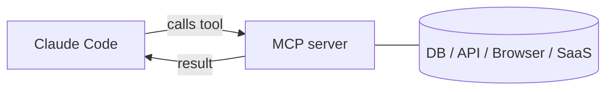

# Claude Code의 MCP 서버

> Source: https://derob98.github.io/ailmanac/ko/docs/claude-code/mcp · AILmanac (CC BY 4.0) · last verified 2026-11-10

Model Context Protocol을 통해 데이터베이스, GitHub, 브라우저 등을 연결하세요.

<LevelBadge level="advanced" />

<VerifyNote lastVerified="2026-11-10" source="https://code.claude.com/docs/en/mcp">
`claude mcp` 명령, 설정 스코프, 전송 방식은 계속 바뀝니다 — 공식 Claude Code MCP 문서와 modelcontextprotocol.io에서 확인하세요. 아래의 네 가지 전송 방식, 스코프 저장 경로, SSE 지원 중단, 프로젝트 승인 동작은 모두 해당 페이지를 근거로 합니다.
</VerifyNote>

**Model Context Protocol(MCP)** 은 AI를 외부 도구와 데이터에 연결하기 위한 오픈 표준입니다. **MCP 서버**는 기능(데이터베이스 쿼리, GitHub PR 열기, 브라우저 조작)을 노출하고, Claude Code는 이 서버에 연결해 세션 중에 **그 도구들을 호출**할 수 있습니다. Claude를 파일 시스템과 셸 너머로 확장하는 방법입니다.

<Callout type="objectives" items={["MCP 서버가 무엇이고 Claude Code가 그 도구를 어떻게 호출하는지 설명한다", "두 가지 전송 방식인 로컬 stdio와 원격 HTTP/SSE를 구분한다", "claude mcp add로 서버를 추가하고 기록되는 JSON을 읽는다", "서버를 누가 볼 수 있어야 하는지에 따라 알맞은 스코프(local, project, user)를 고른다", "실제 데이터베이스를 Claude에 처음부터 끝까지 연결한다", "대부분의 사람들이 걸려드는 보안 및 설정 함정을 피한다"]} />

## 전체 구조



Claude가 쓸 수 있는 서버를 선언하면, 각 서버는 스키마가 있는 도구 모음을 게시하고, Claude는 다른 도구와 똑같이 그 도구를 골라 호출합니다.

<Flashcards title="MCP 용어" cards={[{front: "Model Context Protocol (MCP)", back: "AI를 외부 도구와 데이터에 연결하기 위한 오픈 표준."}, {front: "MCP 서버", back: "데이터베이스 쿼리, GitHub PR 열기, 브라우저 조작 같은 기능을 호출 가능한 도구로 노출하는 프로그램."}, {front: "도구(Tool)", back: "MCP 서버가 스키마와 함께 게시하는 기능. Claude는 다른 도구와 똑같이 이를 골라 호출한다."}, {front: "전송 방식(Transport)", back: "Claude가 서버에 도달하는 방법: stdio(로컬 프로세스), HTTP(호스팅형, 주로 OAuth), SSE(지원 중단 — HTTP가 자동으로 대체 연결함), WebSocket ws/wss(지속 연결, 푸시, 헤더 인증만 가능, --transport 플래그 없음)."}, {front: "스코프(Scope)", back: "서버를 누가 보는가: local(나, 이 프로젝트), project(커밋된 팀), user(나, 어디서나)."}]} />

## 전송 방식

Claude가 서버에 도달하는 방법은 네 가지입니다. 서버가 어디서 실행되고 어떻게 통신하는지에 따라 고르세요.

- **stdio** — Claude가 실행하는 로컬 프로세스(로컬 도구/CLI에 적합). `type`이 없는 JSON 항목이 바로 이것을 의미합니다.
- **HTTP** — 호스팅되는 서버로, 주로 OAuth를 사용합니다. 원격 서버라면 기본으로 선택할 방식입니다.
- **SSE** — **지원 중단**; 가능하면 HTTP를 쓰세요. 아직 SSE 엔드포인트만 제공하는 서비스도 있는데, Claude Code v2.1.265부터는 `--transport http`가 먼저 HTTP를 시도하고 알아서 SSE로 전환하므로 `--transport sse`를 명시할 일은 거의 없습니다.
- **WebSocket**(`ws` / `wss`) — 서버가 요청 없이 이벤트를 푸시해야 할 때 쓰는, 지속적인 양방향 연결입니다. `--transport`는 `ws`를 받지 *않습니다*: `claude mcp add-json '{"type":"ws","url":"wss://…"}'`로 추가하거나 `.mcp.json`에 직접 적으세요. OAuth는 없으며 인증은 헤더 방식뿐입니다.

<Callout type="warning" items={["url은 있는데 type이 없는 JSON 항목은 합리적인 기본값이 아니라 설정 오류입니다. Claude Code는 type이 없는 항목을 stdio 서버로 읽고 건너뛰면서 \"url\"은 있지만 \"type\"이 없다고 보고합니다. 직접 작성하는 원격 서버에는 항상 \"type\": \"http\"(또는 \"sse\" / \"ws\")를 지정하세요."]} />

## 서버 설정하기

가장 빠른 방법은 `claude mcp add` 명령입니다 — 설정을 대신 써 줍니다. 이 순서를 따라 하면 처음부터 서버 연결까지 갈 수 있습니다.

<Steps items={[{title: "로컬 stdio 서버 추가", body: "claude mcp add를 실행하세요 — -- 뒤의 모든 것이 Claude가 대신 실행하는 시작 명령입니다."}, {title: "또는 원격 HTTP 서버 추가", body: "--transport http와 스코프를 지정한 다음 서버 URL을 입력하세요. 원격 서버는 대개 호스팅되며 OAuth를 사용합니다."}, {title: "연결된 서버 확인", body: "claude mcp list를 실행해 설정된 서버와 연결 상태를 확인하세요."}, {title: "점검 및 인증", body: "세션 안에서 /mcp를 사용해 서버의 도구를 점검하고 원격 서버를 인증하세요."}]} />

<PromptCard title="로컬 stdio 서버 추가">{`# A local stdio server (everything after -- is the launch command)
claude mcp add filesystem -- npx -y @modelcontextprotocol/server-filesystem ~/code/myproject`}</PromptCard>

<PromptCard title="원격 HTTP 서버 추가 (프로젝트와 공유)">{`# A remote HTTP server, shared with everyone on the project
claude mcp add --transport http --scope project github https://api.githubcopilot.com/mcp/`}</PromptCard>

내부적으로는 그저 JSON입니다. **project** 스코프 서버는 저장소 루트의 `.mcp.json`에 기록됩니다 — 이를 커밋하면 팀원들이 워크스페이스를 신뢰하는 즉시 같은 도구를 얻습니다:

```json
{
  "mcpServers": {
    "github": { "type": "http", "url": "https://api.githubcopilot.com/mcp/" }
  }
}
```

<Callout type="warning" items={["오래된 튜토리얼에서 볼 수 있는 @modelcontextprotocol/server-github, -postgres, -slack, -puppeteer 패키지에 손대지 마세요. 이들은 보관(archived) 처리되었고 npm 지원 중단 안내에 \"Archived and unmaintained; no security guarantees\"라고 적혀 있습니다. 공급업체가 직접 제공하는 서버가 있다면 그것을 쓰세요 — GitHub는 위의 HTTP 엔드포인트이고, 브라우저 제어는 @playwright/mcp로 옮겨 갔습니다. TypeScript 레퍼런스 서버 중 여전히 유지보수되는 것은 filesystem, memory, everything, sequential-thinking뿐입니다."]} />

### 스코프가 서버를 볼 수 있는 사람을 결정합니다

| 스코프 | 저장 위치 | 로드되는 곳 | 사용 용도 |
|---|---|---|---|
| `local` (기본값) | `~/.claude.json` 안, 이 프로젝트 경로 아래 | 이 프로젝트에서만 | 개인 실험, 비밀 값 |
| `project` | 저장소의 `.mcp.json` (커밋됨) | 이 프로젝트에서만, 팀과 공유 | 팀 전체가 공유해야 하는 도구 |
| `user` | `~/.claude.json` | 내 모든 프로젝트 | 어디서나 쓰고 싶은 서버 |

<Callout type="warning" items={["MCP의 \"local 스코프\"는 로컬 설정과 같은 것이 아닙니다. local 스코프 MCP 서버는 홈 디렉터리의 ~/.claude.json에 있으며, 프로젝트의 .claude/settings.local.json에 있지 않습니다. 프로젝트 폴더에서 찾아봐야 헛수고입니다."]} />

`claude mcp list`로 연결된 서버를 확인하고, 세션 안에서 `/mcp`로 도구를 점검하고 원격 서버를 인증하세요. 복사해 붙여 넣을 수 있는 시작 템플릿은 [MCP 설정 및 서버 스캐폴드](/docs/templates/mcp-config)를 참고하세요.

## 실전 예제: Claude에게 데이터베이스 연결해 주기

쿼리 결과를 직접 붙여 넣는 대신, 로컬 Postgres에 대한 질문에 Claude가 답하게 하고 싶다고 해 봅시다. 팀원들도 쓸 수 있도록 project 스코프로 서버를 추가합니다.

보관 처리된 서버 문제가 가장 크게 와닿는 곳이 데이터베이스입니다. 예전의 `@modelcontextprotocol/server-postgres`는 더 이상 유지보수되지 않고 공식 대체품도 없으므로, 패키지 이름이 직접 내려야 하는 유일한 결정입니다. 유지보수되는 커뮤니티 서버를 고르고, [검토한](/docs/security/reviewing-third-party-code) 다음 연결하세요 — 무엇을 고르든 형태는 같습니다:

<PromptCard title="project 스코프로 Postgres 서버 추가">{`# Replace the package with a maintained Postgres MCP server you have reviewed.
# The connection string is read-only on purpose — see below.
claude mcp add --scope project db -- npx -y <postgres-mcp-server> "postgresql://readonly@localhost/app"`}</PromptCard>

이제 세션에서 평범한 말로 질문하면 쿼리 반복 작업은 Claude가 알아서 처리합니다:

<PromptCard title="데이터베이스에 질문하기">{`How many users signed up last week? Check the DB.`}</PromptCard>

Claude는 서버가 게시한 쿼리 도구를 호출하고, 행을 받아 답합니다 — 복사해 붙여 넣는 과정이 없습니다. Claude가 정말로 쓰기가 필요한 경우가 아니라면 연결 문자열은 읽기 전용으로 유지하세요. 그리고 필요한 것이 쿼리 한 번뿐이라면, Bash를 통한 `psql -c '…'`가 토큰을 훨씬 적게 쓴다는 점을 기억하세요. 어느 쪽이 유리한지는 [MCP 토큰세](/docs/claude-code/mcp-token-cost)에서 다룹니다.

project 스코프이므로 저장소를 pull한 팀원도 같은 기능을 얻습니다 — 하지만 **조용히, 곧바로 얻는 것은 아닙니다**. 커밋된 `.mcp.json`의 서버는 팀원이 해당 폴더에서 `claude`를 실행하고 워크스페이스 신뢰 대화상자를 수락할 때까지 `⏸ Pending approval` 상태로 남습니다. 복제된 저장소는 자신의 서버를 미리 승인할 수 없습니다. 프로젝트의 `.claude/settings.json`에 커밋된 `enableAllProjectMcpServers`나 `enabledMcpjsonServers`는 신뢰되지 않은 폴더에서는 *무시됩니다*. 반면 사용자 수준의 `~/.claude/settings.json`, 관리형 설정, 또는 `--settings`로 전달한 승인은 거기서도 적용됩니다. "팀원이 서버를 못 보는 이유가 뭐죠?"라는 질문에 대한 흔한 답이 바로 이것입니다.

## 신뢰와 보안

<Callout type="warning" items={["MCP 서버는 코드를 실행하고 데이터를 읽고 동작을 수행할 수 있습니다 — 신뢰하는 서버만 연결하세요.", "각 서버에는 필요한 최소 권한만 부여하세요.", "서버가 반환하는 모든 외부 콘텐츠에는 프롬프트 인젝션이 담겨 있을 수 있습니다.", "서드파티 서버는 연결하기 전에 검토하세요."]} />

:::warning[MCP 서버는 소프트웨어를 설치하는 것처럼 다루세요]
MCP 서버는 코드를 실행하고 데이터를 읽고 동작을 수행할 수 있습니다. 신뢰하는 서버만 연결하고, 필요한 **최소 권한**만 부여하며, 서버가 반환하는 모든 외부 콘텐츠에 [프롬프트 인젝션](/docs/security/prompt-injection)이 담겨 있을 수 있음을 기억하세요. 서드파티 서버는 먼저 검토하세요 — [서드파티 코드 검토하기](/docs/security/reviewing-third-party-code)를 참고하세요.
:::

## 앱에서도 MCP

MCP는 Claude 앱의 **커넥터**도 뒷받침합니다 — 같은 표준, 다른 화면입니다. [앱의 커넥터(MCP)](/docs/claude-app/connectors)와, API에 대해서는 [MCP와 도구 연결](/docs/api/mcp)을 참고하세요.

## 흔한 실수

- **잘못된 스코프.** `local` 스코프로 추가한 서버는 팀원에게 나타나지 않습니다. 본인만 쓰려던 서버를 `project` 스코프로 커밋해서도 안 됩니다. 의도를 갖고 고르세요.
- **서버도 너무 많고 도구도 너무 많음.** 도구 검색은 기본으로 켜져 있으므로, 연결된 서버는 보통 전체 스키마가 아니라 도구 *이름*과 서버 지침만 매 턴 비용으로 듭니다 — 그래도 턴마다 내는 세금이고, Claude가 검색하는 순간 스키마가 컨텍스트에 들어옵니다. 카탈로그 전체가 아니라 작업에 필요한 것만 연결하세요. 실제 수치, `ENABLE_TOOL_SEARCH` 모드, 코드 실행이 두 번째 비용을 줄이는 방식은 [MCP 토큰세](/docs/claude-code/mcp-token-cost)를 참고하세요.
- **과도한 권한의 연결.** Claude가 정말로 쓰기가 필요한 경우가 아니라면 데이터베이스 서버에는 읽기 전용 역할을 주세요. MCP는 기능을 현실로 만들어 줍니다 — 범위를 좁히세요.
- **인젝션 위험 잊기.** 서버가 반환하는 모든 것(웹 페이지, 이슈 본문, 데이터 행)은 [프롬프트 인젝션](/docs/security/prompt-injection)을 담을 수 있는 신뢰할 수 없는 텍스트입니다. 강력한 쓰기 가능 서버를 신뢰할 수 없는 읽기 가능 서버 옆에 충분히 생각하지 않고 연결하지 마세요.

<Quiz title="스스로 점검하기" questions={[{q: "Claude가 직접 실행하는 로컬 프로세스인 전송 방식은 무엇인가요?", options: ["원격 HTTP/SSE", "stdio", "OAuth"], answer: 1, explain: "stdio는 Claude가 실행하는 로컬 프로세스로, 로컬 도구와 CLI에 이상적입니다. 나머지 셋은 원격입니다: HTTP(주로 OAuth), 지원 중단된 SSE, 그리고 WebSocket."}, {q: "project 스코프 서버는 어디에 기록되며, 팀원은 무엇을 해야 하나요?", options: ["내 사용자 설정; 나만 볼 수 있음", "저장소 루트의 .mcp.json; pull한 뒤에도 서버가 Pending approval에서 벗어나려면 워크스페이스를 신뢰해야 함", "숨겨진 전역 캐시; 아무도 편집할 수 없음"], answer: 1, explain: "project 스코프는 저장소 루트의 커밋된 .mcp.json에 기록됩니다. 하지만 복제된 저장소는 자신의 서버를 승인할 수 없습니다 — 커밋된 enableAllProjectMcpServers는 신뢰되지 않은 폴더에서 무시되므로, 팀원이 워크스페이스 신뢰 대화상자를 수락할 때까지 서버는 Pending approval에서 대기합니다."}, {q: "Claude가 읽기만 하면 될 때 데이터베이스 연결을 읽기 전용으로 두는 이유는 무엇인가요?", options: ["쿼리가 더 빨리 실행되기 때문", "최소 권한 — MCP는 기능을 현실로 만들어 주므로, 정말 필요하지 않다면 쓰기 권한을 주지 않는다", "프로토콜이 읽기 전용을 요구하기 때문"], answer: 1, explain: "서버에는 필요한 최소 권한만 주세요. MCP는 기능을 현실로 만들어 주므로, 읽기 전용 역할이 의도치 않은 쓰기를 막아 줍니다."}]} />

<Callout type="takeaways" items={["MCP는 오픈 표준이며, MCP 서버는 Claude Code가 다른 도구와 똑같이 호출하는 도구를 노출한다.", "전송 방식은 네 가지: stdio(Claude가 실행하는 프로세스), HTTP(원격의 기본값), SSE(지원 중단 — HTTP가 알아서 전환), WebSocket ws/wss(푸시, 헤더 인증, add-json 전용).", "claude mcp add가 설정을 대신 써 준다. 내부적으로는 JSON이다. project 스코프는 커밋된 .mcp.json에 있고, 팀원의 사본은 워크스페이스를 신뢰할 때까지 Pending approval에 머문다.", "스코프가 가시성을 결정한다: local(나, 이 프로젝트), project(팀을 위해 커밋), user(나, 어디서나).", "서버는 소프트웨어를 설치하듯 다루자: 신뢰, 최소 권한, 그리고 서버가 반환하는 모든 것에 담긴 프롬프트 인젝션 경계."]} />

## 다음

- [첫 MCP 서버 만들고 연결하기 (워크스루)](/docs/walkthroughs/first-mcp-server)
- [MCP 설정 및 서버 스캐폴드](/docs/templates/mcp-config)
- [에이전트와 도구 보호하기](/docs/security/securing-agents)
