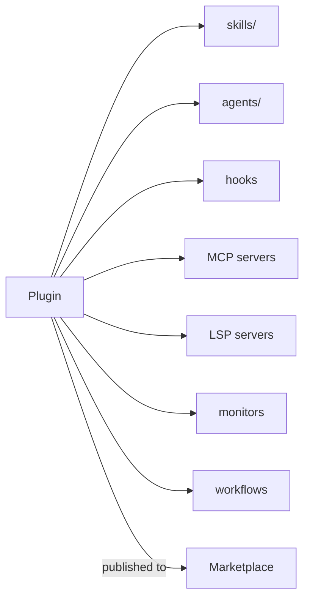

# 플러그인과 마켓플레이스

> Source: https://derob98.github.io/ailmanac/ko/docs/claude-code/plugins-marketplaces · AILmanac (CC BY 4.0) · last verified 2026-10-22

스킬, 에이전트, 명령어, 훅, MCP를 설치 가능한 하나의 단위로 묶습니다.

<LevelBadge level="advanced" />

<VerifyNote lastVerified="2026-10-22" source="https://code.claude.com/docs/en/plugins">
플러그인 구조와 마켓플레이스 동작 방식은 빠르게 변하고 있습니다. 자세한 내용은 Claude Code 공식 문서에서 확인하세요.
</VerifyNote>

**플러그인**은 여러 커스터마이징 — [스킬](/docs/claude-code/skills), [서브에이전트](/docs/claude-code/subagents), [슬래시 명령어](/docs/claude-code/slash-commands), [훅](/docs/claude-code/hooks), [MCP 서버](/docs/claude-code/mcp), 그리고 Claude Code v2.1.287부터는 [**mod**](/docs/claude-code/mods) — 를 버전 관리되는 하나의 설치 가능한 단위로 묶은 것입니다. **마켓플레이스**는 사람들이 찾아서 설치할 수 있는 플러그인 카탈로그입니다.

## 플러그인이 중요한 이유

- **팀 툴킷을 한 번에 배포하세요.** 모두에게 파일 다섯 개를 복사하라고 요청하는 대신 플러그인을 게시하면, 팀원은 설치만으로 같은 명령어, 훅, 에이전트, MCP 연결을 얻습니다.
- **버전 관리.** 플러그인을 업데이트하면 모두가 새 버전을 받습니다.
- **배포.** 마켓플레이스를 통해 내 툴킷(또는 다른 사람의 툴킷)을 쉽게 찾을 수 있습니다.

## 보통 무엇이 들어 있나

플러그인은 구성 요소를 담은 구조화된 폴더입니다. `.claude-plugin/plugin.json` 매니페스트는 **선택 사항**입니다. 없으면 Claude Code는 [표준 레이아웃](https://code.claude.com/docs/en/plugins-reference#standard-layout)에서 찾은 것을 로드하므로, `SKILL.md`만 들어 있는 폴더도 이미 플러그인으로 로드됩니다. 메타데이터, 버전, 기본 디렉터리 밖에 있는 구성 요소, 사용자가 설정할 수 있는 값이 필요할 때 매니페스트를 작성하세요.

스킬 외에도 플러그인은 서브에이전트, 훅, MCP 서버를 묶을 수 있으며, 최근에는 코드 인텔리전스를 위한 [LSP 서버](https://code.claude.com/docs/en/plugins-reference#lspservers), 백그라운드 [모니터](https://code.claude.com/docs/en/plugins-reference#monitors), [워크플로](https://code.claude.com/docs/en/workflows#distribute-a-workflow-in-a-plugin), 실행 파일을 담는 `bin/`, 기본 설정도 포함할 수 있습니다. 각 플러그인은 잡동사니가 아니라 **일관성** 있게 유지하세요 — "팀 규칙" 플러그인, "Python 툴킷" 플러그인처럼요.

## 설치 전에 신뢰부터

:::warning 플러그인은 실행 가능한 코드를 포함할 수 있습니다
플러그인의 훅과 MCP 서버는 내 권한으로 실행됩니다. 신뢰할 수 있는 출처에서만 설치하고, 먼저 플러그인이 무엇을 하는지 검토하세요 — [서드파티 코드 검토](/docs/security/reviewing-third-party-code)를 참고하세요.
:::

## 설정을 확장해 나가는 경로

자연스러운 진행은 다음과 같습니다. `CLAUDE.md` → 몇 개의 [스킬](/docs/claude-code/skills)과 [명령어](/docs/claude-code/slash-commands) → 이를 플러그인으로 묶기 → 팀이나 커뮤니티를 위해 마켓플레이스에 게시. 마지막 단계는 AILmanac이 생태계의 성장을 돕고자 하는 방식의 일부입니다.

## 다음

- [Mod: 인프로세스 확장](/docs/claude-code/mods) — Claude Code *내부*에서 실행되며 내장 동작을 대체할 수 있는 유일한 플러그인 구성 요소
- [플러그인 평가(Plugin Evals)](/docs/claude-code/plugin-evals) — 게시하기 전에 `claude plugin eval`로 플러그인이 도움이 됨을 증명하세요
- [스킬](/docs/claude-code/skills) · [서브에이전트](/docs/claude-code/subagents) · [MCP](/docs/claude-code/mcp)
- [서드파티 코드 검토](/docs/security/reviewing-third-party-code)
- AILmanac의 [스킬 팩](/docs/templates/skills)
