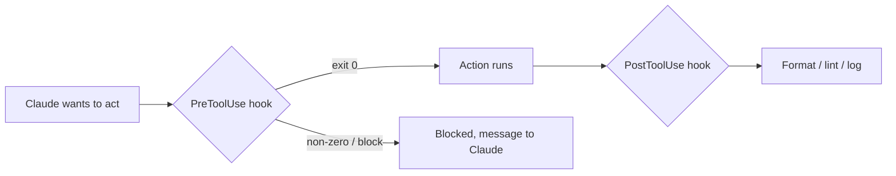

# Хуки: детерминированная автоматизация

> Source: https://derob98.github.io/ailmanac/ru/docs/claude-code/hooks · AILmanac (CC BY 4.0) · last verified 2026-08-22

Запускайте команды на событиях жизненного цикла, чтобы обеспечить форматирование, проверки и безопасность.

<LevelBadge level="advanced" />

<VerifyNote lastVerified="2026-08-22" source="https://code.claude.com/docs/en/hooks">
Claude Code документирует более 30 событий хуков, сгруппированных по фазам. Полный список, грамматика матчеров для каждого события и универсальные поля JSON-вывода приведены в официальном справочнике по хукам. Названия и форма полезной нагрузки меняются; сверяйтесь с первоисточником, прежде чем опираться на конкретное событие или поле.
</VerifyNote>

Хуки — это **shell-команды, которые Claude Code запускает автоматически** в определённых точках своего жизненного цикла. Там, где [разрешения](/docs/claude-code/permissions) решают, *разрешено* ли действие, хуки позволяют *вам* выполнять вокруг него детерминированную логику — форматирование, валидацию, логирование, проверки, маскирование. С их помощью поведение становится гарантированным, а не зависит от просьбы «пожалуйста, не забудь».

<Callout type="objectives" items={["Когда выбирать хук вместо инструкции, разрешения или скилла", "Полный жизненный цикл: события сессии, промпта, инструмента, субагента, задачи, компактификации и конца хода", "Как настраивается хук: событие, матчер и JSON-нагрузка в stdin", "Два способа, которыми хук блокирует действие, — код выхода 2 против JSON в stdout", "Универсальные поля JSON-вывода, общие для событий: continue, additionalContext, systemMessage, reloadSkills, sessionTitle, suppressOutput, updatedInput", "Хорошие практики и типичные ошибки, отличающие быстрые и безопасные хуки от медленных и молчаливых"]} />

## Когда выбирать хук

Выбирайте хук, когда поведение должно быть *гарантированным*, а не просто запрошенным. Каждая типичная задача соответствует событию жизненного цикла:

- **Автоформатирование / линтинг** после каждой правки файла (`PostToolUse` на `Edit|Write`).
- **Блокировка** действия, нарушающего правило, до его выполнения (`PreToolUse`).
- **Маскирование** сообщения ассистента до того, как оно попадёт в терминал (`MessageDisplay`).
- **Перезагрузка скиллов** или установка **заголовка сессии** после `SessionStart`.
- **Уведомление или запись в лог**, когда сессия завершается, задача заканчивается или ход падает с ошибкой (`Stop`, `StopFailure`, `SessionEnd`).
- **Внедрение контекста** при старте сессии или при загрузке инструкций.

## Как они работают

Вы регистрируете хуки в [`settings.json`](/docs/claude-code/settings), сопоставляя их с **событием** (и часто с матчером — обычно это имя инструмента, иногда тип субагента, триггер компактификации или вид уведомления). Когда событие срабатывает, Claude запускает вашу команду и передаёт ей **JSON-нагрузку в stdin** (имя события, сессию и поля, специфичные для события, такие как имя инструмента и его входные данные). Код выхода и stdout вашей команды определяют, что произойдёт дальше.

<Steps items={[{title: "Выберите событие", body: "Зарегистрируйте хук в settings.json под нужным событием жизненного цикла — например, PostToolUse для автоматизации после инструмента или MessageDisplay для маскирования."}, {title: "Сузьте матчером", body: "Добавьте матчер, чтобы хук срабатывал только когда это уместно, например matcher \"Edit|Write\" для правок файлов или matcher \"startup|resume\" на SessionStart."}, {title: "Прочитайте нагрузку из stdin", body: "Когда событие срабатывает, Claude запускает вашу команду и передаёт через конвейер JSON-нагрузку в stdin — имя события, сессию и поля, специфичные для события (tool_name, tool_input, notification и т. д.)."}, {title: "Решите, что будет дальше", body: "Код выхода и вывод вашей команды определяют исход: пропустить действие, выполнить вашу логику, заблокировать его или вернуть структурированный JSON, чтобы изменить то, что видит Claude."}]} />

```json
{
  "hooks": {
    "PostToolUse": [
      {
        "matcher": "Edit|Write",
        "hooks": [
          { "type": "command", "command": "jq -r '.tool_input.file_path' | xargs npx prettier --write" }
        ]
      }
    ]
  }
}
```

Хук выше достаёт путь изменённого файла из JSON в stdin (`.tool_input.file_path`) и форматирует его. Не рассчитывайте, что путь лежит в переменной окружения — **читайте его из stdin.** Полезные плейсхолдеры путей вроде `${CLAUDE_PROJECT_DIR}` *доступны* для поиска ваших скриптов.

## Жизненный цикл с одного взгляда

Хуки Claude Code охватывают всю сессию, а не только вызовы инструментов. Сгруппируйте их по фазам, чтобы понимать, куда подвесить свою логику.

| Фаза | События | Типичное применение |
| --- | --- | --- |
| **Сессия** | `SessionStart`, `SessionEnd`, `Setup`, `InstructionsLoaded`, `ConfigChange`, `CwdChanged`, `DirectoryAdded`, `FileChanged` | Внедрить контекст при старте, сделать снимок в конце, отреагировать на перезагрузку `CLAUDE.md` или изменение `.env` на диске |
| **Промпт** | `UserPromptSubmit`, `UserPromptExpansion` | Проверить или переписать промпт, прежде чем его увидит Claude |
| **Инструмент** | `PreToolUse`, `PermissionRequest`, `PermissionDenied`, `PostToolUse`, `PostToolUseFailure`, `PostToolBatch` | Разрешить/запретить действие, передать решение человеку, отформатировать после правок, повторить после отказа в авто-режиме |
| **Субагент** | `SubagentStart`, `SubagentStop` | Логировать запуск/остановку, не давать субагенту вернуть результат |
| **Задача** | `TaskCreated`, `TaskCompleted` | Откатить случайно созданную задачу, поставить проверку на завершение |
| **Компактификация** | `PreCompact`, `PostCompact` | Сделать снимок транскрипта до компактификации, проверить после |
| **Модель** | `PreModelSwitch`, `PostModelSwitch` | Заблокировать смену модели до её применения; отреагировать после смены, в том числе когда возобновлённая сессия восстанавливает модель |
| **Ход** | `Stop`, `StopFailure`, `Notification`, `MessageDisplay` | Уведомить о завершении, поднять тревогу при сбое API, замаскировать отображаемый текст |
| **Команда + MCP** | `TeammateIdle`, `Elicitation`, `ElicitationResult`, `WorktreeCreate`, `WorktreeRemove` | Координация между сессиями, проверка MCP-elicitation, обёртка операций с worktree |

Точные поля stdin каждого события, грамматика матчеров и правила блокировки описаны в [официальном справочнике по хукам](https://code.claude.com/docs/en/hooks). Каталог выше — это карта, а справочник — местность.

## Как хук блокирует

Двумя способами, в зависимости от события:

- **Код выхода 2** — хук проваливает действие, а то, что он записал в **stderr**, становится сообщением, которое видит Claude. Просто и работает для command-хуков на блокирующих событиях (`PreToolUse`, `UserPromptSubmit`, `UserPromptExpansion`, `Stop`, `SubagentStop`, `TeammateIdle`, `TaskCreated`, `TaskCompleted`, `ConfigChange`, `PostToolBatch`, `PreCompact`, `PreModelSwitch`, `Elicitation`, `ElicitationResult`, `WorktreeCreate`, `WorktreeRemove`). На `PermissionRequest` код выхода 2 игнорируется; отказывайте через его объект `decision`.
- **JSON в stdout (код выхода 0)** — верните структурированное решение. Для `PreToolUse` это `permissionDecision` со значением `"allow"`, `"deny"`, `"ask"` (показать вызов пользователю) или `"defer"` (только для запусков `-p`, которыми управляет приложение, возобновляющее их), вместе с `permissionDecisionReason`. Неблокирующие события (`PostToolUse`, `Notification`, `MessageDisplay`, `StopFailure`, большинство событий сессии) игнорируют попытки блокировки — но их JSON-вывод всё равно может направлять то, что Claude увидит дальше.

Скрипт ниже — хук `PreToolUse` на инструмент Bash. Читайте его сверху вниз: он достаёт команду из stdin, и если она выглядит разрушительной, пишет причину в stderr и завершается с кодом 2, блокируя её.

```bash
#!/usr/bin/env bash
# PreToolUse hook on the Bash tool: refuse to delete things.
command=$(jq -r '.tool_input.command' < /dev/stdin)
if [[ "$command" == rm\ * || "$command" == *"rm -rf"* ]]; then
  echo "Blocked: destructive 'rm' is not allowed by policy." >&2
  exit 2
fi
exit 0
```

## Универсальные поля JSON-вывода

Большинство событий принимает в stdout структурированный JSON-объект, который направляет дальнейший ход событий — отдельно от полей решений, специфичных для события, таких как `permissionDecision`. Самые полезные:

| Поле | Что делает | Где работает |
| --- | --- | --- |
| **`continue`** | Если `false`, Claude полностью прекращает обработку — приоритетнее любого решения, специфичного для события | Большинство событий |
| **`systemMessage`** | Добавляет сообщение в контекст / транскрипт Claude, чтобы он видел, почему вы вмешались | Большинство блокирующих событий |
| **`additionalContext`** | Внедряет дополнительный контекст, который Claude может прочитать и использовать на следующем ходу | `SessionStart`, `UserPromptSubmit`, другие |
| **`reloadSkills`** | Повторно сканирует каталоги скиллов, чтобы сессия подхватила только что написанный скилл | `SessionStart` (и другие события сессии) |
| **`sessionTitle`** | Устанавливает заголовок сессии в интерфейсе — внутри `hookSpecificOutput` на `SessionStart` | `SessionStart` |
| **`suppressOutput`** | Скрывает вывод инструмента от Claude (полезно для шумных команд) | События инструментов |
| **`updatedInput`** | Переписывает входные данные инструмента перед запуском (например, добавляет флаг `--dry-run`) | `PreToolUse` |
| **`terminalSequence`** | Выдаёт escape-последовательности терминала — звонок, заголовок окна, значок уведомления | `Notification`, `StopFailure`, другие |

Поля решений, специфичные для события, — `permissionDecision` (`"allow"`, `"deny"`, `"ask"` или `"defer"`, плюс `permissionDecisionReason`) на `PreToolUse`, `decision.behavior` (`"allow"` или `"deny"`) на `PermissionRequest` и `retry: true` на `PermissionDenied`, позволяющее Claude повторить отклонённый вызов, — накладываются поверх универсальных.

## Мысленная модель

Хук `PreToolUse` запускается *до* действия и может его заблокировать; хук `PostToolUse` запускается *после* его успешного выполнения и реагирует на результат.



<Flashcards title="События хуков с одного взгляда" cards={[{front: "PreToolUse", back: "Срабатывает до выполнения действия. Используйте для блокировки или проверки — например, отклонить разрушительную команду до её запуска. Поле решения: permissionDecision."}, {front: "PostToolUse", back: "Срабатывает после подходящего действия. Используйте, чтобы отформатировать, прогнать линтер или записать в лог только что изменённое. Неблокирующее."}, {front: "MessageDisplay", back: "Срабатывает при отображении текста сообщения ассистента. Используйте, чтобы маскировать секреты или персональные данные в терминале — только отображение, заблокировать не может."}, {front: "SessionStart", back: "Срабатывает в начале (или при возобновлении) сессии. Используйте, чтобы внедрить контекст через additionalContext, вызвать reloadSkills после появления нового скилла или задать sessionTitle."}, {front: "Stop / StopFailure", back: "Stop срабатывает, когда Claude чисто завершает ход; StopFailure — когда ход закончился ошибкой API (rate_limit, overloaded, auth и т. д.). На вариант с ошибкой вешайте уведомление или автоповтор."}, {front: "PreCompact / PostCompact", back: "Срабатывают вокруг компактификации контекста. PreCompact может заблокировать (код выхода 2) или сначала сделать снимок транскрипта; PostCompact реагирует на уже сжатое состояние."}]} />

## Хорошие практики

- **Делайте хуки быстрыми и идемпотентными** — они запускаются часто. Хуки `SessionEnd` делят один общий бюджет в 1,5 секунды, поэтому работу при завершении сессии держите минимальной.
- **Громко падайте на настоящих проблемах**, но не блокируйте из-за косметических.
- **Относитесь к выводу хука как к обратной связи для Claude** — чёткое сообщение в stderr (код выхода 2) или в `systemMessage` (JSON) помогает ему исправиться самому.
- **Предпочитайте JSON-вывод кодам выхода**, когда хотите сказать больше, чем «заблокировано»: `permissionDecision: "ask"` на `PreToolUse` передаёт решение человеку, не хлопая дверью, а `additionalContext` позволяет *направлять*, а не только отказывать.
- Хуки выполняются с привилегиями вашей оболочки — проверяйте любой хук, который написали не вы ([Проверка стороннего кода](/docs/security/reviewing-third-party-code)).

## Типичные ошибки

- **Чтение пути к файлу из переменной окружения.** Путь лежит в JSON на stdin (`.tool_input.file_path`), а не в `$CLAUDE_FILE_PATH`. Пропустите stdin через `jq`.
- **Молчаливые блокировки.** Если хук `PreToolUse` завершается с кодом 2 и ничего не пишет в stderr, Claude заблокирован, но не знает, *почему*, и не может подстроиться. Всегда пишите понятную причину (или используйте `permissionDecisionReason`).
- **Попытка заблокировать неблокирующее событие.** `PostToolUse` срабатывает *после* выполнения инструмента — код выхода 2 лишь шепнёт Claude сообщение, но не отменит действие. Если нужна проверка, вешайтесь на `PreToolUse`.
- **Медленные хуки.** Хук `PostToolUse` запускается после *каждой* подходящей правки. Линтер на 3 секунды делает всю сессию вязкой — держите хуки быстрыми и, в идеале, обрабатывайте только то, что изменилось.
- **Слишком широкие матчеры.** `matcher: ".*"` срабатывает на каждом инструменте. Сужайте точным именем, списком `Edit|Write` или полем `if` для отдельного обработчика (например, `"if": "Bash(git push *)"`).
- **Забывать, что матчеры есть и у событий, не связанных с инструментами.** `SessionStart` сопоставляется с `startup|resume|clear|compact|fork`; `Notification` — с видами вроде `permission_prompt|idle_prompt|agent_completed`; `PreCompact` — с `manual|auto`. Один хук, привязанный не к тому подмножеству, срабатывает либо слишком часто, либо никогда.
- **Доверять хукам, которые вы не писали.** Хук выполняет произвольный shell с вашими привилегиями. Сначала проверяйте любой хук из плагина или шаблона — см. [Проверка стороннего кода](/docs/security/reviewing-third-party-code).

<Callout type="warning" items={["Хук выполняет произвольный shell с вашими привилегиями — никогда не подключайте хук из плагина или шаблона, не прочитав его."]} />

## Рецепты, которые стоит позаимствовать

Заготовки для копирования лежат в [Рецептах хуков и settings.json](/docs/templates/hooks-settings). Несколько самых полезных, показывающих форму более новых событий:

<PromptCard title="Автоформатирование изменённых файлов (PostToolUse на Edit|Write)">{`{
  "hooks": {
    "PostToolUse": [
      {
        "matcher": "Edit|Write",
        "hooks": [
          { "type": "command", "command": "jq -r '.tool_input.file_path' | xargs npx prettier --write" }
        ]
      }
    ]
  }
}`}</PromptCard>

<PromptCard title="Заголовок сессии для каждого проекта при старте (SessionStart)">{`{
  "hooks": {
    "SessionStart": [
      {
        "matcher": "startup|resume",
        "hooks": [
          {
            "type": "command",
            "command": "jq -nc --arg t \\"$(basename \\"$PWD\\") — $(git rev-parse --abbrev-ref HEAD 2>/dev/null || echo detached)\\" '{hookSpecificOutput:{sessionTitle:$t}}'"
          }
        ]
      }
    ]
  }
}`}</PromptCard>

<PromptCard title="Перезагрузка скиллов после SessionStart (подхватывает только что написанный скилл)">{`{
  "hooks": {
    "SessionStart": [
      {
        "matcher": "startup|resume",
        "hooks": [
          { "type": "command", "command": "printf '{\\"reloadSkills\\": true}\\n'" }
        ]
      }
    ]
  }
}`}</PromptCard>

<PromptCard title="Маскирование API-ключей в отображаемом тексте ассистента (MessageDisplay)">{`{
  "hooks": {
    "MessageDisplay": [
      {
        "hooks": [
          {
            "type": "command",
            "command": "jq -r '.message.content' | sed -E 's/(sk-[A-Za-z0-9_-]{20,})/sk-***REDACTED***/g'"
          }
        ]
      }
    ]
  }
}`}</PromptCard>

<PromptCard title="Уведомление о сбое хода (StopFailure — лимиты, перегрузка, аутентификация)">{`{
  "hooks": {
    "StopFailure": [
      {
        "matcher": "rate_limit|overloaded|authentication_failed|billing_error",
        "hooks": [
          { "type": "command", "command": "osascript -e 'display notification \\"Claude Code turn failed — check the terminal\\" with title \\"Claude Code\\"'" }
        ]
      }
    ]
  }
}`}</PromptCard>

<Quiz title="Проверьте себя" questions={[{q: "Где хук находит путь к только что изменённому файлу?", options: ["В переменной окружения $CLAUDE_FILE_PATH", "В JSON-нагрузке на stdin, по пути .tool_input.file_path", "В аргументе командной строки, который передаёт Claude"], answer: 1, explain: "Путь лежит в JSON на stdin (.tool_input.file_path), а не в переменной окружения. Пропустите stdin через jq, чтобы прочитать его."}, {q: "Хук PreToolUse завершается с кодом 2. Что происходит?", options: ["Действие разрешено, а stdout записывается в лог", "Действие заблокировано, а то, что хук записал в stderr, становится сообщением, которое видит Claude", "Claude игнорирует результат, потому что код выхода 2 зарезервирован"], answer: 1, explain: "Код выхода 2 проваливает действие; stderr становится сообщением, которое видит Claude. Всегда пишите понятную причину, чтобы Claude мог подстроиться."}, {q: "Вы хотите, чтобы сессия подхватила скилл, который только что добавили в .claude/skills/, без перезапуска. Какое поле вывода и на каком событии?", options: ["reloadSkills: true на SessionStart", "restart: true на Stop", "refresh: true на PostToolUse"], answer: 0, explain: "Вывод {\"reloadSkills\": true} из хука SessionStart повторно сканирует каталоги скиллов, и текущая сессия подхватывает новые или изменённые скиллы."}, {q: "Вы хотите замаскировать секреты в тексте Claude до того, как он появится на экране пользователя. Какое событие?", options: ["PreToolUse", "PostToolUse", "MessageDisplay"], answer: 2, explain: "MessageDisplay срабатывает при отображении текста сообщения ассистента — подходящее место, чтобы преобразовать или замаскировать текст на пути в терминал. Заблокировать он не может."}]} />

<Callout type="takeaways" items={["Хуки делают поведение гарантированным, а не запрошенным — детерминированная логика вокруг действий, которые разрешения лишь разрешают или запрещают.", "Жизненный цикл охватывает более 30 событий по фазам сессии, промпта, инструмента, субагента, задачи, компактификации и хода — выберите правильную фазу, прежде чем писать скрипт.", "Регистрируйте в settings.json событие плюс матчер; Claude передаёт JSON-нагрузку в stdin и читает ваш код выхода и вывод.", "Читайте путь к файлу из stdin (.tool_input.file_path), а не из переменной окружения.", "Блокируйте кодом выхода 2 (stderr становится сообщением) или структурированным JSON в stdout (permissionDecision на событиях инструментов, {continue: false}, чтобы остановить всё).", "Универсальные поля вывода — additionalContext, systemMessage, reloadSkills, sessionTitle, suppressOutput, updatedInput — позволяют направлять Claude, а не только разрешать или отказывать.", "Делайте хуки быстрыми, идемпотентными и с узкими матчерами — и проверяйте любой хук, который писали не вы, ведь он выполняется с привилегиями вашей оболочки."]} />

## Дальше

- [Mods: расширения внутри процесса](/docs/claude-code/mods) — родственник внутри процесса: TypeScript-мидлвар, который может *переписать* событие, а не только разрешить или заблокировать его, и доступен для каждого события этой страницы как `classic.<Event>`
- [settings.json](/docs/claude-code/settings) · [Разрешения](/docs/claude-code/permissions)
- [Скиллы](/docs/claude-code/skills) — экспертиза против автоматизации
- [Усиление защиты автономных запусков](/docs/security/hardening-autonomous-runs)
