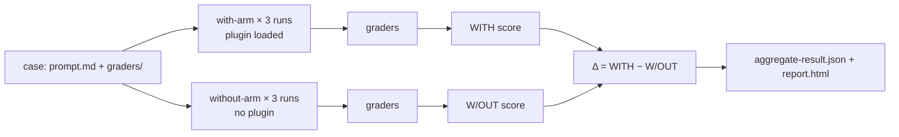

# Plugin Evals: проверка плагина командой claude plugin eval

> Source: https://derob98.github.io/ailmanac/ru/docs/claude-code/plugin-evals · AILmanac (CC BY 4.0) · last verified 2026-09-14

Докажите, что плагин Claude Code действительно помогает: пишите eval-кейсы, оценивайте их шестью типами грейдеров, читайте дельту «с плагином / без него», подменяйте MCP-серверы моками и ставьте в CI ворота по оценке.

<LevelBadge level="advanced" />

<VerifyNote lastVerified="2026-09-14" source="https://code.claude.com/docs/en/plugin-evals">
`claude plugin eval` вышла в Claude Code **v2.1.269 (11 сентября 2026)** и в документации описана как молодая функция: схема кейса — `1.1`, JSON-результат — `schemaVersion: 1`, а Anthropic может отключить команду на стороне сервера («plugin eval is currently unavailable»). Значения по умолчанию, флаги и семантика грейдеров ниже взяты с официальной страницы на указанную дату; перед тем как ставить жёсткие ворота в CI, перепроверьте их.
</VerifyNote>

<Callout type="objectives" items={[
  "Понять, что измеряет plugin eval и чего не могут `claude plugin validate` и ручная проверка: *срабатывает* ли навык и превосходит ли он «голую» модель",
  "Читать три числа в каждом результате — WITH, W/OUT и Δ — и понимать, почему некоторые грейдеры намеренно исключены из оценки",
  "Выбирать среди шести типов грейдеров (четыре бесплатных, два на основе судьи) и писать рубрики, дающие стабильный сигнал",
  "Подменять MCP-серверы плагина моками, чтобы набор тестов был воспроизводим и никогда не обращался к реальному сервису",
  "Настроить ворота в CI с зафиксированными моделями, потолком стоимости и контрактом кодов выхода"
]} />

До сих пор у автора плагина было два инструмента: `claude plugin validate`, который проверяет, что манифесты и frontmatter разбираются, и собственные глаза. Ни один не отвечает на вопрос, от которого зависит, стоит ли ставить плагин: **когда пользователь пишет обычный запрос, выбирает ли Claude навык, и лучше ли результат того, что Claude сделал бы и так?** `claude plugin eval` отвечает именно на это. Он запускает каждый кейс во временной сессии, где загружен только ваш плагин, затем запускает его ещё раз вообще без плагина, оценивает оба прогона и сообщает разницу.

Эта страница для тех, у кого уже есть работающий [плагин](/docs/claude-code/plugins-marketplaces) или [навык](/docs/claude-code/skills). Если нужна только идея, прочитайте первые два раздела и квиз.

## Ментальная модель: две ветки и дельта

Каждый кейс — это **промпт** плюс один или несколько **грейдеров**. Грейдер — это проверка «прошло/не прошло» для того, что произвёл Claude. Для каждого кейса Claude Code запускает:

- **ветку with**: свежую headless-сессию, где загружен только ваш плагин; промпт отправляется, Claude работает, пока не закончит или не упрётся в лимит ходов/времени, затем применяются грейдеры;
- **ветку without**: тот же промпт, то же число прогонов, без плагина.

Каждая ветка запускает кейс **по умолчанию три раза**, потому что один прогон недетерминированного агента почти ничего не говорит. Оценка прогона — доля пройденных грейдеров (с весами, если вы их задали). Оценка кейса — среднее по прогонам. Вы получаете:

| Колонка | Значение |
|---|---|
| `WITH` | Средняя оценка с загруженным плагином |
| `W/OUT` | Средняя оценка без плагина |
| `Δ` | `WITH − W/OUT` — что плагин реально дал |

Неочевидный момент: **высокая оценка `WITH` сама по себе ничего не доказывает.** Если кейс получает 1.0 в обеих ветках, Claude справился без вас, и для этого промпта плагин — мёртвый груз. Именно Δ оправдывает существование плагина. В документации Anthropic названа самая частая первая находка: Δ около нуля *при* проваленном грейдере skill-fired, то есть Claude ни разу не выбрал ваш навык на естественной формулировке. Это проблема `description` в `SKILL.md`, а не кода, и ни одно ручное тестирование, в котором вы вызываете навык по имени, её бы не поймало.



### Почему часть грейдеров исключена из оценки

Проверка вроде «вызван инструмент `Skill`» никогда не пройдёт в ветке without. Если бы она учитывалась, она тянула бы `W/OUT` к нулю и бесплатно раздувала Δ. Поэтому в двухветочном запуске Claude Code **исключает из оценки в обеих ветках** каждый грейдер `tool_used`, у которого `tool` равен `Skill`, а также всё, что вы пометили `arm: with-only`. Они по-прежнему появляются в отчёте как индикаторы «прошло/не прошло» (отчёт помечает их как «plugin-fired indicator»), а в JSON отмечены `scored: false`. Из этого вытекают два граничных правила:

- Если исключёнными оказались бы *все* грейдеры кейса, они оцениваются как обычно — иначе оценивать было бы нечего.
- `arm: both` заставляет грейдер учитываться в обеих ветках. Это нужно для проверки «навык **не** должен вызываться» на промпте-приманке, записанной как `tool_used` с `min: 0` и `max: 0`.

Следствие, которое стоит помнить: один и тот же набор может показать **другую абсолютную оценку** при `--ablation none` (одна ветка, ничего не исключено), чем в стандартном двухветочном режиме. Сравнивайте сопоставимое, когда строите графики трендов.

## Анатомия кейса

Набор лежит в `evals/` внутри плагина (или в другой директории, которую вы укажете). Каждый кейс — папка с `prompt.md`, `case.yaml` или обоими файлами, плюс папка `graders/` с одним Markdown-файлом на грейдер.

```text
my-plugin/
├── .claude-plugin/plugin.json
├── skills/...
└── evals/
    ├── drafts-commit-message/
    │   ├── prompt.md            # frontmatter: run limits; body: the user's request
    │   └── graders/
    │       ├── criteria.md      # type: llm — rubric in the body
    │       └── skill-fired.md   # type: tool_used, tool: Skill
    ├── ignores-unrelated-request/
    │   └── ...
    ├── mocks/                   # optional suite-wide MCP mocks
    └── results/                 # written by each run — add to .gitignore
```

Тело промпта отправляется Claude **ровно так, как написано**. Новичков в первую очередь кусают две вещи:

- Каждый прогон начинается в **пустой рабочей директории** с временным home, без пользовательских настроек, без `CLAUDE.md`, без личных MCP-серверов, без других плагинов и только с белым списком переменных окружения (базовые вроде `PATH`, авторизация провайдера, большинство `ANTHROPIC_*`/`CLAUDE_CODE_*` и всё, что называется `EVAL_*`). Если задаче нужны файлы, положите их в промпт, создайте скаффолдом или поставляйте в плагине.
- Упоминания `@path` в промпте **не** разворачиваются во вложения. Выдайте `Read` в `allowed_tools`, если Claude должен открывать файл.

Самые важные поля frontmatter в `prompt.md`:

| Поле | По умолчанию | Примечание |
|---|---|---|
| `runs` | 3 | от 1 до 50 на ветку; `--runs` переопределяет |
| `max_turns` | 10 | До 200. Достижение лимита логируется как ошибка прогона и обычно снижает оценку, так что не жалейте |
| `timeout_seconds` | 300 | До 3600 на прогон |
| `allowed_tools` | `[]` | Инструменты только для чтения выдаются простым перечислением; всё остальное требует выдачи через CLI |
| `model` | модель сессии по умолчанию | `--model` переопределяет; в CI фиксируйте |
| `env` | `{}` | Ключи должны соответствовать `EVAL_[A-Z0-9_]*`, иначе прогон падает |
| `plugins` | ближайший объемлющий плагин | Укажите `["../.."]`, если автоопределение не нашло ваш плагин |

`case.yaml` содержит те же поля (выполнение — в разделе `execution:`) плюс три, которые ссылаются на другие файлы: `context.scaffold_script` (Bash-скрипт, заполняющий рабочее пространство; запускается только с `--scaffold`), `context.history_file` (транскрипт `.jsonl` для продолжения, так что ваш промпт становится следующим ходом) и `context.add_dirs` (директории с фикстурами, которые Claude может читать).

## Шесть типов грейдеров

Четыре вычисляются по транскрипту и файлам и ничего не стоят. Два вызывают модель-судью и увеличивают счёт.

| Тип | Бесплатный? | Проходит, когда |
|---|---|---|
| `regex` | да | JavaScript-регулярка найдена в цели (`last_message` по умолчанию, либо `trace`, `files`, конкретный файл или `mock_calls`). `match: not_contains` — для отсутствия, `match: "count:N"` — для точного числа вхождений. Нечувствительность к регистру задаётся через `flags: i`; встроенный `(?i)` не поддерживается |
| `tool_used` | да | Число вызовов `tool`, чей JSON-кодированный ввод соответствует `input_match`, лежит между `min` (по умолчанию 1) и `max` (без ограничения). `min: 0, max: 0` утверждает, что инструмент ни разу не вызывался |
| `tool_order` | да | Оба инструмента вызваны, и первое совпадение `before` предшествует первому совпадению `after` |
| `file_exists` | да | Файл, **созданный Claude**, соответствует glob в `path` (или ни один не соответствует, при `exists: false`). Файлы, созданные скаффолдом или лишь отредактированные Claude, не считаются |
| `llm` | нет | Модель-судья голосует PASS по вашей рубрике как минимум в **двух из трёх голосов** |
| `baseline` | нет | Судья находит, что прогон удовлетворяет критериям как минимум так же хорошо, как эталонный транскрипт, сохранённый вами как `baseline_file` |

**Грейдеров с произвольным кодом нет.** Если нужно проверить, что сборка или тесты прошли, попросите в промпте Claude запустить их и записать результат в файл, оцените этот файл через `regex`, а факт запуска команды подтвердите грейдером `tool_used`, у которого `input_match` называет эту команду.

Грейдер skill-fired, который нужен почти каждому кейсу, выглядит так (замените имя навыка; шаблон также совпадает с формой с пространством имён `plugin:skill`):

<PromptCard title="graders/skill-fired.md — did my skill actually run?">{`---
type: tool_used
tool: Skill
input_match: '"skill"\\s*:\\s*"(?:[\\w-]+:)?your-skill-name"'
---`}</PromptCard>

А рядом — рубрика для судьи, написанная как конкретные условия PASS/FAIL, а не как прилагательные:

<PromptCard title="graders/criteria.md — a rubric that gives a stable verdict">{`---
type: llm
weight: 2
---

PASS if the reply is a single conventional-commit subject line under 72 characters,
starts with "refactor:", and mentions both the rename (getUser -> fetchUser) and the
number of call sites updated.
FAIL if the reply contains more than one candidate message, asks a clarifying
question, or omits the rename.`}</PromptCard>

### Привычки, сохраняющие стабильность оценок

Это практики, которые рекомендует официальная документация и которые совпадают с тем, чему трудным путём учится каждый, кто запускал пайплайны LLM-as-judge:

- **Длинный вывод оценивайте `regex` по файлу, а не судьёй `llm`.** Разброс оценок судьи растёт с длиной читаемого текста. Грейдеры `llm` оставьте для коротких финальных сообщений.
- **Один грейдер на результат, один на путь.** Грейдер `regex`/`llm`/`file_exists` говорит, что ответ был верным; грейдер `tool_used`/`tool_order` говорит, что его произвёл *именно ваш плагин*. Чтобы интерпретировать Δ, нужны оба.
- **Если Δ отрицательна, но навык сработал, сначала подозревайте судью, а не плагин.** Судья по умолчанию — маленькая быстрая модель; она может засчитать правильный ответ как провал из-за формата, отличающегося от рубрики. Перезапустите с `--judge-model sonnet` и уточните рубрику, чтобы формат ничего не решал.
- **Итерируйте один кейс в одной ветке**, затем подтверждайте тремя прогонами: `--case <name> --runs 1 --ablation none`. С одной веткой в таблице вместо `WITH`/`W/OUT`/`Δ` показываются `SCORE` и `PASS%`.

## Моки MCP-серверов

Если навыки вашего плагина вызывают MCP-инструменты, прогон **никогда не запускает реальные серверы, пока вы не попросите**. Вместо этого Claude Code регистрирует заглушку под именем каждого сервера и отвечает на вызовы инструментов из Markdown-файлов: `evals/mocks/<server>/<tool>.md` — для всего набора, либо папка `mocks/` самого кейса — для переопределения на уровне кейса. Тело файла — это результат инструмента, с подстановками `{{input.<field>}}` и вставками `{{file:fixtures/...}}`. Инструмент без файла-мока Claude просто недоступен.

<PromptCard title="evals/mocks/tracker/create_issue.md — a mock that also asserts the input">{`---
expect:
  title: string
  priority: [low, medium, high]
---

Created issue #4821: {{input.title}}`}</PromptCard>

Блок `expect:` превращает мок в проверку: вызов, нарушающий его, **прерывает прогон с оценкой 0** и записывает сервер, инструмент и причину. Направьте грейдер на `target: mock_calls`, чтобы оценить, что плагин попросил сделать у сервера. Для серверов, ответы которых зависят от диалога, `type: agent` позволяет небольшой модели сыграть сервер; чистые прогоны сохраняют её ответы в `results/<timestamp>/mock-recordings/`, а после того как вы скопируете запись в `mocks/.replay/<server>/`, последующие прогоны воспроизводят её без вызова модели. Коммитьте `.replay/`, чтобы CI был детерминированным. `_tools.json` (сохранённый ответ `tools/list`) даёт замоканным инструментам их настоящие описания и схемы вместо разрешающей заглушки.

Чтобы обратиться к реальным серверам: `--allow-real-servers` запускает те, у которых нет моков; `--mocks off` полностью игнорирует моки. В обоих случаях эти процессы работают **от вашего имени, вне песочницы**, а их инструментам по-прежнему нужна явная выдача, например `--allow-tools "mcp__plugin_my-plugin_github__*"`.

## Запуск

<Steps items={[
  {title: "Сгенерируйте набор", body: "Из корня плагина выполните `claude plugin eval init`. Откроется интерактивная сессия, в которой Claude читает плагин, спрашивает, каким должен быть хороший результат, предлагает промпты, которые должны и не должны его запускать, проектирует грейдеры, один раз их обкатывает и записывает по одной директории кейса на каждый промпт. `claude plugin eval init --bare <name>` записывает вместо этого пустой шаблон (единственная форма, работающая без терминала, например в CI)."},
  {title: "Запустите весь набор", body: "`claude plugin eval .` запускает каждый кейс, обе ветки, по три прогона. При первом запуске спрашивается `Trust this plugin directory?`; внутри git-репозитория ответ «да» доверяет всему репозиторию, в том числе для интерактивных сессий. Для каждого прогона печатается строка прогресса с вердиктом каждого грейдера; затем идут итоговая таблица и путь `Report:`."},
  {title: "Выдавайте только то, что нужно кейсам", body: "Прогоны никогда не останавливаются, чтобы спросить разрешение. Встроенные инструменты, которым нужна невыданная вами выдача (`Bash`, `Write`, `Edit`, `WebFetch`, `WebSearch`), полностью удаляются из сессии. Выдавайте их на весь запуск: `--allow-tools Write Edit \"Bash(npm test *)\"`. Любая выдача Bash работает под OS-песочницей Claude Code; на машине без бэкенда песочницы (нативный Windows) запуск отклоняется, а не выполняется без изоляции."},
  {title: "Прочитайте отчёт", body: "`report.html` — один самодостаточный файл без внешних запросов. Сверху — строка вердикта (эффект плагина в пунктах относительно baseline, кейсы улучшились/без изменений/ухудшились) и пять плиток (оценка набора, Δ абляции, оценка baseline, пройденные кейсы, идеальные прогоны). Карточка каждого кейса показывает Δ и шкалу оценки с отметкой порога; отрицательная Δ получает красную левую кромку. Проваленные грейдеры заранее раскрыты, с голосами судьи и фрагментом, который он видел."},
  {title: "Решите, куда идёт отчёт", body: "При входе с подпиской claude.ai и включённых артефактах отчёт также публикуется как приватный артефакт, и печатается URL `Published:`; `--no-publish` оставляет его локальным. Авторизация по API-ключу никогда не публикует. Запуск из сессии Claude Code остаётся локальным, пока вы не добавите `--publish-report`."}
]} />

Команда для всего набора с флагами, которые вам реально понадобятся:

<PromptCard title="Run the suite with a stronger judge and a cost ceiling">{`claude plugin eval . \\
  --judge-model sonnet \\
  --max-cost-usd 10 \\
  --allow-tools Read Write "Bash(npm test *)" \\
  -j 4`}</PromptCard>

Замечания по флагам: `-j`/`--concurrency` принимает значения от 1 до 8 и лишь сокращает реальное время, потому что все прогоны делят лимит запросов вашего аккаунта. `--max-cost-usd` — потолок для **оценки по прайс-листу**, проверяемый перед стартом каждого прогона; уже идущие прогоны завершаются, так что расход может превысить потолок на их величину, а всё ещё не начатое приводит к выходу команды с кодом 2 и `partial: true`. Ставьте цель (`.`) **перед** `--tag`, `--allow-tools` и `--json`: каждый из них принимает список или необязательное значение и «проглотит» следующую за ним цель (ошибка «`--json` output path must end in `.json`» — как раз эта ошибка).

## Сколько это стоит

Каждый прогон и каждый голос судьи — реальный вызов модели на вашем аккаунте, учитываемый в лимите тарифа или счёте API. Грубый расчёт: `cases × runs` прогонов агента для ветки with, столько же для ветки without, плюс **три коротких вызова судьи на каждый грейдер `llm` или `baseline` на прогон**. Единственный кейс из официального разбора с двумя грейдерами (`llm` и `tool_used`) дал шесть прогонов агента за 74 секунды при оценке по прайс-листу около $0.41. Три рычага удерживают набор в разумных рамках:

- `--ablation none` вдвое сокращает прогоны агента, когда вы дорабатываете грейдеры и Δ не нужна.
- Только бесплатные грейдеры (`regex`, `tool_used`, `tool_order`, `file_exists`) для набора на каждый коммит; грейдеры-судьи — для ночного.
- Ошибка лимита использования или лимита запросов посреди набора приводит к тому, что каждый следующий прогон **завершается этой ошибкой и обычно получает 0, а набор не помечается `partial`**, так что троттлинг может выглядеть в точности как регрессия. Прежде чем верить внезапному падению, проверьте колонку `NOTES` или `cases[].arms.with[].error`.

## Ворота в CI

<PromptCard title="CI job — pinned models, local report, exit code drives the build">{`claude plugin eval . \\
  --trust-plugin \\
  --json results.json \\
  --threshold 0.8 \\
  --model claude-sonnet-5 \\
  --judge-model claude-haiku-4-5 \\
  --no-publish \\
  --max-cost-usd 20`}</PromptCard>

Зачем нужен каждый флаг:

- `--trust-plugin` подтверждает решение о доверии при первом запуске. Без него неинтерактивное задание отклоняется с кодом 1 (или зависает на запросе, если раннер выделяет TTY). Передавайте его только для плагинов, чей код и набор вы запустили бы на собственной машине.
- `--model` и `--judge-model` **зафиксированы**, чтобы выкатку новой модели никогда не приняли за регрессию плагина. Это важнее, чем кажется: тестируемый агент по умолчанию использует `ANTHROPIC_MODEL` или текущую модель по умолчанию Claude Code, которая меняется с релизами.
- `--threshold 0.8`, потому что значение по умолчанию — **1.0**, из-за чего команда завершается с кодом 1, как только какой-либо кейс хоть немного не идеален. Планка 1.0 для среднего по трём прогонам недетерминированного агента — нестабильные ворота.
- `--json results.json` записывает версионированный документ результата (`schemaVersion: 1`, camelCase, новые поля добавляются без переименований) и подавляет вывод прогресса.

Контракт кодов выхода:

| Код | Значение |
|---|---|
| 0 | Каждый кейс на пороге или выше, и каждый файл кейса загружен |
| 1 | Кейс ниже порога, файл кейса не загрузился, кейсов не найдено, прогон не удалось начать, недоверенная директория без `--trust-plugin` или неверная опция |
| 2 | Частичный запуск: достигнут потолок стоимости или учётные данные отклонены в первом прогоне или до него. `results.json` всё равно записывается с `partial: true` |
| 130 / 143 | Прерван / завершён (например, таймаутом CI). Частичные результаты записаны |

Проблемы с записью или публикацией отчёта **никогда** не меняют код выхода. Когда строите тренды, отбрасывайте документы с `partial: true` и прогоны с пометкой `skippedPaidGraders`, поскольку их оценки несопоставимы.

Поля, которые скрипт-ворота читает из JSON: `aggregates.overallScore`, `aggregates.casesPassed` / `casesTotal`, `aggregates.meanDelta`, а для каждого кейса `cases[].aggregates.score` и `.delta` (опускается, когда ветки несопоставимы). Прогон с ненулевым `cases[].arms.with[].error` (например, `timed out after 300s`) всё равно оценивается по тому, что он произвёл, так что ошибка не означает оценку 0; `aborted`-прогон (сработал `expect:` мока) получает 0, при этом `error` остаётся `null`.

## До чего может дотянуться прогон, а до чего нет

Прочитайте это перед оценкой плагина, который писали не вы. Направить `claude plugin eval` на директорию — то же решение о доверии, что и `claude --plugin-dir`: навыки плагина **и его хуки** загружаются и выполняются на вашей машине от вашего имени. Изоляция ограничивает то, что может делать *тестируемый агент*; это не граница против собственного кода плагина, и проходящий набор ничего не говорит о том, безопасен ли плагин.

- **Изолированный агент.** Каждый прогон получает временный home, рабочую директорию и конфигурацию Claude Code, запускается как дочерний процесс `claude -p`, не может читать директорию eval (поэтому никогда не видит промптов и грейдеров кейса и соседних кейсов), и инструмент Artifact для него отключён.
- **Управляемые настройки по-прежнему действуют.** Ограничения, развёрнутые администратором на машине, действуют и внутри прогона, поэтому результаты на управляемом ноутбуке могут отличаться от результатов на неуправляемом раннере CI.
- **Явные лазейки.** `scaffold_script` кейса запускается от вашего имени вне песочницы и только с `--scaffold`. Реальные MCP-серверы — только с `--allow-real-servers` или `--mocks off`. `allowed_tools` кейса или собственный frontmatter `allowed-tools` навыка никогда не могут их расширить.
- **Сеть.** Выданные вами shell-команды подчиняются сетевым правилам песочницы; выдача `WebFetch(domain:…)` обращается прямо к этому домену; хуки плагина и любой реальный MCP-сервер, который вы запустите, могут обращаться к любому хосту.

Для стороннего плагина, поставляющего хуки или требующего своих реальных серверов, считайте оценки справочными, если вы не запускали набор в контейнере или на раннере CI. Более широкий чек-лист — в [Reviewing Third-Party Code](/docs/security/reviewing-third-party-code).

## Краткая справка: подводные камни

- Цель `target` для `regex` по умолчанию — `last_message`. Когда вы указываете `trace`, это JSON по строкам, так что кавычки выглядят как `\"`, а переводы строк экранированы.
- `files` — это **список путей** к файлам, созданным Claude, а не их содержимое. Чтобы оценить содержимое, используйте `{ source: file, path: <path> }` как `target`/`focus`. Судья `llm` видит PNG/JPEG/GIF/WebP как изображения и отказывается от других бинарных файлов (`.pptx`, PDF).
- Судья `llm`, читающий `trace`, видит только **первые 12 и последние 12 сообщений**.
- `file_exists` видит только файлы, созданные во время прогона. Созданный скаффолдом или лишь отредактированный файл для него невидим; оценивайте его содержимое или используйте `tool_used` для `Edit`.
- Неизвестные ключи во frontmatter `prompt.md` — ошибка, а ключи `env` должны быть `EVAL_*`.
- Оценка установленного плагина по имени (`name@marketplace`) записывает результаты в `./evals/results/` в текущей директории и пропускает запрос доверия.
- Формат кейсов plugin-eval **отделён** от файла `evals/evals.json`, который плагин skill-creator использует для оценки навыков.

<Flashcards cards={[
  {front: "with-arm / without-arm", back: "Два набора прогонов кейса: только с вашим плагином и вообще без плагина. Δ — это оценка ветки with минус оценка ветки without."},
  {front: "Почему `tool_used: Skill` не учитывается в оценке?", back: "Без плагина он никогда не пройдёт, так что учёт тянул бы W/OUT к нулю и раздувал Δ. Он исключён в обеих ветках и показывается как индикатор срабатывания плагина."},
  {front: "Порог по умолчанию", back: "1.0 — любой кейс ниже идеального заставляет команду завершиться с кодом 1. В CI задайте `--threshold` по своей реальной планке."},
  {front: "Правило голосов судьи", back: "Грейдер `llm` проходит, когда судья голосует PASS минимум в двух из трёх голосов; грейдер `baseline` сравнивает с сохранённым эталонным транскриптом."},
  {front: "Код выхода 2", back: "Частичный запуск: достигнут потолок --max-cost-usd или учётные данные отклонены. results.json всё равно записывается с partial: true."},
  {front: "Блок `expect:` мока", back: "Защита ввода замоканного MCP-инструмента. Нарушающий вызов прерывает прогон с оценкой 0 и записывает сервер, инструмент и причину."},
  {front: "Переменные EVAL_*", back: "Единственные пользовательские переменные окружения, которые доходят до прогона. Всё остальное из вашей оболочки не передаётся, кроме небольшого белого списка."}
]} />

<Quiz title="Проверьте себя" questions={[
  {q: "Кейс получает 1.00 WITH и 1.00 W/OUT. О чём это говорит?", options: ["Плагин работает идеально", "Claude решает этот промпт без плагина, так что плагин здесь ничего не добавляет", "Грейдеры сломаны", "Модель-судья слишком слабая"], answer: 1, explain: "Δ равна нулю. Высокая оценка ветки with сама по себе никогда не доказывает пользу плагина; доказывает её только разница между ветками."},
  {q: "Ваше задание CI запускает `claude plugin eval . --json results.json` без других флагов и завершается с кодом 1, хотя каждый кейс набрал 0.9. Почему?", options: ["Режим JSON всегда завершается с кодом 1", "Порог --threshold по умолчанию равен 1.0, поэтому 0.9 — провал", "Директория плагина была доверена", "--json отключает оценку"], answer: 1, explain: "Порог по умолчанию — идеал (1.0). Передайте --threshold 0.8 или вашу планку. Также передавайте --trust-plugin в CI, иначе проверка недоверенной директории тоже завершится с кодом 1."},
  {q: "Какие типы грейдеров не стоят ничего дополнительно?", options: ["llm и baseline", "regex, tool_used, tool_order, file_exists", "Только regex", "Все шесть бесплатны"], answer: 1, explain: "Четыре грейдера вычисляются по транскрипту и файлам. llm и baseline добавляют по три коротких вызова судьи на прогон."},
  {q: "Δ отрицательна, но грейдер skill-fired прошёл в каждом прогоне ветки with. Что, по официальным рекомендациям, проверять первым?", options: ["Удалить плагин", "Увеличить max_turns", "Судью: перезапустить с --judge-model sonnet и уточнить рубрику, чтобы формат не решал", "Добавить больше кейсов"], answer: 2, explain: "Небольшой судья может засчитать правильный ответ как провал из-за формата, отличающегося от рубрики. Сначала подозревайте судью, а не плагин."},
  {q: "Замоканный MCP-инструмент в прогоне получает вызов, ввод которого нарушает блок `expect:` мока. Что происходит?", options: ["Вызов возвращает строку с ошибкой, и прогон продолжается", "Прогон прерывается с оценкой 0, причина записывается", "Грейдер пропускается", "В качестве запасного варианта запускается реальный сервер"], answer: 1, explain: "expect: — это проверка. Нарушающий вызов прерывает прогон, оценка 0, а в JSON он отображается как `aborted` с сервером, инструментом и причиной."},
  {q: "К чему из перечисленного имеет доступ тестируемый агент во время прогона?", options: ["Ваши настройки ~/.claude и CLAUDE.md", "Ваши личные MCP-серверы", "Промпт и грейдеры кейса", "Инструменты только для чтения из allowed_tools кейса плюс всё, что вы выдали через --allow-tools"], answer: 3, explain: "Прогоны изолированы: временный home и конфигурация, нет личных настроек, нет других плагинов, а директория eval скрыта от агента."}
]} />

## Источники и дополнительное чтение

- [Test plugins with evals](https://code.claude.com/docs/en/plugin-evals) — официальный справочник, на котором построена эта страница: формат кейса, таблица грейдеров, опции, коды выхода, изоляция
- [Plugin CLI reference: `claude plugin eval`](https://code.claude.com/docs/en/plugins/cli-reference#plugin-eval) — каждый флаг, плюс `plugin eval init` для создания заготовки набора
- [Plugins reference: `experimental.evals`](https://code.claude.com/docs/en/plugins-reference#fields) — поле манифеста, указывающее на нестандартную директорию eval
- [Claude Code changelog, v2.1.269 (11 сент. 2026)](https://code.claude.com/docs/en/changelog) — запись о релизе
- [Skills: frontmatter и то, как `description` решает, сработает ли навык](https://code.claude.com/docs/en/skills)
- [Sandboxing](https://code.claude.com/docs/en/sandboxing) — OS-песочница, применяемая, когда вы выдаёте прогону Bash
- [Headless mode](https://code.claude.com/docs/en/headless) — дочерний процесс `claude -p`, на котором построен каждый прогон

## Далее

- [Plugins & Marketplaces](/docs/claude-code/plugins-marketplaces) — упакуйте только что протестированное и опубликуйте, когда набор станет зелёным
- [Skills](/docs/claude-code/skills) — поле `description` — это то, что вам говорит проваленный грейдер skill-fired
- [Reviewing Third-Party Code](/docs/security/reviewing-third-party-code) — прежде чем прогонять чужой плагин (и его хуки) через eval на своей машине
