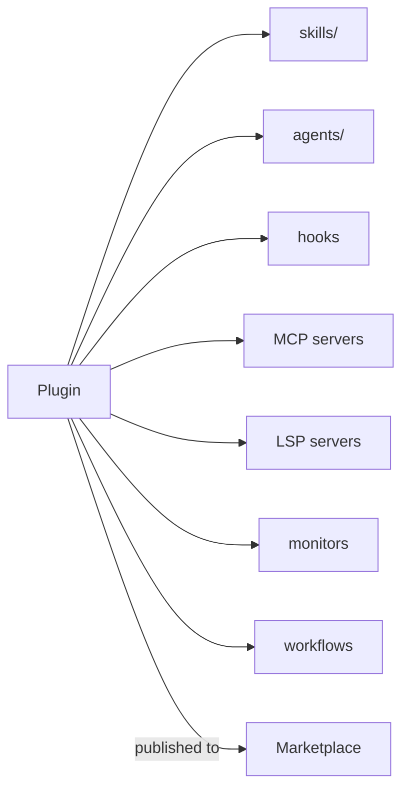

# Плагины и маркетплейсы

> Source: https://derob98.github.io/ailmanac/ru/docs/claude-code/plugins-marketplaces · AILmanac (CC BY 4.0) · last verified 2026-10-22

Объедините навыки, агентов, команды, хуки и MCP в одну устанавливаемую единицу.

<LevelBadge level="advanced" />

<VerifyNote lastVerified="2026-10-22" source="https://code.claude.com/docs/en/plugins">
Структура плагинов и механика маркетплейсов быстро меняются — уточняйте детали в официальной документации Claude Code.
</VerifyNote>

**Плагин** объединяет несколько настроек — [навыки](/docs/claude-code/skills), [субагентов](/docs/claude-code/subagents), [слэш-команды](/docs/claude-code/slash-commands), [хуки](/docs/claude-code/hooks), [MCP-серверы](/docs/claude-code/mcp) и, начиная с Claude Code v2.1.287, [**мод**](/docs/claude-code/mods) — в одну версионируемую устанавливаемую единицу. **Маркетплейс** — это каталог плагинов, которые люди могут находить и устанавливать.

## Почему плагины важны

- **Доставляйте командный набор инструментов за один шаг.** Вместо просьбы к каждому скопировать пять файлов опубликуйте плагин; коллеги устанавливают его и получают те же команды, хуки, агентов и MCP-подключения.
- **Версионирование.** Обновите плагин — и все получат новую версию.
- **Распространение.** Маркетплейс делает ваш набор инструментов (или чужой) легко находимым.

## Что обычно внутри

Плагин — это структурированная папка с компонентами. Манифест `.claude-plugin/plugin.json` **необязателен**: без него Claude Code загружает всё, что найдёт в [стандартной структуре](https://code.claude.com/docs/en/plugins-reference#standard-layout), — поэтому папка, в которой лежит только `SKILL.md`, уже загружается как плагин. Пишите манифест, когда нужны метаданные, версия, компонент вне каталога по умолчанию или настраиваемые пользователем значения.

Помимо навыков, плагин может объединять субагентов, хуки и MCP-серверы, а в последнее время ещё и [LSP-серверы](https://code.claude.com/docs/en/plugins-reference#lspservers) для анализа кода, фоновые [мониторы](https://code.claude.com/docs/en/plugins-reference#monitors), [воркфлоу](https://code.claude.com/docs/en/workflows#distribute-a-workflow-in-a-plugin), папку `bin/` с исполняемыми файлами и настройки по умолчанию. Делайте каждый плагин **цельным** — плагин «командные соглашения», плагин «набор для Python» — а не свалкой всего подряд.

## Доверие до установки

:::warning[Плагины могут содержать исполняемый код]
Хуки и MCP-серверы в плагине выполняются с вашими привилегиями. Устанавливайте только из источников, которым доверяете, и сначала проверяйте, что делает плагин, — см. [Проверка стороннего кода](/docs/security/reviewing-third-party-code).
:::

## Путь к масштабированию вашей конфигурации

Естественная последовательность: `CLAUDE.md` → несколько [навыков](/docs/claude-code/skills) и [команд](/docs/claude-code/slash-commands) → объединить их в плагин → опубликовать в маркетплейсе для команды или сообщества. Этот последний шаг — часть того, как AILmanac хочет помочь экосистеме расти.

## Дальше

- [Моды: расширения внутри процесса](/docs/claude-code/mods) — единственный компонент плагина, который работает *внутри* Claude Code и может заменить его встроенное поведение
- [Plugin Evals](/docs/claude-code/plugin-evals) — докажите, что плагин полезен, с помощью `claude plugin eval`, прежде чем публиковать
- [Навыки](/docs/claude-code/skills) · [Субагенты](/docs/claude-code/subagents) · [MCP](/docs/claude-code/mcp)
- [Проверка стороннего кода](/docs/security/reviewing-third-party-code)
- [Пакеты навыков](/docs/templates/skills) AILmanac
