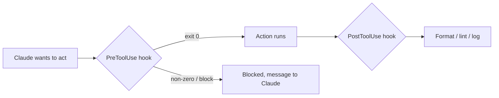

# Hooks：确定性自动化

> Source: https://derob98.github.io/ailmanac/zh-Hans/docs/claude-code/hooks · AILmanac (CC BY 4.0) · last verified 2026-08-22

在生命周期事件上运行命令，以强制执行格式化、关卡检查和安全规则。

<LevelBadge level="advanced" />

<VerifyNote lastVerified="2026-08-22" source="https://code.claude.com/docs/en/hooks">
Claude Code 记录了 30 多种按阶段分组的 hook 事件——完整列表、每个事件的 matcher 语法以及通用的 JSON 输出字段都在官方 hooks 参考中。名称和 payload 结构会不断演进；在固定依赖某个特定事件或字段之前，请对照官方来源确认。
</VerifyNote>

Hooks 是 **Claude Code 在其生命周期的特定节点自动运行的 shell 命令**。[权限](/docs/claude-code/permissions)决定一个操作*是否*被允许，而 hooks 让*你*围绕该操作运行确定性的逻辑——格式化、校验、日志、关卡、脱敏。这样你就能让行为变成有保证的，而不是"请记得……"。

<Callout type="objectives" items={["何时应该使用 hook，而不是指令、权限或 skill", "完整的生命周期：会话、提示词、工具、子代理、任务、压缩和回合结束事件", "hook 如何接入：事件、matcher，以及 stdin 上的 JSON payload", "hook 阻止操作的两种方式——退出码 2 与 stdout 上的 JSON", "各事件共享的通用 JSON 输出字段：continue、additionalContext、systemMessage、reloadSkills、sessionTitle、suppressOutput、updatedInput", "区分快速安全的 hook 与迟缓无声的 hook 的良好实践和常见错误"]} />

## 何时使用 hook

当你希望某个行为被*保证*，而不只是被请求时，就使用 hook。每种常见任务都对应一个生命周期事件：

- 每次编辑文件后**自动格式化 / lint**（`Edit|Write` 上的 `PostToolUse`）。
- 在违反规则的操作运行之前**阻止**它（`PreToolUse`）。
- 在助手的消息显示到终端之前对其**脱敏**（`MessageDisplay`）。
- 在 `SessionStart` 之后**重新加载 skills**或设置**会话标题**。
- 会话结束、任务完成或某个回合失败时**通知或记录日志**（`Stop`、`StopFailure`、`SessionEnd`）。
- 在会话开始或加载指令时**注入上下文**。

## 工作方式

你在 [`settings.json`](/docs/claude-code/settings) 中注册 hooks，匹配一个**事件**（通常还有一个 matcher——多为工具名称，有时是子代理类型、压缩触发方式或通知类别）。事件触发时，Claude 会运行你的命令，并在 **stdin 上传入 JSON payload**（事件名称、会话，以及工具名称和输入等特定于事件的字段）。命令的退出码和 stdout 决定接下来发生什么。

<Steps items={[{title: "匹配事件", body: "在 settings.json 中，把 hook 注册到你关心的生命周期事件下——例如用 PostToolUse 做工具之后的自动化，或用 MessageDisplay 做脱敏。"}, {title: "用 matcher 缩小范围", body: "添加 matcher，让 hook 只在相关时触发，例如文件编辑用 matcher \"Edit|Write\"，或在 SessionStart 上用 matcher \"startup|resume\"。"}, {title: "从 stdin 读取 payload", body: "事件触发时，Claude 运行你的命令，并通过 stdin 传入 JSON payload——事件名称、会话，以及特定于事件的字段（tool_name、tool_input、notification 等）。"}, {title: "决定接下来发生什么", body: "命令的退出码和输出决定结果：放行操作、运行你的逻辑、阻止它，或返回结构化 JSON 来改变 Claude 看到的内容。"}]} />

```json
{
  "hooks": {
    "PostToolUse": [
      {
        "matcher": "Edit|Write",
        "hooks": [
          { "type": "command", "command": "jq -r '.tool_input.file_path' | xargs npx prettier --write" }
        ]
      }
    ]
  }
}
```

上面的 hook 从 stdin 的 JSON（`.tool_input.file_path`）中读出被编辑文件的路径并格式化它。不要假设某个环境变量里存着路径——**请从 stdin 读取。** 像 `${CLAUDE_PROJECT_DIR}` 这样的路径占位符*确实*可用，用于定位脚本。

## 生命周期一览

Claude Code 的 hooks 贯穿整个会话，而不只是工具调用。按阶段分组，你就知道该把逻辑挂在哪里。

| 阶段 | 事件 | 典型用途 |
| --- | --- | --- |
| **会话** | `SessionStart`、`SessionEnd`、`Setup`、`InstructionsLoaded`、`ConfigChange`、`CwdChanged`、`DirectoryAdded`、`FileChanged` | 启动时注入上下文，结束时做快照，响应 `CLAUDE.md` 重新加载或磁盘上 `.env` 的变化 |
| **提示词** | `UserPromptSubmit`、`UserPromptExpansion` | 在 Claude 看到提示词之前对其设置关卡或改写 |
| **工具** | `PreToolUse`、`PermissionRequest`、`PermissionDenied`、`PostToolUse`、`PostToolUseFailure`、`PostToolBatch` | 允许/拒绝操作，升级交给人工，编辑后格式化，自动模式拒绝后重试 |
| **子代理** | `SubagentStart`、`SubagentStop` | 记录子代理的启动/停止，阻止子代理返回 |
| **任务** | `TaskCreated`、`TaskCompleted` | 回滚误创建的任务，对完成设置关卡 |
| **压缩** | `PreCompact`、`PostCompact` | 压缩前对对话记录做快照，压缩后验证 |
| **模型** | `PreModelSwitch`、`PostModelSwitch` | 在模型切换生效前阻止它；在模型变更后做出反应，包括恢复的会话还原模型时 |
| **回合** | `Stop`、`StopFailure`、`Notification`、`MessageDisplay` | 完成时通知，API 失败时告警，对显示的文本脱敏 |
| **团队 + MCP** | `TeammateIdle`、`Elicitation`、`ElicitationResult`、`WorktreeCreate`、`WorktreeRemove` | 跨会话协调，对 MCP elicitation 设置关卡，包装 worktree 操作 |

每个事件确切的 stdin 字段、matcher 语法和阻止规则都在[官方 hooks 参考](https://code.claude.com/docs/en/hooks)中。上面的目录是地图；参考文档才是实地。

## hook 如何阻止操作

有两种方式，取决于事件：

- **退出码 2** —— hook 使操作失败，它写到 **stderr** 的内容会成为 Claude 看到的消息。简单，适用于阻塞型事件上的命令 hook（`PreToolUse`、`UserPromptSubmit`、`UserPromptExpansion`、`Stop`、`SubagentStop`、`TeammateIdle`、`TaskCreated`、`TaskCompleted`、`ConfigChange`、`PostToolBatch`、`PreCompact`、`PreModelSwitch`、`Elicitation`、`ElicitationResult`、`WorktreeCreate`、`WorktreeRemove`）。在 `PermissionRequest` 上退出码 2 会被忽略；请改用它的 `decision` 对象来拒绝。
- **stdout 上的 JSON（退出码 0）** —— 返回结构化决定。对 `PreToolUse`，就是 `permissionDecision`，取值为 `"allow"`、`"deny"`、`"ask"`（把这次调用交给用户）或 `"defer"`（仅用于由会恢复它们的应用驱动的 `-p` 运行），并附上 `permissionDecisionReason`。非阻塞型事件（`PostToolUse`、`Notification`、`MessageDisplay`、`StopFailure`、大多数会话事件）会忽略阻止尝试——但它们的 JSON 输出仍然可以引导 Claude 接下来看到什么。

下面的脚本是 Bash 工具上的 `PreToolUse` hook。从上到下读：它从 stdin 取出命令，如果看起来有破坏性，就向 stderr 写入原因并以退出码 2 阻止。

```bash
#!/usr/bin/env bash
# PreToolUse hook on the Bash tool: refuse to delete things.
command=$(jq -r '.tool_input.command' < /dev/stdin)
if [[ "$command" == rm\ * || "$command" == *"rm -rf"* ]]; then
  echo "Blocked: destructive 'rm' is not allowed by policy." >&2
  exit 2
fi
exit 0
```

## 通用 JSON 输出字段

大多数事件都接受 stdout 上的结构化 JSON 对象，用来引导接下来发生什么——它独立于 `permissionDecision` 这类特定于事件的决定字段。最有用的几个：

| 字段 | 作用 | 适用位置 |
| --- | --- | --- |
| **`continue`** | 若为 `false`，Claude 完全停止处理——优先于所有特定于事件的决定 | 大多数事件 |
| **`systemMessage`** | 向 Claude 的上下文 / 对话记录添加一条消息，让它知道你为何这样做 | 大多数阻塞型事件 |
| **`additionalContext`** | 注入额外上下文，Claude 在下一回合可以读取并据此行动 | `SessionStart`、`UserPromptSubmit` 等 |
| **`reloadSkills`** | 重新扫描 skill 目录，使会话能获取你刚写好的 skill | `SessionStart`（以及其他会话事件） |
| **`sessionTitle`** | 设置界面中的会话标题——在 `SessionStart` 上位于 `hookSpecificOutput` 之下 | `SessionStart` |
| **`suppressOutput`** | 对 Claude 隐藏工具的输出（适合输出很吵的命令） | 工具事件 |
| **`updatedInput`** | 在工具运行前改写其输入（例如添加 `--dry-run` 标志） | `PreToolUse` |
| **`terminalSequence`** | 发出终端转义序列——响铃、窗口标题、通知角标 | `Notification`、`StopFailure` 等 |

特定于事件的决定字段——`PreToolUse` 上的 `permissionDecision`（`"allow"`、`"deny"`、`"ask"` 或 `"defer"`，外加 `permissionDecisionReason`）、`PermissionRequest` 上的 `decision.behavior`（`"allow"` 或 `"deny"`），以及 `PermissionDenied` 上让 Claude 重试被拒绝调用的 `retry: true`——叠加在这些通用字段之上。

## 心智模型

`PreToolUse` hook 在操作*之前*运行并可以阻止它；`PostToolUse` hook 在操作成功*之后*运行并对结果做出反应。



<Flashcards title="Hook 事件速览" cards={[{front: "PreToolUse", back: "在操作运行之前触发。用它来阻止或设置关卡——例如在破坏性命令执行前拒绝它。决定字段：permissionDecision。"}, {front: "PostToolUse", back: "在匹配的操作之后触发。用它来格式化、lint 或记录刚刚发生的变化。非阻塞。"}, {front: "MessageDisplay", back: "在助手消息文本显示时触发。用它从终端中脱敏机密或个人信息——仅作用于显示，无法阻止。"}, {front: "SessionStart", back: "在会话开始（或恢复）时触发。用它通过 additionalContext 注入上下文，在新 skill 就位后用 reloadSkills，或设置 sessionTitle。"}, {front: "Stop / StopFailure", back: "Stop 在 Claude 正常完成一个回合时触发；StopFailure 在回合因 API 错误（rate_limit、overloaded、auth 等）结束时触发。对失败变体做通知或自动重试。"}, {front: "PreCompact / PostCompact", back: "在上下文压缩前后触发。PreCompact 可以阻止（退出码 2）或先对对话记录做快照；PostCompact 对压缩后的状态做出反应。"}]} />

## 良好实践

- **保持 hooks 快速且幂等**——它们会频繁运行。所有 `SessionEnd` hooks 共用 1.5 秒的总预算，所以会话结束时的工作要尽量少。
- **对真正的问题要大声失败**，但不要因为外观上的小问题而阻止。
- **把 hook 的输出当作给 Claude 的反馈**——stderr 上（退出码 2）或 `systemMessage`（JSON）中清晰的消息能帮助它自我纠正。
- **想说的不止"已阻止"时，优先使用 JSON 输出而非退出码**——`PreToolUse` 上的 `permissionDecision: "ask"` 把决定推给人工而不是砰地关门，`additionalContext` 则让你能*引导*而不只是拒绝。
- Hooks 以你的 shell 权限运行——审查任何不是你自己写的 hook（[审查第三方代码](/docs/security/reviewing-third-party-code)）。

## 常见错误

- **从环境变量读取文件路径。** 路径在 stdin 的 JSON 里（`.tool_input.file_path`），而不是 `$CLAUDE_FILE_PATH`。把 stdin 通过管道交给 `jq`。
- **无声的阻止。** 如果 `PreToolUse` hook 以退出码 2 退出而 stderr 什么也没有，Claude 被阻止了却不知道*为什么*，也就无法调整。务必写明清晰的原因（或使用 `permissionDecisionReason`）。
- **试图阻止非阻塞型事件。** `PostToolUse` 在工具运行*之后*触发——退出码 2 只是在 Claude 耳边说一句话，无法撤销操作。如果需要设置关卡，请挂在 `PreToolUse` 上。
- **缓慢的 hook。** `PostToolUse` hook 在*每一次*匹配的编辑后运行。一个耗时 3 秒的 linter 会让整个会话显得迟缓——保持 hooks 快速，最好只处理发生变化的部分。
- **过宽的 matcher。** `matcher: ".*"` 会在每个工具上触发。用精确名称、`Edit|Write` 列表，或每个 handler 的 `if` 字段（例如 `"if": "Bash(git push *)"`）来收窄。
- **忘了非工具事件也有 matcher。** `SessionStart` 匹配 `startup|resume|clear|compact|fork`；`Notification` 匹配 `permission_prompt|idle_prompt|agent_completed` 这类类别；`PreCompact` 匹配 `manual|auto`。单个 hook 接到了错误的子集，要么触发过于频繁，要么从不触发。
- **信任不是你写的 hook。** hook 以你的权限运行任意 shell。先审查来自插件或模板的任何 hook——参见[审查第三方代码](/docs/security/reviewing-third-party-code)。

<Callout type="warning" items={["hook 以你的权限运行任意 shell——在没有读过之前，切勿接入来自插件或模板的 hook。"]} />

## 值得借鉴的配方

可直接复制粘贴的起步模板在 [Hooks 与 settings.json 配方](/docs/templates/hooks-settings)中。下面几个高杠杆的例子，展示较新事件的用法：

<PromptCard title="自动格式化已编辑的文件（Edit|Write 上的 PostToolUse）">{`{
  "hooks": {
    "PostToolUse": [
      {
        "matcher": "Edit|Write",
        "hooks": [
          { "type": "command", "command": "jq -r '.tool_input.file_path' | xargs npx prettier --write" }
        ]
      }
    ]
  }
}`}</PromptCard>

<PromptCard title="启动时设置按项目命名的会话标题（SessionStart）">{`{
  "hooks": {
    "SessionStart": [
      {
        "matcher": "startup|resume",
        "hooks": [
          {
            "type": "command",
            "command": "jq -nc --arg t \\"$(basename \\"$PWD\\") — $(git rev-parse --abbrev-ref HEAD 2>/dev/null || echo detached)\\" '{hookSpecificOutput:{sessionTitle:$t}}'"
          }
        ]
      }
    ]
  }
}`}</PromptCard>

<PromptCard title="SessionStart 之后重新加载 skills（获取你刚写好的 skill）">{`{
  "hooks": {
    "SessionStart": [
      {
        "matcher": "startup|resume",
        "hooks": [
          { "type": "command", "command": "printf '{\\"reloadSkills\\": true}\\n'" }
        ]
      }
    ]
  }
}`}</PromptCard>

<PromptCard title="对显示的助手文本中的 API 密钥脱敏（MessageDisplay）">{`{
  "hooks": {
    "MessageDisplay": [
      {
        "hooks": [
          {
            "type": "command",
            "command": "jq -r '.message.content' | sed -E 's/(sk-[A-Za-z0-9_-]{20,})/sk-***REDACTED***/g'"
          }
        ]
      }
    ]
  }
}`}</PromptCard>

<PromptCard title="回合失败时通知（StopFailure——速率限制、过载、认证）">{`{
  "hooks": {
    "StopFailure": [
      {
        "matcher": "rate_limit|overloaded|authentication_failed|billing_error",
        "hooks": [
          { "type": "command", "command": "osascript -e 'display notification \\"Claude Code turn failed — check the terminal\\" with title \\"Claude Code\\"'" }
        ]
      }
    ]
  }
}`}</PromptCard>

<Quiz title="自测" questions={[{q: "hook 在哪里找到刚被编辑文件的路径？", options: ["在 $CLAUDE_FILE_PATH 环境变量中", "在 stdin 的 JSON payload 里，位于 .tool_input.file_path", "在 Claude 传入的命令行参数中"], answer: 1, explain: "路径在 stdin 的 JSON 里（.tool_input.file_path），而不是环境变量。把 stdin 通过管道交给 jq 来读取。"}, {q: "PreToolUse hook 以退出码 2 退出。会发生什么？", options: ["操作被允许，stdout 被记录", "操作被阻止，hook 写到 stderr 的内容成为 Claude 看到的消息", "Claude 忽略该结果，因为退出码 2 是保留的"], answer: 1, explain: "退出码 2 使操作失败；stderr 成为 Claude 看到的消息。务必写明清晰的原因，让 Claude 能够调整。"}, {q: "你希望会话无需重启就能获取刚添加到 .claude/skills/ 的 skill。应该在哪个事件上使用哪个输出字段？", options: ["SessionStart 上的 reloadSkills: true", "Stop 上的 restart: true", "PostToolUse 上的 refresh: true"], answer: 0, explain: "从 SessionStart hook 输出 {\"reloadSkills\": true} 会重新扫描 skill 目录，使当前会话获取新增或已编辑的 skills。"}, {q: "你想在 Claude 的文本出现在用户屏幕上之前对其中的机密脱敏。应该用哪个事件？", options: ["PreToolUse", "PostToolUse", "MessageDisplay"], answer: 2, explain: "MessageDisplay 在助手消息文本显示时触发——正是在文本送往终端途中转换或脱敏的合适位置。它无法阻止。"}]} />

<Callout type="takeaways" items={["Hooks 让行为有保证而非只是被请求——围绕操作的确定性逻辑，而权限只能允许或拒绝。", "生命周期包含会话、提示词、工具、子代理、任务、压缩和回合各阶段的 30 多个事件——写脚本之前先选对阶段。", "在 settings.json 中针对事件加 matcher 注册；Claude 通过 stdin 传入 JSON payload，并读取你的退出码和输出。", "从 stdin（.tool_input.file_path）读取文件路径——而不是环境变量。", "用退出码 2（stderr 成为消息）或 stdout 上的结构化 JSON 阻止（工具事件用 permissionDecision，{continue: false} 停止一切）。", "通用输出字段——additionalContext、systemMessage、reloadSkills、sessionTitle、suppressOutput、updatedInput——让你引导 Claude，而不只是放行或拒绝。", "保持 hooks 快速、幂等且匹配范围窄——并审查任何不是你写的 hook，因为它以你的 shell 权限运行。"]} />

## 下一步

- [Mods：进程内扩展](/docs/claude-code/mods) —— 进程内的兄弟机制：可以*改写*事件而不只是允许或阻止它的 TypeScript 中间件，并以 `classic.<Event>` 的形式覆盖本页的每个事件
- [settings.json](/docs/claude-code/settings) · [权限](/docs/claude-code/permissions)
- [Skills](/docs/claude-code/skills) —— 专业知识 vs 自动化
- [加固自主运行](/docs/security/hardening-autonomous-runs)
