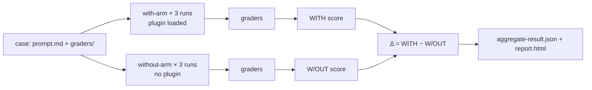

# Plugin Evals：用 claude plugin eval 测试你的插件

> Source: https://derob98.github.io/ailmanac/zh-Hans/docs/claude-code/plugin-evals · AILmanac (CC BY 4.0) · last verified 2026-09-14

证明 Claude Code 插件确实有用：编写评测用例，用六种 grader 打分，读取有/无插件的差值，模拟 MCP 服务器，并以分数作为 CI 的关卡。

<LevelBadge level="advanced" />

<VerifyNote lastVerified="2026-09-14" source="https://code.claude.com/docs/en/plugin-evals">
`claude plugin eval` 随 Claude Code **v2.1.269（2026 年 9 月 11 日）** 发布，官方文档将其描述为一个年轻的功能：用例 schema 为 `1.1`，JSON 结果为 `schemaVersion: 1`，且 Anthropic 可以在服务端关闭该命令（"plugin eval is currently unavailable"）。下文的默认值、标志和 grader 语义均来自所示日期的官方页面；在接入严格的 CI 关卡之前请重新核对。
</VerifyNote>

<Callout type="objectives" items={[
  "理解 plugin eval 能衡量而 `claude plugin validate` 和手动测试做不到的事：skill 是否会*被触发*，以及它是否优于裸模型",
  "读懂每份结果中的三个数字——WITH、W/OUT 和 Δ——并明白为什么有些 grader 被刻意排除在得分之外",
  "在六种 grader（四种免费、两种基于评判模型）中做选择，并写出能给出稳定信号的评分标准",
  "模拟插件的 MCP 服务器，使测试套件可重复，且绝不触碰真实服务",
  "搭建 CI 关卡：固定模型、成本上限，以及退出码约定"
]} />

到目前为止，插件作者只有两样工具：`claude plugin validate`（检查清单和 frontmatter 能否解析）和自己的肉眼。两者都回答不了决定插件值不值得安装的那个问题：**当用户输入一个自然的请求时，Claude 会选用这个 skill 吗？结果比 Claude 本来就能做到的更好吗？** `claude plugin eval` 恰好回答这个问题。它在一次性会话中只加载你的插件运行每个用例，再在完全没有插件的情况下运行一次，对两者打分，并报告差值。

本页面向已经有可用[插件](/docs/claude-code/plugins-marketplaces)或 [skill](/docs/claude-code/skills) 的人。如果你只想了解概念，读前两节和测验即可。

## 心智模型：两条分支与一个差值

每个用例由一个 **prompt** 加一个或多个 **grader** 组成。grader 是对 Claude 产出结果的通过/不通过检查。对每个用例，Claude Code 会运行：

- **with 分支**：一个全新的 headless 会话，只加载你的插件，发送 prompt，让 Claude 工作直到完成或触及轮数/时间上限，然后应用 grader；
- **without 分支**：同样的 prompt、同样的运行次数，不加载插件。

每条分支**默认运行用例三次**，因为对非确定性智能体只跑一次几乎说明不了什么。一次运行的得分是通过的 grader 所占的比例（若设置了权重则为加权）。用例得分是各次运行的平均值。你会得到：

| 列 | 含义 |
|---|---|
| `WITH` | 加载插件时的平均得分 |
| `W/OUT` | 不加载插件时的平均得分 |
| `Δ` | `WITH − W/OUT` — 插件实际贡献的部分 |

不太直观的一点：**单看高 `WITH` 得分什么也证明不了。** 如果一个用例在两条分支里都得 1.0，说明 Claude 没有你也解决了，对这个 prompt 而言你的插件是累赘。Δ 才是证明插件存在价值的数字。Anthropic 自己的文档点出了最常见的第一个发现：Δ 接近零，*同时*skill-fired grader 失败，这意味着在自然措辞下 Claude 从未选择你的 skill。这是 `SKILL.md` 中 `description` 的问题，不是代码问题，而你按名字调用 skill 的任何手动测试都发现不了它。



### 为什么有些 grader 被排除在得分之外

类似“`Skill` 工具被调用过”的检查在 without 分支里永远不可能通过。如果计入，它会把 `W/OUT` 拉向零，白白抬高 Δ。因此在双分支运行中，Claude Code **在两条分支里都把**所有 `tool` 为 `Skill` 的 `tool_used` grader，以及你标记为 `arm: with-only` 的任何 grader，**排除在得分之外**。它们仍会在报告里作为通过/不通过指示器出现（报告将其标为 “plugin-fired indicator”），JSON 中则标记为 `scored: false`。由此引出两条边界规则：

- 如果一个用例的*所有* grader 都会被排除，那么它们会照常计分，否则就没有东西可计了。
- `arm: both` 强制一个 grader 在两条分支里都计分。对于诱饵 prompt 上“**不得**调用该 skill”的检查，你需要的就是它，写法是 `tool_used` 加 `min: 0` 和 `max: 0`。

值得记住的后果：同一个套件在 `--ablation none`（单分支，不排除任何 grader）下报告的**绝对得分**，可能与默认双分支模式下不同。绘制趋势时请对可比的数据做比较。

## 用例的结构

套件位于插件内的 `evals/`（或你指定的其他目录）。每个用例是一个文件夹，包含 `prompt.md`、`case.yaml` 或两者，外加一个 `graders/` 文件夹，每个 grader 对应一个 Markdown 文件。

```text
my-plugin/
├── .claude-plugin/plugin.json
├── skills/...
└── evals/
    ├── drafts-commit-message/
    │   ├── prompt.md            # frontmatter: run limits; body: the user's request
    │   └── graders/
    │       ├── criteria.md      # type: llm — rubric in the body
    │       └── skill-fired.md   # type: tool_used, tool: Skill
    ├── ignores-unrelated-request/
    │   └── ...
    ├── mocks/                   # optional suite-wide MCP mocks
    └── results/                 # written by each run — add to .gitignore
```

prompt 正文会**原样**发送给 Claude。新手最先踩的有两个坑：

- 每次运行都从**空的工作目录**开始，使用一次性的 home，没有用户设置、没有 `CLAUDE.md`、没有个人 MCP 服务器、没有其他插件，且只放行一份环境变量白名单（`PATH` 等基础变量、提供方认证、大多数 `ANTHROPIC_*`/`CLAUDE_CODE_*`，以及任何名为 `EVAL_*` 的变量）。如果任务需要文件，请把它们写进 prompt、用脚手架生成，或随插件一起发布。
- prompt 中的 `@path` 提及**不会**被展开为附件。如果 Claude 需要打开文件，请在 `allowed_tools` 中授予 `Read`。

`prompt.md` 的 frontmatter 中最重要的字段：

| 字段 | 默认值 | 说明 |
|---|---|---|
| `runs` | 3 | 每条分支 1 到 50；`--runs` 可覆盖 |
| `max_turns` | 10 | 最高 200。触顶会被记录为运行错误并通常拉低得分，所以请放宽 |
| `timeout_seconds` | 300 | 每次运行最高 3600 |
| `allowed_tools` | `[]` | 只读工具只需列出即授予；其他都需要通过 CLI 授权 |
| `model` | 会话默认值 | `--model` 可覆盖；在 CI 中请固定 |
| `env` | `{}` | 键必须匹配 `EVAL_[A-Z0-9_]*`，否则运行失败 |
| `plugins` | 最近的包含它的插件 | 如果自动检测找不到你的插件，请设为 `["../.."]` |

`case.yaml` 承载相同的字段（执行相关的放在 `execution:` 下），外加三个引用其他文件的字段：`context.scaffold_script`（填充工作区的 Bash 脚本，仅在 `--scaffold` 时运行）、`context.history_file`（用于续接的 `.jsonl` 对话记录，这样你的 prompt 就成为下一轮）、以及 `context.add_dirs`（Claude 可读取的 fixture 目录）。

## 六种 grader

四种根据对话记录和文件计算，不花钱。两种会调用评判模型，计入账单。

| 类型 | 免费？ | 通过条件 |
|---|---|---|
| `regex` | 是 | 在目标中找到一个 JavaScript 正则（默认目标为 `last_message`，也可以是 `trace`、`files`、某个具体文件或 `mock_calls`）。`match: not_contains` 表示不存在，`match: "count:N"` 表示恰好出现 N 次。忽略大小写写作 `flags: i`；不支持内联 `(?i)` |
| `tool_used` | 是 | 对 `tool` 的调用中，其 JSON 编码输入匹配 `input_match` 的次数介于 `min`（默认 1）和 `max`（无上限）之间。`min: 0, max: 0` 断言某工具从未被调用 |
| `tool_order` | 是 | 两个工具都被调用过，且第一个 `before` 匹配出现在第一个 `after` 匹配之前 |
| `file_exists` | 是 | **Claude 创建的**某个文件匹配 `path` glob（或在 `exists: false` 时没有文件匹配）。由脚手架创建或仅被 Claude 编辑的文件不算 |
| `llm` | 否 | 评判模型按你的评分标准至少在**三票中的两票**投 PASS |
| `baseline` | 否 | 评判模型认为这次运行满足标准的程度至少不低于你保存为 `baseline_file` 的参考对话记录 |

**没有自定义代码 grader。** 如果你需要检查构建或测试是否通过，让 prompt 告诉 Claude 去运行它并把结果写入文件，用 `regex` 给该文件打分，再用 `input_match` 指明该命令的 `tool_used` grader 来断言命令确实运行过。

几乎每个用例都需要的 skill-fired grader 如下（替换 skill 名称；该模式同样匹配带命名空间的 `plugin:skill` 形式）：

<PromptCard title="graders/skill-fired.md — did my skill actually run?">{`---
type: tool_used
tool: Skill
input_match: '"skill"\\s*:\\s*"(?:[\\w-]+:)?your-skill-name"'
---`}</PromptCard>

旁边是评判标准，写成具体的 PASS/FAIL 条件，而不是形容词：

<PromptCard title="graders/criteria.md — a rubric that gives a stable verdict">{`---
type: llm
weight: 2
---

PASS if the reply is a single conventional-commit subject line under 72 characters,
starts with "refactor:", and mentions both the rename (getUser -> fetchUser) and the
number of call sites updated.
FAIL if the reply contains more than one candidate message, asks a clarifying
question, or omits the rename.`}</PromptCard>

### 让得分保持稳定的习惯

这些是官方文档推荐的做法，也与任何跑过 LLM-as-judge 流水线的人用教训换来的经验一致：

- **对长输出，用针对文件的 `regex` 打分，而不是 `llm` 评判。** 评判的方差随它所读内容的长度增长。`llm` grader 只留给简短的最终消息。
- **一个 grader 看结果，一个看路径。** `regex`/`llm`/`file_exists` grader 告诉你答案对不对；`tool_used`/`tool_order` grader 告诉你是*你的插件*产生了它。解读 Δ 需要两者兼备。
- **当 Δ 为负而 skill 已触发时，先怀疑评判模型，再怀疑插件。** 默认评判模型是一个小而快的模型；它可能因为格式与评分标准不同而判一个正确答案不通过。用 `--judge-model sonnet` 重跑，并收紧评分标准，让格式不再起决定作用。
- **用单分支迭代一个用例**，再以三次运行确认：`--case <name> --runs 1 --ablation none`。单分支时，表格显示 `SCORE` 和 `PASS%`，而不是 `WITH`/`W/OUT`/`Δ`。

## 模拟 MCP 服务器

如果插件的 skill 会调用 MCP 工具，一次运行**除非你要求，否则绝不会启动真实服务器**。Claude Code 会改为以每个服务器的名字注册一个替身，并用 Markdown 文件响应工具调用：整个套件用 `evals/mocks/<server>/<tool>.md`，或用某个用例自己的 `mocks/` 文件夹做逐用例覆盖。文件正文就是工具的返回结果，支持 `{{input.<field>}}` 替换和 `{{file:fixtures/...}}` 插入。没有 mock 文件的工具对 Claude 来说就是不可用的。

<PromptCard title="evals/mocks/tracker/create_issue.md — a mock that also asserts the input">{`---
expect:
  title: string
  priority: [low, medium, high]
---

Created issue #4821: {{input.title}}`}</PromptCard>

`expect:` 块把 mock 变成断言：违反它的调用会**以 0 分中止该次运行**，并记录服务器、工具和原因。把 grader 指向 `target: mock_calls`，即可对插件向服务器发出的请求打分。对于答案取决于对话的服务器，`type: agent` 让一个小模型扮演服务器；干净的运行会把它的回答保存到 `results/<timestamp>/mock-recordings/`，把某份录制复制到 `mocks/.replay/<server>/` 后，之后的运行会不调用模型直接回放。请提交 `.replay/`，让 CI 保持确定性。`_tools.json`（保存下来的 `tools/list` 响应）让被模拟的工具拥有真实的描述和 schema，而不是宽松的占位符。

要使用真实服务器：`--allow-real-servers` 启动没有 mock 的那些；`--mocks off` 则完全忽略 mock。无论哪种方式，这些进程都**以你的身份在沙箱之外**运行，它们的工具仍需要显式授权，例如 `--allow-tools "mcp__plugin_my-plugin_github__*"`。

## 运行

<Steps items={[
  {title: "生成套件", body: "在插件根目录运行 `claude plugin eval init`。它会打开一个交互式会话，Claude 在其中读取插件，询问怎样算好的结果，提出应该和不应该触发它的 prompt，设计 grader，试运行一次，并为每个 prompt 写出一个用例目录。`claude plugin eval init --bare <name>` 则写出一个空白模板（这是唯一能在没有终端时工作的形式，例如在 CI 中）。"},
  {title: "运行整个套件", body: "`claude plugin eval .` 运行每个用例、两条分支、各三次。首次运行会询问 `Trust this plugin directory?`；在 git 仓库内回答是，会信任整个仓库，交互式会话同样如此。每次运行会打印一行进度及每个 grader 的结论；随后是汇总表和 `Report:` 路径。"},
  {title: "只授予用例所需的权限", body: "运行从不停下来询问权限。需要你未授予权限的内置工具（`Bash`、`Write`、`Edit`、`WebFetch`、`WebSearch`）会被整个从会话中移除。对整个运行授予它们：`--allow-tools Write Edit \"Bash(npm test *)\"`。任何 Bash 授权都在 Claude Code 的操作系统级沙箱下运行；在没有沙箱后端的机器上（原生 Windows），运行会被拒绝，而不是不受限地运行。"},
  {title: "阅读报告", body: "`report.html` 是一个独立的单文件，没有任何外部请求。顶部：一行结论（插件相对基线的效果，以分计，以及改善/持平/退步的用例数）和五个磁贴（套件得分、消融 Δ、基线得分、通过的用例、满分运行）。每张用例卡片显示 Δ 和一条在阈值处带刻度的得分条；负的 Δ 会有红色左边缘。失败的 grader 默认展开，附有评判模型的投票及其所见的摘录。"},
  {title: "决定报告去向", body: "登录 claude.ai 订阅并启用 artifact 时，报告还会作为私有 artifact 发布，并打印 `Published:` URL；`--no-publish` 则保留在本地。API 密钥认证从不发布。在 Claude Code 会话内部启动的运行除非加上 `--publish-report`，否则保持本地。"}
]} />

包含你真正会用到的标志的完整套件命令：

<PromptCard title="Run the suite with a stronger judge and a cost ceiling">{`claude plugin eval . \\
  --judge-model sonnet \\
  --max-cost-usd 10 \\
  --allow-tools Read Write "Bash(npm test *)" \\
  -j 4`}</PromptCard>

关于标志的说明：`-j`/`--concurrency` 取值 1 到 8，只会缩短实际耗时，因为所有运行共享你账户的速率限制。`--max-cost-usd` 是对**标价估算**的上限，在每次运行开始前检查；已在进行的运行会跑完，所以花费可能超出这些运行的量，任何尚未开始的运行会让命令以 2 退出并带 `partial: true`。把目标（`.`）放在 `--tag`、`--allow-tools` 和 `--json` **之前**：它们每个都接受列表或可选值，会吞掉跟在后面的目标（错误 “`--json` output path must end in `.json`” 就是这个失误）。

## 成本

每次运行和每次评判投票都是对你账户的真实模型调用，计入你的套餐用量或 API 账单。粗略算法：with 分支 `cases × runs` 次智能体运行，without 分支再来一遍，加上每次运行中每个 `llm` 或 `baseline` grader **三次简短的评判调用**。官方演练中只有一个用例、两个 grader（一个 `llm`、一个 `tool_used`），跑了六次智能体运行，耗时 74 秒，标价估算约 $0.41。三个杠杆可让套件保持负担得起：

- 当你在迭代 grader 且不需要 Δ 时，`--ablation none` 把智能体运行减半。
- 每次提交的套件只用免费 grader（`regex`、`tool_used`、`tool_order`、`file_exists`）；评判型 grader 留给夜间套件。
- 套件中途出现用量上限或速率限制错误，会让之后的每次运行**以该错误结束且通常得 0 分，而套件不会被标记为 `partial`**，所以被限流的运行看起来可能与退步一模一样。在相信突然的下滑之前，请检查 `NOTES` 列或 `cases[].arms.with[].error`。

## 用它给 CI 设关卡

<PromptCard title="CI job — pinned models, local report, exit code drives the build">{`claude plugin eval . \\
  --trust-plugin \\
  --json results.json \\
  --threshold 0.8 \\
  --model claude-sonnet-5 \\
  --judge-model claude-haiku-4-5 \\
  --no-publish \\
  --max-cost-usd 20`}</PromptCard>

每个标志存在的原因：

- `--trust-plugin` 声明首次运行的信任决定。没有它，非交互式任务会以退出码 1 被拒绝（或者在 runner 分配了 TTY 时卡在提示处）。只对你愿意在自己机器上运行其代码和套件的插件使用它。
- `--model` 和 `--judge-model` 被**固定**，以免模型发布被误认为插件退步。这比听起来更重要：被测智能体默认使用 `ANTHROPIC_MODEL` 或 Claude Code 当前的默认模型，而它会随版本变化。
- `--threshold 0.8`，因为默认值是 **1.0**，这会让命令在任何用例不完美时都以 1 退出。对非确定性智能体三次运行均值设 1.0 的门槛，是一道不稳定的关卡。
- `--json results.json` 写出带版本的结果文档（`schemaVersion: 1`，camelCase，新增字段不会改名）并静默进度输出。

退出码约定：

| 退出码 | 含义 |
|---|---|
| 0 | 每个用例都达到或高于阈值，且每个用例文件都已加载 |
| 1 | 有用例低于阈值、用例文件加载失败、未找到用例、某次运行无法启动、未信任的目录且没有 `--trust-plugin`，或选项无效 |
| 2 | 部分运行：触及成本上限，或凭据在首次运行时或之前被拒绝。仍会写出带 `partial: true` 的 `results.json` |
| 130 / 143 | 被中断 / 被终止（例如 CI 超时）。会写出部分结果 |

写入或发布报告的问题**绝不会**改变退出码。绘制趋势时，请丢弃带 `partial: true` 的文档以及标记为 `skippedPaidGraders` 的运行，因为它们的得分不可比。

关卡脚本从 JSON 中读取的字段：`aggregates.overallScore`、`aggregates.casesPassed` / `casesTotal`、`aggregates.meanDelta`，以及每个用例的 `cases[].aggregates.score` 和 `.delta`（两条分支不可比时省略）。`cases[].arms.with[].error` 非空的运行（例如 `timed out after 300s`）仍按其产出打分，所以出错并不意味着得 0 分；`aborted` 的运行（mock 的 `expect:` 触发）得 0 分，而 `error` 仍为 `null`。

## 一次运行能触及什么、不能触及什么

在评测不是你写的插件之前请先读这一节。把 `claude plugin eval` 指向一个目录，与 `claude --plugin-dir` 是同一个信任决定：插件的 skill **和 hook** 会在你的机器上以你的身份加载并运行。隔离限制的是*被测智能体*能做什么；它并非针对插件自身代码的边界，通过的套件也说明不了插件是否安全。

- **隔离的智能体。** 每次运行都有一次性的 home、工作目录和 Claude Code 配置，作为 `claude -p` 子进程运行，无法读取 eval 目录（因此永远看不到该用例及其同级用例的 prompt 和 grader），且 Artifact 工具被关闭。
- **托管设置仍然生效。** 管理员部署在机器上的限制在运行内部同样适用，所以在受管笔记本上的结果可能与不受管 CI runner 上的不同。
- **需主动开启的逃生口。** 用例的 `scaffold_script` 以你的身份在沙箱之外运行，且仅在 `--scaffold` 时。真实 MCP 服务器仅在 `--allow-real-servers` 或 `--mocks off` 时。用例的 `allowed_tools` 或 skill 自身的 `allowed-tools` frontmatter 永远不能扩大这些权限。
- **网络。** 你授权的 shell 命令遵循沙箱的网络规则；`WebFetch(domain:…)` 授权会直接访问该域名；插件的 hook 和你启动的任何真实 MCP 服务器可以访问任何主机。

对于带 hook 或需要其真实服务器的第三方插件，除非你在容器或 CI runner 中运行了套件，否则请把得分仅作参考。更完整的清单见 [Reviewing Third-Party Code](/docs/security/reviewing-third-party-code)。

## 速查：陷阱

- `regex` 的默认 `target` 是 `last_message`。当你指向 `trace` 时，它是每行一个 JSON，所以引号显示为 `\"`，换行被转义。
- `files` 是 Claude 创建的**路径列表**，而不是它们的内容。要对内容打分，请把 `{ source: file, path: <path> }` 用作 `target`/`focus`。`llm` 评判会把 PNG/JPEG/GIF/WebP 当作图像查看，并拒绝其他二进制文件（`.pptx`、PDF）。
- 读取 `trace` 的 `llm` 评判只能看到**前 12 条和后 12 条消息**。
- `file_exists` 只能看到运行期间创建的文件。脚手架生成或仅被编辑的文件对它不可见；请对其内容打分，或对 `Edit` 使用 `tool_used`。
- `prompt.md` frontmatter 中的未知键是错误，且 `env` 键必须是 `EVAL_*`。
- 按名称评测已安装的插件（`name@marketplace`）会把结果写入当前目录下的 `./evals/results/`，并跳过信任提示。
- plugin-eval 的用例格式与 skill-creator 插件用于 skill 评测的 `evals/evals.json` 文件是**相互独立**的。

<Flashcards cards={[
  {front: "with-arm / without-arm", back: "一个用例的两组运行：只加载你的插件，和完全不加载插件。Δ 等于 with 分支得分减去 without 分支得分。"},
  {front: "为什么 `tool_used: Skill` 不计分？", back: "没有插件时它永远不可能通过，计入会把 W/OUT 拉到零并抬高 Δ。它在两条分支里都被排除，并显示为插件触发指示器。"},
  {front: "默认阈值", back: "1.0 — 任何不完美的用例都会让命令以 1 退出。在 CI 中把 `--threshold` 设为你真正的门槛。"},
  {front: "评判投票规则", back: "`llm` grader 在评判至少三票中有两票为 PASS 时通过；`baseline` grader 则与保存的参考对话记录比较。"},
  {front: "退出码 2", back: "部分运行：触及 --max-cost-usd 上限或凭据被拒绝。results.json 仍会写出，带 partial: true。"},
  {front: "Mock 的 `expect:` 块", back: "被模拟 MCP 工具的输入守卫。违反它的调用会以 0 分中止运行，并记录服务器、工具和原因。"},
  {front: "EVAL_* 变量", back: "唯一能传到一次运行中的自定义环境变量。你 shell 中的其他变量都被拦下，只有一小份白名单除外。"}
]} />

<Quiz title="自测" questions={[
  {q: "一个用例 WITH 得 1.00，W/OUT 也得 1.00。这说明什么？", options: ["插件完美运行", "Claude 没有插件也能解决这个 prompt，所以插件在这里没有增益", "grader 坏了", "评判模型太弱"], answer: 1, explain: "Δ 为零。仅有 with 分支的高分永远证明不了插件有帮助；只有两条分支之间的差值才行。"},
  {q: "你的 CI 任务不带其他标志运行 `claude plugin eval . --json results.json`，尽管每个用例都得了 0.9，却以 1 退出。为什么？", options: ["JSON 模式总是以 1 退出", "默认的 --threshold 是 1.0，所以 0.9 算失败", "插件目录已被信任", "--json 禁用了计分"], answer: 1, explain: "默认阈值是满分（1.0）。请传 --threshold 0.8 或你的门槛。在 CI 中还要传 --trust-plugin，否则未信任目录的检查同样会以 1 退出。"},
  {q: "哪些 grader 类型运行时不产生额外费用？", options: ["llm 和 baseline", "regex、tool_used、tool_order、file_exists", "只有 regex", "六种全部免费"], answer: 1, explain: "四种 grader 根据对话记录和文件计算。llm 和 baseline 各自每次运行增加三次简短的评判调用。"},
  {q: "Δ 为负，但 skill-fired grader 在 with 分支的每次运行中都通过了。官方指引说应首先检查什么？", options: ["删除插件", "提高 max_turns", "评判模型：用 --judge-model sonnet 重跑并收紧评分标准，让格式不再起决定作用", "增加更多用例"], answer: 2, explain: "小型评判模型可能因为格式与评分标准不同而判正确答案不通过。先怀疑评判模型，再怀疑插件。"},
  {q: "运行中一个被模拟的 MCP 工具收到的调用，其输入违反了 mock 的 `expect:` 块。会发生什么？", options: ["调用返回一个错误字符串，运行继续", "运行以 0 分中止，并记录原因", "该 grader 被跳过", "回退启动真实服务器"], answer: 1, explain: "expect: 是一个断言。违反它的调用会中止运行、得 0 分，并在 JSON 中显示为带服务器、工具和原因的 `aborted`。"},
  {q: "运行期间，被测智能体可以访问下列哪项？", options: ["你的 ~/.claude 设置和 CLAUDE.md", "你的个人 MCP 服务器", "该用例的 prompt 和 grader", "用例 allowed_tools 中列出的只读工具，外加你用 --allow-tools 授予的任何工具"], answer: 3, explain: "运行是隔离的：一次性的 home 和配置，没有个人设置，没有其他插件，且 eval 目录对智能体隐藏。"}
]} />

## 来源与延伸阅读

- [Test plugins with evals](https://code.claude.com/docs/en/plugin-evals) — 本页所依据的官方参考：用例格式、grader 表、选项、退出码、隔离
- [Plugin CLI reference: `claude plugin eval`](https://code.claude.com/docs/en/plugins/cli-reference#plugin-eval) — 每个标志，以及用于搭建套件脚手架的 `plugin eval init`
- [Plugins reference: `experimental.evals`](https://code.claude.com/docs/en/plugins-reference#fields) — 指向非默认 eval 目录的清单字段
- [Claude Code changelog, v2.1.269（2026 年 9 月 11 日）](https://code.claude.com/docs/en/changelog) — 该版本的条目
- [Skills：frontmatter 以及 `description` 如何决定触发](https://code.claude.com/docs/en/skills)
- [Sandboxing](https://code.claude.com/docs/en/sandboxing) — 当你向运行授予 Bash 时所应用的操作系统级沙箱
- [Headless mode](https://code.claude.com/docs/en/headless) — 每次运行所基于的 `claude -p` 子进程

## 下一步

- [Plugins & Marketplaces](/docs/claude-code/plugins-marketplaces) — 把刚测试好的东西打包，套件变绿后发布
- [Skills](/docs/claude-code/skills) — 失败的 skill-fired grader 在告诉你要修的就是 `description` 字段
- [Reviewing Third-Party Code](/docs/security/reviewing-third-party-code) — 在你的机器上通过 eval 运行别人的插件（及其 hook）之前
