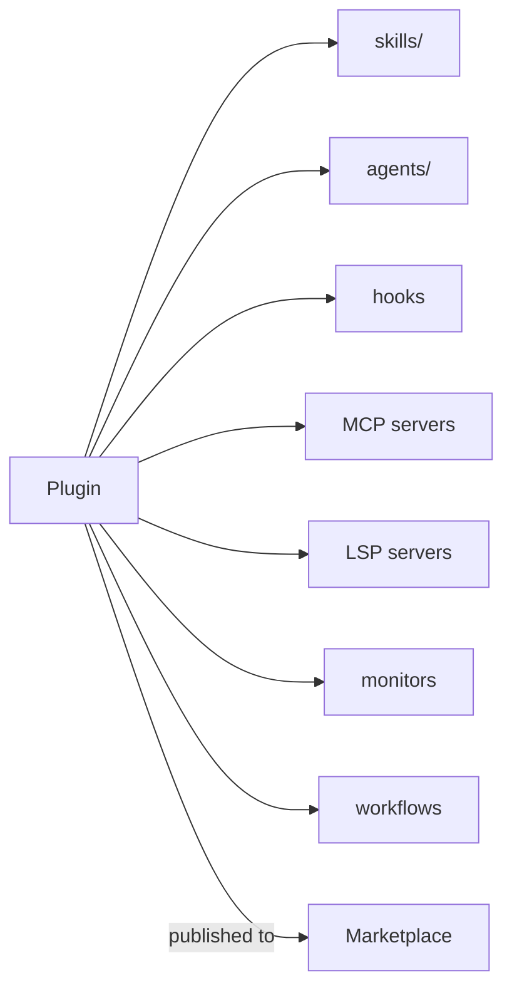

# 插件与市场

> Source: https://derob98.github.io/ailmanac/zh-Hans/docs/claude-code/plugins-marketplaces · AILmanac (CC BY 4.0) · last verified 2026-10-22

把技能、智能体、命令、钩子和 MCP 打包成一个可安装的单元。

<LevelBadge level="advanced" />

<VerifyNote lastVerified="2026-10-22" source="https://code.claude.com/docs/en/plugins">
插件结构和市场机制正在快速演进——请在 Claude Code 官方文档中确认细节。
</VerifyNote>

**插件**把多种自定义内容——[技能](/docs/claude-code/skills)、[子智能体](/docs/claude-code/subagents)、[斜杠命令](/docs/claude-code/slash-commands)、[钩子](/docs/claude-code/hooks)、[MCP 服务器](/docs/claude-code/mcp),以及自 Claude Code v2.1.287 起的 [**mod**](/docs/claude-code/mods)——打包成一个带版本、可安装的单元。**市场**是人们可以发现并安装插件的目录。

## 为什么插件很重要

- **一步交付团队工具包。** 不必让每个人复制五个文件,只需发布一个插件;队友安装后就能获得相同的命令、钩子、智能体和 MCP 连接。
- **版本管理。** 更新插件,所有人都会拉取新版本。
- **分发。** 市场让你的工具包(或他人的工具包)更容易被发现。

## 通常包含什么

插件是由多个组件构成的结构化文件夹。`.claude-plugin/plugin.json` 清单文件是**可选的**:没有它时,Claude Code 会加载在[标准布局](https://code.claude.com/docs/en/plugins-reference#standard-layout)中找到的内容——所以只放了一个 `SKILL.md` 的文件夹就已经能作为插件加载。当你需要元数据、版本号、位于默认目录之外的组件,或用户可配置的值时,再编写清单。

除了技能,插件还可以打包子智能体、钩子和 MCP 服务器,以及——较新的——用于代码智能的 [LSP 服务器](https://code.claude.com/docs/en/plugins-reference#lspservers)、后台[监视器](https://code.claude.com/docs/en/plugins-reference#monitors)、[工作流](https://code.claude.com/docs/en/workflows#distribute-a-workflow-in-a-plugin)、存放可执行文件的 `bin/` 目录和默认设置。让每个插件保持**内聚**——比如“团队规范”插件、“Python 工具包”插件——而不是大杂烩。

## 安装前先确认信任

:::warning[插件可能附带可执行代码]
插件中的钩子和 MCP 服务器会以你的权限运行。只从你信任的来源安装,并先查看插件的行为——参见[审查第三方代码](/docs/security/reviewing-third-party-code)。
:::

## 扩展你的配置的路径

自然的演进路径:一个 `CLAUDE.md` → 几个[技能](/docs/claude-code/skills)和[命令](/docs/claude-code/slash-commands) → 把它们打包成插件 → 发布到市场,供你的团队或社区使用。最后这一步,正是 AILmanac 希望帮助生态系统成长的方式之一。

## 下一步

- [Mod:进程内扩展](/docs/claude-code/mods)——唯一运行在 Claude Code *内部*、并能替换其内置行为的插件组件
- [插件评测(Plugin Evals)](/docs/claude-code/plugin-evals)——发布前用 `claude plugin eval` 证明插件确实有帮助
- [技能](/docs/claude-code/skills) · [子智能体](/docs/claude-code/subagents) · [MCP](/docs/claude-code/mcp)
- [审查第三方代码](/docs/security/reviewing-third-party-code)
- AILmanac 的[技能包](/docs/templates/skills)
